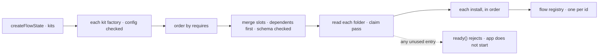

# Kits

A kit is the installable unit above a flow. A feature author ships a feature as a kit; an app installs several kits in one list, in any order, each with one config object:

```ts
createFlowState({
  kits: [claudeCode(), harnesses({ workspace }), workforce({ directory: options.tree, model })], // any order
  fill: { [harnesses.slots.harnesses]: [codexHarness(), cursorHarness()] },                    // the app's own fill
  flows: [readiness, context],                                                                  // the app's own flows
  stores,
});
```

It is the third way to put a feature's pieces into an app, beside a flow's `flows:` entry and a block's `uses`, and it composes the first: a kit's install returns flows, and the flows carry their resources, views and capabilities. Design history: `specs/issues/FIX-2626/`; mechanism row `kit` in `docs/mechanisms/mechanisms.yaml`.

## Where each piece lives

| Piece | Package | Why there |
|---|---|---|
| `defineKit`, `slot.keyed` / `slot.list`, the `KitFolder` type | `core` (`packages/core/src/kit/`) | A kit's definition has no Node import, so it can sit on any entry |
| `createFlowState({ kits, fill, root })`, ordering, slot merge, install | `engine` (`packages/engine/src/flowstate/kits.ts`) | Installing is the runtime's job; it registers into the same flow registry `flows:` uses |
| The walk primitives and the claim pass | `engine/folder` (`packages/engine/src/folder/`), Node-only | The kit system must not depend on one kit; workforce's readers import them from here |
| The naming rule (`segmentNameProblem`) | `core/helpers` | Pure; a kit name and every workforce folder name obey it |

A kit has no client half (FIX-2626 D1). Screens import a kit package's views, hooks and components like any other export.

## A definition

```ts
export const workforce = defineKit({
  name: "workforce",                                  // lowercase-hyphen; half of every slot key
  config: z.object({ model: z.string() }),            // the factory checks it at the app's own call
  slots: { workerFlows: slot.keyed(workerFlowSchema) },
  directory: { path: "workforce", read: readWorkforceFolder }, // Node-only reader, from the kit's server entry
  install: ({ config, folder, slots }) => ({ flows: hire(folder, slots.workerFlows, config) }),
});

export const harnesses = defineKit({
  name: "harnesses",
  requires: [workforce],
  slots: { harnesses: slot.keyed(harnessSchema) },
  contributes: ({ config, slots }) => ({ [workforce.slots.workerFlows]: { coder: coderFlow(config, slots.harnesses) } }),
  install: ({ config }) => ({ flows: [readinessFlow(config)] }),
});
```

The factory (`workforce({ model })`) returns a `KitInstance`. It also takes `directory`, the app's path for the kit's folder; a kit that owns no folder refuses it. `instance.without(slotKey, key?)` drops that kit's contribution to one slot, or one entry of a keyed slot.

## Install, in two halves



**At construction (synchronous).** `planKits` orders the kits so each installs after every kit it requires; ties keep the app's listed order. It then walks that order backwards, so dependents contribute first: for each kit it merges the kit's own slots (contributions in install order, then the app's `fill`, last), and only then calls the kit's `contributes({ config, slots })`. A kit's `contributes` and its `install` therefore see their own slots fully filled. Each folder-owning kit's folder is resolved: its default `directory.path` against `root` (a path, or `import.meta.url`; the working directory when omitted), a `directory` from config against the working directory. The path is kept as written for the root check, which refuses a `..` that steps back through an earlier segment; it is normalized only to compare two kits' folders. Each slot entry is stored as its schema parsed it, so defaults and coercions apply.

All of these throw one `FlowStateConfigError` naming every problem, as a duplicate flow id does: a kit listed twice, a requirement that is not installed, kits that require each other, a fill of an undeclared slot, a fill by a kit that does not require the slot's owner (directly or through another kit), a keyed key given twice (naming both contributors), an entry its slot's schema refuses, and two kits on one folder.

**At start-up** (`#buildRuntime`, shared by `ready()`, `getRouter()` and `getRuntime()`). `installKits` opens every kit's folder, runs its reader and then the claim pass, across all kits, before any install runs. Any refusal rejects start-up with every entry named; the stores never open. Then each install runs in order and its flows are registered. `meta.flowKeys` lists a kit's flows only after start-up.

## Slots

A slot key is `<kit>.<slot>`, read from the owning factory (`workforce.slots.workerFlows`), never spelled. A kit name refuses `.` so a key always splits back.

- **Keyed**: a contributor gives a record, or a list of entries each keyed by its string `id`. A single entry goes in a list: a plain object is always read as a record. A key given twice is refused, naming both.
- **List**: a contributor gives an entry or an array; entries append in install order, the app's last.

Only the app (`fill`) or a kit that requires the owner can fill a slot.

## The claim pass

`openKitFolder(root, what)` (engine-internal, `engine/folder/claim.ts`) hands the reader a `KitFolder`: `path`, and `claim(relativePath)` for a file or a directory (claiming a directory claims everything under it). `unclaimed()` then walks the folder without following symlinks and reports, by slash path:

- a top-level entry with no claim at or under it, as `unclaimed` (a fully unclaimed directory is named once);
- inside a partly claimed directory, each unclaimed entry;
- every symlink, claimed or not, as `symlink` (a claimed directory is still walked for links), and an unreadable entry as `unreadable`.

`IGNORED_ENTRIES` (`.DS_Store`, `Thumbs.db`) is the only pass. A claim outside the folder (`..`, absolute) throws.

The primitives under it (`classify`, `openStructuralDirectory`, `openRoot`, the refusal wordings) moved here from workforce's loader with no alias; `openRoot` takes a label so its messages name the folder being opened. Workforce's six directory readers and `fsdev gen`'s walk import them from `@flow-state-dev/engine/folder`. Workforce's kit reads its folder with `readWorkforceFolder` (`@flow-state-dev/workforce/loader`): the readers run over the whole tree, and it claims each file the published convention names (`TEAM.md`, each `WORKER.md`, the documents, references, skills and packages at each level, the code `fsdev gen` registers, and `workforce.gen.ts`). A reader's problem stops the app too, every one named.

## The kits that ship

| Kit | From | Slots | Contributes | Serves |
|---|---|---|---|---|
| `workforce` | `@flow-state-dev/workforce/kit` | `workerFlows` (keyed: `workerFlow(…)` entries, built on the installation), `uses` (list: capabilities for the agent and coordinator flows it builds) | nothing | one copy per worker flow, the roster flow, GitHub's service flow when configured |
| `harnesses` | `@flow-state-dev/harness-manager/kit` (the only entry of that package that imports workforce) | `harnesses` (keyed: `Harness` values) | `coder`, the one coding worker flow, to `workerFlows`; the readiness capability to `uses` | the `harnesses` flow, its `readiness` view |
| `claude-code` | `@flow-state-dev/claude-code` (`claudeCode()`) | none | Claude Code (and, with `plan`, Claude Code in plan mode) to `harnesses` | the `claude-code` flow, declaring the collections a run records into |

Codex and Cursor install nothing, so they are plain values (`codexHarness()`, `cursorHarness()`), filled by the app. The workforce kit adds two capabilities of its own to the flows it builds, over its installation: consulting another conversation and the routine tools, each offered only to a worker whose file picks it. `createWorkerInstallation` and `hireWorkforce` are what its install runs.

## Not here yet

- `init` (starter files for a kit's folder through `fsdev ui add`'s registry copy-in) is decided but not built: no kit has starter files until FIX-2627.
