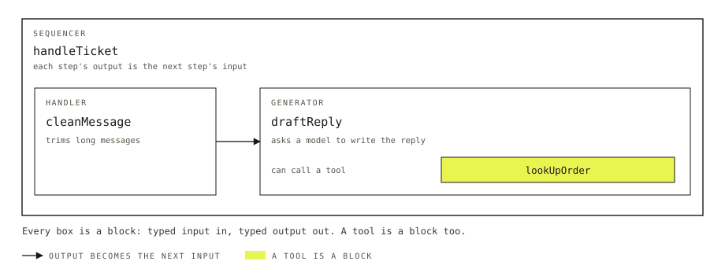

# Blocks

A customer writes in: "Where is my refund?" Before a reply goes back, a few things happen. The message is cleaned up. A model writes the answer, and may need to look up an order first. Each step is a different kind of work, and you want to change one without touching the others.

A block is one of those steps: a named piece of work with a typed input and a typed output. You build a flow, the backend your app calls, by putting blocks together. Blocks can hold other blocks, so a whole pipeline is a block too.



*A flow's blocks, nested. Description for the site's `Figure`: One large box, a sequencer named handleTicket, contains two steps joined by an arrow. The first step is a handler named cleanMessage. The second is a generator named draftReply. Inside draftReply, highlighted, is a handler named lookUpOrder that the model can call as a tool. This page builds the flow one piece at a time.*

## What a block gets you

You could write this whole reply as one function. Putting each step in its own block is what lets the framework do the rest.

- **A finished block is a checkpoint.** Its output is recorded. On a store that persists, such as SQLite or Postgres, a run that dies after `cleanMessage` picks up at `draftReply`. The message is not cleaned twice.
- **A block can wait.** A block can pause the run for a user, such as a manager approving a refund, and carry on when the answer arrives. The wait survives a restart.
- **Every block is traced.** Each time a block runs, the run is recorded, and the DevTool shows it. You can see which step was slow or wrong without adding any logging.
- **A block moves.** It knows only its own input and output. `lookUpOrder` can be a step in this flow, a tool in another, and a piece of something a teammate builds later.

## The smallest flow

A handler is a block that runs your code. A generator is a block that asks a model to write. Here is one of each.

```ts title="src/flows/support/blocks/clean-message.ts"
import { handler } from "@flow-state-dev/core";
import { z } from "zod";

export const cleanMessage = handler({
  name: "clean-message",
  inputSchema: z.object({ message: z.string() }),
  outputSchema: z.object({ text: z.string(), truncated: z.boolean() }),
  execute: async (input) => {
    const text = input.message.trim();
    return { text: text.slice(0, 2000), truncated: text.length > 2000 };
  },
});
```

```ts title="src/flows/support/blocks/draft-reply.ts"
import { generator } from "@flow-state-dev/core";
import { z } from "zod";

export const draftReply = generator({
  name: "draft-reply",
  model: "openai/gpt-6-luna",
  prompt: "You answer customer support messages. Be brief and specific.",
  inputSchema: z.string(),
  user: (input) => input,
  itemVisibility: { client: true, history: true },
});
```

A sequencer, a block that runs other blocks in order, joins them:

```ts title="src/flows/support/blocks/handle-ticket.ts"
import { sequencer } from "@flow-state-dev/core";
import { z } from "zod";
import { cleanMessage } from "./clean-message";
import { draftReply } from "./draft-reply";

export const handleTicket = sequencer({
  name: "handle-ticket",
  inputSchema: z.object({ message: z.string() }),
})
  .step(cleanMessage)
  .step((cleaned) => cleaned.text, draftReply);
```

Look at the two kinds first. The handler is plain code with a schema for what goes in and what comes out. The generator is a model, a prompt, and what to send it as the user's message.

Then the connector. `cleanMessage` returns an object, and `draftReply` wants a string, so the second step begins with a small function that reshapes one into the other.

`itemVisibility` controls what the user sees. An item is one thing a flow streams to the client, such as a message or a tool call. Without `itemVisibility`, a generator streams nothing. This one streams its reply and keeps it in the conversation. A handler is quiet in the same way until it emits through `ctx.emit`.

A flow exposes a block as an action, a call a client can make. `defineFlow({ kind: "support", actions: { reply: { block: handleTicket } } })` makes this one callable as `reply`, because a sequencer is a block like any other.

## The five kinds

| Kind | What it does | In this flow |
| --- | --- | --- |
| Handler | Runs your code | `cleanMessage` |
| Generator | Asks a model to write: text, tool calls, or a typed object | `draftReply` |
| Evaluator | Asks a model a question and gets a typed answer: a choice, a score, a yes or no | Not used here |
| Sequencer | Runs blocks in order | `handleTicket` |
| Router | Picks one block to run | Not used here |

## Blocks inside blocks

Look at the last two rows. A sequencer and a router do no work of their own. They arrange other blocks, and because they are blocks, they nest. `handleTicket` could be a step in a longer sequencer, or the block a router picks.

A router returns one of the blocks it lists, chosen by your code. Every route takes the router's input and returns its output, so a sequencer can treat the router as one step.

An evaluator is for when your code will branch on a model's answer, such as whether a message is about a refund. [Generators and tools](./generators-and-tools.md) covers it.

## Giving a block to a model

A generator can call blocks as tools. Any block will do: a handler, a router, or a sequencer that runs a whole pipeline behind one tool call.

```ts title="src/flows/support/tools/look-up-order.ts"
import { handler } from "@flow-state-dev/core";
import { z } from "zod";

// A stand-in for your order system.
const orders: Record<string, string> = { "A-1001": "shipped Tuesday" };

export const lookUpOrder = handler({
  name: "look-up-order",
  description: "Look up where an order is. Use it when the customer gives an order id.",
  inputSchema: z.object({ orderId: z.string() }),
  outputSchema: z.string(),
  execute: async (input) => orders[input.orderId] ?? "No order with that id.",
});
```

Add `tools: [lookUpOrder]` to `draftReply`, importing `lookUpOrder` from `../tools/look-up-order`. The model decides when to call it from its name and description. The framework runs the block and gives the result back to the model.

## What a block needs

If `lookUpOrder` read a stored list of orders, it would declare that list as a resource, stored data a flow keeps. Including the block in a flow installs the list, so the block moves between flows on its own. [Resources](./resources.md) covers them.

## What a block won't do

- Be called as a function from your code. A block has no call method; the framework runs it, as an action, a step, a route or a tool.
- Call other blocks from inside a handler. A handler that needs another block's output goes after that block in a sequencer.

## Next

- [Generators and tools](./generators-and-tools.md) goes deeper on prompts, history, structured output, evaluators and giving a model tools.
- [Composition](./composition.md) covers the rest of the sequencer: parallel steps, loops, side chains and error recovery.
- [Flows and actions](./flows-and-actions.md) shows how a block becomes something a client can call.
- [Blocks reference](../reference/blocks.md) lists every option each kind takes.
