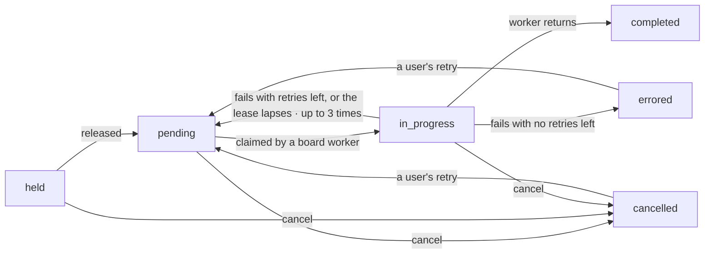
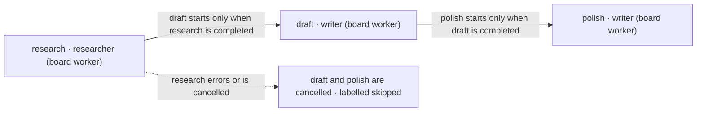
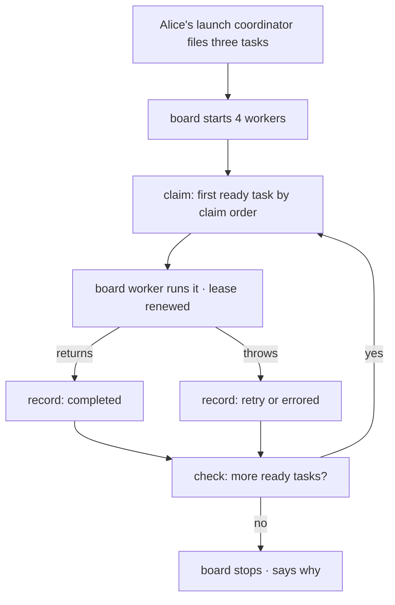
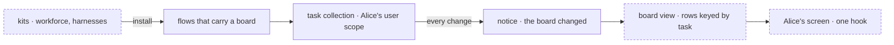

# Tasks and Task Boards: How It Should Work

## Why this doc

An agent app that does more than answer one message needs a list of work: what to do, in what order, who does it, and what happened. Flow State has that list. It is spread over a task type, a storage layer, a loop, a handful of model tools and a set of rules for failure, and it is hard to see as one thing.

This doc describes the model for the release that ships kits, from the ground up, for someone who has never used Flow State. It describes the target first. The last section lists where today's code differs.

## Base terms

**A task is one unit of work, written down as a row.** It outlives the code that runs it. You can read it, change it and cancel it while it waits.

**A task board is a stored list of tasks plus the loop that works through it.** The list is the task collection. The loop is the drain.

**A board never decides who may see its tasks.** The scope its collection lives in decides that, the same as for any other stored data.

**A board worker is the block that runs one task.** It is not a Workforce worker, which is a configuration a user owns. A Workforce worker can be named as a task's assignee, but the board worker is still the block that runs it.

**Everything a board changes, it changes by a checked write.** A write that is not allowed comes back as a refusal with a reason. It does not throw, and it does not half-apply.

Six words from the rest of the framework appear below. A **block** is one unit of code with typed input and output. A **flow** is a set of blocks and actions that an app serves. A **session** is one conversation or piece of work inside a flow, with its own history, owned by one user. A **scope** says who a stored thing belongs to: one session, one user, or one org. A **resource collection** is a keyed set of stored rows in a scope. A **kit** is an installable unit that adds flows to an app from one config object, and it can declare **slots** that other kits fill. A **harness** is a coding agent (Claude Code, Codex, Cursor) run as a block. An **entry** is a named way into a flow. A **topic** is a named channel a screen subscribes to for change notices. A task is **open** until it reaches a final status. Workforce words (roster, delegate, coordinator) appear only in passing: a coordinator is a worker that hands work to the delegates on its user's roster.

## The parts, in the order you meet them

Each part uses only the ones above it.

1. **Task.** One row: a goal, a status, and what the worker needs.
2. **Dependency.** A task can wait for other tasks to complete.
3. **Task collection.** Where tasks are stored, with one API however they are stored.
4. **Assignee and board worker.** The name on a task, and the block that name picks.
5. **Claim and lease.** How one worker takes a task, and how an abandoned task comes back.
6. **Board.** The loop: claim, run, record, check, until the board has nothing left to do.
7. **Endings.** Completion, retry, failure, cancel, and what each does to other tasks.
8. **Holds and steers.** A task waiting for a person, and words sent into a task that is open.
9. **Filing.** How a model or an app adds tasks and changes them.
10. **Goal-seek loop.** A judge around the board: drain, ask "are we done?", add work, drain again.
11. **Seeing a board.** Notices, the board view, and how kits install all of this into an app.

## The cast

Alice and Bob are two users. Alice has a project called **launch**. Her launch coordinator files three tasks on a board: **research**, **draft** and **polish**. Two board workers run them: **researcher (board worker)** and **writer (board worker)**. Bob has his own board for his own project. Every example below uses these.

## 1. Task

A task says what to do and records what happened. The fields that matter:

| Field | What it is |
| -- | -- |
| Goal | What to do, in words. An optional short title is for lists |
| Status | One of six: `pending`, `in_progress`, `held`, `completed`, `errored`, `cancelled` |
| Assignee | Optional name that picks which board worker runs it |
| Dependencies | Optional list of other task ids that must complete first |
| Priority | Optional number, used only if the board orders by priority |
| Input, output | What the worker receives and what it returns. Both are free-form |
| Context | Optional readable support text: the slice of the request the worker needs |
| Attempts, retry limit | How many times it has been taken, and how many attempts it may have in all. Unset means one |
| Error, feedback | Why the last attempt failed, passed to the next attempt |
| Labels, metadata | Free tags and a free object for the app |

The framework writes more onto the row, and no caller can set it: who holds the task and until when, which session is running it, what it has spent, what holds it for a person, what words were sent in, and who filed it.

A task starts `pending` or `held`, runs while `in_progress`, and ends in one of the three final statuses. Look at the two arrows back into `pending` from `errored` and `cancelled`: only a person's retry does that, and `completed` has no way back. *Held* is the filer saying "don't start this yet" and nothing else.

**Who owns it, who sees it.** A task belongs to the scope of its collection (part 3). A browser sees every field except four the server keeps to itself: the claim's session identity, who created it, which session filed it, and which org it was filed under. The lease deadline is not among them.

**Where it's stored.** As a row in the task collection, keyed by task id.

**How many.** Bounded by three limits: how many may be added while others still wait (100), how many the board may ever hold, finished ones included (500), and how many failure retries it may grant in total (50). The numbers are the defaults and apply to a collection the board builds itself. A collection you hand the board carries whatever limits it was built with.

## 2. Dependency

A task with dependencies starts only when every one of them is `completed`. A dependency that is missing, still running, failed or cancelled keeps it waiting.

The board refuses bad dependencies when the task is filed, so a mistake shows up as a refusal and not as a board that stalls: an id that names no task on this board, a dependency that has already failed or been cancelled, a loop, or a task id already filed on this board. Dependency ids are read on the board the task is filed to, so Bob's "research" is always Bob's.

Alice's board is a chain. Draft cannot start before research completes. If research ends in error or is cancelled, draft and polish are cancelled for her, labelled `skipped`, and the row says which task caused it.

A cancelled or errored task runs again only if a person retries it (part 7), and the retry is refused while one of its dependencies has ended badly: retry that one first. Dependencies are between tasks on the same board. They are not a way to wait on another board or on a person. A person is a hold (part 8).

## 3. Task collection

The collection is where the rows live. Every storage choice has the same API: add, list, claim, complete, fail, cancel, release, and the rest.

| Storage | Lives | Use it for |
| -- | -- | -- |
| Request (the default) | On the running request | A plan made and worked inside one request |
| Sequencer state | In one run of one sequencer | A single pass; the state does not survive a second run |
| Durable collection | A stored resource in a scope | Tasks that outlive the request, or that several sessions work |
| Your own | Whatever you build | A store that already exists |

A durable collection is declared with a name and a scope.

- **Session scope** is private to one session. A board can opt in to sharing its rows down the session's lineage, so a child session the board starts to run one task settles that task on the parent's board.
- **User scope** is private to one user and spans all of that user's sessions. It can be split into partitions, so each conversation of Alice's gets a separate set of rows.
- **Org scope** belongs to the org. Who may change it is the flow's resource rules, not the board's.

**Who owns it, who sees it.** The scope owner. Alice's launch board is in her user scope, so Bob cannot read it, and a task Bob files can never appear on it.

**Where it's stored.** As a resource collection under the name you gave it, one row per task. A partitioned collection has one set of rows per partition, and a task id then finds its partition through an index. Each partition is its own board for every check: Alice's two conversations can each file a task called "research" and they do not collide, though a bare id then names two tasks.

**How many.** One collection per board. A flow can hold several boards, each with its own name. Alice has one board per conversation if the app partitions by conversation.

## 4. Assignee and board worker

A board has either one board worker that runs every task, or a registry that maps an assignee name to a board worker. Alice's launch board has a registry: `researcher` and `writer`. A board worker is any block that can take a task as input. The framework gives it the goal, input, context, and, by a setting called flow policy, the results of earlier tasks. The default shows a worker only the results of its own dependencies.

A task whose assignee names no one goes to the board's default worker if it has one, and fails otherwise.

With Workforce, the assignee can be a name from the user's own roster. The board checks it, so a coordinator can only hand work to the user's own delegates.

**Who owns it, who sees it.** The block belongs to the flow that declares the board, and the code stays on the server. The names are part of the board's definition. A task stores only the name, so anyone who can read the row sees which assignee it has.

**How many.** Any number of assignees on a board. At most as many tasks run at once as the board has workers (4 by default).

## 5. Claim and lease

A worker takes a task by **claiming** it. A claim is one atomic step: pick the first ready task, mark it `in_progress`, count an attempt, stamp a lease. If two workers reach for the same task, one wins and the other moves to the next ready one.

A task is **ready** when it is `pending`, has no open hold (part 8), and every dependency is `completed`. The claim order only decides which ready task goes first. It never makes an unready one ready. Two orders exist: first in, first out (the default) and highest priority first, oldest on ties. You can pass your own.

The **lease** says how long the worker may be gone before the task goes to someone else. Two minutes by default. The framework renews it while the worker runs, so a lapsed lease means no worker is running it. The next claim then takes the task back as a fresh attempt. A task can be taken back this way three times, and a recovery does not use up the retry limit. If the lease lapses a fourth time, the task ends in error instead.

Every write a worker makes later (complete, fail, report progress) carries a ticket naming its claim. A worker that lost its claim gets a refusal, so a slow worker cannot overwrite the result of the one that replaced it. The cost: after a crash, the work may run twice, and only the second result counts.

**Who owns it, who sees it, where it's stored.** The claim and lease live on the task row. The claim belongs to one running worker and its identity is server-only. The lease deadline is visible to anyone who can read the row. Each task has at most one claim at a time.

## 6. Board

The board is the loop, called the drain. It seeds any initial tasks, then starts several workers in parallel. Each worker repeats:

1. Claim the next ready task, or wait for a change if there is none.
2. Run the board worker on it.
3. Record the result: completed if the worker returned, retry or errored if it threw.
4. Check whether the board is finished.

Look at the two arrows into the check: a success and a failure both end in the same question, so one failed task never stops the others.

The loop reads the board again after each task, so tasks added while it runs are picked up.

**When to use a board.** Use a plain sequencer when the steps are known and fixed in the code. Use a board when the list is data: made at run time, changed while it runs, kept past the request, or watched by a screen.

**When it stops.** The default stops when everything is done, or when nothing can be claimed and no worker is active. Other settings: stop only when nothing is pending or running, or keep going until the app's own check says stop. A board always says why it stopped.

| Reason | Meaning |
| -- | -- |
| All completed | Every task is `completed` |
| Blocked by failures | Something left is errored, cancelled or held, or can never start |
| Retry budget exhausted | The board's cap on failure retries refused a retry |
| Waiting on a user | Some task left waits for a person's answer. Tasks queued behind it wait too |
| Waiting on an event | What is left waits for something outside the board |
| Dispatched | Every task left is running in another session |

**Modes.** In **plan** mode, the default, the drain waits for every task it hands out, including one run in a session of its own. In **delegation** mode every task is handed to another session and the drain waits for none. That session settles the task itself. A delegation board must be durable and carry an id the app picks and never changes. The word "delegation" here is the board's mode, and has nothing to do with a Workforce coordinator's delegates.

**When a worker throws.** The default marks that one task failed and keeps going. The other setting fails the whole board.

## 7. Endings

A task ends in one of these ways.

- **Completed.** The worker returned. Its return value is the task's output, unless the worker already reported a checkpoint, which is kept.
- **Retried.** The worker failed, the task has a retry limit, and attempts remain. It goes back to `pending` with the error as feedback. A board-wide budget also caps retries.
- **Errored.** The worker failed, with no retries left. Or the lease lapsed too many times.
- **Cancelled.** Someone cancelled it: the filer, the app, or a cascade.

When a task ends in error or is cancelled, the board owes two cascades. Every open task that depends on it is cancelled and labelled `skipped`. Every open task that task filed is cancelled too. The debt is written in the same write as the ending, so a crash between the two cannot lose it. The next touch of the board pays any debt that is still due.

**A person can retry an errored or cancelled task.** It goes back to `pending` with its id, history and spend, and the next claim takes a new attempt. The retry counts against the board's retry budget, and a board that has already stopped needs its drain run again. A task with attempts left keeps them; one with none left gets exactly one more. It is refused, with nothing written, if the task completed or never ended, if its last ending is still being delivered (a cascade or a resume is owed), if one of its dependencies has errored or been cancelled, or if the budget is spent.

Every write returns a verdict: recorded, unchanged (it already held), or declined with a reason. Reasons include: the task is already final, the move is not allowed, the claim was lost, or a hold is open.

## 8. Holds and steers

A task can be kept from running in two different ways. The first is the **held status**: the filer filed it held, so it does not start until released. It has no entry on the task's hold list. The second is a **hold**: an entry on that list, for a task waiting on a person or an event. A hold takes these forms:

- **A question or a confirm.** The task asks before it starts, or midway through. It stays where it is and nobody works it. A confirm is a yes or a no, and a no either cancels the task or lets the work continue, as the filer chose.
- **A run's stop.** A task run in its own session stops for a review or an approval, and the task mirrors that stop.
- **An event wait.** A running task waits on something outside the board, such as a pull request being merged. A person's line or a delivered message ends it.

An open hold keeps the task from being claimed. A task that was waiting to start stays `pending`. A task asked midway stays `in_progress` with no lease, so recovery leaves it alone and no other worker can take it. Alice's **Inbox** is the list of open holds that wait on her. Her answer closes the hold and gives the task its next turn. If the host sets a deadline for answers and none comes, a "no answer came" line is sent into the task instead.

A **steer** is words sent into a task that is still open: from the filer's model, from the app, or from a line typed in the task's session. Every later attempt reads every steer. A task takes at most 20, and a finished task takes none. For a finished task, file a follow-up, which runs in the same session with the same worker.

A board whose only remaining tasks wait on a person stops with "waiting on a user" and leaves them as they are.

**Who owns it, who sees it.** A hold belongs to its task and is visible to whoever can read the board. Only a user's own answer closes a user's hold.

**Where it's stored, how many.** On the task row, in one list, oldest first. A task's open questions and its steers share one cap of 20, and a question that would go past it is refused. A hold can be on a `pending`, `held` or `in_progress` task. Cancelling a task closes every hold on it.

## 9. Filing

Tasks arrive in these ways.

- **An initial list on the board.** For a fixed plan.
- **A model, through task tools.** The filer gets four: `createTask`, `getTask`, `listTasks` and `updateTask`. The board worker gets one more, `reportProgress`, to leave a one-line note and a checkpoint. Each `updateTask` field has one rule: you can change it before the task starts, and you can cancel it until it finishes. Goal, assignee, dependencies and priority are all fixed once a task starts, and a late edit comes back refused with a reason.
- **An app, through actions.** The board's task tools are also available as flow actions, so a screen can read a task, cancel it, steer it, release it or retry it.

A model can only set what the tools let it. The tools offer no field for who filed the task, which session, which user, or who holds the claim, and the write surface reaches none of them. The framework writes those from the running request. The same goes for a worker's payload, which only the code that filed the row can set.

A filer can wait for a task's result in the same turn. The turn pauses until the task ends, or until the deadline, when it carries on without the result. The deadline cancels nothing.

## 10. Goal-seek loop

The board stops when its tasks are done. It does not know whether the goal was met. The goal-seek loop adds that. It drains the board, asks a judge one question, and acts on the answer:

| Verdict | What happens |
| -- | -- |
| Done | The loop ends |
| Continue | Drain again, no new tasks |
| Replan | File the tasks the judge gave, or ask a planner for them, then drain again |

A cap on rounds, which you set, guarantees it ends. The **judge** is a block you supply, often a model. A **planner**, if you give one, is a block that turns "replan" into new tasks. A drain that left a task waiting on a person ends the pass without judging, because the judge would rule on unfinished work. Run the loop again once the person has answered. A loop refuses to be built around a delegation board, since the tasks would still be running when the judge ruled.

Four higher-level patterns, `supervisor`, `planAndExecute`, `parallelTasks` and `eventActors`, are boards with a particular worker and judge.

## 11. Seeing a board

Every change to a task emits a change item with the whole row (minus the four server-only fields) and a notice that the board changed. A screen listens for the notice and reads the board again.

For the kits release, a screen does not build that read itself. The board is read through a **board view**: its rows are typed and keyed by task id, and the screen watches it with one hook. A change to anything the view read reaches every watcher. The harness kit adds a coding board view, which is the same rows plus the harness, pull requests and review state of a coding task.

A dashed box is planned, not built. The kits install the flows that hold a board. The board's rows reach Alice's screen through a view, and a change to a row reaches her screen without her app naming a topic.

**Does a board get its own kit?** Not in this release (open in Decisions). A kit installs flows, and a board is a part of a flow. The flows the workforce kit installs carry Workforce's conversation board. The harness kit installs the coding board view and puts one shared coding worker flow into a slot the workforce kit declares, so a worker whose file says `harness: codex` runs its task on the Codex entry. The orchestration package stays a library that those two kits are built on.

**What this replaces.** Today each app writes its own read of the board: watch the right topics, re-read, assemble rows, type them by hand. Shift Manager's reads file is 1,109 lines (the kit epic's figure). A view removes that. It costs a record of what each view run read, and once a host has any view, every user or org resource write publishes a notice, so a view's watchers cannot miss a change.

**Who owns it, who sees it.** A view runs as the user who watches it and reads only what that user may read. A view never writes. A screen changes a task only through the board's actions.

## How it flows

Alice asks her launch coordinator for a blog post. Bob has an unrelated board of his own.

1. The coordinator files **research** (assignee researcher), **draft** (writer, depends on research) and **polish** (writer, depends on draft, up to two attempts). Each filing is checked. Dependencies name real tasks and there is no loop. The board is in Alice's user scope, so only she can read it.
2. The drain starts four workers. Only research is ready. One worker claims it: `in_progress`, one attempt, a two-minute lease. The other three wait for a change.
3. The researcher runs and the framework renews the lease. It returns notes. Research is `completed`. The board wakes the workers.
4. Draft is now ready. A worker claims it. Halfway, the writer asks "formal or casual?" That is a question hold. The task drops its lease and nothing works it. The question appears in Alice's Inbox. Bob's Inbox shows nothing.
5. Alice answers "casual". The hold closes, the answer joins the writer's brief, and the task takes its next turn on the same attempt. It returns a draft. Draft is `completed`.
6. Polish is ready. The writer fails. Polish has an attempt left, so it goes back to `pending` with the error as feedback. The second attempt fails too. Polish is `errored`. Nothing depends on it, so there is no cascade.
7. Nothing is ready and no worker is active. The board stops, and its reason is "blocked by failures", because polish is errored.
8. Alice's screen has watched all of this through the board view. Every step reached it as a changed row, and it never named a topic.

Now the edge case. Suppose in step 3 the researcher's host crashes after the claim. The lease lapses two minutes later. Another worker's next claim takes research back as attempt two and counts one recovery. If the first host comes back and tries to complete research, its ticket names a lost claim, and the write is declined. Only the second result counts.

## Naming debates

### "Board" or "plan"

| Name | Says | Fits | Familiar from | Risks |
| -- | -- | -- | -- | -- |
| Task board | A shared list of cards with columns | A list that many workers pull from and that others watch | Kanban tools | Suggests drag-and-drop columns, which the framework does not draw |
| Plan | An ordered set of steps made up front | One-shot plans from a planner | Planning agents | Wrong for a board where tasks are added while it runs, or that lives for weeks |

**Recommend board.** It is the name already used by the package, the glossary and the screens. Use "plan" only for the thing a planner produces before it files tasks. It would change if the framework ever draws columns itself.

### "Task collection" or "ledger"

| Name | Says | Fits | Familiar from | Risks |
| -- | -- | -- | -- | -- |
| Task collection | The set of task rows | The storage, with one API for several backings | The framework's resource collections | Two words |
| Ledger | A record of what happened | The audit side: attempts, spend, who wrote what | Accounting | Reads as write-only, and hides that the rows are live and claimable |

**Recommend task collection in prose and docs.** "Ledger" stays in code names until a rename is worth its cost.

## The rules

A behavior none of these rules explains is a bug in the model.

1. A task has exactly one status and moves only along the arrows. `completed` never changes. `errored` and `cancelled` change only by a person's retry.
2. A task starts only when it is `pending`, has no open hold, and every dependency is `completed`.
3. Exactly one worker holds a task at a time. A write from a worker that has lost its claim is declined.
4. A lapsed lease returns the task to the queue as a fresh attempt, at most three times. A fourth lapse ends it in error.
5. A task that ends in error or is cancelled ends every open task that depends on it, and every open task it filed.
6. A debt an ending creates (a cascade, a notice, a resume) is written in the same write as the ending. A crash cannot lose it.
7. A refused write is a value with a reason. It never half-applies.
8. A model sets only what the task tools let it set. Who filed, which session, which user, who holds the claim and the lease are written by the server.
9. A board never decides who may read its tasks. The collection's scope does. A browser never receives the four server-only fields.
10. A board is bounded: pending adds, total tasks, total retries, rounds of a loop, iterations of a worker.
11. A board always stops for a named reason.
12. A person's answer owes the task its next turn. A hold with no answer and no host deadline waits for ever.
13. A view never writes. A screen changes a task only through the board's actions.

When the model changes a stored shape, the old shape is still read. Today that applies to three:

| Old | New | Files that mention it today |
| -- | -- | -- |
| Status `blocked` | `held` | 20 files under `packages/` contain the string; 2 are the read-forward (`task-status.ts`, `retired-shapes.ts`). The rest mix task status with other uses and need a pass |
| Hold list named `questions` | `holds` | Read forward by `retired-shapes.ts` |
| Hold source marker `row` | `task` | Read forward in `schema/hold.ts` |

## Vocabulary

One term, one thing. Retired from prose: ledger (say task collection), and "flow read" for a computed answer a screen watches (say view).

| Term | Means | Private or shared |
| -- | -- | -- |
| Task | One unit of work, stored as a row | Follows its collection's scope |
| Task collection | The stored set of tasks, with one API | Follows its scope |
| Task board | A task collection plus the drain that works through it | Follows its scope |
| Drain | The loop that claims, runs, records and checks | Not stored |
| Board worker | The block that runs one claimed task | Part of the flow |
| Assignee | The name on a task that picks its board worker | Stored on the row |
| Claim, lease | One worker's hold on a task, and how long it may be silent | The claim's identity is server-only; the lease deadline is visible |
| Claim order | The rule that picks which ready task goes first | Part of the board |
| Hold | A task waiting for a person or an event | On the row |
| Steer | Words sent into an open task | On the row |
| Cascade | The cancelling of everything that depends on, or was filed by, a task that ended badly | Written to rows |
| Mode | Whether the drain waits on its tasks (plan) or hands them all off (delegation). Not a Workforce delegate | Part of the board |
| Goal-seek loop | A judge around the drain | Not stored |
| Dispatch | Hand a task to another session to run | The task's row is shared with that session |
| Flow policy | Which earlier tasks' results a board worker sees | Part of the board |
| Partition | One set of a user's task rows, kept per conversation | Private to the user |
| Checkpoint | A partial result a worker reports while it runs; it becomes the output | On the row |
| Follow-up | A new task on a finished one, run in the same session with the same worker | On the row |
| Inbox | The list of open holds that wait on one user | Private |
| Notice | A message that a board changed, carrying no rows | Sent to watchers |
| Workforce worker | A configuration one user owns; can be named as an assignee | Private |
| Retry (by a person) | Puts an errored or cancelled task back to `pending` | Written to the row |
| Judge, planner | Blocks you supply to a goal-seek loop: one rules done, continue or replan; the other turns a replan into tasks | Not stored |
| Board view | The typed, keyed read of a board that a screen watches | Per watching user |
| Kit | An installable unit that installs flows into an app | Installation-level |

### Retired terms

Counts are files that mention the term, by search, as of this doc's date.

| Retired term | Say instead | Where it lives today | Files |
| -- | -- | -- | -- |
| Ledger | Task collection | `taskLedgers`, `taskLedgerResources`, `ledger.ts`, README and tests | 276 under `packages/` |
| `taskToolReads` (a flow read) | The board view | `skills/task-tools-capability.ts`, `internal.ts`, `workforce/src/conversation-board/board.ts`, docs | 19 across the repo, 6 of them source or README |

## Decisions

- [ ] **Does orchestration become a kit of its own?** Open. Recommend no for this release. A kit needs a slot that two packages fill, and the workforce kit's own spec dropped the two board-related slots because nothing fills them. It would change if a second package needs to add fields to every board row.
- [x] **A screen reads a board through a view.** Decided by the views work in the kit epic. The board view replaces the board's hand-written read.
- [ ] **The default claim order.** Open, and a docs mismatch. The glossary says `topological` is the default. The code has first-in first-out and priority only, and fifo is the default. Recommend: fix the glossary to say fifo. Dependency gating already does what topological would, so don't build it.
- [ ] **Should a durable collection get the default caps?** Open. Today the defaults (100 pending adds, 500 total, 50 retries) apply only when the board builds its own collection. A board handed a durable collection applies none. Recommend yes, with the same defaults on durable collections, because a durable board that runs for weeks is the one that needs a bound. It would change if a caller already sizes its own.
- [ ] **"Delegation" as a board mode.** Open. It shares a word with a coordinator's delegates. Recommend keep: the mode is code-level and a screen never shows it. It would change if a screen ever shows the mode to a user.
- [ ] **"Ledger" in code.** Open. Recommend no rename now. It touches 276 files for a word that only a reader of the source meets.
- [ ] **Dependencies across boards.** Punted. Nothing needs it today.
- [x] **A refused write is a value, not a throw.** Decided. Callers that want to react read the reason.

## Where today's code differs

| Target | Today |
| -- | -- |
| The board's rows are watched through one typed, keyed board view | `taskToolViews` already builds a keyed task-list view (`orchestration/src/skills/views/task-list-view.ts:54`) and is exported from `internal.ts`. `taskToolReads` still exists beside it (`skills/task-tools-capability.ts:2480`), and apps still build their own reads (`shift-manager/src/lib/reads.ts`) |
| A coding board view carries the harness, pull requests and review state | Not built. Lab adapters assemble it by hand (`harnessOf`, `boardOf`) |
| One hook for board actions: cancel, steer, release, retry | The actions exist (`taskToolActions`, `skills/task-tools-capability.ts`, re-exported from `task-board/index.ts:246`). No client hook wraps them |
| Kits install the flows that hold a board | No `defineKit` yet. A host builds the workforce installation and hires by hand (`workforce`'s `createWorkerInstallation`, `hireWorkforce`) |
| The harness kit fills a slot with one coding worker flow | Each lab keeps its own coding flow copy |
| Default claim order is first in, first out; priority is the other | Same in code (`task-board/shared.ts:27-38`). The glossary says `topological` (`apps/docs/docs/glossary.md:89`) |
| A board applies default caps to every collection | Only to one the board builds. A supplied collection gets none (`task-board/index.ts:1401-1411`) |
| Recovery of a lapsed lease is bounded at three | Same (`DEFAULT_MAX_ABANDONMENTS = 3`, `tasks/collection/internal.ts:524`) |
| Lease is two minutes | Same (`DEFAULT_LEASE_DURATION_MS`, `tasks/collection/internal.ts:1131`) |
| The board stops with a named reason from a fixed ladder | Same (`task-board/blocks/board-meta.ts:219-234`) |
| Holds live in one list on the row | Same (`tasks/schema/task.ts`, `schema/hold.ts`). The old `questions` name is still read |
| Four fields never reach a browser | Same (`SERVER_ONLY_TASK_FIELDS`, `tasks/collection/change-event.ts:140`) |
