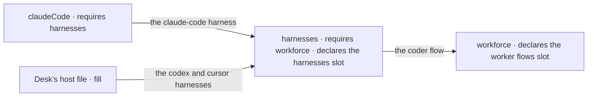
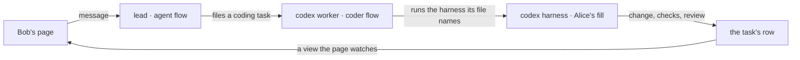

<!-- Concept doc, target model for the release that ships kits. "Today" claims are in the last section, each with the path it was read from. -->

# What Flow State Is: How It Should Work

## Why this doc

Open the repository and you meet packages, flows, blocks, workers, harnesses, labs, starters and, with this release, kits. Nothing says which of them you would change to make your app do something different, so people change the wrong one, or copy a whole app to change one line.

This doc describes an app from the top down, as it should read once kits ship: what it is made of, who owns each layer, where each lives, and which one to change for a given job. The last section lists where today's code differs.

## Base terms

**A user is always a person.** The one who signs in to an app. Every session belongs to one user.

**A builder makes an app. Users use it.** One person can be both. This doc says which.

**An app is one server and the pages that talk to it.**

**Code is imported or owned, never both.** Imported code lives in a package. It is versioned, you update it by upgrading, and you configure it without editing it. Owned code lives in your app's files. You edit it freely, and nothing updates it for you.

### The cast

- **Alice** (builder) makes **Desk** (app). She begins from the **Teammates** (starter).
- **Bob** (user) signs in to Desk and talks to its workers.
- **workforce** (kit) gives Desk its workers. **harnesses** (kit) lets workers hand coding to a coding agent.
- **lead**, **researcher** and **codex** (workers) are three files Alice owns. Lead and researcher answer questions. Codex does coding tasks.
- **triage** (flow) is a flow Alice writes herself. **classify** and **file-ticket** (blocks) are its two steps.

## The parts, in the order you meet them

Each part is explained using only the ones above it. Kits, flows and blocks are named in the list so you know what is coming.

1. **The app.** One server, the pages that talk to it, and a place to keep data.
2. **The starter.** A complete app you begin from, so you never face an empty folder.
3. **Kits.** Features an app installs, each with one config object. Workers and coding agents are kits.
4. **Flows.** What the server serves. Kits install flows, and the builder writes some.
5. **Blocks.** The steps a flow runs: a model call, plain code, a check, a choice between paths.
6. **Which one to change.** Not a part of the app. A guide that maps a job to one layer.


The colors carry the page's one rule. Blue is imported, so Alice configures it. Green is owned, so she edits it. Everything Alice edits is green.

## The app

An app has three things in it.

- **A host file.** One call that builds the server. It lists the kits to install, the app's own flows and where data is kept.
- **Pages.** A React app. It reads and writes through typed hooks, which call the server.
- **A store.** Where sessions, state and tasks are kept. Unset, data lives in memory and is gone at restart. Set to a SQLite file, it survives.

The server answers requests. A **request** is one run of one action on one session. Sessions are private: each belongs to one user, and another user cannot open it. When Bob and Alice both use Desk, they share its flows and workers, and nothing else.

| | |
|---|---|
| **Owned by** | The builder |
| **Who can see it** | Users who sign in. Each sees their own sessions only |
| **Where it lives** | The app's folder: host file, `src/`, the folders kits own |
| **How many** | One server per app. One app can serve many users |

## The starter

A starter is a complete, working app: pages, a team of workers, the flows they run on, and a host file that installs the kits. It is not a template with holes. You run it, it works, and you change it.

The repository ships two. **Teammates** (starter) is a small team you talk to one at a time. **Claude Code-style** (starter) is one conversation driving an agent loop. Alice forks the repository and works in the Teammates folder. From then on it is hers, and framework updates arrive when she pulls them.

A starter holds, in the order Alice meets it:

- the **host file**, owned;
- the **kit folders**, such as `workforce/` with its worker files, owned;
- the **app's own flows**, in `src/flows/`, owned;
- the **pages**, in `src/`, owned;
- the **kits themselves**, imported from packages, so not in the folder at all.

The last line is the point. A starter feels big because it is a whole app, but the framework in it stays in packages. What Alice owns is configuration, files and a few small flows.

| | |
|---|---|
| **Owned by** | The builder, after the fork |
| **Who can see it** | Anyone with the repository |
| **Where it lives** | The starter's folder in the builder's fork |
| **How many** | An app begins from one. The repository ships two |

### Starter or kit?

A starter is a whole app that you fork and then own. A kit is one feature that you install and keep current by upgrading. A builder with an app already (a Next.js project, say) installs kits into it and has no starter. A builder with nothing starts from a starter.

### Why not install a starter from a package?

Because a starter is meant to be edited, and an edited package is a fork you can't update. The fork is honest about that. The cost is that you pull framework changes with `git pull`, and conflicts are yours.

## Kits

A kit is one feature packaged so an app installs it with one config object. Two kits ship with this release: **workforce**, which gives an app workers and tasks, and **harnesses**, which gives workers a coding agent to hand coding to. A third, **claudeCode**, is a small kit that adds Claude Code's own storage and plugs in as a harness.

Alice's host file lists them in any order:

```ts
export default createFlowState({
  kits: [
    harnesses({ workspace: ".", checks: ["pnpm test"] }),
    workforce({ model: "openai/gpt-6-luna" }),
  ],
  fill: { [harnesses.slots.harnesses]: [codexHarness(), cursorHarness()] },
  flows: [triage],
  stores,
});
```

### What a kit is made of

| Part | What it is for |
|---|---|
| Name | Identifies the kit. Half of every slot's key |
| Config | The one object the app passes. Checked at the call, so a bad value fails where it was written |
| Requires | The kits it builds on. The framework installs those first, whatever order the app listed |
| Slots | Typed places other kits and the app fill. Only the kit that owns a concept declares its slots |
| Contributions | What the kit puts into slots of the kits it requires |
| Folder | Optional. One directory the kit owns inside the app |
| Install | What turns config and slots into flows |

### Two halves

A kit is imported in one half and owned in the other.

**The library half is the kit's package.** It holds the flows the kit installs, plus views (answers a page can watch), hooks, blocks, capabilities and React components. Pages import them like any other export. A kit has no browser runtime of its own, so a page never asks "which kits are installed". It imports the package it wants.

**The copied half is a folder the kit owns inside the app.** Workforce's is `workforce/`: team files and one `WORKER.md` per worker. The kit scaffolds starter content into it once. After that Alice owns it, and the kit only reads it. A kit whose users write content has a folder. A kit that is only machinery, such as harnesses, has none.

Scaffolded files never update when the kit does. A newer kit either still reads an older file or refuses it, naming it. It never rewrites it.

The folder has one hard rule. **Every file in it is used, or the app refuses to start and names the file.** A stray `notes.txt` is an error, so a misspelled filename never turns into a worker that silently doesn't exist.

A kit's folder is named for the kit and sits beside the others. If Alice writes a kit called mission, its files go in `mission/`, never in `workforce/`.

The split follows what a person is meant to change. Behavior and data contracts are imported, so they never drift between apps. Wording, workers and look-and-feel are owned, because there drift is the point. No flow is both exported by a kit and scaffolded into a folder.

### What install does

1. Each kit's config is checked.
2. Kits are ordered so each comes after every kit it requires. Ties keep the listed order.
3. Each slot is merged: kits that require its owner contribute, then the app's `fill` goes last.
4. Every kit's folder is read. If any file went unused, the app stops and names all of them.
5. Each kit's install runs, and its flows are registered next to the app's own.

Steps one to three run when the server is built. Steps four and five run at start-up.

### Slots

A slot is how one kit reaches another without patching it. Workforce declares a slot for worker flows. Harnesses requires workforce and puts a coding flow, `coder`, in that slot. Harnesses declares its own slot too, for harnesses: plain values that say how to run one coding agent (how to start it, how to check this machine can run it, what it costs). Claude Code's kit puts one in. Alice's host file puts Codex and Cursor in.



Arrows point the way entries travel. Only the app, or a kit that requires the owner, can fill a slot, so claudeCode can reach harnesses but cannot touch workforce.

A slot has one of two shapes. A **keyed** slot holds entries by id, and a duplicate id is refused with both contributors named. A **list** slot appends in install order, the app's entries last. An app can also switch a kit's contribution off, one slot or one entry.

### How many, who owns, where

| | |
|---|---|
| **Owned by** | The kit's author owns the package. The builder owns the folder, the config and every fill |
| **Who can see it** | The server only. Pages see a kit through the views, hooks and components its package exports |
| **Where it lives** | Package in the dependencies. Folder in the app, as a sibling of other kits' folders, never inside one |
| **How many** | Each kit once per app, since listing it twice is refused. A kit owns at most one folder, and two kits cannot share one |

### When to use a kit

Use a kit when two apps need the same feature, or when a feature must reach into another (coding into workers). Use a flow for one app's behavior. Use a capability when one block needs a bundle of tools and state.

### Why not a capability?

A capability installs into one block. It can't add a flow, declare a slot or own a folder. A kit holds only existing pieces (flows, capabilities, blocks, config) and adds the install and the slots around them. Capabilities stay the unit a block uses.

### Why not a plugin system?

A kit is Flow State's own way to compose its features. It has no registry, no publishing and no discovery, and nothing in this release promises a third-party ecosystem. The word kit was chosen because it promises only pieces that go together.

### What this replaces

An app that wanted workforce read the worker folder itself, built an installation on a callback that refers to the flows it is still building, hired the workers, spread the results into the server call and cast types away. A host that wanted coding copied a coding flow and a readiness map. Each app wired it a little differently. A kit moves that wiring behind one config object. The cost is a new public concept, slots, that is hard to change once other kits fill them, which is why workforce and harnesses ship together: slots meet a second user before they freeze.

## Flows

A flow is what the server serves. It has an id, and it declares:

- **Actions**: named entry points. Each runs one root block and is the only way in.
- **State**, kept at a scope: the session, the user or the org. The **org** is the group every user belongs to and shares data inside.
- **Resources**: named, typed data at one of those scopes.
- **Capabilities**: bundles a block pulls in.
- **Views**: answers a page can ask for and watch.

The server registers each flow once under its id. Two with the same id, whether Alice's or a kit's, are refused when the server is built. A **session** is opened against a flow and lasts as long as one conversation, and it keeps its own history. One flow serves many sessions, each belonging to one user.

A worker is not a flow. A worker is a `WORKER.md` file that names the flow it runs on:

```md
---
name: Codex
description: Runs coding tasks on Codex in the background, in the team's working folder.
flow: coder
harness: codex
---

You run coding tasks. Make the change in the working folder, check it, and say in one line what changed.
```

A file that names no flow runs on `agent`, the built-in flow that does open-ended work. Lead and researcher do. Codex names `coder`, and `harness: codex` picks which entry in the harnesses slot runs it.

Here is every flow Desk serves:

| Flow | Comes from | Owned by | What it does |
|---|---|---|---|
| `agent` | workforce | The kit (imported) | Answers a message with a model, tools and memory |
| `coder` | harnesses, into workforce's slot | The kit (imported) | Takes a coding task, runs it on the worker's harness, checks the result |
| a flow carrying the roster view | workforce | The kit (imported) | Lists the user's workers for a page to show and watch |
| a flow carrying the readiness view | harnesses | The kit (imported) | Says which coding agents this machine can run |
| `triage` | the host file's `flows` | Alice (owned) | Sorts incoming requests and files tickets |

| | |
|---|---|
| **Owned by** | Whoever wrote it. A kit's package or the builder |
| **Who can see it** | Everyone who can call the server. Each session's content is private to its user |
| **Where it lives** | Code in a package or the app. Sessions and state in the store, at the flow's scopes |
| **How many** | One registered copy per id. Many sessions per flow |

### Flow, worker, or kit?

A worker is a configuration: instructions, tools, a flow to run on. Write one when an existing flow already does the job and you only need different words. Write a flow when no existing one does the job. Write a kit when two apps will install it.

## Blocks

A block is a typed unit of work: an input shape, an output shape, and something that runs. There are exactly five kinds.

| Kind | What it does |
|---|---|
| handler | Plain code |
| generator | A model call |
| evaluator | A model's judgment of something |
| sequencer | Runs other blocks in order, so blocks nest |
| router | Picks one block to run |

A tool a model can call is an ordinary block. There is no separate tool type.

Alice's triage flow is two blocks in a sequencer:

```ts
const classify = generator({
  name: "classify",
  model: "openai/gpt-6-luna",
  prompt: "Label the request: bug, question or feature. Answer with the label only.",
  inputSchema: z.object({ message: z.string() }),
  user: (input) => input.message,
});

const fileTicket = handler({
  name: "file-ticket",
  inputSchema: z.string(),
  execute: async (label, ctx) => { /* write a ticket row */ },
});

const pipeline = sequencer({ name: "triage-pipeline", inputSchema: z.object({ message: z.string() }) })
  .step(classify)
  .step(fileTicket);

export const triage = defineFlow({ kind: "triage", requireUser: true, actions: { send: { block: pipeline } } })();
```

The generator's output feeds the handler. Where a step is plain code, no model runs, and Alice chooses a model per generator.

| | |
|---|---|
| **Owned by** | Whoever wrote the flow it sits in. A kit's package exports its blocks too, so Alice can compose them into her own flows |
| **Who can see it** | What a block emits reaches a page only if marked visible to the client. Everything else stays on the server |
| **Where it lives** | Code only. Each run records one trace per attempt, under an id made from the request, the step's path and the attempt number |
| **How many** | As many as a flow has. A block can sit in several flows |

## Which one to change

Start at the top of this table and stop at the first row that does the job.

| The job | Change | Layer | Imported or owned |
|---|---|---|---|
| Make researcher answer in a different tone | The body of its `WORKER.md` | Kit folder | Owned |
| Add a second researcher | A new folder with a `WORKER.md` | Kit folder | Owned |
| Change the model or turn on memory | The kit's config in the host file | Host file | Owned |
| Let workers use Aider as a coding agent | Fill the harnesses slot with an Aider harness | Host file | Owned |
| Do something no worker does, such as triage | Write a flow and list it in `flows` | Your flows | Owned |
| Change what one step of your flow does | Edit that block | Your flow | Owned |
| Change a screen's look | The pages in `src/` | Pages | Owned |
| Change how `coder` itself decides things | Don't edit the package. Switch off its contribution and put your own flow in the slot, built from the kit's blocks | Host file, your flows | Owned |
| Reuse a feature across two apps | Write a kit | A new package | Imported by the second app |

Two rows are worth a sentence. The first four rows never touch code. And the `coder` row is the one people reach for wrongly: editing the kit's package leaves Alice unable to upgrade, so the framework gives her a place to stand that is hers, the slot.

## How it flows

Bob opens Desk and tells lead to fix a typo in the README.

1. **The page** (owned) sends Bob's message on his session with lead.
2. **The server** runs one request: one run of lead's action on Bob's session. Lead is a worker, so its `WORKER.md` names no flow, and it runs on the `agent` flow from workforce (imported).
3. **The agent flow** runs a generator with lead's instructions. Items stream to the page as they are written.
4. **Lead** decides the typo needs a code change, and files a coding task for the codex worker.
5. **The codex worker**'s file names `coder`, which the harnesses kit put into workforce's slot. Before running, `coder` checks readiness: a coding agent this machine isn't set up for fails the task at once, with a sentence saying what to run.
6. **`coder`** runs the harness named in the worker's file, `codex`, which Alice put in the harnesses slot. It works in its own checkout, runs Alice's checks, and, when the harnesses config sets `review`, waits for Bob's go-ahead before the task completes.
7. **The page** shows the task's row changing, through a view and hook that the workforce and harnesses packages export.



Every box on the path is imported except Alice's page, her `codex` and `lead` files and her fill. Alice can open none of this: the session is Bob's. She sees Desk's flows and files, never his conversation.

## Naming debates

### Starter, lab, or template?

| Name | What it says | Fits | Familiar from | Risks |
|---|---|---|---|---|
| **Starter** | An app you begin from | A complete, working app | Starter kits, "create" templates | Reads like a stub, though these are whole apps |
| **Lab** | An experiment | The folder name, `labs/` | Research repos | Reads as unfinished. It also names something else in Shift Manager |
| **Template** | A shell with holes | Nothing here: these run | Scaffolders | Suggests you fill blanks. You change a working thing |

**Recommend starter.** It is what the root README already says. What would change it: starters becoming installable from a package, where "template" is the word people look for.

### Starter files, or scaffolded files?

A kit's `init` writes starter content into the kit's folder. "Starter files" collides with the starter, which is a whole app.

**Recommend scaffolded files** for what a kit writes into its folder. What would change it: dropping the word starter for apps.

## The rules

A behavior none of these rules explains is a bug in the model.

1. An app serves flows, each once under its own id. Kits and the host's `flows` list are the only ways one gets there.
2. Code is imported or owned, never both. No flow is both exported by a kit and scaffolded into a folder.
3. A kit holds only existing pieces: flows (with their views, resources and capabilities), blocks, config, slots and one folder. It has no browser runtime.
4. A kit reaches another kit only through that kit's slots, and only if it requires it. The app can fill any slot.
5. The order kits are listed in never matters. `requires` decides the order.
6. These are refused when the server is built, in one error that names every problem: a bad config, a missing requirement, a cycle, a kit listed twice, a duplicate flow id, and a duplicate slot key (naming both contributors).
7. Every file in a kit's folder is used or the app refuses to start and names it. A kit's folder is the only place that kit's files go.
8. A page reads a kit through its package's exports. A page never asks which kits are installed.
9. Every action runs one block. Every unit of work is one of five block kinds.
10. A session belongs to one user and is opened against one flow. Sharing flows is not sharing sessions.

## Vocabulary

One term, one thing. Retired: *plugin*, *extension*, *pack* and *add-on* (none was adopted; say kit), *starter files* (say scaffolded files), *lab* for an app you begin from (say starter), *read* and *reads* as the name of the hook a flow uses to compute a screen's answer (say view), and a keyed record for the host's flows (it is a list).

| Term | Means | Imported or owned |
|---|---|---|
| User | A person who signs in. Every session belongs to one | |
| Builder | A person who makes an app | |
| App | One server and the pages that talk to it | Owned |
| Host file | The one call that builds the server | Owned |
| Starter | A complete app you begin from | Owned after the fork |
| Kit | A feature packaged to install with one config object: config, requires, slots, contributions, an optional folder, an install | Library half imported, folder owned |
| Library half | A kit's package: flows, views, hooks, blocks, capabilities, components | Imported |
| Copied half | The folder a kit owns in the app, written once and then yours | Owned |
| Slot | A typed, named place a kit declares and other kits or the app fill | |
| Keyed slot, list slot | A slot of entries by id, or a slot that appends | |
| Fill | The app's own entries for a slot | Owned |
| Scaffolded files | What a kit writes into its folder, once | Owned |
| Flow | What the server serves: id, actions, state, resources, capabilities, views | Either |
| Worker | A `WORKER.md` file that names the flow it runs on | Owned |
| Harness | A plain value that says how to run one coding agent, filling the harnesses slot | Either |
| View | An answer a page can ask a flow for and watch. It stores nothing and cannot write | Imported or owned |
| Block | A typed unit of work, one of five kinds | Either |
| Session | One conversation's scope, opened against a flow, belonging to one user | |
| Org | The group every user belongs to and shares data inside | |
| Scope | Where state and resources are kept: session, user or org | |
| Request | One run of one action on one session | |
| Capability | A bundle of tools, state and context a block pulls in | Either |

### Retired terms the refactor removes

Counts are files that mention the term outside `specs/`, as of this doc: in `packages/`, then `goals/`, then `labs/`, `apps/` and `examples/`, then `docs/` and `apps/docs/docs/`.

| Retired | Say instead | Where it lives today | Files |
|---|---|---|---|
| Wiring workforce by hand (`hireWorkforce`, `createWorkerInstallation`, `readDeclaredRoster`) | List the workforce kit | The two starters' host files, workforce's own source and tests, goal checks, docs | 98 / 108 / 24 / 29 |
| `reads` as a flow's computed answer | A view | Flow config in `core`, and its callers | About 24 files across packages, labs, apps, examples and goals (a pattern search, so approximate) |
| Starter files | Scaffolded files | `docs/architecture/kits.md` | 1 |
| Lab, for a starter | Starter | The `labs/` folder, and the root README's folder map | 6 folders |

Lab stays, in its narrow Shift Manager sense: the server one config file exports.

## Decisions

- [x] **The installable unit is a kit.** Decided. Not extension, pack or plugin.
- [x] **A kit has no browser runtime.** Decided. Pages import the package.
- [x] **Every file in a kit's folder is used or the app refuses to start.** Decided.
- [x] **The host's flows are a list**, not a keyed record. Decided.
- [x] **A harness is a plain value filling one keyed slot.** Decided. A harness becomes its own kit only when it installs pieces of its own.
- [x] **Projects are not a workforce default.** Decided. The workforce kit installs no projects flows.
- [x] **No third-party kit ecosystem in this release.** Decided.
- [ ] **Name the app you begin from a starter.** Open. Recommend yes; one word for the whole page.
- [ ] **Name what a kit writes scaffolded files.** Open. Recommend yes, so "starter" means one thing.
- [ ] **Kit config spelling.** Open. The two kit specs spell workforce's config differently (a top-level `model`, or `agent: { model }`, plus `directory`). Recommend the user docs wait for the workforce kit to merge and copy its real shape.
- [ ] **How an app with no starter gets a kit's folder.** Held. The scaffold command is decided and not built. Recommend the release notes say kits ship first, scaffolding after, and give the folder layout by hand until then.
- [ ] **Installing a starter from a package.** Punted. Recommend keeping fork-and-pull until kits have shipped and the fork has a real cost.
- [ ] **Moving the starters' adapters onto kit views.** Punted to a later release. The starters keep their hand-written read layers.

## Where today's code differs

| Target | Today | Read from |
|---|---|---|
| An app lists kits, a fill and a root in one server call | Built. `createFlowState` takes `kits`, `fill` and `root`, orders by `requires`, merges slots, installs. Only a goal fixture lists kits. No starter does | `packages/engine/src/flowstate/types.ts`, `kits.ts`; `goals/kits/install-in-any-order/fixture/fsdev.config.mts` |
| `defineKit`, keyed and list slots | Built, with an instance method to drop a contribution | `packages/core/src/kit/define-kit.ts` |
| The host's flows are a list | Built | `packages/engine/src/flowstate/types.ts` |
| Every folder file used or refused | The claim pass is built in the engine. Workforce's folder reader does not call it | `packages/engine/src/folder/claim.ts`; none in `packages/workforce/src/loader` |
| Workforce is a kit | No kit in workforce. Each starter reads its folder, builds an installation on a `workerFlows: () =>` callback with casts, calls `hireWorkforce` and registers the copies | `labs/teammates/host.mts` lines 285, 345, 382; `labs/claude-code-style/host.mts` line 120; none in `packages/workforce/src` |
| Harnesses is a kit with one coding flow and a readiness view | None. Each starter has its own coding flow and builds readiness in its host | `labs/teammates/src/flows/coder.ts` (213 lines); `labs/claude-code-style/workforce/flows/harness-thread.mts` (346); `labs/teammates/host.mts` line 382 on; `labs/claude-code-style/host.mts` line 139 |
| A worker says `flow: coder` | Teammates' codex worker names `flow: teammates-coder` | `labs/teammates/workforce/teams/teammates/workers/codex/WORKER.md` |
| claudeCode is a small kit | None | `packages/claude-code`, no kit definition |
| Scaffolding writes a kit's folder | Not built. The CLI has no such command. Pieces of UI are copied by `fsdev ui`. Each starter's `workforce/` is hand-written | `packages/fsdev/src/commands/`; `docs/architecture/kits.md` "Not here yet" |
| Pages import a kit's views, hooks and components | Views are built (`defineView`, `useView`, a roster view). Workforce's panels are in the React package, not workforce's own, and the starters read through hand-written adapters | `packages/core/src/flow/defineView.ts`; `packages/react/src/hooks/useView.ts`; `packages/workforce/src/workers/roster-view.ts`; `packages/react/package.json`; `labs/teammates/src/adapter.ts` (1841 lines); `labs/claude-code-style/src/adapter.ts` (1600) |
| Views are the one hook for a screen's computed answer | Flow `reads` still exists beside views | `packages/core/src/types/flow.ts` lines 672, 869, 953 |
| A starter is called a starter | The folder is `labs/`. Shift Manager's glossary calls a server a Lab | `labs/`; `apps/docs/docs/glossary.md` line 144 |
| Kit, slot and view are in the published glossary | Entries exist for contributors, and none in the published page | `docs/contributing/glossary.mjs` lines 635 to 656; `apps/docs/docs/glossary.md` |
| A starter is a fork | Starters run from a clone and are workspace packages, not published | Root `README.md`, "Starters" |
