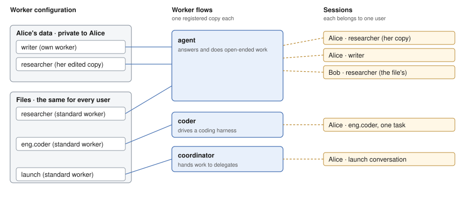
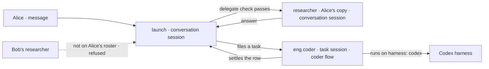

<!-- Concept doc for the release that ships kits. Target model first; today's code is in the last section. -->

# Workers: How They Should Work

## Why this doc

A worker is the named agent an app defines in a `WORKER.md` file, and the one users talk to and hand tasks. Today an app has to learn four things to get one: the file format, the flow that runs it, an installation object, and a registration call. Kits are meant to hide the last two. A new reader can't tell which parts are the idea and which are plumbing.

This doc describes workers as they should work once Workforce installs as a kit, in order from the simplest part up. The last section lists where today's code differs.

## Base terms

**A user is a person, signed in, always inside one org.** The framework has no system users.

**A flow is the code that runs a session.** An app registers each flow once.

**A session belongs to one user.** Nobody else can open it. The server refuses to create a worker session for a user at an address that is another user's.

## The parts, in the order you meet them

Each part uses only the ones above it.

1. **A worker.** A named configuration (instructions, settings, tools) that one flow runs. It is what a user talks to.
2. **A worker flow.** The code that runs workers. Each worker names one. There is one registered copy of each flow, shared by every worker that names it.
3. **The worker contract.** What a flow must meet before it may run workers.
4. **Standard and own workers.** Where a worker's configuration comes from: files the app ships, or a row a user owns.
5. **The roster.** The workers one user can reach, standard and own, read in one list.
6. **Sessions and the door.** A session is where a worker works. The door is the one action that takes a message to any worker.
7. **Delegates and tasks.** How one worker hands work to another.
8. **The Workforce kit.** How an app installs all of the above with one line.

The cast for every example: **Alice** and **Bob** are users. **researcher (worker)** answers questions. **writer (worker)** drafts text. **eng.coder (worker)** does coding work. **launch (worker)** is a coordinator: it hands work to the others.



Alice's two own copies sit in her data. Standard workers sit in files every user shares. Each worker names a flow, all workers on a flow share one copy of it, and every session belongs to one user.

## Workers

**A worker is a configuration that one user can talk to, run by the flow it names.** It is what other frameworks call an agent. We say worker because the flow behind it may be a fixed workflow rather than a model choosing its own steps.

A worker's configuration is its file: frontmatter, then a body.

```md
---
name: Researcher
description: Finds and summarizes sources.
flow: agent
model: openai/gpt-6-luna
tools: [searchWeb]
---
You are the researcher. Cite every claim.
```

- `description` is the only required line. It says what the worker is for.
- The body is the worker's instructions.
- `flow:` names the flow that runs it. Leave it out and the worker runs on the built-in `agent` flow.
- Every other line is a setting of that flow. The flow's own schema decides what is allowed, so a typo or an unknown setting is refused by name, not ignored.

A worker belongs to a team or to the org as a whole. `eng.coder` is the worker `coder` on team `eng`; `researcher` is an org worker with no team. A team can carry a `TEAM.md` whose body is added to the instructions of every worker on it.

Some settings are never written in a file. The framework supplies them when it builds the configuration, and a file that declares one is refused by name:

| Supplied by the framework | What it carries |
| -- | -- |
| the worker's id | so a block inside the worker can sign what it files |
| its skills | the skills its org, team and own folders hold |
| its tools | the blocks from its own folders that its `tools:` line named |
| its packages | the instruction-and-tool bundles it holds |
| its team's instructions | the body of its `TEAM.md`, kept apart from its own |

**Who owns it, who can see it.** A standard worker belongs to the installation and is visible to every user. An own worker belongs to the user who made it and is visible to them alone.

**How many exist.** One per file for standard workers. For own workers, one per id per user.

## Worker flows

A worker flow is an ordinary flow with a few extra duties. The framework ships one, `agent`, and an app adds its own.

| Flow | What it does |
| -- | -- |
| `agent` | Answers and does open-ended work itself. The default |
| coordinator | Takes in messages and hands them to other workers (see Delegates) |
| `coder` | Runs a task on a coding harness: Claude Code, Codex or Cursor, in its own copy of the repository |
| The app's own | Whatever the app wrote and registered as a worker flow, such as a fixed triage step |

**Each flow is registered once, and every worker that names it shares that copy.** Alice's researcher, Alice's writer and Bob's researcher all run on one `agent`. What differs between them is configuration, so what the flow does with that configuration (memory, tools, how it answers) is the flow's, in one place.

A flow can also declare **roles**, which say what else it does beside taking a message. The built-in `agent` flow is a contributor, and a manager as well when it is given a board. The built-in coordinator flow holds all three. An app's own flow declares its roles when it is registered.

| Role | Means |
| -- | -- |
| contributor | Takes tasks filed on a board |
| manager | Runs its own board of tasks for others |
| coordinator | A manager that also routes messages |

So "coordinator" names two things that go together: a flow that holds the coordinator role, and a worker on that flow. `launch` is the second.

Memory is not a worker setting. A flow gets memory by composing a memory capability into its own `uses`, so every worker on that flow has it.

### The worker contract

A flow may run workers only if it meets three conditions:

* **It takes a worker's standard configuration:** instructions, team instructions, skills, tools, packages and the worker's id, plus its own settings beside them.
* **It has a door:** one public action named `respond` that takes `{ message }`, so an app can talk to any worker without knowing its flow.
* **It keeps a worker's state private to the user.**

The check runs when the app starts, over every flow a worker can name. One flow that fails it refuses the whole install and names every problem, so no worker is quietly missing a duty. A flow that was never registered as a worker flow isn't checked; a worker file naming it is refused as naming a flow that isn't there.

A flow can also be kept for **standard workers only**: files may name it, and a user cannot hire an own worker onto it.

## Standard and own workers

| | Standard worker | Own worker |
| -- | -- | -- |
| Defined by | A `WORKER.md` in the app's `workforce/` folder, written by whoever runs the installation | A user, while the app runs: hire, fork or edit |
| Stored as | Not stored. Read from the files each time | One row in the user's own data |
| Who has it | Every user, identical | Only the user who made it |
| Can a user change it | Not the file. Editing makes their own copy | Yes, its owner |
| What a deploy does | A changed file changes the worker for everyone who hasn't edited it | Nothing |

**An edited standard worker is a third case.** It is an own worker row under a standard worker's id. The roster still lists it as standard and on its team, with an edited flag, and the user's copy is read before the file.

An own worker is a row at `workforce/workers/<id>` in the user's own scope, which is per user and per org, so a user has a separate set in each org. The row holds the worker's configuration and nothing that runs it: tools, skills and packages are names, resolved when a session loads the worker. A hire, an edit and a fire are therefore writes to the user's data, and the next turn on any process reads them.

**A hire is a write, checked first.** The flow must be a worker flow that isn't standard-only, and the configuration must pass that flow's own schema with every name resolved. A refused hire writes nothing.

Four ways to change which workers a user has:

* **Hire.** A new own worker on a flow, with an id the user picks.
* **Fork.** A new own worker starting from a copy of another worker's configuration. The copy is taken once and never follows later changes to the file.
* **Edit.** Changing a worker. On an own worker, the row changes. On a standard worker, the user gets their own copy under the same id, and that copy is read before the file until they reset it. Bob's researcher stays the file's; Alice's, once she edits it, is hers.
* **Fire.** Delete an own worker. A standard worker can't be fired. Resetting an edited one deletes the copy.

**What happens to an id.** An id names one worker per user: their copy if they have one, otherwise the file's. A hire, fork or fire naming a standard worker's id is refused.

### Why not store standard workers too?

A reader would ask, since own workers are rows. Stored copies go stale: a deploy that changes a file would leave every stored copy behind. Reading the files each time means the file is always the truth, and the only stored thing is what a user chose to change.

## The roster

**A user's roster is every worker they can reach: their own, and the standard ones.** It is read, never stored. A standard worker the user edited appears once, as their copy, still marked standard and still on its team, with a flag saying it was edited.

The roster is a view: it answers at user scope with no session, keyed by worker id, and a hire, edit or fire reaches anyone watching it without the app saying what to watch. Each row shows the worker's id, flow, name, description and team, and the settings its flow has marked safe to show a browser. Instructions, skills and anything else the flow didn't mark stay on the server.

| Question | Answer |
| -- | -- |
| Who sees it | The user whose roster it is |
| Where it's stored | Nowhere. Computed from the standard workers and the user's own rows |
| How many | One per user per org |

## Sessions and the door

**A session is where a worker works, and it belongs to one user.** It records which worker it runs, once, when it is created, and loads that worker's configuration each time it runs. The server checks the link: the worker must be the creating user's own, or a standard one, and must run on this flow. Nothing changes it afterwards, and a caller can't name a different worker on a later turn.

A worker has no single lasting session. It gets one per piece of work:

| Work | Sessions |
| -- | -- |
| A conversation with a user | One per user per worker. Asking again returns the same session |
| A coordinator's conversation | One session per delegate, for that conversation |
| A task | One per task, opened by the board that handed the task over |

The conversation session's id is derived from the user, org, flow, worker and what the session is for, so researcher and writer, though both on `agent`, get different sessions, while two asks racing for the same worker end on one. The server creates the session if absent and the loser of the race reads the winner's back. The id names its owner, so a user can't create a session at an id that would be another user's.

**Who owns it, where it's stored.** The user owns the session, and only they can open it. It is stored as an ordinary session of the flow its worker names, with the worker's id, and for a task the task's id, as read-only fields of its state. How many: see the table above.

**The door is `respond`.** Every worker flow has it, so any app can send a message to any worker the same way:

```ts
const session = await workforce.ensureWorkerSession({ worker: "researcher" });
await fsd.flow(session.flowKind).send("respond", { message }, { sessionId: session.id });
```

Alice and Bob both send to `researcher` and reach two different sessions on one flow. Alice's runs her edited copy's configuration; Bob's runs the file's.

## Delegates and tasks

**A delegate is a worker another worker may hand work to.** Each worker's configuration carries a default list, `delegates: [...]`. A session copies that list into its own state the first time it reads it, then changes its own copy; a change never reaches the worker's other sessions or its file. A task row lives on the board of the session that filed it, and the delegate works it in its own task session. `launch`'s file lists researcher and eng.coder. Alice adds her own `writer` to her session's list, because her `writer` exists only on her roster. The special value `all` means the user's whole roster, read on every call, so a worker hired mid-conversation is reachable at once.

**A delegate must be on the same user's roster and take tasks.** That is the one check, run for every add, every routed message and every task filed. It asks whether the worker is on this user's roster now, whether its row can be read, and whether its flow declares the contributor role. Another user's worker isn't on the roster, so it gets exactly the answer a worker that doesn't exist gets.

A standard worker's file may name only standard workers as delegates, because those are the only ones every user is sure to have. A user adds their own workers as delegates in a session. This limits the names a file may write; `all` is read against each user's roster when used, so it is not limited.

Handing work takes two shapes:

* **A message.** A coordinator takes a message at its door, picks delegates, and each picked delegate works it in its own session.
* **A task.** A worker with the task tools files a task for a delegate on its board. The delegate works it in a task session of its own and settles the row when done.

**When to use which.** Talk to one worker directly when you know who. Send to a coordinator when the sender shouldn't need to know who answers. File a task when the work should be tracked.

## The Workforce kit

**A kit is the unit an app installs: one config object, listed once.** Workforce installs as a kit, and so does the coding harnesses package. The app owns one folder, `workforce/`, that the kit scaffolds and reads at start. Every file in it is used or refused by path, so a stray file stops the app starting rather than being silently ignored.

```ts
createFlowState({
  kits: [
    workforce({ directory: "workforce", agent: { model: "openai/gpt-6-luna", uses: [memory] } }),
    harnesses({ workspace, defaultHarness: "codex" }),
  ],
  flows: [context],
});
```

An app gets, from that line: the standard workers read from `workforce/`, one registered copy of each worker flow, the roster view, the views of a worker's sessions and turns, and the workers collection. A worker's own writes go through a flow that the collection names.

**What an app can still add.** Kits meet by slots, typed places one kit fills for another. Workforce has two:

| Slot | Takes | Used for |
| -- | -- | -- |
| worker flows | Flows by key | An app's own worker flow, named from a `WORKER.md` |
| `uses` | A list of capabilities | Memory, tools or context for the built-in `agent` flow |

The harnesses kit has one slot, which takes harness values (Codex, Cursor, Claude Code). It contributes the one shared `coder` flow, which routes a task to the harness the worker's `harness:` line names. A worker file for it looks like any other:

```md
---
description: Does the work a filed task names, in its own copy of the repository.
flow: coder
harness: codex
---
```

**The two halves.** The kit's package is imported and versioned: its flows, views, hooks and components. The `workforce/` folder is copied in and owned by the app: its worker files and any flows the app wrote. The kit never also exports a flow that the folder scaffolds.

**What this replaces.** An app no longer reads its roster, builds an installation, passes a flow map and registers the result by hand. Those calls become the kit's internals. Screens import views from the package's browser entry and components from its `/react` entry.

What it costs, and how each cost is handled:

* **Slots are a public contract, and are permanent.** Two kits fill them before they freeze, so the shape isn't built for one consumer.
* **Some files in `workforce/` will now stop the app starting.** They are refused by name, with the path, and moving them is mechanical.
* **An own worker's writes depend on a flow.** A worker's row can be written only through the flow its collection names. A flow that's gone leaves the row unwritable until one is registered.

## How it flows

Alice asks `launch` to get a feature built.

1. The app starts with the Workforce kit and the harnesses kit. Standard workers `researcher`, `eng.coder` and `launch` are read from `workforce/`. Each names a flow, so the kit registers `agent`, `coder` and the coordinator once.
2. Alice opens the app. Her roster view lists three standard workers and her own `writer`. She edited `researcher` last week, so it shows as hers, flagged edited.
3. Alice sends a message to `launch`. The app finds or creates her one conversation session with `launch`, whose id is derived from her user and the worker, then sends `respond`.
4. `launch`'s file lists researcher and eng.coder, and Alice added her `writer` to her session's list. `launch` loads at Alice's scope and picks delegates by judgment: `researcher` for background and `eng.coder` for the build.
5. For each, the delegate check runs: on Alice's roster, readable, flow takes tasks. `researcher` should resolve to Alice's edited copy, the same as in her roster (Decisions: to confirm). Bob's researcher is not on her roster and could not be named.
6. `launch` files a task for `eng.coder`. The board opens a task session on the `coder` flow, which reads `harness: codex` from the worker's file and runs the task on the Codex harness.
7. When the task settles, the row settles on the board that filed it, and the answer returns to `launch`'s conversation. Alice reads it there.



Every session in the trace is Alice's. Bob's researcher never appears, because a delegate must be on the same user's roster.

## Naming debates

### What to call a worker a user made

| Name | Says | Fits | Familiar from | Risks |
| -- | -- | -- | -- | -- |
| Own worker | It belongs to this user | Hire, fork, edit, fire | Own vs standard | "Own" can read as "own flow" |
| Hired worker | It was hired | The hire verb | The code today | A standard worker is also "on the roster", so it reads as the opposite of a file worker |
| Custom worker | The user changed it | A fork | Product UIs | Doesn't say whose it is |

**Recommend own worker,** with hire kept as the verb for making one. It names the property the model turns on (whose it is) and pairs with standard. What would change it: if a user-facing screen needs a friendlier word, the screen can say "your workers" and the doc keeps own.

### Why `respond` and not `send` or `message`

`respond` is already the one door name every flow uses, and the contract finds it by name. **Recommend keeping it.** Renaming would break every worker flow that exists for no new meaning.

## The rules

A behavior none of these rules explains is a bug in the model.

1. A worker is either standard (from files, the same for every user) or own (a row one user owns), and an edited standard worker is the user's own row under the standard id. A configuration is never shared between users. Only the files are the same for all.
2. A session belongs to one user, and a session's worker is set once, when it is created, by the server, from a worker that user can reach.
3. A worker acts as the user whose session it runs in, and reads its configuration at that user's scope.
4. A flow may run workers only if it meets the worker contract, and the check runs when the app starts, for every flow at once.
5. A file can't declare what the framework supplies. Such a setting is refused by name, at every door that reads a worker.
6. Nobody writes a standard worker's file at run time. Editing one makes the user's own copy, read before the file, and resetting deletes it. (Whether editing stays this way is open; see Decisions.)
7. A hire, fork or edit is checked against the flow's own schema before it is written. A refused one writes nothing.
8. A delegate must be on the same user's roster now, readable, and on a flow that takes tasks. A standard worker may name only standard workers.
9. Delegate lists change per session. A change never reaches the file, the row or another session.
10. Every file in `workforce/` is used or refused, by path, when the app starts.
11. Every worker write by a client goes through a flow, never a direct write.

## Vocabulary

One term, one thing. Retired: seat, mailbox (say coordinator), hired worker (say own worker), flow instance, hireWorkforce as a name for the install (say the Workforce kit).

| Term | Means | Private or shared |
| -- | -- | -- |
| User | A person, signed in, inside one org | |
| Org | The boundary every user and every stored row sits inside | |
| Installation | One running copy of an app. Whoever runs it, not necessarily its developer, writes its `workforce/` files | |
| User scope | A user's private data, kept separately for each org they are in | Private |
| Turn | One run of a worker on one message | |
| Board | A list of task rows that belongs to a session. A task settles by updating its row | Private |
| Capability | A bundle of context and tools that a flow composes in through `uses` | Installation-level |
| Skill, package | A skill is a `SKILL.md` a worker can see. A package is a `PACKAGE.md` folder of instructions and tools a worker holds | Installation-level |
| Readiness view | Says which harnesses are ready to run | Installation-level |
| Flow | The code that runs a session; registered once | Installation-level |
| Worker | A named configuration one user talks to, run by the flow it names | Standard or own |
| Worker flow | A flow that meets the worker contract | Installation-level |
| Worker contract | What a flow must meet to run workers: standard configuration, the `respond` door, private state | Installation-level |
| Standard worker | A worker from `workforce/` files, the same for every user | Same configuration, private sessions |
| Own worker | A worker one user made, stored as a row in their data | Private |
| Team | A folder of workers sharing the instructions in a `TEAM.md` | Installation-level |
| Roster | The workers one user can reach, as a view | Private |
| Session | One user's private conversation or piece of work with a worker | Private |
| Door | The `respond` action, which takes a message to any worker | |
| Role | What else a flow does: contributor, manager, coordinator | Installation-level |
| Coordinator | A worker whose flow routes messages to its delegates | Standard or own |
| Delegate | A worker another worker may hand work to; on the same user's roster | Private |
| Task | A unit of work filed for a delegate, worked in a task session | Private |
| Kit | The installable unit: one config object, listed once | Installation-level |
| Slot | A typed place one kit fills for another | Installation-level |
| View | A read of computed data that watchers are told about | Follows what it reads |
| Harness | A coding agent runtime (Claude Code, Codex, Cursor) the `coder` flow drives | Installation-level |

### Retired terms the refactor removes

Counts are files that mention the term, searched in this session. Seat and mailbox were searched in `packages/workforce` only; the other two across the whole repo, specs, goals and docs included.

| Retired term | Say instead | Where it lives today | Files |
| -- | -- | -- | -- |
| Seat, mailbox | Worker; coordinator | Gone from `packages/workforce` source. Only its `CHANGELOG.md` | 1 |
| Hired worker | Own worker | `packages/workforce/src/hire.ts`, `inventory/*`, README, docs, specs | 91 |
| `hireWorkforce`, `createWorkerInstallation`, `readDeclaredRoster` as the install | The Workforce kit | README, hosts, goals, docs | 363 |

## Decisions

- [x] **Decided.** A worker is standard or own and is never shared. (Matches the code: standard workers are a read-only projection, own workers a user-scoped collection.)
- [x] **Decided.** Workforce installs as a kit, with a `workforce/` folder the app owns and a refusal for any unclaimed file.
- [x] **Decided.** One shared `coder` flow, contributed by the harnesses kit, routes by the worker's `harness:` line.
- [x] **Decided.** Every client write to a worker goes through a flow the workers collection names.
- [ ] **Open: edit a standard worker, or fork only.** Today, editing makes a same-id copy that shadows the file. The alternative is that a standard worker can only be forked. Recommend **keeping the shadow copy**: the roster flags it as edited and a reset exists. What would change it: if users forget they edited a worker and miss a deploy's file change, show a notice when the file changes under an edited copy.
- [ ] **Open: does a delegate named by a standard id resolve to the user's edited copy?** The roster and turn read the copy first. I did not confirm the delegate check does the same. Recommend **yes, the same rule everywhere**, and a test that says so.
- [ ] **Open: may a user hire an own worker on `coder`?** Recommend **no, until the readiness view says a harness is ready for that user**, because a worker that can't run is worse than none. What would change it: if readiness is per app and never per user, allow it.
- [ ] **Open: the name** own worker (see Naming debates). Recommend own worker.
- [ ] **Punted.** Sharing a worker between users, such as a template library. Not in this release.
- [ ] **Held.** Workstreams and projects, which need a coordinator and a board, are the next doc.

## Where today's code differs

| Target | Today | Where |
| -- | -- | -- |
| One kit entry, `workforce({ directory, agent })`, in `kits` | No Workforce kit exists. `defineKit` and the engine's kit install exist | `packages/core/src/kit/define-kit.ts`, `packages/engine/src/flowstate/kits.ts`; no `defineKit` in `packages/workforce` |
| The kit builds the installation and registers flows | An app calls `readDeclaredRoster`, `createWorkerInstallation`, then `hireWorkforce`, and registers the result | `packages/workforce/README.md` Quick Start, `workers/register.ts` |
| Worker flows enter through a keyed slot | `workerFlows` option on `createWorkerInstallation`, as a map, entries optionally with `standardOnly`, `roles`, `showSettings`, `needsProject` | `packages/workforce/src/hire.ts` (`HireOptions`, `WorkerFlowEntry`) |
| `uses` slot adds capabilities to `agent` | `defineAgentWorkerFlow({ uses })`, then pass the flow in `workerFlows` | `src/agent-worker-flow.ts`; `README.md` |
| Every file in `workforce/` used or refused | The loader returns `errors` and the caller decides; it doesn't claim every file | `src/loader/read-workforce.ts`, `README.md` ("collected rather than thrown") |
| The workers collection names a flow that writes it | Hire, fork, edit and fire are blocks the roster flow runs. `runBy` does not exist in core or engine | `src/workers/hire-blocks.ts`, `src/workers/roster-flow.ts`; no `runBy` under `packages/core/src` or `packages/engine/src` |
| Roster view installed by the kit | The roster view exists, installed in the roster flow by `hireWorkforce` | `src/workers/roster-view.ts` |
| Views for a worker's sessions and turns | The client lists and finds worker sessions through `createWorkforceClient` | `src/workers/client.ts` |
| One shared `coder` flow, from the harnesses kit | No coder flow in `packages/harness-manager/src` | `packages/harness-manager/src` |
| Components from `@flow-state-dev/workforce/react` | The components are under `@flow-state-dev/react/workforce` | `packages/react/src/workforce/index.ts` |
| Own worker | Called "hired worker" in code and docs | 91 files |
| Standard worker edit keeps the file's id, user copy shadows | Same | `src/workers/standard-workers.ts`, `src/workers/hire-blocks.ts` |
