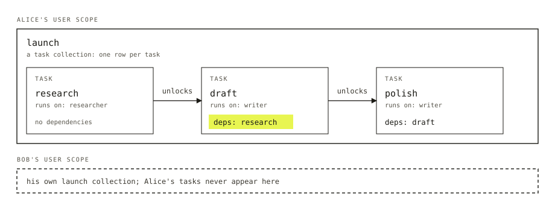

Alice asks an agent for a launch blog post. The agent has a plan: research the topic, draft the post, polish it. The plan lives in a prompt and in the agent's head, so when the request dies halfway you can't see what was done, you can't cancel the polish step, and a crash means starting over.

A **task** is one unit of work written down as a row: a goal, a status, and what the code that runs it needs. It outlives the code that runs it, so you can read it, change it and cancel it while it waits. A **task board** is a stored list of tasks plus the loop that works through it. The list is the **task collection**. The loop is the **drain**.

## If you know job queues

The mechanics will look familiar: rows, a worker that claims one, a lease, retries. Tasks can wait on other tasks, so a board is a plan and not only a queue. It also knows when it is finished and tells you why it stopped.



*Alice's launch tasks sit in her scope, each one waiting on the one before. Description for the site's Figure: A large solid box labelled "Alice's user scope" holds a task collection called launch. Inside it are three boxes in a row, research, draft and polish, joined by arrows labelled "unlocks". Research runs on researcher and has no dependencies. Draft and polish run on writer; draft lists research as a dependency and polish lists draft. Below, a dashed box labelled "Bob's user scope" holds his own launch collection, separate from Alice's.*

## The smallest working board

Start with the board. It names a durable collection in each user's own scope, and two blocks that do the work, keyed by the name a task carries as its **assignee**. Here `researcher` and `writer` are blocks that take a task as input and return its result.

```ts title="src/flows/launch/blocks/launch-board.ts"
import { taskBoard } from "@flow-state-dev/orchestration/task-board";
import { defineTaskCollection } from "@flow-state-dev/orchestration/tasks";
import { researcher } from "./researcher";
import { writer } from "./writer";

const launchTasks = defineTaskCollection({ id: "launch", scope: "user" });

export const launchBoard = taskBoard({
  name: "launch",
  collection: launchTasks,
  workers: { researcher, writer },
});
```

Something has to file the tasks. In a real app a coordinator model does it through task tools; a handler does the same thing here.

```ts title="src/flows/launch/blocks/file-launch-tasks.ts"
import { handler } from "@flow-state-dev/core";
import { z } from "zod";
import { launchBoard } from "./launch-board";

export const fileLaunchTasks = handler({
  name: "file-launch-tasks",
  inputSchema: z.object({ topic: z.string() }),
  outputSchema: z.object({ filed: z.number() }),
  uses: [launchBoard.capability],
  execute: async (input, ctx) => {
    await ctx.cap.launch.createTasks([
      { id: "research", goal: `Research ${input.topic}`, assignee: "researcher" },
      { id: "draft", goal: "Draft the post", assignee: "writer", deps: ["research"] },
      { id: "polish", goal: "Polish the draft", assignee: "writer", deps: ["draft"], maxAttempts: 2 },
    ]);
    return { filed: 3 };
  },
});
```

```ts title="src/flows/launch/flow.ts"
import { defineFlow } from "@flow-state-dev/core";
import { z } from "zod";
import { fileLaunchTasks } from "./blocks/file-launch-tasks";
import { launchBoard } from "./blocks/launch-board";

export default defineFlow({
  kind: "launch",
  requireUser: true,
  actions: {
    file: { inputSchema: z.object({ topic: z.string() }), block: fileLaunchTasks },
    drain: { block: launchBoard.drain },
  },
});
```

The collection's `scope: "user"` decides who can read the tasks, and the board has no say in it. The `deps` fields make a chain: draft starts when research is done. And `maxAttempts: 2` lets polish try twice before it counts as failed. Running the `drain` action is what works the board.

## What is in a task?

A goal, a status, and a few optional fields: the assignee, the dependencies, a priority, free-form input and output, and the error from the last failed attempt, which the next attempt receives as feedback. A task has one of six statuses:

| Status | Meaning |
| --- | --- |
| `pending` | Waiting to be taken |
| `in_progress` | A worker has it |
| `held` | Filed with `held: true`, so it waits until it is released |
| `completed` | The worker returned |
| `errored` | It failed with no attempts left |
| `cancelled` | The filer, the app or a cascade cancelled it |

`completed` never changes again. An `errored` or `cancelled` task comes back to `pending` only when a user retries it. Only a user can retry an errored or cancelled task. Code can't.

## How does a task start?

A task is ready when it is `pending`, nothing is holding it for a user, and every dependency is `completed`. A worker takes a ready task by **claiming** it: the task becomes `in_progress`, an attempt is counted, and a **lease** starts, two minutes by default, renewed while the worker runs. If two workers reach for the same task, one wins and the other takes the next ready one. If a worker's host dies, the lease runs out and the next claim takes the task back as a fresh attempt. After a crash, work can run twice, and only the second result counts.

Dependencies are checked when you file, so a mistake is refused at that point and nothing is filed. The refusals are a dependency that names no task on this board, one that has already failed or been cancelled, a loop, and a task id already filed. Sending the same batch twice is refused the second time. Alice's "research" is always Alice's: Bob's can't be named from her board.

If research ends in error or is cancelled, draft and polish can never run. The board cancels them for you, labelled `skipped`, and the row says which task caused it.

## How does a board stop?

The drain starts several workers, four by default. Each one claims the next ready task, runs the block that does the task, records the result, and checks whether the board is finished. A failure and a success both lead to the same check, so one failed task doesn't stop the others. Tasks added while the drain runs are picked up.

When nothing is ready and no worker is active, the board stops and says why:

| Reason | Meaning |
| --- | --- |
| All completed | Every task is `completed` |
| Blocked by failures | Something left is errored, cancelled or held, or can never start |
| Retry budget exhausted | The board's `maxTotalRetries` option, a cap on retries across all its tasks, refused a retry. `maxAttempts` limits each task on its own |
| Waiting on a user | A task waits for a user's answer |

Run Alice's board and suppose polish fails twice. It goes back to `pending` after the first failure with the error as feedback, then ends `errored` on the second. Research and draft keep their results. The board stops with "blocked by failures", and Alice sees all three rows.

## What if a task needs a user's answer?

A worker can ask a question midway, such as "formal or casual?". The task becomes a **hold**: nobody works it, and the question appears in that user's Inbox, the list of questions waiting on them. Their answer closes the hold and the task resumes as the same attempt. A board whose only remaining tasks wait on a user stops with "waiting on a user" and leaves them as they are. Run the drain again after the answer.

## Who can see a board?

Whoever can read the collection's scope. Alice's launch board is in her user scope, so Bob can't read it, and a task Bob files can't appear on it. In a session scope the board is private to one conversation; in an org scope it belongs to the org. [Scopes and resources](./scopes-and-resources.md) explains who may change each.

A browser receives every field of a task except four that stay on the server: the claim's identity, who filed the task, which session filed it, and which org it was filed under. Task tools can't set the filer, session, org or claim.

## What it gets you

- **A plan you can see and change.** Alice's three tasks are rows. She can cancel polish, or change its goal before it starts, without touching the code that runs.
- **A plan that survives the request.** The tasks sit in Alice's user scope. If the request dies after research, the next drain finds research done and carries on from draft.
- **Failures that stay small.** Polish failing leaves research and draft intact, and the board says it was blocked by failures and not that it finished.
- **Mistakes caught early.** A typo in `deps: ["reserch"]` is refused when you file it, not found later as a board that never finishes.

## What it won't do

- Decide whether the goal was met. A board stops when its tasks are done. A [goal-seek loop](./goal-seek-loop.md) adds a judge that asks "are we done?" and files more tasks.
- Wait on another board. Dependencies are between tasks on the same board.
- Read tasks across users. Scope is the only access rule.

## Next

- [Goal-seek loop](./goal-seek-loop.md): wrap a board in a judge that decides when to stop.
- [Workers and coordinators](./workers-and-coordinators.md): the named agents that can be an assignee or file the tasks.
- [Scopes and resources](./scopes-and-resources.md): how user, session and org scope decide who sees what.
- [Task board reference](../reference/task-board.md): every option, limit and error.
