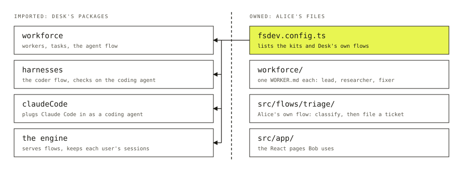

Say you want an app where users chat with a few named agents, and one of them can hand a coding task to Claude Code and report back. The model calls are the easy part. The rest is streaming replies to a browser, keeping each user's conversations apart, holding state between messages and showing a task as it changes. That part is much the same in every agent app.

Flow State is a TypeScript framework that supplies it: a server that runs your agent logic, and React hooks that read from it. You write the instructions, the steps and the screens.

## One app, start to finish

Follow a made-up app called Desk. Alice builds it. Bob is a user, someone who signs in, and he talks to Desk's **workers**: named agents such as `lead`, `researcher` and `fixer`.

The server starts from one file.

```ts title="fsdev.config.ts"
import { createFlowState } from "@flow-state-dev/engine";
import { workforce } from "@flow-state-dev/workforce";
import { harnesses } from "@flow-state-dev/harness-manager";
import { claudeCode } from "@flow-state-dev/claude-code";
import { triage } from "./src/flows/triage/flow"; // Alice's own flow

export default createFlowState({
  kits: [
    workforce({ directory: "./workforce", agent: { model: "openai/gpt-6-luna" } }),
    harnesses({ workspace: "./workspace" }),
    claudeCode(),
  ],
  flows: [triage],
});
```

A **kit** is a feature an app installs with one config object. `workforce` gives Desk its workers. `harnesses` lets a worker hand coding to a coding agent. `claudeCode` plugs Claude Code in as one, through a **slot**, an opening that `harnesses` leaves for other kits to fill. List kits in any order: `claudeCode` needs `harnesses`, and loads after it even when you list it first.

`flows` takes what Alice writes herself. A **flow** is what the server serves: named actions, each running a tree of **blocks**, plus the state they keep. A block is one typed step, such as a model call, plain code, a check or a choice between paths. `triage` is two blocks in a row: one labels a request, one files a ticket.

A worker is a file, not code.

```md title="workforce/teams/desk/workers/fixer/WORKER.md"
---
name: Fixer
description: Runs coding tasks on Claude Code in the background.
flow: coder
harness: claude-code
---

You run coding tasks. Make the change in the working folder, check it, and say in one line what changed.
```

`flow: coder` names the flow the worker runs on, one that `harnesses` installs. A file that names no flow runs on `agent`, the built-in flow that answers with a model and tools. `lead` and `researcher` do. `harness: claude-code` picks which coding agent in the slot runs the task.

When Bob asks `lead` to fix a typo, `lead` files a coding task for `fixer`. His page shows the task's row change as the work goes.

## Imported or owned



*Desk's code splits into what Alice imports and what she owns.*

Every piece of code in an app is one or the other. Imported code lives in a package. You upgrade it and configure it, and you do not edit it. Owned code lives in your files. Upgrading a package never rewrites them.

The `workforce/` folder is owned, and the `workforce` kit reads it. If a file in it doesn't load as a worker, the app refuses to start and names the file.

## Which layer to change

Start at the top and stop at the first row that does the job.

| The job | Change |
| --- | --- |
| Make `researcher` answer in a different tone | The body of its `WORKER.md` |
| Add a second researcher | A new folder with a `WORKER.md` |
| Change the model, or add another coding agent | The kit config, or the slot fill, in `fsdev.config.ts` |
| Do something no worker does, such as triage | Write a flow and list it in `flows` |
| Change what one step of your flow does | Edit that block |
| Change how a screen looks | The pages in `src/app/` |

You do not have to begin from an empty folder. A **starter** is a complete working app in the Flow State repository: pages, a team of workers and a host file like the one above. Alice copies one and from then on it is hers: the packages it imports upgrade through your package manager, and its files change only when she edits them.

## What you get

- Bob's replies stream to his page as the model writes them.
- Each conversation is a **session** that belongs to one user, so Bob's conversations stay apart from every other user's.
- The framework stays in packages. Upgrading one doesn't touch `fsdev.config.ts`, `workforce/` or `triage`.

## What it won't do

- Kits have no registry or marketplace.
- A kit changes another kit only through slots the other kit leaves open.

## Next

- [Kits](./kits.md): install, order and fill slots, and write your own.
- [Workers](./workers.md): what goes in a `WORKER.md` and how a worker picks its flow.
- [Flows](./flows.md): actions, state and sessions, and the flow you write when no worker fits.
- [Blocks](./blocks.md): the five kinds of step and how they nest.
