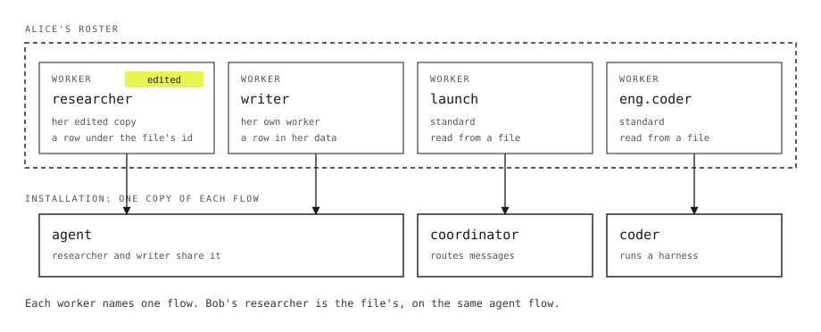

You are building an app where users talk to more than one assistant. One answers research questions, one drafts text, one does coding work. Each needs its own instructions and tools, and some users will want to tweak one without changing it for everybody else.

In Flow State, each of those assistants is a **worker**: a named configuration that one user can talk to, run by a **flow**, which is the code that runs a session. The configuration says who the worker is and what it may do. The flow says how it does it. Every user reaches their workers through a **roster**, the list of workers that user can talk to.

## If you know agents

A worker is what other frameworks call an agent. We say worker because the flow behind it may be a fixed workflow rather than a model choosing its own steps. Configuration is data, so a worker can be hired, edited and fired while the app runs (see below).

## The shape of it

The cast for this page: Alice and Bob are users. Standard workers `researcher`, `launch` and `eng.coder` come from files. Alice has edited her `researcher` and hired a `writer` of her own.



*Alice's workers on top, the installation's flows below.*

## The smallest working example

A worker is a file. This one is `researcher`, an org-wide worker with no team.

```md title="workforce/workers/researcher/WORKER.md"
---
name: Researcher
description: Finds and summarizes sources.
flow: agent
model: openai/gpt-6-luna
tools: [searchWeb]
---
You are the researcher. Cite every claim.
```

The app installs workers with one line in its config.

```ts title="fsdev.config.ts"
import { createFlowState } from "@flow-state-dev/engine";
import { workforce } from "@flow-state-dev/workforce";

export default createFlowState({
  kits: [
    workforce({ directory: "./workforce", agent: { model: "openai/gpt-6-luna" } }),
  ],
});
```

`description` is the only required line: it says what the worker is for. The body is its instructions. Every other line is a setting of the flow named by `flow:`. Leave `flow:` out and the worker runs on the built-in `agent` flow, which answers and does open-ended work itself. The flow's own schema decides which settings are allowed, so a typo or unknown setting is refused by name.

A worker can sit in a team, as in `workforce/teams/eng/workers/coder/WORKER.md`, which is `eng.coder`. A `TEAM.md` in the team's folder adds its body to the instructions of every worker on it.

## Where does a worker come from?

A **standard worker** is a `WORKER.md` file written by whoever runs the installation. Every user sees the same one. A changed file changes the worker for everyone who hasn't edited it. An **own worker** is a row in one user's data, made by that user while the app runs. Only that user sees it.

Users change their workers four ways:

- **Hire** creates an own worker on a flow, under an id the user picks.
- **Fork** creates an own worker from a copy of another worker's configuration. The copy is taken once and does not follow the file.
- **Edit** changes an own worker's row. On a standard worker it creates the user's own copy under the same id. The copy is read before the file until the user resets it.
- **Fire** deletes an own worker. A standard worker can't be fired, but resetting an edited one deletes the copy.

A hire is checked before it is written: the flow must accept the configuration, and every tool and skill name in it must resolve. A refused hire writes nothing. A hire or fork under a standard worker's id is refused, and so is a fire of one. Alice's edited `researcher` is hers; Bob's is the file's.

The roster is computed from both sources and never stored. An edited standard worker appears once, as the user's copy, on its team, with an edited flag.

## What is a worker flow?

An ordinary flow that meets three conditions, so the framework can treat any worker alike. It accepts a worker's standard configuration. It has a public action named `respond` that takes `{ message }`. And it keeps a worker's state private to the user.

The framework ships `agent`, a coordinator flow, and `coder`, which runs a task on a coding harness (Claude Code, Codex or Cursor) in its own copy of the repository. An app adds its own. When the app starts, the framework checks every flow a worker names. One flow that fails refuses the install and names every problem.

Alice's `researcher`, Alice's `writer` and Bob's `researcher` all run on the same `agent`.

## How do I talk to one?

A **session** is where a worker works. It belongs to one user, and nobody else can open it. The door into any worker is `respond`, so an app does not need to know which flow runs it.

```ts title="src/lib/ask-worker.ts"
import type { Client } from "@flow-state-dev/client";
import type { WorkforceClient } from "@flow-state-dev/workforce/browser";

export async function askWorker(
  fsd: Client,
  workforce: WorkforceClient,
  worker: string,
  message: string,
) {
  const session = await workforce.ensureWorkerSession({ worker });
  await fsd.flow(session.flowKind).send("respond", { message }, { sessionId: session.id });
}
```

A user has one conversation session per worker. Asking again returns the same session, and two asks at once end on one. Alice and Bob both call this with `researcher` and reach two sessions on the same flow. Alice's runs her edited copy, Bob's runs the file's. A session stays with the worker it was created for.

## How does one worker hand work to another?

A **delegate** is a worker another worker may hand work to. The list starts in the worker's file.

```md title="workforce/workers/launch/WORKER.md"
---
description: Takes a feature request and gets it built.
flow: coordinator
delegates: [researcher, eng.coder]
---
Send background questions to the researcher and the build to eng.coder.
```

A session copies that list the first time it reads it, then changes its own copy. When Alice adds her `writer`, that change never reaches the file or any other session. The value `all` means the user's whole roster, read on every call, so a worker hired mid-conversation is reachable at once.

A delegate must be on the same user's roster and its flow must take tasks. Another user's worker is not on the roster, so naming it is refused with `No worker "<id>" on your roster.` A file may name only standard workers, since those are the only ones every user has.

Work is handed over as a message or as a task. A coordinator takes a message and each delegate it picks works it in its own session. A worker with the task tools files a **task** on its board, the list of tasks that belongs to its session. The delegate works it in a session of its own and settles the row. Talk to a worker directly when you know who. Send to a coordinator when the sender shouldn't need to know. File a task when the work should be tracked.

## What it gets you

- Alice changes her `researcher` and Bob's does not change. A deploy that edits the file reaches everyone who hasn't edited it.
- `researcher` and `writer` share one `agent` flow, so a memory or tool added to that flow reaches every worker on it.
- Alice's `launch` can only reach workers on Alice's roster, and its sessions are all Alice's.

## What it won't do

- Edit a standard worker's file at run time. Users get their own copy instead.
- Take a setting the framework supplies, such as the worker's id or its skills. A file that declares one is refused by name.
- Hire a worker onto a flow that was never registered as a worker flow.

## Next

- [Kits](./kits.md): how one line in `fsdev.config.ts` installs workers, and how kits fill each other's slots.
- [Flows](./flows.md): write your own worker flow.
- [Sessions](./sessions.md): where a worker's conversations and tasks live.
- [Workers reference](../reference/workers.md): every setting, action and error.
