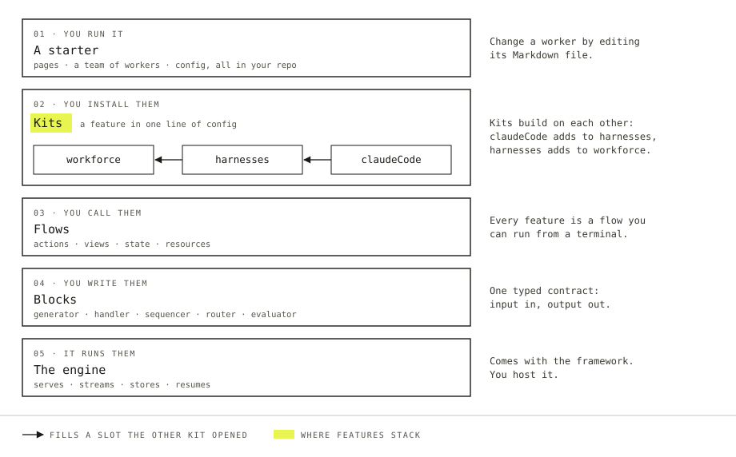

# What Flow State is

Most agent frameworks hand you parts. Flow State hands you an app.

Run a starter and you have a team of AI workers, a page to talk to them on, and a backend that streams their answers, remembers what they learned, and picks up where it stopped after a crash. The code is in your repo. The data is in your database.

Then you change it. A worker is a Markdown file, so you rewrite its brief. A feature is a kit, so you add a line. When you want something nobody has built yet, you write it with the same typed pieces the kits are made of.



*What an app is made of. You start at the top and go down only as far as you need. Description for the site's `Figure`: Five layers, top to bottom. A starter: pages, a team of workers and config, all in your repo; you change a worker by editing its Markdown file. Kits: a feature in one line of config; the claude-code kit fills a slot the harnesses kit opened, and harnesses fills one that workforce opened. Flows: actions, views, state and resources; every feature is a flow you can run from a terminal. Blocks: generator, handler, sequencer, router and evaluator, with one typed contract. Under all of them, the engine serves, streams, stores and resumes.*

## A starter is a whole app

A starter comes with React pages, a team of workers, and the flows they run on. Teammates is one: a small team you talk to one at a time, whose members message each other where you can see it and hand code changes to a coding agent.

Each worker on that team is a file like this:

```md
---
name: researcher
description: Finds facts for the team and says where each one came from.
tools: [search, fetch]
---

You find facts: dates, prices, what a document or the code says. Look them up,
never guess. Say where each fact came from.
```

Rewrite the brief, restart the app, and the researcher follows the new one. Add a folder with a second file and the team has a new member.

## A kit is a feature you install

The team, the task board it shares and the coding agents it hands work to are not written into the starter. They are kits, and the starter lists them:

```ts
export default createFlowState({
  kits: [
    workforce({ directory: "./workforce" }),
    harnesses({ workspace }),
    claudeCode(),
  ],
});
```

A kit brings its flows, the files it reads from your repo, and the views your pages read from it. A kit can also leave openings, called slots, for other kits to fill. `harnesses` opens a slot for coding agents and `claudeCode` fills it. Neither kit imports the other.

A kit that fills a slot can open slots of its own, so features stack. An app one person built becomes the base somebody else builds on.

## Kits are made of flows and blocks

Under every kit are flows. A flow is a set of actions served over HTTP, with typed state and a stream of results. Flows are built from blocks, and there are five kinds:

| Block | What it does |
| --- | --- |
| Generator | Calls a model |
| Handler | Runs your code |
| Sequencer | Chains blocks into steps |
| Router | Picks one block to run |
| Evaluator | Asks a model a typed question |

Any block composes with any other. A block can also be given to a model as a tool, whatever is inside it:

```ts
const research = sequencer({ name: "research" })
  .step(planQueries)   // a generator: the model writes search queries
  .step(runSearches)   // a handler: your code calls the search API
  .step(summarize);    // a generator again

const assistant = generator({
  name: "assistant",
  model: "openai/gpt-6-luna",
  prompt: "You help the user research a topic.",
  tools: [research],   // the whole pipeline is one tool call
});
```

You decide, step by step, where the model chooses and where your code does.

## You build it with an agent

Every flow runs from a terminal, with no server and no browser:

```bash
pnpm fsdev run hello-chat chat -i '{"message": "Hello!"}'
```

The run prints what the flow produced, one JSON line per item. A coding agent can write a flow, run it, read what happened and fix it. Most people build on Flow State this way, and [Build with your coding agent](./build-with-your-coding-agent.md) sets it up.

## Where it stands

Flow State is open source, written in TypeScript, and runs as a web service you host. It is an early preview. The starters are research software, and each one's README lists what isn't wired yet.

## Next

- [Run a starter](./run-a-starter.md) takes about ten minutes and one API key.
- [How it fits together](./how-it-fits-together.md) goes through the layers above, one at a time.
- [Add to an existing app](./add-to-an-existing-app.md) is the way in when you already have a product and want flows inside it.
