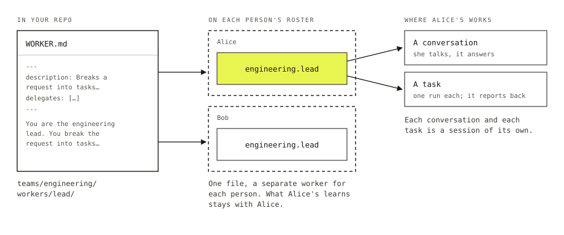

# Workers

A worker is an agent with a name and a job. You brief it in a Markdown file, the way you would brief a new colleague: what it's for, what it can use, who it can ask for help.

You can talk to a worker, or hand it a task and come back later. What it learns about you stays with you. The people you work with have rosters of their own.

## The file

```md
---
name: Engineering Lead
description: Breaks a request into tasks and reports what came back.
model: openai/gpt-6-luna
delegates: [engineering.coder, engineering.reviewer]
---

You are the engineering lead. You do not write code yourself. You break the
request into tasks, hand them to the coder and the reviewer, and report what
came back.
```

Save that as `workforce/teams/engineering/workers/lead/WORKER.md` and you have a worker called `engineering.lead`. The folders give it its id. The settings between the fences say what it is and what it can reach, and `description` is the only one a file must have. Everything below the fences is its instructions.

Someone who doesn't write TypeScript can add a worker, or change what one has been told, by editing a document.



*File, worker, session. Description for the site's `Figure`: On the left, a WORKER.md file in your repo, under teams/engineering/workers/lead. In the middle, two rosters, Alice's and Bob's, each holding its own engineering.lead made from that one file. On the right, where Alice's worker works: a conversation, where she talks and it answers, and a task, which it runs once and reports back on. Each conversation and each task is a session of its own.*

## Install the roster

Workers come with the Workforce kit. Point it at the folder:

```ts
export default createFlowState({
  kits: [workforce({ directory: "./workforce" })],
});
```

The folder is read when the app starts. A file the kit can't use stops the app from starting and names the file, so a typo in a worker doesn't turn into a worker that quietly never answers.

## Talk to one

A conversation with a worker is a session that names it:

```ts
import { createClient } from "@flow-state-dev/client";
import { createWorkforceClient } from "@flow-state-dev/workforce/browser";

const fsd = createClient({ userId, baseUrl });
const workforce = createWorkforceClient(fsd);

const session = await workforce.ensureWorkerSession({ worker: "engineering.lead" });

await fsd
  .flow(session.flowKind)
  .send("respond", { message: "Add rate limiting to the API." }, { sessionId: session.id });
```

`ensureWorkerSession` returns this user's conversation with that worker and creates it the first time. The worker sees the recent turns of that conversation. Nothing said there reaches any other conversation.

## Hand one a task

A worker with `delegates` can hand work to the workers it names. The lead above doesn't write code. It files a task for `engineering.coder`, and the coder runs that task in a session of its own: the task's goal is the message, and the coder's answer is the task's result. The lead hears when it's done and carries on.

The tasks sit on a [board](./tasks-and-boards.md) that belongs to the conversation, so your page can show what is waiting, running and done.

A worker can only hand work to its own delegates. A task filed for anyone else is refused, and the refusal names the worker.

When you want one front door for a whole team, make it a [coordinator](../catalog/workforce/coordinators.md): a worker whose job is to pick the right delegate for each message.

## Whose worker it is

The files in your repo define the **standard** workers. Every user gets each of them, and each user's copy is theirs alone. Alice's lead answers to Alice. Bob can't open her conversations, name her lead as a delegate, or read what it remembers about her.

Nobody can edit a standard worker from inside the app. A user who wants a different one **forks** it, and gets a worker of their own that starts from the same settings. A user can also hire a worker from scratch while the app runs. Those workers are rows in that user's data. No file changes and nothing restarts.

## What runs a worker

Every worker runs on a flow. Leave `flow:` out of the file and it runs on the built-in agent: a model, the worker's instructions, its tools, and the conversation so far.

When a worker needs to be more than a model with a brief, write a flow and name it:

```md
---
description: Sends an incoming request to an answer or to a person.
flow: request-triage
---

Answer directly when the request is about a feature that already shipped.
```

The file stays a document somebody can edit. What changes is the machinery underneath, which can have deterministic steps, a router, or a review before anything is sent.

## What a worker won't do

- Act for anyone but its owner.
- Carry a message between two users. Workers message other workers on the same roster.
- Change because you edited the file while the app is running. Standard workers are read at start-up.

## Next

- [Run a starter](../start/run-a-starter.md) gives you a team of workers to talk to in about ten minutes.
- [Workforce](../catalog/workforce/overview.md) covers what the kit installs and every way to extend it.
- [Tasks and boards](./tasks-and-boards.md) is the list a worker's tasks live on.
- [WORKER.md reference](../reference/worker-md.md) lists every setting.
