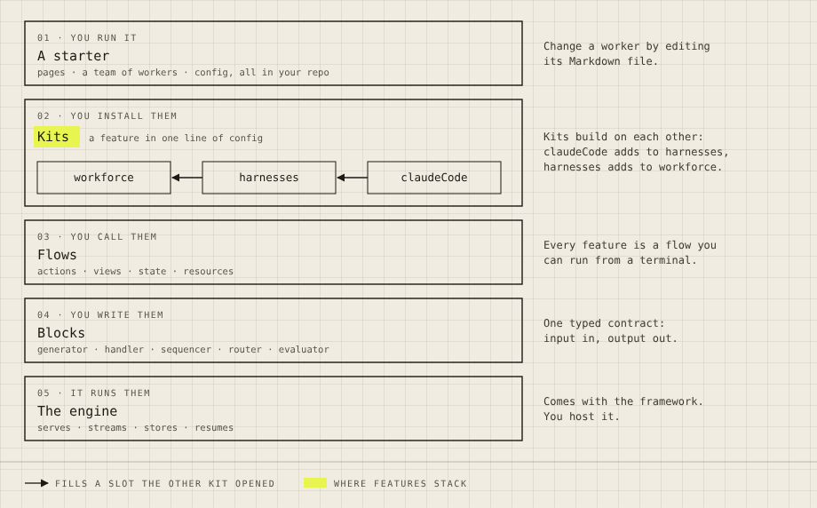
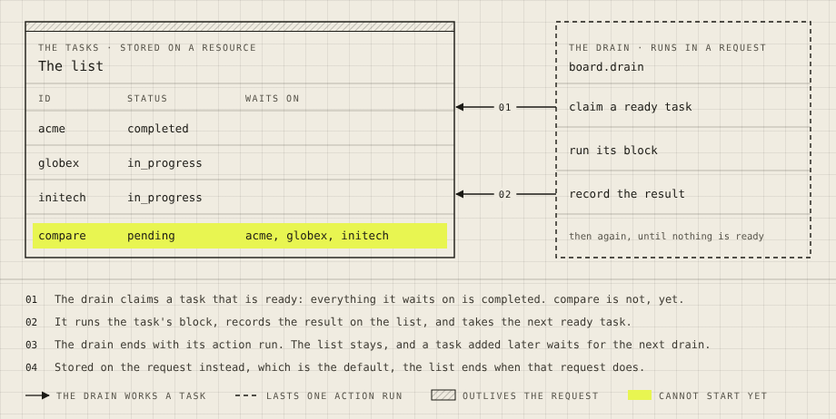
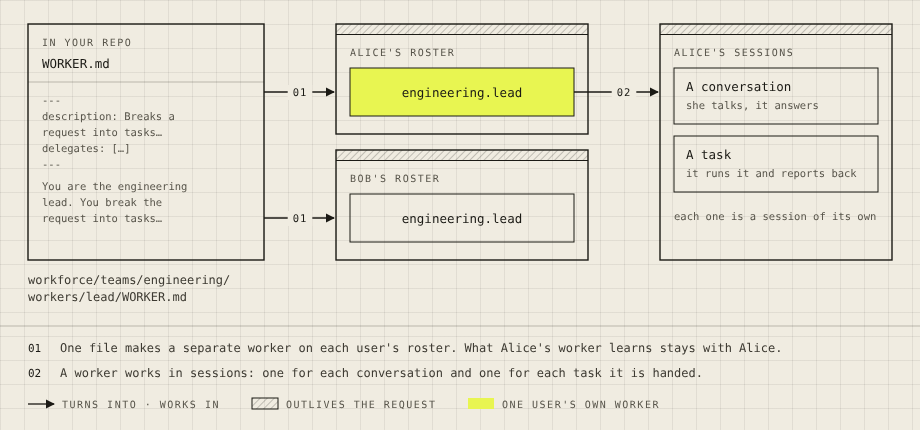

# Figures for the user docs

One visual language for every figure in the user docs. A reader who has learned a mark on one page
can read it on every other page, because each mark means one thing site-wide.

This file is the home of the figure rules, beside the page standard. [`user-docs.md`](./user-docs.md#figures)
says when a page needs a figure; this file says how to draw, check and embed one. [The lint
rules](#lint-rules) say what the figure check enforces.

| Here | What it is |
| --- | --- |
| [What the marks mean](#what-the-marks-mean) | The patterns, and the one meaning each has |
| [The key](#the-key) | Required on every figure |
| [Anatomy and canvas](#anatomy-and-canvas) | Sizes, columns, text |
| [Light and dark](#light-and-dark) | Where a figure's colours come from |
| [The figure brief](#the-figure-brief) | What to write before drawing |
| [Render it and look at it](#render-it-and-look-at-it) | `render.sh`, and what to check |
| [On the page](#on-the-page) | The `Figure` component |
| [Lint rules](#lint-rules) | What the figure lint checks |
| [Exemplars](#exemplars) | The three pilot figures, redrawn |

## Where the style comes from

Nothing here is new. The marks are the site's drawing classes, defined once in
[`labs/design-system/page.css`](../../labs/design-system/page.css) under `.drawing` and
published as `@flow-state-dev/design-system/page.css`. The site inlines each SVG through
[`apps/docs/src/components/Figure`](../../apps/docs/src/components/Figure/index.tsx), so the
drawing takes the page's fonts and colour tokens. `apps/docs/scripts/lint-brand.mjs` already
fails a published figure that writes a colour value into the file, carries a `<style>` block
or uses an unknown class. A figure held to this standard carries the light value of each
colour, line and type property as a fallback, which the lint checks against `page.css` (see
[Light and dark](#light-and-dark)).

The meanings come from the thirteen figures published today. All thirteen key their hatching as
`OUTLIVES THE REQUEST`. Compare a new figure against two of them:
`apps/docs/docs/fundamentals/state-scopes.svg` and `flow-type-instance-session.svg`.

## What the marks mean

| Mark | How it is drawn | Means, on every page | Key label |
| --- | --- | --- | --- |
| **Hatching** | A 10-unit band, `fill="url(#hatch)"`, across the top of a box | The thing is stored and outlives the request | `OUTLIVES THE REQUEST`, always these words |
| **Dashed outline** | `class="dash"` on a box or a lifeline | The thing lasts one action run and is gone | `LASTS ONE ACTION RUN`, always these words |
| **Highlighter** | One `class="hl"` fill, with `on-hl` on the text over it | The one idea a reader should leave with | The idea, in the figure's words: `CANNOT START YET` |
| **Arrow** | `class="ln"` with `marker-end="url(#ah)"` | One relation, read from the thing that acts to the thing acted on | The verb: `FILLS A SLOT`, `READS` |
| **Dashed arrow** | `class="ln-dash"` with the arrowhead | The relation holds only under a condition | Starts with `ONLY`: `ONLY WHEN EXPOSED` |
| **Red** | `x` beside `ln`, `t` or `plate`, ending in a bar and no arrowhead | An exception: refused, cannot read, failed | The exception: `REFUSED` |
| **Layer boxes** | Full-width `solid` boxes stacked 16 apart, labelled `01 ·`, `02 ·` from the top | Each layer is built from the one below it | None: the numbers carry it |
| **A box in a box** | A `thin` box inside a `solid` one | A part inside a thing | None |
| **Boxes side by side** | `solid` boxes in columns | Separate things; none sits inside another | None |

Three rules follow.

- **A mark asserts; its absence asserts nothing.** A `solid` box says "this exists" and makes no
  claim about how long it lasts. When the figure is about lifetimes, give every box its lifetime
  mark.
- **Never borrow a mark.** Dashed does not mean optional, planned, or "someone else's". Hatching
  does not mean a container, a file, or "final". If no mark fits, use words.
- **One highlighter per figure,** and it can be a small part: one row, one name.

A box cannot be both hatched and dashed. An arrow that means two relations is two arrows, each
numbered with a plate, or a key label that names both: `TURNS INTO · WORKS IN`.

## The key

Every figure ends with a key: one row at the bottom that shows each mark the figure uses and says
what it means here. It is a `<g id="key">`, the last element in the file.

```svg
<g id="key">
<line class="ln" x1="28" y1="436" x2="54" y2="436" marker-end="url(#ah)"/>
<text class="lb" x="62" y="440">THE DRAIN WORKS A TASK</text>
<line class="dash" x1="259" y1="436" x2="285" y2="436"/>
<text class="lb" x="293" y="440">LASTS ONE ACTION RUN</text>
<rect fill="url(#hatch)" x="475" y="430" width="26" height="11"/><rect class="thin" x="475" y="430" width="26" height="11"/>
<text class="lb" x="509" y="440">OUTLIVES THE REQUEST</text>
<rect class="hl" x="691" y="430" width="26" height="11"/>
<text class="lb" x="725" y="440">CANNOT START YET</text>
</g>
```

- An entry is a sample, 26 wide, then an `lb` label in capitals 8 units to its right. Leave 32
  between entries.
- The key lists every arrow, hatching, dashed outline, highlighter and red mark the figure uses,
  and nothing it does not use.
- Order: arrows, dashed, hatching, highlighter, red.
- Boxes, rules and text need no entry.

## Anatomy and canvas

A figure has up to three bands, top to bottom:

1. **The drawing.** Boxes, arrows and short labels.
2. **Notes**, optional. A full-width `hi` rule, then numbered sentences (`n` for the number, `t`
   for the text), 25 apart. A note explains a numbered plate on an arrow, or states the one thing
   the drawing cannot show. Four at most.
3. **The key.** 27 below the last note, or below a `hi` rule when there are no notes.

| | Value |
| --- | --- |
| Canvas | `viewBox="0 0 920 H"`. Grow down, never wider |
| Height | 300 to 600 is usual. Past 720, split the figure in two |
| Margins | 28 left and right, 24 top, 22 under the key's baseline |
| Columns | One of 864. Two of 420, gap 24. Three of 272, gap 24. Four of 204, gap 16 |
| Layer stack | Boxes 560 wide at x=28; a sentence beside each at x=612 |
| Inside a box | Text starts 14 in. The first label sits 22 below the top edge, or 32 below a hatched one |
| Arrow gap | 36 or more between boxes; 110 when the arrow carries a plate |

**Text** is monospace, never wraps, and never rotates. Break lines yourself, 16 or 17 apart.

| Class | Use | Size | Units per character |
| --- | --- | --- | --- |
| `lb` | What kind of thing this is, in capitals | 10 | 7.5 |
| `nm` | A thing's name | 15 | 9 |
| `sub` | A quiet second line | 10.5 | 6.3 |
| `c` | Code, ids, values | 12.5 | 7.5 |
| `t` | A sentence, set outside the boxes or in a note | 12 | 7.2 |
| `n` | A note's number | 11 | 6.6 |
| `plate` | A number or word set on an arrow, over a `ground` rect | 10.5 | 7.3 |

A line of text starts and ends at least 12 units inside its box, and runs no further than the
margins, from x=28 to x=892.

**Lines.** `solid` outlines a thing. `thin` outlines a part, and closes a hatched band. `hi` is a
rule between rows. `ln` is an arrow. Arrows run horizontally or vertically, start and end on a box
edge, and pass through gaps, never over text. A plate is a `ground` rect 15 tall with the `plate`
text centred on it; `01` takes a rect 24.6 wide.

**Words.** Labels are fragments a reader could say aloud. The page's example appears by name
(`acme`, `engineering.lead`). No option names unless the page teaches them. No sentence addressed
to the writer or the reviewer: anything in the drawing is for the reader.

**The two definitions** every figure starts with, unchanged (the `stroke=`, `stroke-width=` and
`fill=` are their light fallbacks, see [Light and dark](#light-and-dark)):

```svg
<defs>
<pattern id="hatch" width="5" height="5" patternUnits="userSpaceOnUse" patternTransform="rotate(45)"><line class="hatch-line" stroke="rgba(27, 26, 21, 0.45)" stroke-width="1" x1="0" y1="0" x2="0" y2="5"/></pattern>
<marker id="ah" viewBox="0 0 10 10" refX="9" refY="5" markerWidth="7" markerHeight="7" orient="auto-start-reverse"><path class="ink" fill="#1b1a15" d="M0,0 L10,5 L0,10 z"/></marker>
</defs>
```

## Light and dark

A figure's colours, lines and type come from the page tokens. `page.css` gives every class its
Paper value and its Night value from the same tokens the page uses, so one file draws correctly in
both. The file also carries the light (Paper) value of each as a fallback: every element carries,
as attributes with exactly the value `page.css`'s light theme gives its classes, its `fill`,
`stroke`, `stroke-width`, `stroke-dasharray`, `font-family`, `font-size`, `font-weight` and
`letter-spacing`, the hatch line and the arrowhead included, and nothing carries one its classes
do not set. SVG has no attribute for `text-transform`, so where a class uppercases its text the
text is written in capitals. On the site the class rules override these attributes, in Paper and
in Night; opened on its own or on GitHub, the file draws as the site's Paper does, dashes and
type included. The font stack, `'IBM Plex Mono', ui-monospace, monospace`, ends in the generic
`monospace`, so where the webfont is missing the text keeps the advance width the text-fit rule
assumes. The lint reads the values from `page.css`, resolving its cascade, and checks the two
match. There is still no `<style>` block in the file.

The palette is the page's own: paper for the ground, the inks for lines and text, the
yellow highlighter (`hl`) for the one thing to look at, and red (`x`, `x-fill`) for a failure or
a struck-out step. Colour marks emphasis, never category: two kinds of thing are told apart by
line, hatch and label, not by giving each its own colour.

- Text over the highlighter takes `on-hl`. The highlighter is the same yellow in both modes, and
  without `on-hl` the text turns pale on it at night.
- The only fills are `hl`, `ground` under a plate, `ink` on an arrowhead or a dot, `x-fill` on a
  failure mark, and the hatch.
  Do not cover a line with a filled shape.
- Opened on its own or on GitHub, a figure draws in its Paper fallbacks, in whatever monospace
  the viewer has. To see it as the site draws it, in both modes, render it.

## The figure brief

Write this before drawing, and keep it in the page's record. The page plan in
[`SITEMAP/`](../../specs/epics/FIX-2696/SITEMAP/README.md) has one for every planned figure.

| Line | Example, for the board figure |
| --- | --- |
| **The one idea** | A board is a stored list and a loop that works through it |
| **What it adds over the prose** | Shows the two side by side with different lifetimes: what is left when the request ends |
| **The parts, named from the page's example** | The list with `acme`, `globex`, `initech`, `compare`; the drain's three steps |
| **Marks** | Hatching on the list; dashed outline on the drain; arrows for claim and record; highlighter on `compare` |
| **Layout** | Two columns with an arrow gap; notes; key |

If the idea needs two sentences, it is two figures.

## Render it and look at it

```bash
docs/contributing/docs-revamp/figures/render.sh docs/contributing/docs-revamp/pilot/figures/board.svg
```

[`render.sh`](./docs-revamp/figures/render.sh) inlines the file into a page that loads `page.css`, as the site does,
and writes `rendered/<name>.light.png` and `rendered/<name>.dark.png` beside it with headless Chromium. Pass
a second argument to write somewhere else.

Open both images and check, in each:

1. No text crosses a box edge or the right margin.
2. No arrow crosses a label, and each arrowhead touches the box it points at.
3. Exactly one thing is highlighted, and its text is readable in both modes.
4. Every mark in the drawing is in the key, with the right words.
5. Set it beside the two published figures. Same marks, same line weights, same type sizes.
6. Read the figure without the page. The one idea should be recoverable from it.

Then run the site's brand lint on the file, which checks [the lint rules](#lint-rules). It runs
from `apps/docs` and takes file paths:

```bash
pnpm --filter @flow-state-dev/docs exec node scripts/lint-brand.mjs "$PWD/docs/contributing/docs-revamp/pilot/figures/board.svg"
```

## On the page

A figure goes on the page through the site's `Figure` component, as on every published page:

```mdx
import Figure from "@site/src/components/Figure";
import Board from "./figures/board.svg";

<Figure svg={Board} caption="A board is a list and a loop" description={"On the left, the list of tasks …"} />
```

- **`caption`** is the figure's title: a short noun phrase or statement, no full stop, 60
  characters or fewer. The component numbers it.
- **`description`** says in full what the drawing shows, for a reader who cannot see it. It
  names every part and every mark's meaning, and the one idea.
- Nothing else. No italic line under the figure, and no note about how the figure will be
  embedded. A sentence the reader needs beside the figure is ordinary prose.
- The imports go under the frontmatter. `scripts/check-docs-page.mjs` leaves imports and
  `<Figure … />` lines out of the word count.

The pages sit outside the site until cutover, so GitHub shows the component as text. The rendered
images under [`docs-revamp/figures/rendered/`](./docs-revamp/figures/rendered) are what a reviewer looks at.

## Lint rules

`apps/docs/scripts/lint-brand.mjs` checks all sixteen, and CI runs it as `lint:brand`. Rules 1
to 5 hold every diagram, the site's published ones included. Rules 6 to 15 hold every figure
under `docs/contributing/docs-revamp/`, whatever folder it sits in, and the lint's figure
fixtures. Rule 16 holds the revamp's pages in `pages/` and `pilot/`, and any `.md` file named to
the lint. The site's published diagrams get rules 1 to 5 only, until they are redrawn. Before the real files, the lint runs its
fixtures. `apps/docs/scripts/brand-lint-fixtures/figures/` holds the clean figures and pages,
`good.*`, which must pass every rule. Each case in `brand-lint-fixtures/cases.mjs` breaks one
rule by editing a clean one in memory (`{ name, base, find, replace, rule, expect }`), named for
the rule's name in the lint's output (`key`, `key.two-keys`). `expect` is part of the message the
broken branch gives, so each branch of a rule has a case of its own. The lint fails if a case's
`find` is not in its base, if a case does not give a finding of its rule containing its `expect`,
if a rule is tripped by no fixture, or if a clean one (a case with `rule` and `expect` null, or a
`good.*` file) trips any.

**Banned constructs**

1. No `<style>`, `style=`, `<title>` or `<desc>`.
2. Colours come from the page tokens. A figure under `docs/contributing/docs-revamp/` carries the
   light value of each as a fallback: each element whose class sets a `fill` or `stroke` in
   `page.css`'s light theme carries `fill=` and `stroke=` with exactly that value, and no other
   element carries a colour, `fill="url(#hatch)"` aside. The lint reads the values from
   `page.css` and checks the two match. No other colour literal anywhere: hex, `rgb()`, `hsl()`
   or a colour name. The site's published diagrams, until they are redrawn, carry no colour
   literal at all, and their only `fill` attribute is `fill="url(#hatch)"`.
3. Every `class` is one `page.css` defines under `.drawing`.
4. Classes set line and type. A figure under `docs/contributing/docs-revamp/` carries their light
   values as fallbacks, as rule 2 does for colour: `stroke-width`, `stroke-dasharray`,
   `font-family`, `font-size`, `font-weight` and `letter-spacing`, each exactly as `page.css`'s
   light theme gives the element's classes, and none its classes do not set; text a class
   uppercases is written in capitals. The lint reports these as `fallback`. The site's published
   diagrams, until they are redrawn, carry no `stroke-width`, `stroke-dasharray` or `font-family`
   attribute.
5. No `<image>`, `<foreignObject>`, `<a>`, `<script>`, `<tspan>`, gradient, filter, `opacity`,
   `textLength`, `<!DOCTYPE>` or `<!ENTITY>`. A figure is drawn in canvas coordinates and takes no
   transforms: no `transform` on any element, no `<svg>` inside the root, and text is placed by one `x` and one `y`, with no
   `dx`, `dy` or `rotate`. A figure is drawn with `<svg>` (the root only), `<defs>`, `<pattern>`
   and `<marker>` (inside the `<defs>` only), `<g>`, `<rect>`, `<line>`, `<path>` and `<text>`, and
   no other element: no `<use>`, `<symbol>`, `<switch>`, `<clipPath>` or `<mask>`. No element has an
   `href` or `xlink:href`, and only the root and the `ah` marker have a `viewBox` or
   `preserveAspectRatio`. Each element carries only the attributes the standard's figures draw
   with, besides the fallbacks of rules 2 and 4: `svg` `xmlns viewBox`; `pattern` `id width
   height patternUnits patternTransform`; `marker` `id viewBox refX refY markerWidth markerHeight
   orient`; `g` `id text-anchor`; `rect` `class x y width height`; `line` `class x1 y1 x2 y2
   marker-start marker-end`; `path` `class d marker-start marker-end`; `text` `class x y
   text-anchor`. Any other (`writing-mode`, `dominant-baseline`, `word-spacing`…) is an `attr`
   finding. The site's published diagrams, until they are redrawn, are held only to no
   `transform` on text or on a group around it.
6. `<defs>` holds exactly the `hatch` pattern and the `ah` marker, as printed above.

**Canvas and text**

7. The root is `viewBox="0 0 920 H"` with whole-number `H`, and has no `width` or `height`. Every
   `rect`, `line` and `path` outside the `<defs>` stays on the canvas, 0 to 920 across and 0 to `H`
   down (the canvas edge, not the 28 margin: a full-width rule runs edge to edge). A `path` is
   read from its `M`, `L`, `H`, `V` and `Z` commands, absolute or relative; any other command is a
   finding.
8. Every `<text>` has exactly one of `lb`, `nm`, `sub`, `c`, `t`, `n`, `plate`, with `on-hl` or
   `x` as the only additions. `lb` and `plate` text is capitals.
9. Text fits. Width is characters times the class's units per character, and its `text-anchor`
   (its own or a group's, `start` by default) places it. The line starts at or after x=28, ends at
   or before x=892, and keeps 12 or more inside both edges of its box: the smallest box that holds
   where it starts, or else the smallest its span overlaps.
10. An `ln` or `ln-dash` runs only horizontally or vertically: a `<line>` with one coordinate
    fixed, or a `<path>` of `M`, `H` and `V`. A `marker-start` or `marker-end` is `url(#id)` naming a
    `<marker>` the figure defines; a misspelt one draws the line with no head.

**The key**

11. Exactly one `<g id="key">`, and it is the last element. Each entry is one sample followed by
    one `lb` label.
12. Each mark used outside the key has an entry, and each entry's mark is used outside the key:

    | Used outside the key | Sample in the key | Label |
    | --- | --- | --- |
    | `fill="url(#hatch)"` | A hatched rect | Exactly `OUTLIVES THE REQUEST` |
    | `class="dash"` | A `dash` line | Exactly `LASTS ONE ACTION RUN` |
    | `class="hl"` | An `hl` rect | Any; five words or fewer |
    | `ln` with a marker | An `ln` line with the marker | Any |
    | `ln-dash` | An `ln-dash` line | Starts with `ONLY` |
    | `x` | An `ln x` line | Any |

**Pattern meanings**

13. Hatching is a band and nothing else: a rect 10 tall that shares its `x`, `y` and `width`
    with a `solid` or `thin` rect. Never a whole-shape fill, and never on a `dash` rect.
14. At most one `hl` shape outside the key. `on-hl` appears only on text inside it: the whole line, measured as in rule 9, not only its anchor.
15. One numbering. Plates numbered `01`, `02` on arrows each have a note with the same `n`, and
    notes count up from `01` without a gap. Numbers are not used for anything else, except the
    `01 ·` prefix on layer labels, which a figure with numbered notes does not use.
16. On the page: every figure is a `<Figure svg caption description />`. The caption is 60
    characters or fewer with no closing full stop, the description is 30 words or more, and no
    line contains "Description for the site's". No figure is drawn inline as an `<svg>` on the page.

Not lintable, so the cold read and the reviewer check it: that hatching and dashes are used
where their meaning is true, and that the highlighted thing is the page's one idea.

## Exemplars

The three pilot figures, redrawn to these rules. Each passes the brand lint with no findings
and was rendered and read in both modes. `docs-revamp/pages/figures/blocks.svg` has not been redrawn
yet; it is redrawn with its page, and until then the lint skips it and `pages/blocks.md`.

### Layer boxes: `docs-revamp/pilot/figures/layers.svg`

<picture>
  <source media="(prefers-color-scheme: dark)" srcset="docs-revamp/figures/rendered/layers.dark.png">
  
</picture>

Five layers, numbered from the top, with the verb for each in its label. The arrows have one
meaning, and the key says it. Nothing is hatched or dashed, because the figure makes no claim
about lifetimes. There are no notes, since the sentence beside each layer does that job.

### Hatching and dashes: `docs-revamp/pilot/figures/board.svg`

<picture>
  <source media="(prefers-color-scheme: dark)" srcset="docs-revamp/figures/rendered/board.dark.png">
  
</picture>

The list is hatched and the drain is dashed, so the figure shows what is left when the request
ends. The two arrows carry plates, and notes 01 and 02 explain them. Note 04 states the default
the drawing does not show.

### Columns and copies: `docs-revamp/pilot/figures/worker.svg`

<picture>
  <source media="(prefers-color-scheme: dark)" srcset="docs-revamp/figures/rendered/worker.dark.png">
  
</picture>

Three columns of separate things. The file is `solid` and unhatched: it is code in the repo, and
the hatching is kept for what the app stores. The highlighter marks one user's copy, which is
the idea the page turns on.
