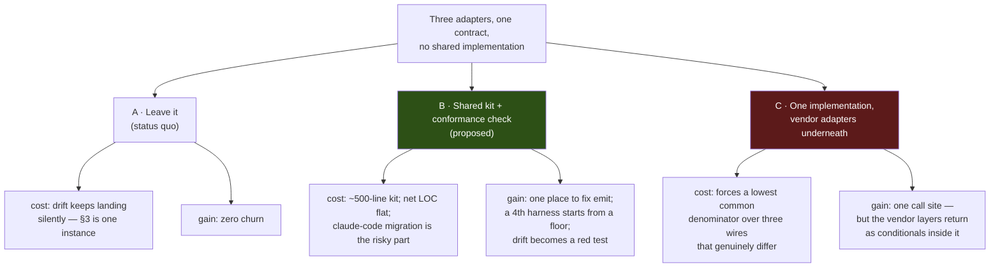

# Design — One floor under three harnesses, proved in Kitchen Sink

**Date:** 2026-10-26
**Status:** PROPOSED. Phase 0 is **built and green on this branch** (see §6); phases 1–3 are not.

> The question this answers: *should we refactor so we don't have three
> implementations?* The short answer is **no — not three into one.** Most of
> what looks duplicated is irreducible vendor difference, and collapsing it
> would invent a false equivalence. What is missing is a **floor**: a small
> shared kit and, more importantly, a check that holds the three to one
> contract. Kitchen Sink is where that check belongs, because it is the only
> place that runs all three over the same flow.

---

## 1. What is actually there

| Package | src lines | src *code* lines | test lines | docs page |
|---|---|---|---|---|
| `claude-code` (sdk + cli) | 6,221 | 3,142 | 8,563 | 865 |
| `codex` | 2,199 | 1,267 | 2,090 | 308 |
| `cursor` | 2,719 | 1,495 | 2,751 | 386 |

Half the file volume is doc prose. The two younger adapters are **~2,760 lines
of real code combined** — unification is not where meaningful volume lives.

Above them, the architecture is already right: `packages/core/src/types/harness.ts`
owns the neutral contract, and `harness-manager` drives all three through it
with **zero dependency on any harness package**. Kitchen Sink has converged too
— `HarnessModePage id="claude-code" | "codex" | "cursor"` is one component, and
`lib/harness-session-flow.ts` is one flow. The three mode files differ only in
vendor config and host checks.

**The app layer already proved the shape. The package layer below the contract
has no shared floor at all.**

---

## 2. Duplication, broken down

| Layer | codex ↔ cursor overlap | Shareable? |
|---|---|---|
| `translate.ts` | 415 of 547 lines differ | **No** — vendor wire formats |
| `cost.ts` | arithmetic differs materially | **No** — codex `inputTokens` *includes* cached, cursor's excludes |
| `agent.ts` bodies | different lifecycles (thread/stream vs agent/send/wait) | **Spine only** |
| `emit.ts` protocol (`buildBase`, provenance, added/done sequences, tool open+settle, error item, finalize) | near-identical | **Yes** |
| `errors.ts` (SdkNotInstalled / VersionMismatch / ConfigError / RunError / Aborted) | identical structure, vendor strings only | **Yes** |
| `capability.ts` | ~30 code lines, identical but for names | **Yes** |
| Spine guards: `assertNoOwnedKeys`, `abortRace`, `assertTestedSdkVersion`, prompt/abort preflight, handle assembly | same shape | **Yes** |

### The decision, and what it costs either way

**C is the trap.** `cost.ts` is the proof: the two estimators differ because
Codex's `input_tokens` includes cached tokens and Cursor's does not. A unified
cost function would have to carry that as a flag, which is the vendor layer
back again — but now in shared code, where getting it wrong is wrong
everywhere.

---

## 3. The evidence that the status quo costs something

### 3.1 A fix landed in one copy only (measured, then fixed — §6)

`cursor/src/emit.ts` settles a tool item with the index its `item.added`
carried. `claude-code` and `codex` re-read `ctx.response.getItemCount()` on the
settle — which, because the count does not grow when an existing item is
closed, returns the index the *next* item is about to take. Two items end up
sharing one index.

Measured over `message → tool_call → tool_result → message`:

| Emitter | item indices | collides |
|---|---|---|
| claude-code | `message#0, tool_output#2, message#2` | **yes** |
| codex | `message#0, tool_output#2, message#2` | **yes** |
| cursor | `message#0, tool_output#1, message#2` | no |

`itemIndex` orders a request's items, and core's replay picks among same-id
traces by the highest one (`core/src/blocks/internal/replay-log.ts`). Two items
sharing an index make that order a guess.

Cursor's code carries a comment explaining exactly this. The fix never reached
its two siblings, because nothing connects them.

### 3.2 Feature coverage has diverged

| Capability | claude-code | codex | cursor |
|---|---|---|---|
| Usage reader (`readXUsage`) | ✅ | ✅ | ❌ |
| Env fencing | `harnessEnv` | `harnessEnv` | own `child-runtime.ts` |
| Cost | SDK-reported | estimated | estimated |
| Vendor-only extras | MCP relay, workspace, work recorder | — | plan recording |

Even the **scripted** harnesses in Kitchen Sink have drifted: `[new]` exists for
claude-code and codex but not cursor; `[slow-start]` for claude-code and codex
but not cursor; `[errored]` for claude-code and cursor but not codex.

### 3.3 Features get built three times

Since September, stripping release and repo-wide mechanical commits:

- `FIX-1952` — model-per-harness, landed across all 3
- `3841e8d2e` — *"characterize item task scope in all three emitters"*, a test commit that exists **only** because there are three emitters
- `FIX-1716` — `harnessEnv({ pass })` allowlist, 2 of 3
- `FIX-2142` — usage left, 2 of 3

---

## 4. The plan

Each phase has a **Kitchen Sink–visible proof**, because Kitchen Sink is the
only place all three harnesses run the same flow. That is the point of putting
the check there rather than in a package: a rule stated once, held against
every harness, and extended by adding a row when a fourth arrives.

### Phase 0 — the parity check (**done, §6**)

`apps/kitchen-sink/test/harness-parity.test.ts`: one table over the three
modes, each driven through its real session flow with its scripted SDK behind
it. Four rules, asserted identically for all three.

> **Proof in Kitchen Sink:** 12 tests across `/claude-code`, `/codex`,
> `/cursor`. Reverting the codex fix turns exactly one of them red.

This is the highest-value piece and it required no shared code. If the roadmap
adds no fourth harness, **phase 0 alone is a defensible stopping point.**

### Phase 1 — `@flow-state-dev/harness-kit`, built from codex + cursor

The two genuinely sibling-shaped adapters. The kit holds:

- emit protocol: `buildBase`, `deriveProvenance`, `EmitState` core, tool
  open/settle, error item, `finalizeOpenItems` — the index rule lands once
- error-class factory parameterised by vendor name / package / strings
- `createHarnessAgentCapability` + `promotedResources`
- spine helpers: `assertNoOwnedKeys`, `abortRace`, preflight, handle assembly
- cost: the `findModelEntry`-then-estimate **guard** only; each vendor keeps
  its own token mapping

> **Proof in Kitchen Sink:** the parity suite stays green while codex and
> cursor lose ~400–500 code lines each, and `/codex` and `/cursor` render
> identically to before.

### Phase 2 — the kit exports the conformance suite

Phase 0's rules move into the kit as a suite each package runs over its own
emitter, so a harness is held to them *before* it reaches Kitchen Sink. The
Kitchen Sink table stays as the end-to-end half — it is the one that runs the
real flow, the worktree and the session.

Today's `harness-conformance.test-d.ts` files (36/40/52 lines) are type-level
only; core's own comment calls that *"the cheap half."*

> **Proof in Kitchen Sink:** add a fourth row to the parity table for a
> scripted-only harness and it passes with no new assertions written.

### Phase 3 — claude-code adopts, emit + errors only

It is the oldest and most divergent (`itemFields` vs `buildBase`, 3,142 code
lines, plus workspace / work-recorder / MCP relay that have no sibling).
Forcing it fully onto the kit is where the risk and cost concentrate, for the
least return.

> **Proof in Kitchen Sink:** `/claude-code` renders identically, and the
> `[bash]`, `[plan]` and subagent paths stay green.

### Sizing, honestly

~400–600 lines removed per clone, ~500-line kit added. **Net LOC is roughly
flat — do not justify this on LOC.** Justify it on: one place to fix emit bugs,
a check that proves the family, and a fourth harness starting from a floor
rather than a copy-paste. (`FIX-1905` BR-24 already names "the scripted coder"
alongside Cursor and Codex, so a fourth is in view.)

---

## 5. What this plan deliberately does *not* do

- **Not** one implementation with vendor adapters (§2, option C).
- **Not** a shared `translate.ts`. There is nothing in common to share.
- **Not** a unified cost function. The vendor usage semantics genuinely differ.
- **Not** a forced claude-code migration. Opportunistic, emit + errors only.
- **Not** a dedup of the three doc pages (865/308/386). They describe different
  products to different readers; the duplication there is mostly prose about
  genuinely different behaviour.

---

## 6. What is already built on this branch

| Change | File | Why |
|---|---|---|
| Phase 0 parity check | `apps/kitchen-sink/test/harness-parity.test.ts` (new) | 12 tests, 3 modes, 4 shared rules |
| Settled tool items keep their index | `packages/codex/src/emit.ts` | §3.1 |
| Same, incl. streamed message/reasoning and subagent containers | `packages/claude-code/src/sdk/emit.ts` | §3.1 |
| Harness sandboxing removed from Kitchen Sink | `apps/kitchen-sink/lib/harness-sandbox.ts` (deleted) + the three mode files | see below |

**Harness sandboxing is gone from Kitchen Sink** (owner's call, 2026-10-26).
It was ~45% of each mode file, it is a showcase app that should not carry that
much custom confinement code, and the design wants rethinking before it comes
back. Kitchen Sink now assumes a machine that allows any edits: no sandbox on
any of the three, `KITCHEN_SINK_HARNESS_UNSANDBOXED` deleted, 357 lines
removed against 122 added. The per-session git worktree stays — that is where
a session works, not a fence — as do the env allowlists and `settingSources: []`.

That is worth noting *here* because it changes §2's arithmetic: with preflight
no longer asking about sandboxes, the per-mode code the kit would absorb is
smaller than measured, though the shape is unchanged. Note also that
`@flow-state-dev/tools/bash`'s `Sandbox` was never a candidate for this job —
it is an execution seam for commands the framework dispatches, and a harness
runs its own tools inside its own loop, so there is no command to intercept.

Plus three test-portability defects found while verifying, all macOS-only
(this repo's CI is `ubuntu-latest`, so none of them fail there):

| Fix | File | Cause |
|---|---|---|
| Ignore OS-injected env vars | `packages/cursor/test/env-fence.spec.ts` | macOS adds `__CF_USER_TEXT_ENCODING` to every process linking CoreFoundation, which Node does |
| Same, in the allowlist spec | `packages/claude-code/test/sdk/harness-env.spec.ts` | as above |
| Resolve the scratch dir's physical path | `packages/claude-code/test/sdk/workspace.spec.ts` | `/tmp` → `/private/tmp`; the agent realpaths `cwd`, so `toBe(base)` compared two spellings of one directory |
| Explicit 60s budget | `apps/kitchen-sink/test/harness-session.test.ts` | the hostile-ids case creates 13 worktrees serially — measured 13.9s against vitest's default 5s |

### Verification

| Suite | Result |
|---|---|
| `packages/claude-code` | 362 passed (16 files) |
| `packages/codex` | 110 passed (9 files) |
| `packages/cursor` | 148 passed (11 files) |
| `apps/kitchen-sink` | 351 passed (39 files) |
| Red-state check | reverting the codex index fix fails exactly one parity test |

**Not run:** `apps/kitchen-sink/test/codex-real-cli.test.ts`, which binds a port
on `127.0.0.1` and starts the real `codex` program. The sandbox this was
verified in forbids `listen`. It needs a run on an ordinary host before this
branch is trusted.
