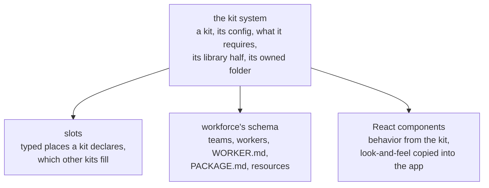
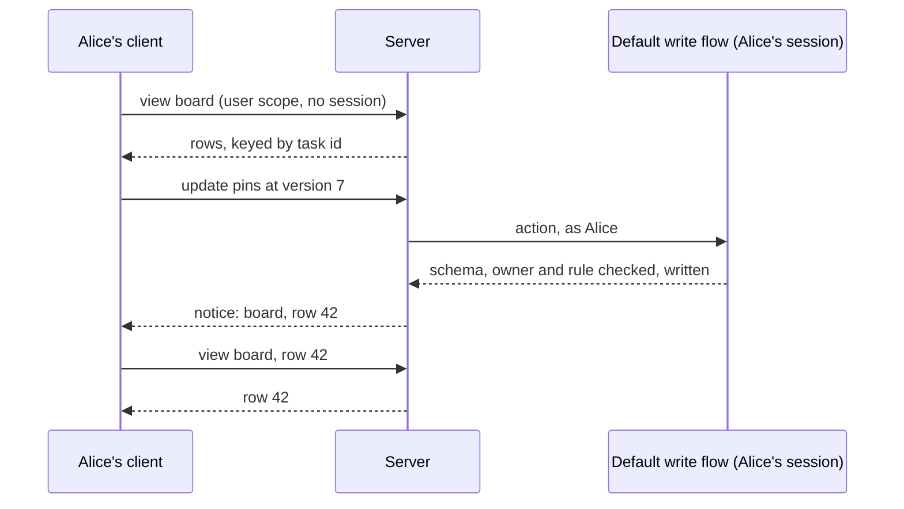

# Reading, Writing and Installing: How It Should Work

## Why this doc

An app on FSD (flow-state-dev) has several ways to read what the server knows, and none of them is the obvious one.
To show a user's pins, an app makes a session it doesn't need, runs a flow written only to answer
one question, and learns which topics to watch so the screen stays current. To use Workforce, it
wires flows to each other by hand and then writes a thousand lines to read them back.

This doc describes how an app should read, write, stay current and install a feature, built up
one part at a time, as if it had always worked this way. It is the model the
[FIX-2618](../../../specs/epics/FIX-2618/SPEC.md) epic builds; the epic's decisions are in its
[DECISIONS.md](../../../specs/epics/FIX-2618/DECISIONS.md). This doc decides none of them: its
Decisions section records what the owner decided, and names the questions still open, each with
a recommendation for whoever owns it. The last section lists where today's code differs.

## Base terms

**A user is always a person, signed in, inside one org.** The server works out who the user is
and which org they are in from the request's sign-in, which the host (the server program that
runs the app) verifies. A client never says who it is by putting a name in the request.

**Every piece of data has a scope: a session, a user or an org.** A session's data belongs to one
conversation or piece of work. A user's data belongs to one person and follows them across
sessions. An org's data is shared by everyone in the org.

**A session belongs to one user.** Nobody else can open it, read it or run anything in it.

**A resource is named data with a schema, stored at one scope.** A collection is a set of
resources of one shape, each under its own key.

**A flow is the server code that changes things.** It does so through actions, and every action
a client sends records a request: who sent it, when, and what happened. A flow is built from
**blocks**, the steps of server code it runs; a **capability** is a bundle of tools and context a
block can use.

**A client is the app's code acting as the signed-in user**, in a browser or anywhere else.

A few things the doc names in passing: **Workforce** is FSD's package for workers (agents a user
directs), organized into teams; **the labs** and **Shift Manager** are apps built on it, whose code
the "what this replaces" notes cite.

## The cast

One set of examples runs through the whole doc.

- **Alice and Bob**, two users in the same org.
- **pins (user resource):** the tasks a user pinned. Alice's pins and Bob's pins are two
  resources, one each.
- **launch (org resource):** one project in the org's projects collection. Everyone in the org can
  read it, and Alice and Bob both edit it through the default write flow.
- **board (view):** the tasks a user's workers are on, across all their sessions, with pinned tasks at the top. One row per task, keyed by the task's id.
- **workforce (kit):** the feature that gives an app workers, their tasks and the board.

## The parts, in the order you meet them

Each part uses only the ones above it. Two forward glances are named where they happen: a view
can be installed by a kit, and its keys pay off in notices.

1. **A view.** How a screen asks the server a question and gets the answer, computed fresh,
   stored nowhere.
2. **A direct read.** How a client reads a user or org resource by its scope and name, with no
   session.
3. **A write through the resource's flow.** How a client changes a user or org resource: always
   by sending an action to the flow the resource names.
4. **A notice.** How the server tells a screen that something it shows has changed, and which
   rows.
5. **A kit.** How an app installs a whole feature (its resources, views, flows and screens) with
   one config object.
6. **What the app writes itself.** What is left once the parts above are in place: the app's own
   screens, its own flows and its config.

## Views

**A view answers a screen's question.** "What are Alice's tasks, pinned ones first?" is a view.
The server runs it when a client asks, as that client's user, and sends back the answer. The
answer is stored nowhere: the view computes it fresh every time.

**A view never changes anything.** It can read resources and state, but any attempt to write,
start a run, or send work somewhere is refused. Anything that changes state is an action.

A view is built from four things:

| Part | What it says | For board (view) |
| -- | -- | -- |
| Scope | Where it runs: in a session, or at user or org scope with no session | User scope: Alice asks for her board without opening any session |
| Input | What the caller passes, checked against a schema | Nothing, or a filter such as "only open tasks" |
| Dependencies | Every state and resource the view's run read, recorded by the engine | The task records, and pins |
| Key | What names one row of its answer | A task's id |

**Dependencies are recorded, not declared** ([FIX-2623 D1](../../../specs/issues/FIX-2623/DECISIONS.md#d1)).
The engine records what each run of a view reads, child blocks included, and the answer names the
change topics those reads fall under, so a watcher hears a change to anything the view read. A
list written in advance would be a second copy that drifts; recorded per run, it is right on
whatever branch the run took. Once any flow declares a view, every resource write publishes a
notice, since a view may read any of them.

**A view calls no model** ([FIX-2623 D2](../../../specs/issues/FIX-2623/DECISIONS.md#d2)). It runs
for every watcher on every change; a model's answer is an action's to compute and store.

**A key names a row.** Because each row of board has a key, the server can later say "row 42
changed" instead of "something changed".

**Where it lives.** A view is defined once, in a flow's views or in a kit. It belongs to the flow
or kit that defines it. There is one definition, and one answer per call: Alice's board and
Bob's board are two calls to the same view, each computed as its caller and seen only by them.

**When to use it.** A screen that shows something the server computes, such as a join, a count,
a sort or a filter, uses a view. A screen that shows one resource as it is stored uses a direct
read (below).

**In code:** `defineView`, with `scope`, `block`, an optional `inputSchema` and `key`; on the
client (proposed), `useView(view, input)`, and the answer's type is `ViewOutput<typeof view>`.

### What this replaces

A flow's read is today's version of a view: a block a client runs to watch something the flow
computes, which stores nothing and refuses writes. A view keeps that rule and adds a scope, so a
user or org question needs no session, plus dependencies and keys. The read hook goes, with no
second name kept for it. A scope's `derived` entries compute a value from one scope's state
and resources into the session's snapshot (the session record a client loads). They fold into
views too: the screen asks for a view instead of reading the value off the snapshot, so one hook
computes every answer a screen sees.

What it costs, and how each cost is handled:

- **Recording runs on every view, and more writes publish.** Measured at under 1% of a read
  (FIX-2621); an extra notice is allowed, a missed one is the failure.
- **Every flow read is renamed.** The rename has no alias, so nothing old lingers beside it.

## Direct reads

**A client reads a user or org resource by naming its scope and its name.** Alice's client asks
for "user pins" and gets Alice's pins. It names no user: the server fills in the user from the
verified identity, so Alice can never ask for Bob's pins by writing his name.

**No session is involved.** Reading a user's own data doesn't need a conversation, so it doesn't
open one.

**What a client may read is the resource's own choice.** A resource says which of its parts a
client may read: its state (the structured fields), its content (the text it holds), or a
projection of either (a subset or a computed summary). A part it doesn't open stays on the
server, and a resource that opens nothing can't be read by a client at all.

| Resource | Who owns it | Who can read it | How many exist | Stored where |
| -- | -- | -- | -- | -- |
| pins (user resource) | Alice owns hers, Bob owns his | Only its owner | One per user | User scope, under the name "pins" |
| launch (org resource) | The org | Everyone in the org, as the resource allows | One per org | Org scope, under the name "launch" in its collection |

A session-scope resource is still read through its session, since it belongs to one
conversation.

**In code** (proposed): `fsd.resources.user("pins").state()`; in React, `useResource(pins)`.

### What this replaces

Today every resource route names a session, so an app that wants a user's pins first finds or
makes a session only to read through it. Four helpers in the labs and Shift Manager exist to do
exactly that. They all go.

## Writes through the resource's flow

**A client changes a user or org resource only by sending an action to the flow that runs it.**
The resource names that flow. A resource that names none can't be written from a client at all;
the server's own flows still write it from inside their actions, as any flow writes a resource.

There are two kinds of flow a resource can name:

- **The default write flow**, for plain data such as pins. It is part of the framework. It sets,
  changes and deletes fields, and it checks three things inside the flow: the resource's schema,
  that the caller owns a user resource (or, for an org resource, belongs to its org), and the resource's own write rule, if it has one (for
  pins: no task pinned twice). An org resource must have one: with none, the app refuses to start
  rather than let every member of the org write it (the owner, 2026-11-11; FIX-2624 D3). The rule
  can be "everyone".
- **The app's own flow**, where a write does real work, such as a dashboard that takes data in
  and builds the resource from it.

Either way the client does the same thing: it sends an action, and the flow does the write.

**A write never loses another write.** Each write carries the version of the resource the client
read. If another write landed first, the flow refuses this one and sends back the current state
and version. The client's helper then applies its change again on the current state and resends.
A pin toggles in one line, and two clients toggling different tasks at once both land. Two
writes to the same field land in order: the second change is applied on top of the first.

**Every write records a request.** Like any action, it is attributed to the user who sent it.
That costs a request record, a trace and an action's latency per pin click. It buys an audit
trail of who changed what, and the same checks and notices a richer flow gets.

**Its session is the server's to find or make.** The client never names one. There is one per
resource per writer, so Alice's pins writes and her launch edits go through two different
sessions. This is not a session made only to read: its requests are the resource's write
history, which is what a session is for.

| Resource | Sessions for its writes | Whose |
| -- | -- | -- |
| pins (user resource) | One: Alice's writes to her pins go through her own session of the default write flow | Alice's |
| launch (org resource) | One per writing user: Alice's edits go through her session for launch, Bob's through his | Each writer's own |

So an org resource's write history is spread across its writers' sessions, and its audit trail is
the union of their requests. Alice can't open Bob's session, because a session belongs to one
user. She sees his edit in the launch record itself, which they both read.

**When to use which.** Plain data takes the default write flow. A write that needs real logic,
other resources or a model takes the app's own flow. Nothing writes a user or org resource from
a client any other way.

**In code** (proposed): `runBy: "default"` or `runBy: { flow }` on the resource; on the client,
`fsd.resource(pins).update((s) => ({ pinned: toggle(s.pinned, id) }))`, `.set`, `.delete`, and
`.send(action, input)` for a flow's own actions.

### What this replaces

Today the labs write pins through a pins flow they wrote by hand, with one action to pin, one to
unpin and a read to list them, all on a session they make for it. That flow goes. A worker is
already a resource run by the flow it names; the resource's flow is that pattern for any
resource that needs one.

One direct client write path remains today: the content routes that create, update and delete a
collection's entries. They stay for session-scope collections. Their one user and org use, the
skills drawer, moves onto the default write flow in FIX-2633.

## Notices

**A notice tells a screen that something it shows changed.** The client then reads again, through
the same view or direct read it already uses.

**A notice may say which rows changed, never what changed.** It can carry the keys of the rows
that changed ("tasks 42 and 57"), so the client can re-read only those rows. It never carries a
row's data: every byte a client sees still comes through a checked read.

**Keys are hints.** A notice with no keys means "read everything". A client reads everything when
it connects, reconnects, or hears that notices may have been missed, on a polling timer, and
wherever notices don't cross between server processes. A notice about a whole scope, rather than
one resource or view, carries no keys.

**Who hears one.** A client says what it watches: a view, or one resource at a scope. The server
checks that the user may read it when the client connects. It re-checks every hour, not on every
notice, since a check per notice would be a store read per watcher. So a user whose access is
revoked can keep hearing which keys change for up to an hour, but can never read them. A scope
where even that timing is sensitive turns keys off.

**Where a notice comes from.** A change to a resource reaches only the users who can read it,
and from them, each view they watch that depends on it. When Alice's pins change, the server
tells Alice's watches of board, with the keys that changed. Bob's board depends on Bob's pins,
which didn't change, so Bob hears nothing. When launch changes, everyone in the org watching a
view that depends on launch hears it. A client watching one resource directly hears the keys of
that resource's entries that changed.

Notices are stored nowhere. A screen that is closed hears nothing, and when it opens it reads
everything once.

### What this replaces

Today a notice says that a topic changed, and never which rows. A client names topics itself (a
session, a user scope, an org scope, optionally one resource), so it has to know what each
screen depends on, and re-reads the whole answer on every notice.

## Kits

**A kit is a feature an app installs in one line.** Workforce is a kit: one config object in the
app's list of kits gives it workers, their tasks, the board and the screens that show them.

A kit is built in parts on one base, the kit system. Slots, workforce's schema and React
components each sit on that base, and none needs the others.

Workforce's schema, its slots and its screens all sit on the one kit system; look at how none of
them needs another to exist.

### The kit system

**A kit holds only pieces that already exist:** resources, views, flows, capabilities, blocks,
workers, a client half, config and slots. It adds no new kind of thing inside itself.

**A kit has two halves.**

| | Library half | Owned folder |
| -- | -- | -- |
| What | Resources, views, blocks, capabilities, the flows the kit runs as it ships them, and its client half: the typed calls and hooks a screen uses | Starter files the app's authors change: workers, teams, the flows they configure |
| Where | In the kit's package, imported | In a folder in the app that the kit owns, such as `workforce/` |
| Who changes it | The kit's authors, in a new version | The app, from the moment the files are scaffolded |
| How it updates | With the kit's version | Never on its own |

**The owned folder is optional.** A kit whose users write content, such as workforce, has one. A
kit that only wires up infrastructure has none.

**The kit scaffolds the folder once, and then the app owns it.** The kit's setup command writes
starter files into the folder, the way a UI registry copies a component into your app. From then
on the app edits them, and the kit only reads them. A scaffolded file never updates itself: when
a kit's format moves on, the kit reads the old shape too, or refuses it with a message that says
what to change.

**The kit reads its folder when the app starts, through one shared reader.** Every file in the
folder is either used or refused loudly, naming the file. A file is never skipped in silence,
because an author who followed the docs and got nothing and no error has no way to find out
why. So a file the kit doesn't know is refused. The one exception is a short shared list of
names that never mean anything, such as an operating system's folder metadata files, which every
reader passes over by name.

**One flow, one half.** A flow the app configures is scaffolded into the owned folder and never
also exported from the library half. Otherwise an app could end up running two copies of it.

**Installing.** The app lists its kits, each with one config object. A kit says which kits it
requires, and the framework installs them in that order. Each kit owns at most one folder; how the
folders of a kit and a kit it requires sit relative to each other is open (see Decisions).

| | Who owns it | Where it lives | How many |
| -- | -- | -- | -- |
| A kit's definition | The kit's authors | In its package | One per kit |
| A kit's config | The app | One object in the app's list of kits | One per installed kit |
| A kit's owned folder | The app, once scaffolded | A folder in the app's repository | At most one per kit |

**In code** (proposed): `defineKit({ name, requires, config, resources, views, directory, contributes, client })`,
where `directory` is the owned folder and `contributes` is what the kit puts into other kits'
slots, and `createFlowState({ kits: [workforce({ ... })] })`.

### Slots

**A slot is a typed place in a kit that other kits fill.** Workforce declares a slot for the
flows its workers can run on. A kit that adds a new kind of worker puts its flow into that slot,
and workforce picks it up at install.

- **Only the kit that owns the idea declares the slot.** Workforce declares its worker flows slot;
  nobody else can.
- **Each slot has a schema and a merge policy.** A keyed slot refuses two contributions under one
  key. A list slot adds each one to the end.
- **Contributions are resolved once, at install, in the order kits require each other.** The
  framework collects every contribution to a slot, checks each against the slot's schema, and
  hands the result to the kit that owns the slot.
- **A kit reaches another kit only through its slots.** It never changes another kit's pieces,
  and can't reach anything that kit doesn't publish. The app can turn off what a kit contributes.
- **Slots are few.** Each one is a public promise, hard to change once apps fill it.

A block has slots too: the places its author fills with tools, capabilities or context. A kit's
slot is the same idea one level up: filled by other kits instead of a block's author.

### Workforce's schema

Workforce is the first kit with an owned folder. On top of the shared reader it defines what may
sit in its folder: `teams/`, `workers/`, a `WORKER.md` per worker, a `PACKAGE.md` per package,
and `resources/`. The shared reader handles the walk, the names a folder may have, and the
wording of every refusal; workforce only decides what each file means.

The parts of workforce an app used to call directly to set it up become the inside of
workforce's install. No app calls them.

### React components

A kit's screens split by the same rule as its two halves.

- **Behavior and data contracts are library.** Components bound to the kit's views and actions
  ship in the kit's package behind a separate React entry point. They are never copied, so they
  never drift from the views they read. React is an optional dependency, used only behind that
  entry point, so a server-only app never loads it.
- **Look-and-feel the app will restyle is copied.** Styled, presentational pieces are published
  as registry items, and the kit's setup copies them into the app's components folder. The app
  owns them after that.

### Where each piece lives

No new package. Defining a kit and its slot types sits beside the other definers in `core`.
Installing and resolving kits is the engine's job. The shared folder reader sits on an
engine entry point that only runs under Node, so a browser bundle never pulls in the file
system.

### What this replaces

Today a host builds a workforce installation, passes it a callback that returns the flows map
before the map exists, spreads the flows together by hand and casts them, adds a flow for each
read, and then reads it all back through an adapter of 1,100 to 1,900 lines. A kit's install
does the wiring, its slots replace the callback, and its views and client half replace the
adapter.

What it costs, and how each cost is handled:

- **Slots are a new public contract,** permanent by design. They are built last, against two
  kits (workforce and the coding harness), so they meet a second consumer before they freeze.
- **The owned folder can drift from the kit.** That drift is the point: it is what the app
  changes. The kit reads old shapes or refuses them loudly.

## What the app writes itself

Once a feature installs as a kit and every screen reads through views and direct reads, an app
is configuration, screens and small flows:

- **One config object per kit** in its list of kits.
- **The files in each kit's owned folder,** which it edits as its own.
- **Its own resources,** each naming the flow that writes it, and its own small flows beside the
  kits. An app can keep these in a kit of its own, for everything only it has.
- **Its screens and renderer.** A type for something the server computes comes from the view's
  output. The app writes a type by hand only for what its own screen computes.

What it no longer writes: a session made only to read, a flow made only to answer a read, a list
of topics to watch, a re-read loop, a row type that copies what the server computes, or the
wiring between workforce's flows.

## How it flows

Alice pins task 42, and her board moves it to the top.

1. Alice's app lists one kit, workforce, with its config. At start, workforce reads its owned
   folder and installs its resources, its views (board among them) and its flows.
2. Alice opens her board. Her client asks for the board view at user scope, with no session. The
   server runs it as Alice, reading her tasks and her pins, and sends back the rows. The client
   now watches board.
3. Alice clicks the pin on task 42. Her client calls `update` on pins, which sends an action
   to the default write flow, carrying the version it read.
4. The server finds or makes Alice's session of the default write flow. The flow checks the
   schema, that Alice owns these pins, and the no-duplicates rule, then writes. The request is
   recorded as Alice's.
5. Alice's pins changed, and board depends on pins. The server tells Alice's watches of board:
   row 42 changed. Bob's board depends on his own pins, so he hears nothing.
6. Alice's client re-reads board for the key it heard and shows task 42 at the top. The notice carried the key,
   never the row.

Alice's pin is a write through a flow, and the board learns of it through a notice that names
one row; look at how no session appears on the client's side.

## Naming debates

All three are settled: view and kit by the owner ([O2](../../../specs/epics/FIX-2618/DECISIONS.md#o2),
[O5](../../../specs/epics/FIX-2618/DECISIONS.md#o5)), and slot in the review of the stage-1 specs
([FIX-2619](../../../specs/issues/FIX-2619/DECISIONS.md#decided-not-asked)). They are recorded so
nobody reopens them.

### View, not read

| Name | What it says | Familiar from | Risks |
| -- | -- | -- | -- |
| View | A computed answer you look at | Databases, MVC | An ordinary English word, used loosely elsewhere |
| Read | Something a client fetches | Today's hook | Every resource fetch is also a read |

**Decided: view.** "Read" retires as the hook's name. The ordinary verb stays.

### Kit, not extension or pack

| Name | What it says | Familiar from | Risks |
| -- | -- | -- | -- |
| Kit | Pieces that go together | Toolkits, starter kits | Could read as a starter template |
| Extension | Something third parties add | Editors, browsers | Promises a third-party ecosystem, which is out of scope |
| Pack | A bundle | npm `pack`, the harness manager's git pack | Two collisions already |

**Decided: kit.** Workforce's session factory, the piece that gives each session its own task list, is still never
called a kit.

### Slot, kept in both senses

| Sense | Who declares it | Who fills it |
| -- | -- | -- |
| A block's slot (tools, capabilities, context) | The framework, on every block | The block's author |
| A kit's slot | Only the kit that owns the idea | Other kits, at install |

**Decided: one word, two levels.** Same idea, one level up; nothing retires.

## The rules

A behavior none of these rules explains is a bug in the model.

1. Every call is made by one user, inside one org, worked out from the sign-in the host
   verified, never from the request's body, query or headers.
2. A session belongs to one user. Nobody else can open it, read it or run anything in it.
3. A view never writes, starts a run, or stores its answer.
4. Every byte a client sees comes through a checked read: a view, or a direct read of what a
   resource lets a client read. The current state a refused write sends back is the same state, under the same check.
5. A view at user or org scope needs no session. A session-scope view runs in its session.
6. The engine records every state and resource a view's run reads, and the answer names the
   topics a change to them publishes on. A view never calls a model.
7. A client writes a user or org resource only by sending an action to the flow the resource
   names. A resource that names no flow can't be written from a client.
8. The schema, the owner check and the resource's own write rule run inside that flow, never as
   a route of their own.
9. Every client write records a request, attributed to the user who sent it.
10. A write carries the version it read. A stale write is refused with the current state, and no
    write is lost.
11. A notice may carry the keys of the rows that changed, never their data. No keys means read
    everything.
12. A change reaches only the users who can read what changed, and only through what they watch.
13. A user whose access is revoked may hear changed keys for up to an hour, never read them. A
    scope can turn keys off.
14. A kit holds only existing pieces, and reaches another kit only through the slots that kit
    declares.
15. Only the kit that owns an idea declares its slot. Every slot has a schema and a merge policy.
16. Every file in a kit's owned folder is used or refused loudly. None is skipped, except the
    shared list of names that never mean anything.
17. A flow the app configures is scaffolded into the owned folder, never also exported.
18. A scaffolded file never updates itself.
19. Behavior and data contracts are library. Look-and-feel the app will restyle is copied.

## Vocabulary

One term, one thing. Retired: read, as the name of the hook (say view); a scope's derived entries
(say view); own session, lab session or reader session, a session made only to read (say direct
read); the worker flows callback (say slot).

| Term | Means | Scope or owner |
| -- | -- | -- |
| User | A person, signed in, inside one org | |
| Org | The boundary every user and shared resource sits in | |
| Session | One conversation or piece of work | One user |
| Resource | Named data with a schema, at one scope | Session, user or org |
| Collection | Resources of one shape, each under a key | Session, user or org |
| Flow | Server code that changes things through actions | |
| Action | A call into a flow that may change things, and records a request | Runs in one session |
| Request | The record of one action: who, when, what happened | One session |
| Block | A step of server code a flow runs | |
| Capability | A bundle of tools and context a block uses | |
| Host | The server program that runs the app's flows and verifies who is signed in | |
| Snapshot | The session record a client loads, with the values a scope chose to show | One session |
| Client | The app's code, acting as the signed-in user | One user |
| View | A computed answer for a screen, with a scope and keyed rows. Stores nothing, writes nothing, calls no model | Defined by a flow or kit; each answer is its caller's |
| Dependency | A state or resource a view's run read, recorded by the engine | One run |
| Key | What names one row of a view's answer | |
| Direct read | A client reading a user or org resource by scope and name, with no session | The caller's user or org |
| Resource's flow | The flow a resource names to run its writes: the default write flow or the app's own | One session per resource per writer, shared by a collection's entries |
| Default write flow | The framework's flow for plain writes: set, change and delete fields, with the schema, owner check and write rule | |
| Write rule | A resource's own optional check on a write | |
| Notice | A message that something a client watches changed, maybe with keys | Stored nowhere |
| Kit | An installable feature: existing pieces, a config, and optionally an owned folder | Defined by its authors; configured by the app |
| Library half | What a kit exports: resources, views, blocks, capabilities, the flows it runs as shipped, and its client half (typed calls and hooks) | The kit's authors |
| Owned folder | The folder in an app a kit scaffolds once and reads at start | The app |
| Shared reader | The one reader every kit's owned folder goes through: use or refuse every file | |
| Slot | A typed place a kit declares, with a schema and a merge policy, which other kits fill | The declaring kit |
| Registry item | A styled component published for an app to copy and restyle | The app, once copied |

### Retired terms the change removes

Counts are tracked files that mention the term on `main` as of 2026-11-10: package, app and lab
source, then docs. Counted by search, not by hand.

| Retired | Say instead | Where it lives today | Files |
| -- | -- | -- | -- |
| Read, as the hook | View | `reads` on `defineFlow`, `ReadConfig`, `runRead` (`packages/core/src/types/flow.ts`, `packages/engine/src/execution/runRead.ts`) | 22 / 1 |
| A client's read call | `useView` and the view call | `fsd.flow(kind).read(name, input, { sessionId })` (`packages/client/src/client.ts`) | 9 / 4 |
| A scope's `derived` | View | `client.derived` on a scope (`packages/core/src/types/flow.ts`) | 13 / 10 |
| Own session, lab session, reader session | Direct read | `ownSession`, `labSession`, `readerSessionId` in the labs and Shift Manager | 27 / 0 |
| The worker flows callback | Workforce's worker flows slot | `workerFlows` on `createWorkerInstallation` | 76 / 13 |
| Calling the installation by hand | The workforce kit's install | `createWorkerInstallation`, `hireWorkforce` | 43 / 13, 67 / 21 |

"View" in its everyday sense stays: "derived views" in prose and loose uses in older issues mean
the English word, not the hook.

## Decisions

- [x] **Views replace reads**, with the dependency check. Decided by the owner
  ([O2](../../../specs/epics/FIX-2618/DECISIONS.md#o2)).
- [x] **Every client write to a user or org resource goes through a flow**, with a default write
  flow for plain data. Decided by the owner ([O3](../../../specs/epics/FIX-2618/DECISIONS.md#o3)).
- [x] **Notices may carry keys (the epic says ids)**, the hour after revocation accepted, with a per-scope opt-out.
  Decided by the owner ([O4](../../../specs/epics/FIX-2618/DECISIONS.md#o4)).
- [x] **Kits, with slots, an optional owned folder and React components split by the same two
  halves; no new package.** Decided by the owner ([O1](../../../specs/epics/FIX-2618/DECISIONS.md#o1)).
- [x] **The unit is called kit.** Decided by the owner ([O5](../../../specs/epics/FIX-2618/DECISIONS.md#o5)).
- [ ] **Where a kit that requires another keeps its owned folder: beside the other kit's folder,
  or inside it.** Open, for the owner. Recommend side by side: one owner per folder, so the
  shared reader's "use or refuse every file" has one kit to answer to, and anything one kit adds
  to another's idea goes through a slot. What would change it: a kit whose files only make sense
  inside another kit's tree, such as a team that exists only under workforce's teams.
- [ ] **What a refused file does to the app's start.** Open, owned by FIX-2626. Today workforce's
  reader collects every refusal and the host decides. Recommend refusing to start, so a refusal is
  never only a log line.
- [x] **Whether dependencies can be inferred instead of declared.** Decided by FIX-2623 D1:
  recorded per run, in production. FIX-2621 measured the cost at under 1% of a read.
- [ ] **How a view answers for just some of its keys.** Open, owned by FIX-2623 and FIX-2625.
  Recommend the client asks the same view with the keys it heard and places the rows it gets back;
  a change that moves other rows (a new pin reorders the board) is the view's to report as more
  keys, or as no keys.
- [ ] **Serving each answer on one route only.** Punted to a follow-up epic: some data reaches a
  client two ways today. Recommend filing it at the epic's wrap, as the epic plans.

## Where today's code differs

| Target | Today |
| -- | -- |
| A view at user or org scope runs with no session | Built (FIX-2623): `defineView` and flow `views`, run by `runView` (`packages/engine/src/execution/runView.ts`) at `POST /api/flows/:flowKind/views/:viewName`. Flow reads still run on a session the caller must already have, until their callers move |
| A view never writes and stores nothing | Built, for views and reads alike: one runner, whose stores refuse every write with `read_only` (`runView.ts`, `readOnlyStores`) |
| A view's answer names the topics of what it read | Built: the engine's recorder (`packages/engine/src/context/view-reads.ts`). No client hook uses it yet (`useView`, FIX-2623's next PR) |
| Rows of a view's answer have keys | Built: a view's `key`; a keyed answer whose keys repeat is refused |
| One hook computes every answer a screen sees | Two: a flow's `reads` and a scope's `client.derived`, which projects state into the snapshot (`packages/core/src/types/flow.ts`; `apps/kitchen-sink/flows/chat-agent/flow.ts` declares `derived`) |
| A client reads a user resource by scope and name, with no session | Every resource route names a session (`packages/engine/src/routes/parseFlowRoute.ts`; `ResourcesApi` in `packages/client/src/client.ts` takes a `sessionId` on every call). The claude-code-style lab finds or makes a session per flow to read through (`ownSession`, `labs/claude-code-style/src/adapter.ts`) |
| Pins are a user resource on the default write flow | Pins are a hand-written flow with `pin` and `unpin` actions and a `listPins` read, over user state (`labs/claude-code-style/workforce/flows/pins.mts`), reached through `ownSession("pins")` (`adapter.ts`) |
| A resource names the flow that writes it, or can't be written from a client | No resource names a writer. A client writes collection entries directly through the content routes, with a session (`createCollectionResource`, `updateResourceContent`, `deleteCollectionResource` in `packages/client/src/client.ts`) |
| A notice may carry the keys of the rows that changed | A notice says a topic changed and never what, and carries no ids (`packages/contracts/src/types/change-notice.ts`) |
| A client watches a view, and the server works out what it depends on | A client names topics itself: a session, its user or its org, optionally one resource (`WireTopic`, `change-notice.ts`; `fsd.subscribe` in `adapter.ts`) |
| A watcher's access is re-checked every hour | Already true: a push socket closes an hour after it opens and the client reconnects (`maxAgeMs`, `packages/engine/src/push/socket-session.ts`) |
| An app installs workforce as one kit config | A host builds the installation with a circular callback, spreads the flows by hand and casts them (`workerFlows: () => flows as never`, `hireWorkforce(installation)`, two flows that serve only a read; `labs/teammates/host.mts`) |
| A kit's views and client half replace each app's read model | Each app writes its own: `labs/claude-code-style/src/adapter.ts` (1,535 lines), `labs/teammates/src/adapter.ts` (1,888), `packages/shift-manager/src/lib/reads.ts` (1,110) |
| One shared reader for every kit's owned folder, on a Node-only engine entry point | The reader's parts (`openRoot`, `classify`, `validateSegment`, `IGNORED_ENTRIES`, the refusal wording) are workforce's own, on its Node-only loader entry point, with the "used or refused" rule already stated there (`packages/workforce/src/loader/index.ts`) |
| Kit components ship behind the kit's own React entry point | Workforce's panels ship from the React package's workforce entry point (`./workforce` in `packages/react/package.json`) |
| No kit, no slot, no `defineKit` | None exists. A capability installs into one block and can't add flows or views (`packages/core/src/capability/define-capability.ts`) |
