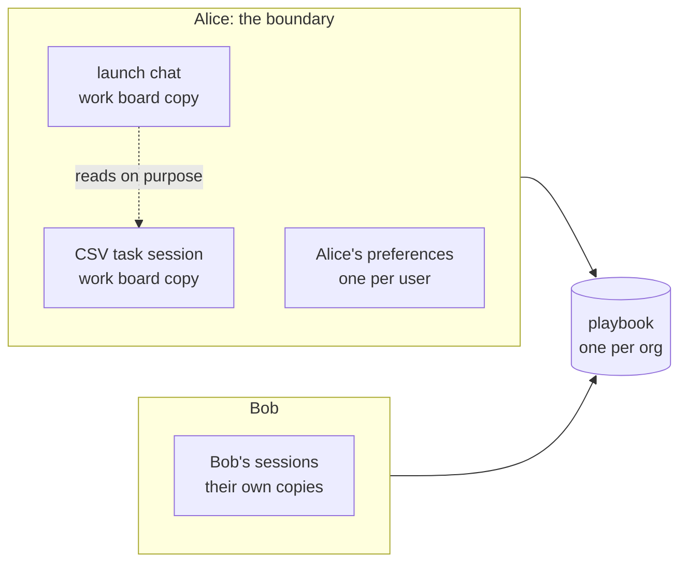
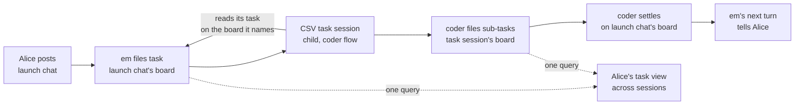

# Scopes and Sessions: How It Should Work

## Why this doc

Several of the hardest parts of FSD to explain, task boards above all, exist mainly to work around one rule: a session can't reach data that belongs to another session, even when both belong to the same user. Each feature that needed to look across sessions built its own way around that rule, and those workarounds now make up a large share of what a newcomer has to learn.

This doc describes how scopes and sessions should work. It describes the target first. The last section lists where today's code differs, with the files it was read from.

## Base terms

**A user is always a person, signed in, inside one org.** The framework has no system users.

**The user is the only access boundary.** Nothing that belongs to Alice is ever reachable by Bob. The one way to share is to write to something stored for the whole org.

**A scope is a place to keep a copy, not a lock.** It says how many copies of a resource exist, and which copy "mine" means by default. It never decides who may look.

**A session belongs to one user and runs one flow.** It's one conversation with a person, or one piece of work. A flow is the code a session runs, such as the built-in agent flow or an app's coder flow.

**A session keeps a log and has state.** Its log is the record of what happened in it, which the user reads as its history. Its state is its flow's working memory. Data meant to be read from anywhere else goes in a resource, not in state.

## The parts, in the order you meet them

Each part uses only the ones above it.

1. **The user.** Who every request runs as, and the boundary nothing crosses.
2. **Scopes.** Where the copies of a resource live: one per session, one per user, or one per org.
3. **Definitions.** The shape of a resource, registered once by name, so any flow can reach it.
4. **Your own copy.** The copy a block reaches without naming anything.
5. **Another session's copy.** The copy a block reaches when it names another of the user's sessions on purpose.
6. **Writes across sessions.** How a session changes data in another session, and what checks and records that.
7. **Child sessions.** A session started from another one, and what it knows about where it came from.
8. **Looking across every session.** How one view shows what's in all of a user's sessions at once.

## The cast

Every example uses these.

| Name | What it is |
| -- | -- |
| Alice | A user in the Acme org |
| Bob | Another user in the Acme org |
| em (worker) | Alice's engineering manager. It hands work out and doesn't write code. Runs on the built-in agent flow |
| coder (worker) | Alice's coding worker. Runs on the coder flow |
| launch chat (session) | Alice's conversation with em about the launch |
| CSV task session (session) | The session coder works one task in: "Add CSV export" |
| work (board) | A task board, kept per session |
| preferences (resource) | Alice's settings, kept per user |
| playbook (resource) | Acme's shared engineering playbook, kept per org |

## The user

Every request runs as exactly one user, inside one org. The server sets that identity. A caller never supplies it.

The user is the line nothing crosses. Alice's sessions, her copies of every per-session and per-user resource, and her workers are hers alone. Bob reaches none of them, and no setting changes that. The only data both of them reach is data kept per org, such as the playbook.

Inside a per-org copy, the same line can run between rows. A row can belong to one user, so that only she can read it, or only she can change it. That's the user boundary applied inside a shared copy, not a second kind of permission.

## Scopes

A scope answers one question: **how many copies of this resource are there?**

| Scope | Copies | "Mine" means | Example |
| -- | -- | -- | -- |
| Session | One per session | The copy in the session I'm running in | work (board) |
| User | One per user | My copy | preferences |
| Org | One for the whole org | The org's copy | playbook |

A per-session resource is the same shape repeated many times. Alice's launch chat has a work board. So does her CSV task session, and so does every other session that uses one. They are separate copies of one definition, the way two rows of a table share their columns.

A scope never makes data private from its own user. Alice's launch chat can look at the work board in her CSV task session whenever it has a reason to. The scope only decides which copy she gets when she doesn't say.



*Copies inside a user, and a shared one outside.* Each of Alice's sessions has its own copy of the work board, and the launch chat can read the task session's copy on purpose. The only thing Alice and Bob both reach is the org's playbook.

### What this replaces

Today a per-session resource is reachable only from its own session, or, when it opts in, from sessions that share its *lineage*: the chain of child sessions started on the same flow. A child started on a different flow gets a lineage of its own. So any data a task needs to reach across flows has been moved up to per-user scope, and then split back up by session inside that one copy. The task board is the main case, and the gap table lists the others.

What it costs, and how each cost is handled:

* **Reaching across sessions must stay deliberate.** A block that lists or claims tasks must not sweep every session's board by accident. That was the real bug the per-user board fixed. Here a sweep always acts on one copy, and reaching another copy means naming it (rule 9).
* **Session ids aren't secrets.** A caller can choose a session's id, so the check that a named session is the user's reads the session's stored owner. It never trusts anything about the id itself (rule 5).

## Definitions

A definition is a resource's shape: its name, its scope, and the shape of its data. Every definition is **registered by name** with the installation, the same way blocks will be. Any flow reaches a registered resource by its name. No flow has to import the module that defined it.

Registration is where shapes are checked. One name has one definition per installation, and a second, different definition under a taken name is refused when the app starts. Two flows that genuinely need separate data use two names.

So looking across sessions is always allowed, and the way to look is by a registered name. The registry, not each flow, is what makes coder and em agree on what a work board row looks like.

A board is the example used throughout:

```ts
// Anywhere in the app. Registering it is what makes "work" exist.
defineBoard({ name: "work", scope: "session" });

// Any flow, by name: the common board API.
const work = boards(ctx, "work");
```

* **Who owns it:** the installation's registry. The module that calls `defineBoard` is where it's written, not who may use it.
* **Where it's stored:** under its name, in each scope copy: `work/<task id>` inside a session's space.
* **How many exist:** one definition per name. Its copies are one per session that uses it.

Two boards in one session are two names, `work` and `triage`, with two sets of copies.

### How a definition gets registered

A definition is declared on the blocks that use it, the way resources are declared today, and it rises with those blocks into every flow that includes them. The registry is every installed flow's declarations put together. Two different shapes under one name are refused when the app starts. So a block that needs a board still carries its own declaration and stays portable, and there's no second place to register anything.

A flow that declares nothing about a board still reaches it by name, because some installed flow declared it. If no installed flow declares it, the name finds nothing. With board names typed from the registry, that's an error when the app is built, not at run time.

### Storage and behaviour

Including a board in a flow used to mean two things at once. They are separate.

| | Storage | Behaviour |
| -- | -- | -- |
| What it is | The rows: one copy per session | What makes it a board rather than a list: claiming and handing out tasks, the entry that hears a task's ending, the entry a worker takes a task on, the model's tools |
| Where it comes from | The registry | Blocks and actions a flow includes |
| Who needs it | Nobody installs it. A session's copy is made the first time anyone writes to it, from any flow | Each flow, for the parts it uses |
| Example | The launch chat's copy of the work board appears when em files the first task | The em flow includes the board's tools and its ending entry. The coder flow includes the board's task entry |

So "the flow a board lives on" stops being a useful idea. The coder flow doesn't declare the work board's storage, but it includes the board's task entry so it can work tasks, and it reaches the launch chat's copy by name.

## Your own copy

A block reaches its own copy without naming anything: the copy for the session it runs in, for the user it runs as, or for the org.

```ts
const mine = boards(ctx, "work");       // the work board in this session
await mine.create({ goal: "Add CSV export", assignee: "coder" });
```

Every operation that goes over a whole copy acts on this copy unless the block names another: listing it, counting it, claiming the next task from it, and hearing about its changes. Nothing goes over every session's copy as a side effect.

## Another session's copy

A block reaches another session's copy by naming the session:

```ts
const launch = boards(ctx, "work", { session: launchChatId });
const row = launch.get(taskId);
```

The server checks one thing: the named session belongs to the user this request runs as. If it doesn't, the call gets nothing, and it gets nothing in the same way when the session doesn't exist, so a caller can't learn which ids are taken. No other permission is involved. Within one user, reaching another session is always allowed.

| Question | Answer |
| -- | -- |
| Who can do it | Any block running as the same user |
| What it needs | The session's id, and the resource's registered name |
| What it reaches | That session's copy of that resource, nothing more |
| What it can't reach | Another user's sessions, ever |

### When to use it

* **To read or change where your own work came from**, such as coder settling its task on the launch chat's board, name the session.
* **To show something across every session**, list the user's sessions and name each one (see *Looking across every session*).
* **For data that belongs to the user rather than to any one session**, such as a coding run's record that every later conversation should find, keep it per user, keyed by what it's about.

## Writes across sessions

A session may write to another session's copy the same way it writes to its own:

```ts
const theirs = boards(ctx, "work", { session: launchChatId });
await theirs.create({ goal: "Write the release note", assignee: "writer" });
```

Three things hold for every such write:

* **The definition's own checks run.** A board keeps a **claim** on each running task: its record of which session is working that task right now. Every write that works a running task, settling included, checks the claim, so only the session working the task can make it, and a stale or second worker is refused. A write from another session gets no way around that.
* **The owning session hears it.** A write from another session notifies the owning session exactly as a write from inside it would. Whether that starts a turn is the definition's call, not the write's. A board's task ending starts its filer's turn.
* **The writing request records it.** A write is part of the request that made it, so the CSV task session's own history shows that it settled a task in the launch chat.

What the owning session's own history shows of a write that came from elsewhere is open. One option is that the write goes through a named action of the definition, such as a board's settle. An action can record itself in the owning session's history too, so the launch chat shows "the CSV task session settled this". The other is that a plain write is enough, and the owning session's history shows only what it heard. See *Decisions*.

### Why writes aren't locked

Forbidding them is what produced the workarounds this doc removes. Each time a session needed to change another session's data, a feature copied the data into per-user scope, or relayed it through a message, or stamped values into a child at birth. The definition's checks are what keep a write safe: the claim on a task, the shape of a row. The scope doesn't need to keep it safe as well.

## Child sessions

A child session is one a session starts for some piece of work. When em hands "Add CSV export" to coder, the CSV task session is a child of the launch chat. A child can run on any flow.

A child carries two things: the id of the session that started it, and the work it was started for, passed in when it starts. Nothing else is shared with it implicitly.

**The work names its own board.** For a task, the work is the task's id, the session whose board it sits on, and the values fixed when it was filed, such as the project it belongs to. A block reaches the task it's running through that, not through the session's parent:

```ts
// In the CSV task session, on the coder flow
const filedOn = boards(ctx, "work", { session: ctx.task.session });
```

The two usually match, but not always. A workstream's lead session is opened once and then takes tasks routed to it from several conversations. Its parent is the session that opened it, while each task it works sits on the board of the conversation that routed it. So "which board is my task on" is answered by the task, every time, and "who started me" by the parent.

**Fixed values stay fixed.** Some values belong to the work as it was filed and must not change after, even if the parent's data does. A task keeps the project it was filed under when its conversation later switches projects. Those values ride on the task row and arrive with the work. Reading the parent live is only for values that should follow the parent.

There's no chain of sessions that quietly shares data, and no second rule for children on the same flow versus another flow. What the child is given is explicit, and whatever else it needs, it reads from the parent, or writes to it, by name.

| Work | Sessions |
| -- | -- |
| A conversation with a worker | One per conversation |
| A task | One per task, a child of the session that filed it |
| A follow-up on a finished task | The same session as the task it follows |

### What this replaces

Today two mechanisms stand in for "the child acts on the parent's data":

* **Lineage sharing.** A resource can opt in to one copy shared by a parent and its same-flow children, so two sessions act on one resource. A child on another flow starts a lineage of its own, because one lineage space can't hold two flows' declarations of the same name. On `main`, the only resource that opts in outside tests is a Kitchen Sink demo board, plus the task board's own rule that a session-scoped board which hands out work must opt in.
* **Copies at birth.** The server copies values from the parent's state into each child, "however many hops down". Some are fixed on purpose, such as a task's project, which must not move when its conversation's does. Others are copies only because the child couldn't read the parent.

Naming the parent covers lineage sharing and the copies that only stood in for a read. The values fixed on purpose move onto the task row, where they already partly live, and arrive with the work. The registry removes the clash between two flows' declarations.

## Looking across every session

Some views need everything at once: an Inbox of everything waiting on Alice, or a board of every task in every one of her sessions.

A view asks for a definition's copies across all of the user's sessions in one call:

```ts
const open = await boards.acrossSessions(ctx, "work").list({ status: "open" });
// each row comes back with the session it belongs to
```

In the SQL stores this is one query, not one per session. Rows are already stored with the session they belong to, and the sessions table already records each session's user. The store joins the two: every row of the work board, in any session whose user is Alice, that matches the filter. It needs two things the stores will have anyway: the parts of a key that vary are indexed (rule 12), and a field a definition filters on, such as a task's status, has an index the definition declares. The filesystem store, used in development, walks the user's session folders instead.

* **Who owns it:** the engine. Nothing extra is written for it, so there's nothing to keep in step.
* **Where it's stored:** nowhere new. It reads every session's copy through one query.
* **How many exist:** one query per call, however many sessions the user has.

A view can still name one session when that's all it needs, and `ctx.sessions.list()` still lists sessions with their flow and status.

### What this replaces

Today each cross-session view builds its own path. Shift Manager reads the user's whole task store through the first session whose flow happens to declare it, then regroups the rows by conversation. The coding board looks up a session's lineage to recompute where its tasks are stored. The Inbox view reads every conversation's tasks at once.

## How it flows

Alice asks em, in the launch chat, to add CSV export.

1. **Alice posts in the launch chat.** Her request runs as Alice, in the launch chat.
2. **em files a task.** `boards(ctx, "work").create(...)` writes to the launch chat's own copy of the work board.
3. **The board hands the task to coder.** The engine starts the CSV task session on the coder flow, as a child of the launch chat. It is given the launch chat's id and the task.
4. **coder reads its task.** The task names its board: `boards(ctx, "work", { session: ctx.task.session }).get(taskId)`. The server checks that the launch chat is Alice's, and it is.
5. **coder splits the work.** It files two pieces on its own copy of the work board, in the CSV task session. A task filed while working another task is its sub-task, so these two are sub-tasks of the CSV task.
6. **Alice opens her task view.** It reads the work board across all her sessions in one query: the CSV task on the launch chat's board, and its two sub-tasks on the task session's board, all running.
7. **The sub-tasks finish, and then coder finishes.** It settles its task on the launch chat's copy. The claim checks that this session holds the task. The CSV task session's request records the settle.
8. **em hears the ending.** A write from another session notifies the owning session as a local write would, and a board's task ending starts its filer's turn. em's next turn in the launch chat runs once, because of the ending, and tells Alice. Her task view shows all three tasks as done.



*One task, two sessions, two copies of one board.* The only reach across sessions is coder naming the launch chat, once to read and once to settle, and Alice's view reading every session's copy in one query.

Bob never appears. Even if coder were handed the id of one of Bob's sessions, both the read and the write would be answered exactly as if that session didn't exist.

## Naming debates

### What to call a session's copy

| Name | Says | Fits | Familiar from | Risk |
| -- | -- | -- | -- | -- |
| Copy | One of many of the same thing | Plain, and the doc's own word | Everyday speech | Sounds like a duplicate that can drift |
| Instance | One realization of a definition | Matches "definition" | Programming | Already used for flow instances |
| Namespace | A space names live in | Says why it exists | Programming | Describes the space, not the data |

**Recommend copy** in docs and prose, with "a session's copy of the work board". Nothing in the API needs the noun: `boards(ctx, "work")` and `{ session }` say it. This changes if users read "copy" as "duplicate that can go stale".

### How to reach a board, and another session's copy

| Shape | Example | Fits | Risk |
| -- | -- | -- | -- |
| A registry lookup by name | `boards(ctx, "work", { session })` | No shared import; one board API for every board | The name is a string, so a typo fails at run time unless names are typed from the registry |
| The definition's own accessor | `work.tasks(ctx, { session })` | Typed by the import | Every flow imports the module that defined the board |
| A sessions handle | `ctx.sessions.get(id).boards("work")` | One place for everything about a session | A second way to reach the same copy |

The sessions handle exists today: a block can ask the engine about its user's other sessions, meaning their flow, the state fields their flow marks readable, their history, and a list of them. It reaches no resources.

**Recommend the registry lookup**, with board names typed from the registry the way flow names are, so a typo fails when the app is built. The definition's accessor can stay as a typed shortcut to the same lookup. The sessions handle stays for what isn't a resource. This changes if registry typing turns out to need a build step apps won't accept.

## The rules

A behavior none of these rules explains is a bug in the model.

1. Every request runs as one user, inside one org. The server sets both.
2. The user is the only access boundary. Nothing of one user's is reachable by another. Sharing means writing to a resource kept per org.
3. A scope decides how many copies of a resource exist and which one "mine" means. It never decides who may look.
4. A block reaches its own copy without naming it.
5. A block may read or write another session's copy by naming that session and the resource. The server checks only that the session belongs to the same user, using the session's stored owner, and answers a session that isn't the user's exactly like one that doesn't exist.
6. A resource name has one registered definition per installation, and any flow reaches it by that name. A second, different definition under a taken name is refused when the app starts.
7. A write from another session runs the definition's own checks, such as a task's claim, exactly as a local write does. Apart from rule 5's owner check, which is about the user, scope adds no check of its own.
8. A write from another session notifies the owning session exactly as a local write would. Whether that starts a turn is the definition's call.
9. An operation that goes over a whole copy (listing, counting, claiming the next task, hearing its changes) goes over one copy: your own, or the one you named. Nothing sweeps every session by accident.
10. A child session knows the session that started it and the work it was started for, and nothing else implicitly. The work names the board its task sits on and carries the values fixed at filing. Anything else the child needs from its parent, it reaches by naming the parent.
11. Data that belongs to a user rather than to one session is kept per user, keyed by what it's about, never by a session's id.
12. Every part of a resource's key that varies (a session, a board, a task id) can be filtered on by the store without a scan. No feature reaches its rows by building a prefix out of encoded values.
13. Reading a definition's copies across all of a user's sessions is one call and, in the SQL stores, one query. Nothing reads a pile of sessions one by one to build a view.

## Vocabulary

One term, one thing. Retired: lineage (say child session, and name the parent), shared to lineage, partition (say a session's copy), filing session (say the session that filed it, or the parent), board above (say the parent's board), conversation (when it means any session, including a task's: say session), carrier session, flow isolation of per-user data (say a separate name).

| Term | Means | Turns on |
| -- | -- | -- |
| User | A person, signed in, inside one org. The access boundary | |
| Org | What every user and every shared resource sits inside | |
| Session | One conversation or piece of work, belonging to one user and running one flow | Owned by one user |
| Conversation | A session with a person in it, such as the launch chat | |
| Flow | The code a session runs, such as the agent flow or the coder flow | |
| Session log | The record of what happened in a session, read as its history | |
| Session state | A flow's working memory for one session. Other sessions read only the fields its flow marks readable | |
| Child session | A session started by another session. It keeps its parent's id and is given the work it was started for | Owned by the same user |
| Sub-task | A task filed while working another task, on the working session's board | |
| Claim | A board's record of which session is working a task right now | Guards every write that works the task |
| Filer | The session that filed a task, which hears how it ended | |
| Installation | One running app with its registry, flows and stores | |
| Scope | How many copies of a resource exist: per session, per user, per org | Never who may look |
| Definition | A resource's name, scope and shape, registered once with the installation | One per name |
| Registry | The installation's list of definitions (and, later, blocks) by name | |
| Copy | One scope's data for one definition, such as the launch chat's work board | Per session, user or org |
| Your own copy | The copy a block reaches without naming anything | |
| Another session's copy | A copy reached by naming another session of the same user | Read and write, under the definition's checks |
| Action | A named write a definition offers, such as a board's settle | Open: whether cross-session writes must use one |
| Board | A task list registered with `defineBoard`, usually kept per session | |

### Retired terms the refactor removes

Counts are files that mention the term today: package source, then `docs/` plus the docs site, then labs and apps.

| Retired term | Say instead | Where it lives today | Files |
| -- | -- | -- | -- |
| Lineage, `lineageId` | The parent's id; a session's own id | The session record, `resolveLineageId`, the lineage storage scope, dispatch and session birth | 65 / 13 / 0 |
| Shared to lineage, `sharedToLineage` | Name the parent and reach its copy | The option on per-session resources and task collections | 30 / 33 / 2 |
| Partition, `partitionBy` | A session's copy | Orchestration's partitioned task collections, the skills collection | 25 / 10 / 0 |
| Filing session, `filingSessionId` | The parent, or the session that filed it | Workforce session state, the conversation ledger's partition | 32 / 7 / 0 |
| Board above, `boardAboveOf` | The parent's board | Workforce conversation board | 9 / 0 / 0 |
| Flow isolation, `flowIsolation`, `isolateUserState` | A separate name, when two flows really need separate data | The resource option and the flow flags | 83 / 56 / 1, and 53 / 36 / 1 |
| Routed session record | The workstream session's own state | Workforce `routed-session.ts` | 4 / 0 / 0 |
| Task chain record, `taskChain` | Depth and count read from the parent links | Workforce `chain.ts`, child state | 12 / 12 / 0 |
| Carrier session | A query across sessions | Shift Manager's cross-conversation board read (`carrier` in `reads.ts`) | 1 / 0 / 0 |

`flowIsolation` is retired once each of its uses is checked. A per-user resource that two flows really must keep apart gets two names.

## Decisions

- [X] **Scopes are copies, and the user is the boundary.** Agreed in discussion.
- [ ] **Sessions of one user can write to each other's copies.** Leaning yes: `theirs.create(...)` is fine. The definition's checks guard the write, and the writing request records it.
- [ ] **Do cross-session writes go through named actions?** Open, to explore. Actions let the owning session's history show who changed what from where. Plain writes are simpler and are already recorded by the writing request. Recommend plain writes by default, with a definition free to offer actions where its history matters, such as a board's settle. Would change: a support or audit need to answer "who changed this conversation's data" from the conversation alone.
- [X] **Definitions are registered by name.** Agreed in direction: one registry for resource definitions, and later blocks, so flows reach a board by name without a shared import. Recommend typing names from the registry so a typo fails at build time.
- [ ] **What a model's task tools look like with several boards.** Open, to explore. A `board` argument on one set of tools, or tools per board. Needs the real use cases first: when does one worker file on two boards in one turn?
- [ ] **Lineage sharing goes.** Leaning yes. It was meant to let two sessions act on one resource, and a child reaching its parent by name covers that. On `main` its only real user is a Kitchen Sink demo board.
- [ ] **The server stops copying parent values into child state.** Recommend yes, with lineage: a child reads its parent by name. Would change: a value the child needs on every turn where reading the parent adds measurable cost.
- [X] **Key parts are indexed, not prefixed.** Every part of a resource key that varies can be filtered on by the SQL stores without a scan, as its own refactor. This retires the prefix reads everywhere, not only for tasks.
- [ ] **Reading across sessions in one query.** Recommend `boards.acrossSessions(ctx, "work")`, answered by the SQL stores as one query that joins rows to the sessions table by owner, with indexed key parts and declared field indexes. No separately kept per-user index, which would have to be updated on every write. Would change: the join turns out slow for users with many thousands of sessions, where a kept index pays for itself.
- [X] **Definitions are declared on blocks and rise into flows, and the registry is their union.** Agreed: option (a).
- [ ] **Session state across sessions.** Open. Recommend keeping today's rule: another session reads only the state fields its flow marks readable. State is the flow's working memory. Data meant to be read elsewhere belongs in a resource.
- [ ] **Tenants inside per-user data.** Punted. A tenant is a customer of an app that hosts many customers on one install, a level above the org. Per-user data today is keyed by user and org, not tenant, and Workforce puts the tenant into its row ids by hand. Out of scope here, but the gap is real.
- [ ] **Moving existing data.** Punted to the spec. Six per-user collections are keyed by a session-derived value today. Each needs a decision: become per-session, or stay per-user keyed by its subject.

## What else this simplifies, and how much it removes

Every item below exists today because a session couldn't reach another session's data. Each one goes, or shrinks to a plain read or write by name.

| Area | Today's workaround | What replaces it | Size today |
| -- | -- | -- | -- |
| Task boards | One per-user store split per conversation by a partition function, flow isolation forced off, and an index to find which partition holds a task | A per-session board, reached by name | `partition.ts` 206 and `find-task-partitions.ts` 60 lines, plus 52 `partitionBy` lines across packages |
| Lineage | A storage space shared by a parent and its same-flow children, its own storage kind, and the rules for when a child joins or starts one | Naming the parent | `lineage-scope.ts` 306 lines, and 244 lines in the engine that mention lineage |
| Copies at birth | Parent values (filing session, project, routing, chain) stamped into each child's state, and carried through message hops | Values fixed at filing, such as the project, ride on the task row; the rest are read from the parent by name | `session-fields.ts` 126 lines, the carried-hop parts of `hop.ts` (239), and `filingSessionId` in 78 lines |
| Board above | A helper that works out which board a task session's task sits on, from the filing session or, for a workstream's session, the conversation that routed the task | The task being worked names its board (`ctx.task.session`) | `board-above.ts` 26 and `filing-session.ts` 115 lines |
| Routed sessions | A per-user record that says which board's task is using a workstream's lead session (the long-running session a workstream's lead worker works in) | That session's own state, read and written by name | `routed-session.ts` 143 lines |
| Task chains | A per-user record counting depth and size under the top task, keyed by a hash of its partition | Depth and size read through parent links, or kept on the top task's own row | `chain.ts` 229 lines |
| Run records | Moved from lineage sharing to per-user scope after a new session couldn't find a finished run | Unchanged: it already sits per user, keyed by its subject. Only its history note goes | none |
| Cross-session views | Shift Manager's carrier read, the coding board recomputing a partition, the Inbox reading every conversation's tasks | One query across the user's sessions | about 45 lines in Shift Manager, about 20 in the coding board, and the ledger read in the Inbox view |
| Prefix reads | Stores scan the whole user scope and filter by an encoded prefix | Indexed key parts (rule 12) | the prefix query in each SQL store |

**What I estimate it removes.** Roughly 1,500 to 1,800 lines of package source: about 1,200 in files that go whole (`partition.ts`, `find-task-partitions.ts`, `lineage-scope.ts`, `session-fields.ts`, `board-above.ts`, `filing-session.ts`, `routed-session.ts`, `chain.ts`), plus 300 to 600 in the parts of other files that carry their values, which is the less certain number. That doesn't include tests. 75 test files touch lineage, partitions, filing-session values or chain records, and most of those tests exist only to prove a workaround holds. It also retires nine terms and four options: `sharedToLineage`, `partitionBy`, forced `flowIsolation`, and the partition-reading `readFor`.

**What it doesn't count.** The task board cleanup that this unlocks is separate and bigger: one board per session instead of the delegation and plan stores, a parent link instead of three copies of it, and the rules that exist because of two stores (`plan.ts` alone is 526 lines). The estimate above covers only what the scope change removes by itself.

**What it adds.** A registry lookup, the `{ session }` option on every resource accessor with its owner check, indexed key parts in the two SQL stores, and one store query that reads a definition across a user's sessions. That's on the order of a few hundred lines, mostly in the engine.

## Where today's code differs

| Target | Today |
| -- | -- |
| A block can read or write another session's copy by naming it, within one user | A block resolves only its own session's storage key, or its lineage root for resources marked shared to lineage (`packages/engine/src/context/createExecutionContext.ts:1543-1546`). The only cross-session API for blocks returns a session's flow, its readable state fields, its history and lists. It reaches no resources (`packages/core/src/types/request-host.ts:296-314, 488-516`) |
| A resource is registered once by name, and any flow reaches it | A resource is reachable only from a flow that declares it. Same-name clashes are checked across flows at user and org scope, but a lineage space can't see two flows' declarations, which is why a cross-flow child gets its own lineage (`packages/engine/src/context/create-request-host.ts:457-465`) |
| Blocks and the HTTP API follow the same rule | The HTTP routes already serve any of the user's own sessions after an owner check (`packages/engine/src/routes/route-utils.ts:250-262`). Blocks get less than a browser does |
| A child reads its parent's data by naming the parent | A same-flow child shares its parent's lineage. A cross-flow child roots its own, because the lineage space has no flow in its key and two flows' declarations would collide there (`packages/engine/src/context/create-request-host.ts:457-475`). Session state is never shared (`packages/core/src/types/resource.ts:254-256`) |
| A child doesn't need copies of its parent's values | Parent values are written into each child's state at birth, "however many hops down" (`packages/workforce/src/workers/session-fields.ts:12-19`) |
| A board is a per-session definition, registered once by name | The conversation board is one per-user collection, split per conversation by a partition function, with flow isolation forced off so another flow can reach it (`packages/workforce/src/conversation-board/ledger.ts:136-150`, `packages/orchestration/src/tasks/collection/define-task-collection.ts:237-246`, `packages/orchestration/src/tasks/collection/partition.ts:4-12`). The steps a worker files for itself sit in a second collection, split the same way (`packages/workforce/src/conversation-board/plan.ts:80-83`) |
| A task id finds its row through the session that holds it | A separate index finds which partition holds a task id (`packages/orchestration/src/tasks/collection/find-task-partitions.ts:1-20`) |
| A view across sessions is one query | Shift Manager reads the whole task store through the first session whose flow declares it, then regroups rows by conversation (`packages/shift-manager/src/lib/reads.ts:388-431`). The coding board looks up a session's lineage to recompute its partition (`packages/harness-manager/src/kit/coding-board.ts:95-118`). The Inbox view reads every conversation's tasks at once (`packages/workforce/src/workers/inbox-view.ts:1-35`) |
| Data about a user's work is kept per user, keyed by its subject | The coding run record was moved from lineage sharing to per-user scope after a new session read `run: null` for a finished job (`packages/harness-manager/src/run-record.ts:22-43`). Matches the target, reached the hard way |
| One session's lock lives in that session | A workstream session's routing lock is a per-user record keyed by session id, because two conversations' boards route to it (`packages/workforce/src/conversation-board/routed-session.ts:1-38`) |
| A child reads its parent's task row by naming the parent | A one-row read and settle of the parent's task exists on the request host, but the default host leaves the read unwired (`packages/core/src/types/request-host.ts:554-572`, `packages/engine/src/flowstate/createFlowState.ts:1069-1072`) |
| Session ids are never trusted beyond the owner check | Matches. The lineage space is a separate storage kind precisely because session ids are caller-chosen (`packages/engine/src/context/createExecutionContext.ts:1574-1587`) |
| Rows inside one shared copy can have per-row owners | Matches. Owner-private and owner-writes collections already do this (`packages/core/src/types/resource-collection.ts:75-94`) |
