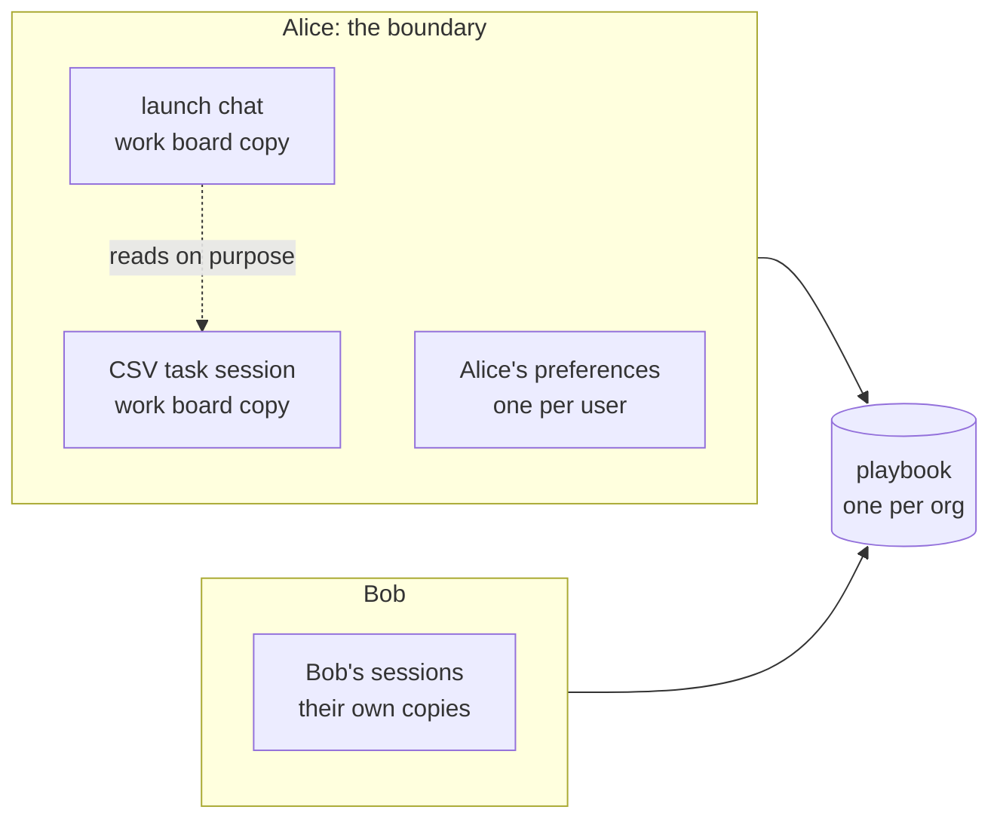
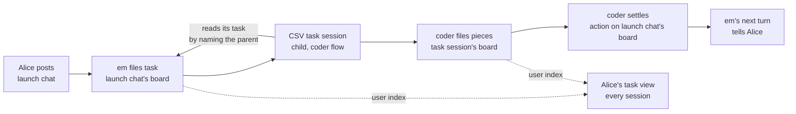

# Scopes and Sessions: How It Should Work

## Why this doc

Several of the hardest parts of FSD to explain, task boards above all, exist mainly to work around one rule: a session can't reach data that belongs to another session, even when both belong to the same user. Each feature that needed to look across sessions built its own way around that rule, and those workarounds now make up a large share of what a newcomer has to learn.

This doc describes how scopes and sessions should work. It describes the target first. The last section lists where today's code differs, with the files it was read from.

## Base terms

**A user is always a person, signed in, inside one org.** The framework has no system users.

**The user is the only access boundary.** Nothing that belongs to Alice is ever reachable by Bob. The one way to share is to write to something stored for the whole org.

**A scope is a place to keep a copy, not a lock.** It says how many copies of a resource exist, and which copy "mine" means by default. It never decides who may look.

**A session belongs to one user and runs one flow.** It's one conversation with a person, or one piece of work. A flow is the code a session runs, such as the built-in agent flow or an app's coder flow.

**A session keeps a log and has state.** Its log is the record of what happened in it, which the user reads as its history. Its state is its flow's working memory. Data meant to be read from anywhere else goes in a resource, not in state.

## The parts, in the order you meet them

Each part uses only the ones above it.

1. **The user.** Who every request runs as, and the boundary nothing crosses.
2. **Scopes.** Where the copies of a resource live: one per session, one per user, or one per org.
3. **Definitions.** The shape of a resource, written once and shared by every flow that uses it.
4. **Your own copy.** The copy a block reaches without naming anything.
5. **Another session's copy.** The copy a block reaches when it names another of the user's sessions on purpose.
6. **Writes across sessions.** How a session changes data in another session, and how that is recorded.
7. **Child sessions.** A session started from another one, and what it knows about where it came from.
8. **Looking across every session.** How one view shows what's in all of a user's sessions at once.

## The cast

Every example uses these.

| Name | What it is |
| -- | -- |
| Alice | A user in the Acme org |
| Bob | Another user in the Acme org |
| em (worker) | Alice's engineering manager. It hands work out and doesn't write code. Runs on the built-in agent flow |
| coder (worker) | Alice's coding worker. Runs on the coder flow |
| launch chat (session) | Alice's conversation with em about the launch |
| CSV task session (session) | The session coder works one task in: "Add CSV export" |
| work (board) | A task board, kept per session |
| preferences (resource) | Alice's settings, kept per user |
| playbook (resource) | Acme's shared engineering playbook, kept per org |

## The user

Every request runs as exactly one user, inside one org. The server sets that identity. A caller never supplies it.

The user is the line nothing crosses. Alice's sessions, her copies of every per-session and per-user resource, and her workers are hers alone. Bob reaches none of them, and no setting changes that. The only data both of them reach is data kept per org, such as the playbook.

Inside a per-org copy, the same line can run between rows. A row can belong to one user, so that only she can read it, or only she can change it. That's the user boundary applied inside a shared copy, not a second kind of permission.

## Scopes

A scope answers one question: **how many copies of this resource are there?**

| Scope | Copies | "Mine" means | Example |
| -- | -- | -- | -- |
| Session | One per session | The copy in the session I'm running in | work (board) |
| User | One per user | My copy | preferences |
| Org | One for the whole org | The org's copy | playbook |

A per-session resource is the same shape repeated many times. Alice's launch chat has a work board. So does her CSV task session, and so does every other session that uses one. They are separate copies of one definition, the way two rows of a table share their columns.

A scope never makes data private from its own user. Alice's launch chat can look at the work board in her CSV task session whenever it has a reason to. The scope only decides which copy she gets when she doesn't say.



*Copies inside a user, and a shared one outside.* Each of Alice's sessions has its own copy of the work board, and the launch chat can read the task session's copy on purpose. The only thing Alice and Bob both reach is the org's playbook.

### What this replaces

Today a per-session resource is reachable only from its own session, or, when it opts in, from sessions that share its *lineage*: the chain of child sessions started on the same flow. A child started on a different flow gets a lineage of its own. So any data a task needs to reach across flows has been moved up to per-user scope, and then split back up by session inside that one copy. The task board is the main case, and the gap table lists the others.

What it costs, and how each cost is handled:

* **Reaching across sessions must stay deliberate.** A block that lists or claims tasks must not sweep every session's board by accident. That was the real bug the per-user board fixed. Here a sweep always acts on one copy, and reaching another copy means naming it (rule 9).
* **Session ids aren't secrets.** A caller can choose a session's id, so the check that a named session is the user's reads the session's stored owner. It never trusts anything about the id itself (rule 5).

## Definitions

A definition is a resource's shape: its name, its scope, and the shape of its data. It is written once, in one module, and every flow that touches the resource declares that same definition.

That matters for reaching across sessions. When coder's flow reads the work board in the launch chat, it reads it through its own declaration of the work board. That declaration is the same object em's flow declares, so both flows agree on what a row looks like. Two flows that declare different shapes under one name are refused when the flows are registered, just as they are today for per-user and per-org resources. Two flows that genuinely need separate data use two definitions with two names.

So looking across sessions is always allowed, and the way to look is through a definition your flow declares. A flow that never declares a resource can't read anyone's copy of it, its own session's included.

A board is the example used throughout:

```ts
// One module, imported by the em flow and the coder flow alike.
export const work = defineBoard({ name: "work", scope: "session" });
```

* **Who owns it:** the module that defines it. It is usually a package, such as Workforce, so every flow that uses it imports one copy.
* **Where it's stored:** under its name, in each scope copy: `work/<task id>` inside a session's space.
* **How many exist:** one definition. Its copies are one per session that uses it.

Two boards in one session are two definitions, `work` and `triage`, with two names and two sets of copies.

## Your own copy

A block reaches its own copy without naming anything: the copy for the session it runs in, for the user it runs as, or for the org.

```ts
const mine = work.tasks(ctx);       // the work board in this session
await mine.create({ goal: "Add CSV export", assignee: "coder" });
```

Every operation that goes over a whole copy acts on this copy unless the block names another: listing it, counting it, claiming the next task from it, and hearing about its changes. Nothing goes over every session's copy as a side effect.

## Another session's copy

A block reaches another session's copy by naming the session:

```ts
const launch = work.tasks(ctx, { session: launchChatId });
const row = launch.get(taskId);
```

The server checks one thing: the named session belongs to the user this request runs as. If it doesn't, the read gets nothing, and it gets nothing in the same way when the session doesn't exist, so a caller can't learn which ids are taken. No other permission is involved. Within one user, looking is always allowed.

| Question | Answer |
| -- | -- |
| Who can do it | Any block running as the same user |
| What it needs | The session's id, and a declaration of the resource |
| What it reaches | That session's copy of that resource, nothing more |
| What it can't reach | Another user's sessions, ever |

### When to use it

* **To read where your own work came from**, such as coder reading its task's row on the launch chat's board, name the session.
* **To show something across every session**, don't loop over sessions by hand. Use a cross-session view (see *Looking across every session*).
* **For data that belongs to the user rather than to any one session**, such as a coding run's record that every later conversation should find, keep it per user, keyed by what it's about.

## Writes across sessions

Reading across sessions is open. Writing is narrower by default.

**By default, a session changes another session's data through an action that the data's definition provides.** An action here is a named write the definition offers, such as a board's settle. The action runs the definition's own checks, and it records the write in the owning session's log: what changed, who changed it, and from which session. So the launch chat's history shows that the CSV task session marked its task done.

A board's own write paths, such as settling a task, are actions in this sense. A board keeps a **claim** on each running task: its record of which session is working that task right now. Every write to a running task's row from the working side, settling included, checks the claim, so only the session working the task can make it, and a stale or second worker is refused.

A direct write, where a definition allows one, still runs the definition's checks, the claim included. It skips only the requirement to go through a named action.

**A definition may allow direct writes from other sessions** when forbidding them would force a workaround. A direct write is still recorded in the owning session's log. The bar is concrete: if a feature would otherwise copy data into another scope, or invent a relay, to get around the rule, allow the write instead.

### Why not allow every write?

A model can be talked into things. "Update session X" would then be a single tool call that changes a conversation the user isn't looking at, with nothing in that conversation saying it happened. Going through the owner's actions puts each write where the user will see it, and the definition decides what's allowed.

## Child sessions

A child session is one a session starts for some piece of work. When em hands "Add CSV export" to coder, the CSV task session is a child of the launch chat. A child can run on any flow.

A child carries two things: the id of the session that started it, and the work it was started for, passed in when it starts. For a task, that's the task's id and its board. Nothing else is shared with it implicitly. When it needs the parent's data, it names the parent like any other session:

```ts
// In the CSV task session, on the coder flow
const filedOn = work.tasks(ctx, { session: ctx.session.parent });
```

There's no chain of sessions that quietly shares data, and no second rule for children on the same flow versus another flow. What the child is given is explicit, and whatever else it needs, it reads from the parent by name.

| Work | Sessions |
| -- | -- |
| A conversation with a worker | One per conversation |
| A task | One per task, a child of the session that filed it |
| A follow-up on a finished task | The same session as the task it follows |

### What this replaces

Today a child on the same flow shares a lineage with its parent, and a child on another flow starts a lineage of its own, because one lineage space can't hold two flows' declarations of the same name. To make up for that, the server copies values from the parent's state into each child at birth, "however many hops down". The rule that every flow declares the same definition removes the clash, and naming the parent removes the copies.

## Looking across every session

Some views need everything at once: an Inbox of everything waiting on Alice, or a board of every task in every one of her conversations.

A definition can ask for a **user index** of its copies. The engine keeps it up to date on every write, in the user's own space, and a view reads that one index instead of opening every session.

```ts
export const work = defineBoard({ name: "work", scope: "session", userIndex: ["status", "assignee"] });

const open = await work.acrossSessions(ctx).list({ status: "open" });  // every session of this user
```

* **Who owns it:** the engine, on the definition's behalf. No feature writes it by hand.
* **Where it's stored:** per user, beside the user's other data.
* **How many exist:** one per definition that asks for it.

It answers "which sessions have something, and what" without loading every session's copy.

### What this replaces

Today each cross-session view builds its own path. Shift Manager reads the user's whole task store through the first session whose flow happens to declare it, then regroups the rows by conversation. The coding board looks up a session's lineage to recompute where its tasks are stored. The Inbox view reads every conversation's tasks at once.

## How it flows

Alice asks em, in the launch chat, to add CSV export.

1. **Alice posts in the launch chat.** Her request runs as Alice, in the launch chat.
2. **em files a task.** `work.tasks(ctx).create(...)` writes to the launch chat's own copy of the work board.
3. **The board hands the task to coder.** The engine starts the CSV task session on the coder flow, as a child of the launch chat. Its one link is the launch chat's id.
4. **coder reads its task.** It names the parent: `work.tasks(ctx, { session: parent }).get(taskId)`. The server checks that the launch chat is Alice's, and it is.
5. **coder splits the work.** It files two pieces on its own copy of the work board, in the CSV task session. A task filed while working another task is its sub-task, so these two are sub-tasks of the CSV task.
6. **Alice opens her task view.** It reads the work board's user index and shows every task in every one of her sessions: the CSV task on the launch chat's board, and its two sub-tasks on the task session's board, all running.
7. **The sub-tasks finish, and then coder finishes.** It settles its task through the board's settle action, on the launch chat's copy. The claim checks that this session holds the task. The launch chat's log records the settle.
8. **em hears the ending.** The settle changed the launch chat's own copy of the board, and a session hears changes to its own copies. em's next turn in the launch chat runs once, because of the ending, and tells Alice. Her task view shows all three tasks as done.



*One task, two sessions, two copies of one board.* The only reach across sessions is coder naming the launch chat, once to read and once through the settle action. Alice's view sees both copies through the index.

Bob never appears. Even if coder were handed the id of one of Bob's sessions, the read would return nothing.

## Naming debates

### What to call a session's copy

| Name | Says | Fits | Familiar from | Risk |
| -- | -- | -- | -- | -- |
| Copy | One of many of the same thing | Plain, and the doc's own word | Everyday speech | Sounds like a duplicate that can drift |
| Instance | One realization of a definition | Matches "definition" | Programming | Already used for flow instances |
| Namespace | A space names live in | Says why it exists | Programming | Describes the space, not the data |

**Recommend copy** in docs and prose, with "a session's copy of the work board". Nothing in the API needs the noun: `work.tasks(ctx)` and `{ session }` say it. This changes if users read "copy" as "duplicate that can go stale".

### How to name another session

| Shape | Example | Fits | Risk |
| -- | -- | -- | -- |
| An option on the definition | `work.tasks(ctx, { session })` | The read needs the definition anyway | One option to add to each definition's accessor |
| A sessions handle | `ctx.sessions.get(id).resources.work` | One place for everything about a session | Untyped unless the handle knows every definition |

The sessions handle exists today: a block can ask the engine about its user's other sessions, meaning their flow, the state fields their flow marks readable, their history, and a list of them. It reaches no resources.

**Recommend the option on the definition.** The definition is what makes the read safe (rule 6), and the type follows from it. The sessions handle stays for what isn't a resource. This changes if most cross-session code needs several resources from one session at once.

## The rules

A behavior none of these rules explains is a bug in the model.

1. Every request runs as one user, inside one org. The server sets both.
2. The user is the only access boundary. Nothing of one user's is reachable by another. Sharing means writing to a resource kept per org.
3. A scope decides how many copies of a resource exist and which one "mine" means. It never decides who may look.
4. A block reaches its own copy without naming it.
5. A block may read another session's copy by naming that session, through a definition its flow declares. The server checks only that the session belongs to the same user, using the session's stored owner, and answers a session that isn't the user's exactly like one that doesn't exist. The same holds for a write that names such a session: it is refused as if the session didn't exist.
6. A resource has one definition, and every flow that touches it declares that definition. Two shapes under one name are refused at registration.
7. By default, a write to another session's copy goes through an action of the resource's definition, and that action records the write in the owning session's log.
8. A definition may allow direct writes from other sessions when forbidding them would force a workaround. Direct writes are recorded too.
9. An operation that goes over a whole copy (listing, counting, claiming the next task, hearing its changes) goes over one copy: your own, or the one you named. Nothing sweeps every session by accident.
10. A child session knows the session that started it and the work it was started for, and nothing else implicitly. It reads its parent's data by naming the parent.
11. Data that belongs to a user rather than to one session is kept per user, keyed by what it's about, never by a session's id.
12. A view across every session reads a user index the engine keeps for the definition, never a pile of per-session reads assembled by hand.

## Vocabulary

One term, one thing. Retired: lineage (say child session, and name the parent), shared to lineage, partition (say a session's copy), filing session (say the session that filed it, or the parent), board above (say the parent's board), conversation (when it means any session, including a task's: say session), carrier session, flow isolation of per-user data (say a separate definition).

| Term | Means | Turns on |
| -- | -- | -- |
| User | A person, signed in, inside one org. The access boundary | |
| Org | What every user and every shared resource sits inside | |
| Session | One conversation or piece of work, belonging to one user and running one flow | Owned by one user |
| Conversation | A session with a person in it, such as the launch chat | |
| Flow | The code a session runs, such as the agent flow or the coder flow | |
| Session log | The record of what happened in a session, read as its history | Every write from another session lands here |
| Session state | A flow's working memory for one session. Other sessions read only the fields its flow marks readable | |
| Child session | A session started by another session. It keeps its parent's id and is given the work it was started for | Owned by the same user |
| Sub-task | A task filed while working another task, on the working session's board | |
| Claim | A board's record of which session is working a task right now | Guards settling |
| Scope | How many copies of a resource exist: per session, per user, per org | Never who may look |
| Definition | A resource's name, scope and shape, written once and declared by every flow that uses it | One per name |
| Copy | One scope's data for one definition, such as the launch chat's work board | Per session, user or org |
| Your own copy | The copy a block reaches without naming anything | |
| Another session's copy | A copy reached by naming another session of the same user | Read: open. Write: through actions by default |
| Action | A write path a definition provides, which records who wrote and from where | |
| Direct write | A write to another session's copy that a definition explicitly allows | Opt-in, still recorded |
| User index | An engine-kept index of a definition's copies across a user's sessions | Opt-in per definition |
| Board | A task list defined with `defineBoard`, usually kept per session | |

### Retired terms the refactor removes

Counts are files that mention the term today: package source, then `docs/` plus the docs site, then labs and apps.

| Retired term | Say instead | Where it lives today | Files |
| -- | -- | -- | -- |
| Lineage, `lineageId` | The parent's id; a session's own id | The session record, `resolveLineageId`, the lineage storage scope, dispatch and session birth | 65 / 13 / 0 |
| Shared to lineage, `sharedToLineage` | Name the parent and read its copy | The option on per-session resources and task collections | 30 / 33 / 2 |
| Partition, `partitionBy` | A session's copy | Orchestration's partitioned task collections, the skills collection | 25 / 10 / 0 |
| Filing session, `filingSessionId` | The parent, or the session that filed it | Workforce session state, the conversation ledger's partition | 32 / 7 / 0 |
| Board above, `boardAboveOf` | The parent's board | Workforce conversation board | 9 / 0 / 0 |
| Flow isolation, `flowIsolation`, `isolateUserState` | A separate definition, when two flows really need separate data | The resource option and the flow flags | 83 / 56 / 1, and 53 / 36 / 1 |
| Routed session record | The workstream session's own state | Workforce `routed-session.ts` | 4 / 0 / 0 |
| Task chain record, `taskChain` | Depth and count read from the parent links | Workforce `chain.ts`, child state | 12 / 12 / 0 |
| Carrier session | A user index | Shift Manager's cross-conversation board read (`carrier` in `reads.ts`) | 1 / 0 / 0 |

`flowIsolation` is retired once each of its uses is checked. A per-user resource that two flows really must keep apart becomes two definitions with two names.

## Decisions

- [X] **Scopes are copies, and the user is the boundary.** Agreed in discussion.
- [X] **Writes go through the owning definition's actions by default.** Direct writes are allowed where forbidding them would force a workaround, and they're recorded either way. Agreed in discussion.
- [ ] **How a block names another session.** Open. Recommend an option on the definition's accessor (`work.tasks(ctx, { session })`), keeping the sessions handle for flow, readable state and history. Would change: most cross-session code reading several resources from one session.
- [ ] **Lineage sharing goes.** Open. Recommend removing it. A child names its parent, and the server stops copying parent values into child state. Would change: a same-flow child that reads its parent's data on every turn, where naming the parent adds measurable cost.
- [ ] **Cross-session views read a user index.** Open. Recommend an opt-in index the engine keeps per definition. It builds on separate work to let the SQL stores filter on the parts of a resource's key, such as a board name or a task id, instead of scanning. Would change: every cross-session view turns out to need only a few sessions, so walking them is cheap enough.
- [ ] **Session state across sessions.** Open. Recommend keeping today's rule: another session reads only the state fields its flow marks readable. State is the flow's working memory. Data meant to be read elsewhere belongs in a resource.
- [ ] **Tenants inside per-user data.** Punted. A tenant is a customer of an app that hosts many customers on one install, a level above the org. Per-user data today is keyed by user and org, not tenant, and Workforce puts the tenant into its row ids by hand. Out of scope here, but the gap is real.
- [ ] **Moving existing data.** Punted to the spec. Six per-user collections are keyed by a session-derived value today. Each needs a decision: become per-session, or stay per-user keyed by its subject.

## Where today's code differs

| Target | Today |
| -- | -- |
| A block can read another session's copy by naming it, within one user | A block resolves only its own session's storage key, or its lineage root for resources marked shared to lineage (`packages/engine/src/context/createExecutionContext.ts:1543-1546`). The only cross-session API for blocks returns a session's flow, its readable state fields, its history and lists. It reaches no resources (`packages/core/src/types/request-host.ts:296-314, 488-516`) |
| Blocks and the HTTP API follow the same rule | The HTTP routes already serve any of the user's own sessions after an owner check (`packages/engine/src/routes/route-utils.ts:250-262`). Blocks get less than a browser does |
| A child reads its parent's data by naming the parent | A same-flow child shares its parent's lineage. A cross-flow child roots its own, because the lineage space has no flow in its key and two flows' declarations would collide there (`packages/engine/src/context/create-request-host.ts:457-475`). Session state is never shared (`packages/core/src/types/resource.ts:254-256`) |
| A child doesn't need copies of its parent's values | Parent values are written into each child's state at birth, "however many hops down" (`packages/workforce/src/workers/session-fields.ts:12-19`) |
| A board is a per-session definition, declared by every flow that uses it | The conversation board is one per-user collection, split per conversation by a partition function, with flow isolation forced off so another flow can reach it (`packages/workforce/src/conversation-board/ledger.ts:136-150`, `packages/orchestration/src/tasks/collection/define-task-collection.ts:237-246`, `packages/orchestration/src/tasks/collection/partition.ts:4-12`). The steps a worker files for itself sit in a second collection, split the same way (`packages/workforce/src/conversation-board/plan.ts:80-83`) |
| A task id finds its row through the session that holds it | A separate index finds which partition holds a task id (`packages/orchestration/src/tasks/collection/find-task-partitions.ts:1-20`) |
| A view across sessions reads a user index | Shift Manager reads the whole task store through the first session whose flow declares it, then regroups rows by conversation (`packages/shift-manager/src/lib/reads.ts:388-431`). The coding board looks up a session's lineage to recompute its partition (`packages/harness-manager/src/kit/coding-board.ts:95-118`). The Inbox view reads every conversation's tasks at once (`packages/workforce/src/workers/inbox-view.ts:1-35`) |
| Data about a user's work is kept per user, keyed by its subject | The coding run record was moved from lineage sharing to per-user scope after a new session read `run: null` for a finished job (`packages/harness-manager/src/run-record.ts:22-43`). Matches the target, reached the hard way |
| One session's lock lives in that session | A workstream session's routing lock is a per-user record keyed by session id, because two conversations' boards route to it (`packages/workforce/src/conversation-board/routed-session.ts:1-38`) |
| A child reads its parent's task row by naming the parent | A one-row read and settle of the parent's task exists on the request host, but the default host leaves the read unwired (`packages/core/src/types/request-host.ts:554-572`, `packages/engine/src/flowstate/createFlowState.ts:1069-1072`) |
| Session ids are never trusted beyond the owner check | Matches. The lineage space is a separate storage kind precisely because session ids are caller-chosen (`packages/engine/src/context/createExecutionContext.ts:1574-1587`) |
| Rows inside one shared copy can have per-row owners | Matches. Owner-private and owner-writes collections already do this (`packages/core/src/types/resource-collection.ts:75-94`) |
