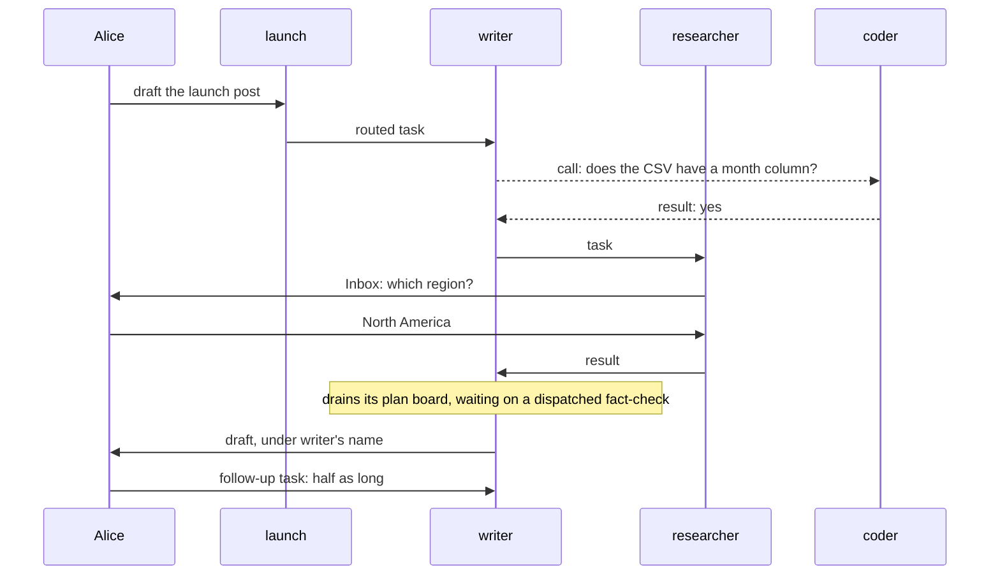

# Workforce Coordination: How It Should Work

## Why this doc

Workers reach each other and their users in many ways today, for three jobs: hand out work,
talk, and stop for a person. This doc gives each job one mechanism, as if it always existed.

Where today's code differs, the phase plan and the retired terms live in
[workforce-coordination-gaps.md](workforce-coordination-gaps.md). That departs from the
concept-doc skill's single-file shape on purpose, to keep the model readable.

- [Use cases](https://claude.ai/artifact/Wiif6vP611QWvKq5jDjUUr): use cases as chains of these building blocks.
- [Reduction check](https://claude.ai/artifact/QNetb3YFwTCAypMm1EkE4M): the per-mechanism count, today against the target.

## Base terms

**A user is a person.** Everything below acts as one user. Users can share an **org**, but nothing
crosses rosters (rule 3). A **screen** is an app's UI, acting as the signed-in user.

**A worker belongs to one user and acts as them.** It runs on the flow it names. A user's
**roster** is all their workers; adding one is a **hire**.

**A session is where a worker works.** Only its user can open it. A **conversation** is the session
where a user talks to one worker. Each worker has one default conversation per user, its message
inbox, plus one per project a coordinator coordinates; the user may open more.

**A request is one run of a worker in a session.** The server sets its **sender**: a user, another
worker's session, or **the engine**, starting a request for a task. It produces a **result**. A
session runs one request at a time; the rest wait in its **queue**. A request **ends** when its
**background work** ends too; until then its session is **busy**. A request **waits** until a task,
a call or a **condition** (an external signal, such as a webhook or a CI result) ends, or it **stops
for a person** with `waitForUser`. Either way it is **suspended**: stored, and **resumed** from the same step; its
session is **waiting**. That needs **durable execution**, a host that stores a waiting request and
carries it on later.

## The cast

| Name | Kind | Belongs to |
| -- | -- | -- |
| Alice, Bob | Users in the same org | |
| launch | Coordinator, routing by judgment. Delegates: writer, researcher, coder | Alice |
| writer | Worker on the agent flow. Delegate: researcher | Alice |
| researcher | Worker on the agent flow. No delegates | Alice |
| coder | Worker on a coding flow that drives a **harness**, an external coding agent run as its own process | Alice |
| Error Reporter | Worker that turns failures into bug reports | Alice |
| Bob's researcher | Worker on the agent flow | Bob |

The **agent flow** is the built-in worker flow: a worker that names no flow runs on it, with its
worker file's text as instructions.

## The parts, in the order you meet them

1. **Task.** A piece of work on one of a session's two boards: its plan board or its delegation board.
2. **Message.** Talk with any worker on your roster.
3. **Inbox item.** The one way work stops for a person.
4. **Routing.** How a coordinator hands a user's message to its delegates.
5. **Chain of command.** How work a worker shouldn't file itself reaches someone who can.
6. **Worker contract.** The entries each of a worker's roles needs, checked at hire.

| Part (all owned by the user, private to them) | Stored | How many |
| -- | -- | -- |
| Task | A row on one of the filing session's two boards | One per piece of work |
| Message | A log of the user's messages, and both sessions | One per send or call |
| Inbox item | The suspended request's record, or the held task's row | One per open stop |
| Routing state, delegates | The session's state | One per session |
| Roles | The worker flow's registration ([FIX-2084 D1](../../../specs/issues/FIX-2084/DECISIONS.md#d1)) | One set per worker flow |
| Whether a coordinator may change its own delegates | The worker's configuration | One per worker |

## Tasks

**A task is a piece of work on a board.** Its **filer** plans it, sees how it ends, and can edit,
steer or cancel it; its **assignee** does it and is accountable; its **brief** says what it is. Every
worker acts as its user, so each sees all that user's tasks.

**Each session has a plan board and a delegation board, told apart by `mode`.** To **drain** a board
is to start its **ready** rows until none is left.

| | Plan board | Delegation board |
| -- | -- | -- |
| Holds | Its own session's work | Tasks for delegates |
| `mode` | `"plan"`, the default: the drain waits on every row | `"delegation"`: the drain never waits |
| Drained by | `work` or `onTaskSettled` working the session's task; `respond` in a conversation | `dispatch`, a pass that starts what's ready and exits |
| A row runs | **Inline**, by the board's own request, its session the assignee; or dispatched to a new session of the worker its dispatcher names, and waited on | In another session, through a **dispatcher** block |
| An ending reaches | The drain, which carries on | The filer, as its result setting says (rule 7) |

So whatever wraps a plan board sees finished work: a sequence, a **pattern** or a **goal-seek loop**,
whose judge would rule while rows still run over a delegation board. **writer's plan board** is
outline, draft, fact-check, tighten: it writes the first two inline, dispatches the fact-check and
waits until the claim gate there settles it, then tightens. **Its delegation board** holds "find
adoption numbers" for researcher; `dispatch` starts it in researcher's session and exits. `dispatch`
reruns on any filing, start, answer, retry or ending that makes a row ready, and on any **touch** of
the board. Its last check for ready rows comes after its other work; a row ready later is a debt.

**Refused when built:** a delegation board with an inline row, a plan board with a dispatcher set to
`wait: false`, a delegation board with one set to `wait: true`, a goal-seek loop over a delegation
board. Inside a board an unset `wait` follows the mode. Outside, `wait` defaults to `false`, and
`wait: true` returns the work's result as output, through a wait with a deadline: a **waited
dispatch**.

**Four settings, chosen at filing,** decide how a delegated task runs; start and attempts stay
editable until it starts. A plan row uses only those two, and the session: unset runs it
inline in the plan's own request, and `"new"` hands it to a new session of the same worker,
which the drain waits on (FIX-2082 D2).

| Setting | Choices | Default |
| -- | -- | -- |
| Start | Now · after **dependencies**, named tasks on the same board · **held** until the filer releases it · **held on questions** | Now |
| Session | New · the assignee's **ongoing session** for the filer's conversation, which routed tasks reuse · an earlier task's session (a **follow-up**) | New |
| Result goes to | **The filer:** its waiting request if one waits on the task, else `onTaskSettled`, a new request in its session · the filer's conversation, under the assignee's name (routing uses this) | The filer |
| Attempts | Tries in all (`maxAttempts`) | 2 (one retry) |

Settings naming the filer's conversation are refused from a filer that isn't one. Across boards, a
plan row waits on a delegation task (writer's "write the stats section" on "find adoption numbers"),
and a delegation task that must follow a plan step is filed held, released by the plan row's request,
the filer, once the step is done.

**Plan it, or delegate it?** Plan what needs the session's context or whose result you need next;
delegate what stands alone, with its own attempts and cancel. Use a follow-up for work that needs an
earlier task's memory, like writer asking researcher to shorten the stats.

**Recurring work is a schedule** that files an ordinary task each time it fires; Alice's scheduled
work lists schedules and next fire times, not a board. A fire whose filing fails is
dropped, not retried; a crash loses a firing whose work the schedule picks as it fires.

A task stays **running** while tasks it filed are open, even with no request on it. A tree of tasks
is at most 5 deep, with at most 100 under its **top task**. A request waits on a task it filed, just
now or earlier, with `getTask({ id, wait: true, deadline? })`; `createTask` only files. A wait's
**deadline** is the host's default unless the caller passes one; reaching it resumes the request
without the result, to wait again or, by default, carry on. Rule 6 says when a task is done,
background work included.

**The claim gate closes a dispatched task.** The engine starts the **task entry**, `work`, inside the
**claim gate**. The **claim** in the entry's input names an attempt; the gate checks it is still the
row's current one before the entry runs, and settles the row once rule 6 holds (rules 2, 6, 18).

**A failed attempt is retried while attempts are left.** An **attempt** fails when one of its
requests throws or errors, its background work included, including a review or input whose `waitForUser` deadline goes unhandled
(an unhandled wait or call deadline just carries on). Its open tasks are cancelled, nothing it
returned is recorded, and the task goes back to pending in its session, or, with no attempts left,
fails.

**`updateTask` gives each field one meaning and one rule.** Only the task's filer and the user, from a
screen, may call it on a task.

| Field | Means | Allowed |
| -- | -- | -- |
| `goal`, `title`, `context`, `input`, `deps` (same board, no cycles), `priority`, `labels`, `metadata`, `assignee` (one of the filer's delegates), `maxAttempts` | Change the task | Before it starts |
| `status: "held"` / `"pending"` | Hold it, or release it. A task held on questions is released by its last answer, not by this field | Before it starts |
| `status: "cancelled"` | Cancel it: resolves its request's suspension as cancelled, or stops the request; cancels its open tasks; closes its Inbox item | Until it finishes |
| `message` | **Steer** it: before it starts, it joins the brief; a running request takes it before its next model call, a suspended one when it resumes, or as the answer to a question the filer may answer. It ends the current coding run (see Inbox items). It uses no attempt and never cancels the task | Until it finishes |

A refusal names its rule: "goal can't change after a task starts; steer it instead". A cancel
sent with a message or edits is refused; reassigning a started task is cancel and refile. Never
editable: other statuses, `followUpOf` (the task a follow-up continues), attempts used, and the
session and result settings. Finished output is fixed because its filer and dependents already used
it; a correction or more tracked work is a follow-up, which a screen can offer. A task view shows the latest completed follow-up's output
as current, the original as history.

**The worker reports progress with `reportProgress({ statusNote?, output? })`,** its own tool, not
the filer's `updateTask`. It's offered only on a task turn, acts on the task the request holds
through its claim (so it takes no `id`), and is refused once the task finishes. Any request holding
the claim may set `statusNote`, but only a `work` or `onTaskSettled` request checkpoints `output`;
a message holds no claim, so it never changes the task's output. It is not a public action: screens don't
checkpoint. `statusNote` is a one-line note for task views; it never changes the task's status, done
stays rule 6, and a worker never settles its own row (rule 18). `output` is a checkpoint of the
result so far, by rule 22. A `percent` may come later. Found work still goes to the filer as a
message.

**A board pays what it owes.** A **debt** is an ending owed to the filer, a wait owed a resume, a task
whose filed tasks have all ended owed its settle, or a ready row never started. Beyond rule 8's fast
paths, the **durability sweeper** wakes at the earliest **due time** and pays, so after a crash nothing waits
on a later touch.

## Messages

**A message is talk with any worker on your roster,** delegate or not. Help bigger than the
recipient's one request is a task.

`sendMessage({ to, text, wait?, deadline?, inReplyTo? })` addresses a worker (`to: "writer"`), a
task (`to: { task: id }`) or one of its user's own conversations (`to: { session: id }`). It
**sends**, returning nothing, or **calls** (`wait: true`), waiting for the result until its
deadline, the host's default unless `deadline` is passed. A late result is kept under its **call
id** for a caller that waits again with `sendMessage({ callId })`.

A message is a dispatcher block calling the recipient's `onMessageReceived`. Delivery is retried until it
lands; the receiver dedupes by id, so it sees each message once, and a repeated call gets the kept
result. A refusal (rule 10) is final, returned to the sender.

Each message starts an `onMessageReceived` request carrying the text and, set by the server, the sender,
whether it waits, and the budget. To answer a send, the recipient sends to its sender with
`inReplyTo`; the reply lands in the session that sent the original, even if that session's task has
ended.

**Where it lands:** the recipient's default conversation with this user (to the project
coordinator from work in a project, that project's conversation), except that a message to the worker
that filed your task lands in the session that filed it, and one to a task in that task's session.
It never changes the brief or stops the request working the task. To an open task, it's
conversation in that session. It doesn't hold the task and isn't part of it: while the task's turn
is running, it's answered after that turn. It holds no claim, doesn't delay the settle, and an
error in it is its own, never the attempt's. To a finished task,
`onMessageReceived` handles it with the session's full history. The user typing in a task's session answers
its question, if its request waits on one; otherwise it steers it while open, as `updateTask({
message })` does. Once finished, `respond` takes it as talk there.

**Limits.** A send or a call to a busy or waiting session queues until its current request ends; a
call waits no longer than its deadline. Each
message a user types funds a **budget** of 6 messages, shared by every request descending from it
through messages, calls and filed tasks; no one request sends more than 3. A request with nothing
behind it, such as a held task once it's released, gets a fresh 6. A message is paid when sent.

## Inbox items

**Work stops for a person in one of two ways, each one Inbox item.** If code reads the answer on
its next line, the request suspends. If the work can pick up from its brief, the task holds.

**A question holds its task,** before it starts or midway. Open questions are a mark on the task's
row, whatever its status, and the claim gate never claims a row that has one. Filed with questions,
a task is pending and in the user's Inbox as one item at once: launch files coder's adoption-script
task held on "Which CSV export should the script read?"; Alice answers, and coder starts, with no
attempt used and a fresh budget. Midway, a request asks its question and ends; the task stays running
with no request on it, its attempt and budget carrying on. Each answer is a steer, and the first
answer to a question wins unless a cancel is already written. The last answer releases the hold: a
held task starts, a running one takes one more turn on the same attempt, picking up from its brief.
Its dependents wait until then, and a task with an open question never settles. A question has no
deadline unless the host or the call sets one; at a set deadline the hold releases and the work
goes on, its brief saying no answer came. Cancelling the task closes the item. A question in a turn with no task has nothing to hold,
so it is input, and suspends.

**Midway, a request suspends** with `waitForUser({ kind, prompt, deadline? })` when its code reads
the answer next, `kind` being an **approval** (every one, "go ahead with the plan?" included), a
**review** or **input**, and `deadline` opting in: with none from the call or the host, it waits until answered, stopped or cancelled. A review is a verdict the code
reads; a revision request is new direction, a steer into a held task. A waited-on task may still
suspend for a person. If the request works a task, the claim gate marks it waiting on a person; it
keeps its claim, and the resume carries on the same attempt.

| A suspension resumes once | When | The suspended block |
| -- | -- | -- |
| Answered | The first answer, in the Inbox or the task's session | Carries on with it |
| Deadline | No answer by then | **Handles** it: goes ahead without the answer, ends, or suspends again with a new deadline (a **check-in**), perhaps messaging its filer first. Unhandled, an approval counts as rejected and a review or input errors, using an attempt |
| Cancelled | Its task is cancelled; the item closes | Resumes at once with `cancelled` and runs to its end: it may clean up and send messages, its writes to the task are refused, anything it creates is cancelled with it, and nothing it returns is recorded |

**The filer hears its task's questions.** A question asked midway reaches the task's filer as a
message from the task's session, for its `onMessageReceived` (delivered by FIX-2070; until then the filer reads
it with `getTask`). The filer may answer it by a steer (rule 11) or
leave it to the user; the first answer closes the item. The task's row holds its open questions, and
records which suspension holds it, so `getTask` and `listTasks` show what the task waits on.

Apart from a cancel, only the user **stops** a
request, from a screen; its Inbox item closes, if it had one. A steer is never a stop.

**A coding run can't pause midway,** because the harness is its own process. Its question ends the
run, and its task holds on the question. The answer, a steer, starts the next run in the same
**coding session**, using no attempt. A steer ends the current coding run, not the request;
the next run continues the coding session with the message.

## Routing

**Routing decides who takes a user's message to a coordinator.** It files **routed tasks** on the
coordinator's delegation board: session = the delegate's ongoing session for this conversation, so
it remembers earlier routed tasks; result = the conversation under the delegate's name; attempts = 1
(no retry).

| Policy | Who picks | Cost |
| -- | -- | -- |
| Judgment | The coordinator's own request files tasks, or answers | One request |
| Best fit | The **fit check**. A weak pick goes to the **fallback** | One model call |
| Round robin | The next delegate | None |
| Everyone | Every delegate | None |

With **rounds**, the coordinator sees each answer and can send it back out. Messages to a coordinator
get its own request, whatever its routing. Internal entries, which no user starts, carry the rest:
`routeOn` and `roundDeadline` for rounds, and, for a project, `changeWorkstreamDelegate` and the
lead's `onWorkstreamOpened`.

## Chain of command

**Your delegates are your authority.** Each session's list starts from its worker's defaults; `all`
means the whole roster, the worker itself included. Rule 13 says who changes it.

**What a request can't file goes up as a message to the filer above (its task's filer), who
decides** (rule 3). For new
work outside its task, the worker messages its filer and carries on, and the filer files a
**sibling**. The filer's flow may spot such a request with an **evaluator** and file it held, for the
user to approve.
The filer also files work a worker needs but can't assign. A filer that can't messages its own
filer; the result goes to whoever filed the task, who passes it down by steering the open task that
asked (`updateTask({ message })`), and that task carries on.

```mermaid
sequenceDiagram
  participant Alice
  participant researcher
  participant writer
  participant launch
  participant coder
  researcher-->>writer: message: I need an adoption script
  writer-->>launch: message: researcher needs a script
  launch->>coder: task, held on: which CSV export?
  Alice->>coder: answers in her Inbox; the hold releases
  coder->>launch: result: the script
  launch->>writer: steer, with the script
  writer->>researcher: steer, with the script
```

*The need goes up as messages, the work comes down as tasks, and every result returns to its
filer, who steers it down.* Dashed arrows are messages.

## The worker contract

**A worker's roles say which entries its flow must have.** An **entry** is a flow action that starts
a request.

| Role | Entries | Example |
| -- | -- | -- |
| Every worker | `respond`: a user's message, in a conversation or a finished task's session. `onMessageReceived`: another worker's | all |
| Contributor (takes tasks) | `work`: a task | researcher, coder |
| Manager (files tasks) | `dispatch`: a pass over the delegation board. `onTaskSettled`: a filed task's ending | writer, which is also a contributor |
| Coordinator (a manager that routes a user's messages) | Manager entries, plus `routeOn` and `roundDeadline` with rounds, `changeWorkstreamDelegate` with projects | launch |

`respond` is the only **public** entry. Roles combine; the hire checks each declared role's entries
exist and accept their inputs, probing their input schemas as it does for `respond`. A flow gets a
role's entries from a **factory**.

| Entry | Input |
| -- | -- |
| `onMessageReceived` | `{ id, from, text, call, inReplyTo?, budget }`, the server setting `from`, `call` and `budget` |
| `work` | `{ taskId, attempt, boardId, partition?, payload }`, `payload` being the task's brief and input |

`boardId` names the board the row is on; `partition?`, the user's slice of a ledger kept per
partition. Today's `work` input also carries `assignee`, `createdAt` and `incarnationId?` (telling
apart rows filed under one id), which the claim gate checks (`taskDispatchInputSchema`,
`packages/core/src/types/dispatch.ts`).

The model's seven tools: the filer's task tools `createTask`, `getTask`, `listTasks` and
`updateTask`, the worker's `reportProgress`, plus `sendMessage` and `waitForUser`. `getTask` can
also wait (rule 9). The filer's task tools are also public actions, not entries: a screen calls them
as the user to cancel a task, release a held one or answer its questions. `reportProgress` isn't one. Outside the seven, every worker gets `listDelegates`; only a coordinator the user
configured at hire to change its own delegates gets `addDelegate`, `removeDelegate` and
`setFallback`.

## How it flows

1. Alice tells launch "Draft the launch post": a `respond` request.
2. It files a routed task for writer, and ends. `dispatch` starts it in writer's session.
3. writer's `work` request calls coder: "Does the CSV have a month column?" coder answers yes.
4. Needing numbers before it plans, it files a task for researcher and ends; writer's task stays
   running with no request on it.
5. researcher asks "Which region?", and its task holds. Alice answers in her Inbox; the task picks
   up from its brief on the same attempt.
6. researcher finishes; the claim gate marks its task done, and `onTaskSettled` starts a request
   working writer's task.
7. It drains writer's plan board, waiting on the dispatched fact-check, and finishes with nothing
   open. writer's task is done; the draft lands in Alice's conversation with launch, under writer's
   name.
8. For a tracked half-length version, Alice files writer a follow-up from the finished task's
   session; launch's session stays its filer, and its output is the new version. Typing the ask
   there instead would be talk, leaving the task done.



*Three delegated tasks, one plan board, one call and one Inbox item carry the whole job.* The
follow-up runs in writer's finished task's session.

## The rules

A behavior none of these rules explains is a bug in the model.

1. Every request acts as one user, with a server-set sender.
2. Only a request the claim gate admits for a task holds its claim: `work`, or `onTaskSettled`
   working the session's task. An `onMessageReceived` never does. The claim gate settles a dispatched task;
   the drain, an inline plan row.
3. A request files tasks only for work its job needs: its task, the user's message it answers, or a
   sibling for work reported by the assignee of a task it filed. Anything else is a message to the
   filer above, or, with no task, said to the user. Nothing leaves the roster: Alice's workers never reach Bob's researcher.
4. A task has one filer, one accountable assignee, and four settings set at filing. A follow-up the
   user files takes the original's filer. Start and attempts stay editable until it starts;
   session and result never change.
5. A session holds at most one open task from the delegation board above it; another stays pending.
   Plan rows don't count.
6. A task is done when its request ends, background work included, with a result, not suspended,
   with no filed task open. Only `waitForUser` makes it waiting on a person.
   A steer is no ending. A failed attempt retries in the task's session while attempts are left.
   Cancelling, retrying or failing a task cancels its open tasks; failing or cancelling it, its
   dependents.
7. Every ending of a delegated task, a failure included, reaches its filer once, as its result
   setting says: the waiting request, or `onTaskSettled`. Set to the filer's conversation, it
   lands there under the assignee's name. An ending that lands while a turn a person's own
   message started is running can be taken by that turn after it answers (`takeFinishedTasks`,
   through the agent flow's `answerAgain`): said there under the assignee's name, through the
   same take record and handling as `onTaskSettled`, and the worker answers again with it in the
   same request (FIX-2159). No other turn takes one.
8. Every debt has a due time. The settling side pays it, a pass or a touch resends what is past
   due, and the durability sweeper pays it when due. The first two are its fast paths; a resend
   pays it if still owed.
9. A request may wait on a task it filed, a call or a condition, even inside a waited-on task, up to
   5 waits deep (apart from the tree's 5), each with a deadline, but never on a task whose result
   goes to the conversation. A late call result is kept for a caller that waits again. It waits on
   a task with `getTask({ id, wait: true })`.
10. A call returns the recipient's result; nothing is relayed or answered automatically. A send or a
    call to a busy or waiting session queues, a call up to its deadline. A message past the budget
    is refused.
11. Every stop for a person is one Inbox item: a request suspended by `waitForUser` for an approval,
    a review or input its code reads next, or a task held on questions, before it starts or midway.
    Only the user answers approvals, reviews and questions asked at filing; a question asked midway
    is also messaged to the filer (FIX-2070), which may answer it by a steer unless the task is routed.
12. A stop for a person ends once: answered, deadline or cancelled; a user stopping its request
    instead ends it and cancels its task. A suspended task keeps its claim. A task with an open
    question is never claimed and never settles; its last answer releases it.
13. Only the user changes delegates, except a coordinator the user configured at hire to change its
    own.
14. A board's `mode` is `plan`, the default, or `delegation`. A plan board's drain waits on every
    row, a delegation board's on none, and a board built to mix the two is refused when built.
15. A hire is refused when a declared role lacks an entry, or an entry refuses its input.
16. A dependency stays within one board. Crossing boards is a wait or a held task.
17. `dispatch` runs one at a time per session; a second call is rejected.
18. A worker block never settles its own row: it returns a result or throws, failing the attempt, and
    the drain records that for an inline row, the claim gate for a dispatched one, even one a plan
    board waits on.
19. A goal-seek loop (`goalSeekLoop`) needs a plan board, and is refused when built over a
    delegation board.
20. Each `updateTask` field has one rule: edits, hold and release before a task starts; cancel and a
    message until it finishes; nothing after, and its output never changes. A follow-up is a new
    task, whose output is the new version.
21. A message addresses a roster worker, any task of its user's (`{ task: id }`), or one of its
    user's own conversations (`{ session: id }`), or replies with `inReplyTo`. The server resolves
    the session within the sending session's tenant and checks it: a `{ session }` target must be a
    conversation of the sender's user, in the sender's org, of a worker still on the roster and
    still on that session's flow, not a task or delegate session (those are reached by `{ task }`),
    and anything else is refused. A worker may message itself only through `{ session }` naming a
    different session of its own; its own name as `to` is refused. In the first version the user
    supplies the `{ session }` id by pasting it; a lookup comes later. A message never steers a
    task; to a finished one it is talk in its session, which outlives the task.
22. Only a request holding a task's claim reports its progress, with `reportProgress`, until the
    task finishes; its `statusNote` never changes the task's status, and only a `work` or
    `onTaskSettled` request checkpoints `output`. A final result replaces the checkpoint unless it
    is missing (`undefined`) or an empty string, which leave the checkpoint as the output; any other
    value, `null`, `false`, `0`, `{}` and `[]` included, replaces it. A failed attempt keeps the
    checkpoint for the retry.

## Vocabulary

One term, one thing. Retired: turn, line, post, park, reply, relay, reopen, blocked, kit (say
factory), pieces (say the tasks it filed), self-assigned row (say plan row), startable (say ready),
run for a task (say attempt), chief of staff (say Shift Coordinator; `shift-coordinator` in code), and
dispatcher for anything but the block. The
[retired-terms table](workforce-coordination-gaps.md#retired-terms-the-refactor-removes) has the
rest.

| Term | Means |
| -- | -- |
| User, worker, roster, hire | A person; an agent acting as one user; all of a user's workers; adding one |
| Org, screen | A group users can share, rosters kept apart; an app's UI, acting as the signed-in user |
| Agent flow | The built-in worker flow, for a worker that names none |
| Harness, coding session, coding run | An external coding agent run as its own process; the harness's own session, which its next run continues; one run of the harness in it |
| Shift Coordinator | The coordinator the Shift Manager app opens on: the user's point of contact, which hires workers, starts projects and hands out work. launch plays it |
| Session, conversation | Where a worker works; where a user talks to one worker |
| Request, sender, the engine, result | One run of a worker in a session; who it runs for; the sender of a request starting a task; what it produces |
| Wait, condition, deadline | Holding a request until a task, call or condition ends; an external signal, such as a webhook; when a wait or suspension resumes unanswered, which a block **handles** by acting on it |
| Suspended, resume, check-in | Stored while waiting, or suspended for a person's approval, review or input; carrying on from the same step; a renewed deadline |
| Stop (a request) | End it from a screen with no result, running or suspended; only the user does, apart from a cancel; unlike a stop for a person |
| Busy, waiting, queue (a session) | Running a request; holding a suspended one, by a wait or a suspension for a person; its requests waiting their turn, such as queued messages |
| Durable execution | A host that stores a waiting request and carries it on later |
| Task, top task, filer, filer above, assignee, brief | Work on a board; one no task filed; the session that filed it; the filer of the task a request works; who does it; what it is |
| Task's session, ongoing session | Where its assignee works it, outliving the task; a delegate's one session per conversation, for routed tasks |
| Board, row, drain, touch | A session's list of tasks; a task on it; starting its ready rows until none is left; any read or write of it |
| Ready, inline | Start setting met, and rule 5 doesn't hold it; worked by the board's own request |
| Mode, plan board, delegation board | A board's kind, `plan` or `delegation`; its own session's work, drained waiting on every row; tasks for delegates, drained without waiting |
| Pattern, goal-seek loop | A ready-made plan board, such as one running several rows at once; a loop (`goalSeekLoop`) that drains a plan board, asks a judge, a block such as an evaluator, whether the goal is met, and drains again if not |
| Dispatch, `dispatch`, dispatcher | Start work in another session; the pass that drains a delegation board; the block that does it, waiting for the result when its `wait` is true, set or followed from a plan board (a waited dispatch) |
| Schedule | A row in a user's schedule list that files a task each time it fires |
| Dependency, held, held on questions | A task on the same board that must end first; not started until the filer releases it; not claimed while it has an open question, asked at filing or midway, and never waiting on a person |
| Pending, running, waiting on a person | Not yet started; worked, its request on a wait, with filed tasks open, or held midway on a question with no lease; its request suspended by `waitForUser` |
| Ending: done, failed, cancelled | Rule 6 met; out of attempts; cancelled |
| Finished, open, settle | Ended; not ended; record a row's ending |
| Attempt | One try at a task: every request working it in that try, resumes included; `maxAttempts` caps them |
| Background work | Work a request started, such as saving to memory, that runs on after it returns its result |
| Progress, status note, checkpoint | What a task's worker reports with `reportProgress` while it runs: a one-line note (never the task's status), and the output so far |
| Steer | `updateTask({ message })` into an unfinished task, or the user typing in its session; the `updateTask` table says what it does. A `sendMessage` never steers |
| Follow-up, sibling | A new task in an earlier task's session; a task filed beside another, for work its worker reported |
| Claim, claim gate, task entry | The right to record a task's ending; the step that checks it and settles the row; `work`, the action a task runs through |
| Debt, due time, durability sweeper | What a row owes; when it's due, a few seconds out; the engine's pass that pays it |
| Send, call, call id, budget | A message returning nothing; one whose sender waits; the call's message id, which its result is kept under; how many messages a request may still send |
| Inbox, Inbox item | The user's screen of open Inbox items; one stop for a person: a request suspended by `waitForUser`, or a task held on questions, before it starts or midway |
| Approval, review, input | `waitForUser`'s kinds: yes or no; the user accepts work or sends it back; a value its code reads next |
| Question | An answer in words its task holds on, on the row, never a `waitForUser` kind |
| Delegate, coordinator | A worker a session may file tasks with; a worker that routes a user's messages |
| Routed task, fit check, fallback, rounds | A task with routing's settings, which a judgment coordinator chooses per task; the model call that picks a delegate for best fit, or vets the lead a worker picked when opening a workstream; the delegate the coordinator names to take a weak pick; up to 3 passes sending answers back out |
| Project, workstream, lead, evaluator | A body of a user's work a coordinator runs, with its own conversation; a piece of a project; the worker that runs it; a block that judges input |
| `routeOn`, `roundDeadline` | A coordinator's internal entries: one only it calls, sending a round's answers back out; one that wakes it when a round's deadline passes with a delegate still working, closing every overdue round |
| `changeWorkstreamDelegate` | A project coordinator's internal entry, adding or removing a workstream's lead, its one delegate per open workstream, as the workstream opens, is marked done, or reopens |
| `onWorkstreamOpened` | A lead's internal entry, which opening a workstream calls to create the lead's session; only a flow with it, such as the agent flow, can lead |
| Entry, public, internal, role | A flow action that starts a request; called by a user: `respond`, the one public entry, and the task actions, which aren't entries; any other entry; contributor, manager or coordinator |
| Factory, capability | A function returning the tools, actions, entries and session state a flow's author spreads into its definition; a bundle of tools, context and resources a block uses |

## Decisions

The model above is the owner's, including: nothing settled by hand (no tool marks a task done or
failed); every wait has a deadline, a waited dispatch included, and a stop for a person has none unless the host or the call sets one (2026-10-24); nested
waits (rule 9); and twenty-three newly decided:

- [x] **Held on questions:** asked at filing or midway, one hold on the row, in the Inbox at once
  → rules 11, 12.
- [x] **The worker contract:** roles declared, entries checked at hire → rule 15.
- [x] **The sweeper backs up what a board owes (rule 8);** the fast paths stay.
- [x] **Dependencies stay within one board (rule 16).**
- [x] **Waiting on a task is `getTask` with `wait` (rule 9).**
- [x] **Recurring work is a schedule** that files a task → Tasks.
- [x] **A failure is an ending (rule 7);** its delivery also sends a final failure to the Error
  Reporter's intake, once, as the task occurrence it dedupes; a filer may still message it.
- [x] **Task tools are public actions,** called by screens as the user → worker contract.
- [x] **`dispatch` runs one at a time (rule 17).**
- [x] **A board's `mode` is `plan` or `delegation` (rule 14).**
- [x] **A worker block never settles its own row (rule 18).**
- [x] **A goal-seek loop needs a plan board (rule 19).**
- [x] **Patterns are plan boards,** unchanged.
- [x] **`sendMessage` addresses a worker, `{ task: id }` or `{ session: id }` (rule 21);** the server refuses a `{ session }` that isn't, within the sender's tenant, a conversation of the sender's user in the sender's org, of a worker still on the roster and on that session's flow, or that names a task or delegate session (BP-031).
- [x] **Four task tools, one rule per field (rule 20):** `addTask`, `readTask`, `cancelTask` go.
- [x] **When a task is done (rule 6).**
- [x] **A task's session outlives its task (rule 21).**
- [x] **A finished task's output never changes (rule 20).**
- [x] **The worker reports progress with its own tool (rule 22):** `reportProgress({ statusNote, output })`,
  claim-bound, not `updateTask({ id, output })`; `percent` later, `followUps` held.
- [x] **The cold read's calls:** retries, stops, typing, `deadline?`, limits, any `{ task }` → rules
  6, 9, 12, 21.
- [x] **Refusing a call into a waiting session (rule 10):** dropped; a call queues like a send, up
  to its deadline.
- [x] **Renames:** `chief-of-staff` becomes `shift-coordinator`, with the gaps file's code renames, in
  phase 5.
- [x] **Whether a worker filer hears of its task's suspensions:** yes, its questions, pushed and
  pulled → rule 11.
- [x] **Capabilities that contribute entries:** no, capabilities stay block-level. A flow one would
  have to add flow entries and give tools to a block; factories such as `defineSessionBoard` and
  `workerTaskEntry` already do both.

Open:

- [x] **A released held task's budget is fresh** → Messages, Limits.
- [x] **An error in background work fails the attempt** → Tasks, failed attempts.
- [x] **A cancelled block may clean up and send messages;** its writes to the task are refused and
  anything it creates is cancelled with it → Inbox items, Cancelled.
- [x] **An unanswered question at a set deadline:** the hold releases and the work goes on from
  its brief, which says no answer came → Inbox items.
- [ ] **Default worker instructions.** Punted to its own issue, as prompt content, not a mechanism:
  asked for more work after its task finished, a worker tells the filer with `sendMessage`.
- [ ] **A separate entry for proposing work.** Punted: found work rides on `sendMessage`, and the
  receiver classifies it. If that proves unreliable, add an optional hint, never authority.

Superseded:

- Rows a session filed for itself, closed by `completeTask` → plan rows, settled by the drain.
- A per-block timeout → a deadline on every wait and call.
- A default deadline on every stop for a person → none unless the host or the call sets one.
- An answer starting a new request → resuming the suspended one, same step and attempt.
- A midway question suspending with `waitForUser` → the task holds on its row, same attempt.
- One Inbox record over two mechanisms → every stop is one Inbox item.
- Moving patterns onto the in-request board → patterns are plan boards as they stand.
- A board-level `wait` → `mode`; `dispatcher({ wait })` stays.
- `updateTask` with one meaning per phase → one rule per field.
- A message to a finished task refused → talk in the task's session.
- Done when a request finishes with nothing open → rule 6.
- A finished task run again, overwriting its result → a follow-up; the output never changes.
- Assignee and settings fixed at filing → editable until the task starts, except session and result.
- A sub-agent as its own kind of row → a dispatched row on a plan board.

## Where today's code differs

In [workforce-coordination-gaps.md](workforce-coordination-gaps.md#where-todays-code-differs).
