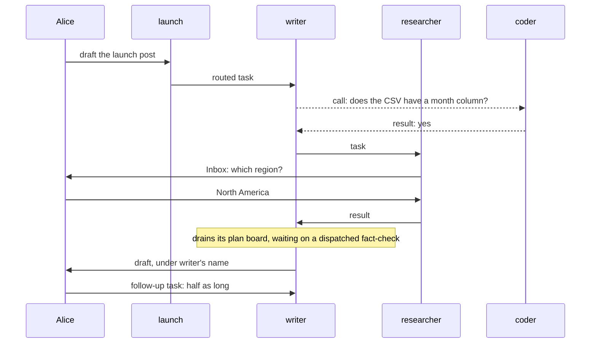

# Workforce Coordination: How It Should Work

## Why this doc

Workers reach each other and their users in many ways today, for three jobs: hand out work,
talk, and stop for a person. This doc gives each job one mechanism, as if it always existed.

Where today's code differs, the phase plan and the retired terms live in
[workforce-coordination-gaps.md](workforce-coordination-gaps.md). That departs from the
concept-doc skill's single-file shape on purpose, to keep the model readable.

## Base terms

**A user is a person.** Everything below acts as one user. Users can share an **org**, but nothing
crosses rosters (rule 3). A **screen** is an app's UI, acting as the signed-in user.

**A worker belongs to one user and acts as them.** It runs on the flow it names. A user's
**roster** is all their workers; adding one is a **hire**.

**A session is where a worker works.** Only its user can open it. A **conversation** is the session
where a user talks to one worker: one per worker per user, plus one per project a coordinator
coordinates.

**A request is one run of a worker in a session.** The server sets its **sender**: a user, another
worker's session, or **the board** (the engine starting a request for a task). It produces a
**result**. A session runs one request at a time. A request **waits** until a task, a call or a
**condition** (an external signal, such as a webhook or a CI result) ends, or it **stops for a
person**. Either way it is **suspended**: stored, and **resumed** from the same step. That needs
**durable execution**, a host that stores a waiting request and carries it on later.

## The cast

| Name | Kind | Belongs to |
| -- | -- | -- |
| Alice, Bob | Users in the same org | |
| launch | Coordinator, routing by judgment. Delegates: writer, researcher, coder | Alice |
| writer | Worker on the agent flow. Delegate: researcher | Alice |
| researcher | Worker on the agent flow. No delegates | Alice |
| coder | Worker on a coding flow that drives a **harness**, an external coding agent run as its own process | Alice |
| Error Reporter | Worker that turns failures into bug reports | Alice |
| Bob's researcher | Worker on the agent flow | Bob |

The **agent flow** is the built-in worker flow: a worker that names no flow runs on it, with its
worker file's text as instructions.

## The parts, in the order you meet them

1. **Task.** A piece of work on one of a session's two boards: its plan board or its delegation board.
2. **Message.** Conversation with any worker on your roster.
3. **Inbox item.** The one way work stops for a person.
4. **Routing.** How a coordinator hands a user's message to its delegates.
5. **Chain of command.** How work a worker shouldn't file itself reaches someone who can.
6. **Worker contract.** The entries each of a worker's roles needs, checked at hire.

| Part (all owned by the user, private to them) | Stored | How many |
| -- | -- | -- |
| Task | A row on one of the filing session's two boards | One per piece of work |
| Message | The user's message log, and both sessions | One per send or call |
| Inbox item | The suspended request's record, or the held task's row | One per open stop |
| Routing state, delegates | The session's state | One per session |
| Roles, and whether a coordinator may change its own delegates | The worker's configuration | One set per worker |

## Tasks

**A task is a piece of work on a board, a session's list of tasks.** Its **filer**, the session that
filed it, plans it, sees how it ends, and can edit, steer or cancel it. Its **assignee** does it and is
accountable. Its **brief** says what the work is. Every worker acts as its user, so each sees all
that user's tasks.

**A board's `mode` makes it a plan board or a delegation board,** and each session has one of
each. To **drain** a board is to start its **ready** rows, those whose start setting is met and
that rule 5 doesn't keep pending, until none is left.

| | Plan board | Delegation board |
| -- | -- | -- |
| Holds | The work of the board's own session | Tasks for delegates |
| `mode` | `"plan"`, the default: the drain waits on every row | `"delegation"`: the drain hands rows off and never waits |
| Drained by | The request working the session's task, or `respond` in a conversation | `dispatch`, a short pass that starts what's ready and exits |
| A row runs | Inline, or dispatched to another session and waited on | In another session, through a **dispatcher** block |
| An ending reaches | The drain, which carries on | The filer, as an event: `onTaskSettled` |

A row runs **inline** when the board's own request works it, with no dispatcher; its assignee is
the board's own session. Because a plan board's drain waits on every row, whatever wraps it, such as
a goal-seek loop or a sequence, sees finished work. A **pattern** is a ready-made plan board, such as
one that runs several rows at once. A **goal-seek loop**, built with `goalSeekLoop`, drains a board,
asks a judge whether the goal is met, and drains again if not, so it needs a plan board: over a
delegation board its judge would rule while rows are still running.

**writer's plan board** is outline, draft, fact-check, tighten. Its request writes the outline and
draft inline, dispatches the fact-check to another session and waits on it, then tightens. The claim
gate around that session's task entry settles the fact-check's row; the drain waits until it has,
then carries on.

**writer's delegation board** holds one task: researcher, find adoption numbers. `dispatch` starts
it in researcher's session and exits. It runs again on any filing, start, answer, retry or ending
that makes a row ready, and on any **touch** (read or write) of the board, one pass at a time per
session, a second rejected. Its last check for a ready row comes after its other work; a row ready
later is a debt (below).

**A board never mixes the two, and one built wrong is refused when built:** a delegation board with
an inline row, a plan board with a dispatcher set to `wait: false`, a delegation board with one set
to `wait: true`, or a goal-seek loop over a delegation board. The **dispatcher** block's own `wait`
is `false` by default outside a board; with `wait: true`, the work's result comes back as its output,
through a durable wait with a deadline. Inside a board, an unset `wait` follows the mode.

**Four settings, set at filing,** decide how a delegated task runs. A plan row uses only start and
attempts.

| Setting | Choices | Default |
| -- | -- | -- |
| Start | Now · after named tasks on the same board (its **dependencies**) · **held** until the filer releases it · **held on questions** (see Inbox items) | Now |
| Session | New · the assignee's **ongoing session** for the filer's conversation, which routed tasks reuse · an earlier task's session (a **follow-up**) | New |
| Result goes to | **The filer:** its waiting request if one waits on the task, otherwise its next request · the filer's conversation, under the assignee's name (routing uses this) | The filer |
| Attempts | Tries in all (`maxAttempts`) | 2 (one retry) |

A **task's session** is the one its assignee works it in. The settings naming the filer's
conversation are refused from a filer that isn't one, and a request can't wait on a task whose result
goes there.

**A dependency never crosses boards;** crossing is a wait or a held task. writer filed "find
adoption numbers" for researcher on its delegation board, and the plan row "write the stats
section" first waits on that task. The other way round, a delegation task that must start after a
plan step is filed held, and the plan row that finishes the step releases it.

**Plan it, or delegate it?** Plan what needs the session's context or whose result you need next;
delegate what stands alone, with its own attempts and cancel. Use a follow-up for work that needs an
earlier task's memory, like writer asking researcher to shorten the stats.

**Recurring work is a schedule:** a row in the user's schedule list that files an ordinary task
each time it fires. Alice's list of scheduled work reads her schedules and their next fire
times, not a board. A fire whose filing fails is dropped, not retried, and a crash loses a run whose work
the schedule picks as it fires.

A task stays **running** while tasks it filed are open, even when no request is working it; rule 6
says how it ends. A tree of tasks is at most 5 deep, with at most 100 under its **top task**, the one
no task filed. Every wait, on a task, a call or a condition, has a **deadline**, the host's default
unless the caller passes one. Reaching it resumes the request without the result, to wait again or,
by default, carry on.

**A task is done** when the request working it ends, background work included, with a result, and
it isn't suspended, with no filed task open and no message queued for its session. **Background
work**, such as saving to memory, runs on after a request returns its result. Suspended by
`waitForUser`, the task is **waiting on a person**; any other suspension leaves it running.

**The claim gate closes a dispatched task.** The request working a task holds its **claim**, the
right to record how it ends. The board starts the **task entry**, `work`, inside the **claim gate**,
as it does `onTaskSettled` and a queued message's `receive` (which keeps its own sender) when they
work the session's task. The gate checks the claim before the entry runs, and settles the row by the
rule above once the session's queue is empty. A worker block never settles its own row: a return is
its result and a throw fails the attempt, recorded by the drain for an inline row and the claim gate
for a dispatched one.

**A failed attempt is retried while attempts are left.** An **attempt** is one try at a task: every
request that works it in that try, queued messages and resumes included. It fails when one of them
throws or errors, including a question or review whose `waitForUser` deadline goes unhandled (an
unhandled wait or call deadline just carries on); its open tasks are cancelled, nothing it returned
is recorded, and the task goes back to pending in its session, or, with no attempts left, fails.

**`updateTask` gives each field one meaning and one rule.** Only the task's filer and the user, from a
screen, may call it on a task.

| Field | Means | Allowed |
| -- | -- | -- |
| `goal`, `title`, `context`, `input`, `deps` (same board, no cycles), `priority`, `labels`, `metadata`, `assignee` (one of the filer's delegates), `maxAttempts` | Change the task | Before it starts |
| `status: "held"` / `"pending"` | Hold it, or release it. A task held on questions is released by its last answer, not by this field | Before it starts |
| `status: "cancelled"` | Cancel it: resolves its request's suspension as cancelled, or stops the request; cancels its open tasks; closes its Inbox item | Until it finishes |
| `message` | **Steer** it: before it starts, it joins the brief; a running request takes it before its next model call, a suspended one when it resumes, or as the answer to a question the filer may answer. A coding run stops (see Inbox items). It uses no attempt and never cancels the task | Until it finishes |

A refusal names its rule: "goal can't change after a task starts; send a message instead". A cancel
sent with a message or edits is refused. A finished task refuses everything, and its output never
changes: its filer and dependents already used it. A correction or more tracked work is a follow-up
task, which a screen can offer; one the user files keeps the original's filer, which hears its
ending. A task view shows the latest finished follow-up's output as current, the original as
history. Reassigning a started task is cancel and
refile. Never editable: other statuses, `followUpOf` (the task a follow-up continues), attempts used,
and the session and result settings.

**Every ending of a delegated task, a failure included, reaches the filer once,** as the result
setting says. writer messages Error Reporter when a failure is worth reporting.

**A board pays what it owes.** A **debt** is what a row owes: an ending owed to the filer, a wait
owed a resume, a task whose filed tasks have all ended owed its settle, or a ready row never started. Each carries a **due time** a few seconds out. The
settling side pays at once, and `dispatch` and every touch resend. Behind both, the engine's
**durability sweeper** wakes at the earliest due time and pays, so after a crash nothing waits on a
later touch.

## Messages

**A message is conversation with any worker on your roster,** delegate or not. Help bigger than the
recipient's one request is a task.

`sendMessage({ to, text, wait?, deadline?, inReplyTo? })` addresses a worker, `to: "writer"`, or a
task, `to: { task: id }`. It **sends**, returning nothing, or **calls** (`wait: true`): the sender
waits for the recipient's result until its deadline, the host's default unless `deadline` is passed.
A late result is kept under its **call id**, so a caller that waits again, or repeats the call, gets
it.

**The recipient's entry is `receive`.** Each message starts a new request carrying the text and,
set by the server, the sender, whether it waits, and the budget. Only a call gets the result back.
To answer a send, the recipient sends to its sender with `inReplyTo`, and the server lands the
reply in the session that sent the original, whether or not that session's task has ended.

**Where it lands:** the recipient's conversation with this user, except that a message to the worker
that filed your task lands in the session that filed it. A message to a task, any task of the
user's, lands in that task's session; the server refuses any other. There it is conversation, for
`receive`, and never steers: it doesn't change the brief or stop the request working the task.

**A task's session outlives its task.** To an open task, a message runs as a `receive` request for
the task after any request working it, in the same attempt, before the task settles; it doesn't
change the task's output. To a finished task, it is conversation: `receive` handles it with the session's full history, and the task doesn't change. The user typing
there steers an open task, as `updateTask({ message })` does; in a finished one, `respond` takes it
as conversation.

**Limits.** A session is **busy** while a request runs in it, and **waiting** while its request is
suspended, on a wait or a stop for a person. A send to either is queued and runs after the current
request ends. A call into a waiting session is refused, so two waits never block each other. A
request's **budget** is how many messages it may still send: each message a user types funds 6,
shared by every request descending from it through messages, calls and filed tasks, and no one
request sends more than 3. A request with nothing behind it, such as the board starting a held task,
gets a fresh 6. A message is paid when sent; one past the budget is refused.

## Inbox items

**Work stops for a person in one of two ways, and each stop is one Inbox item.**

**Before it starts, a task can be held on questions.** They show in the user's Inbox as soon as it's
filed, as one item, and only the user answers them. Each answer joins the task's brief, and the last releases the hold; its dependents wait too.
launch files coder's adoption-script task held on "Which CSV export should the script read?"; when
Alice answers, coder starts. Cancelling the task closes the item.

**Midway, a request suspends** with `waitForUser({ kind, prompt, deadline? })`, where `kind` is
approval (yes or no), question (an answer in words) or review (accept the work or send it back).
Without `deadline`, the host's default applies. A waited-on task may still stop for a person. If the request works a task, the claim gate
marks it waiting on a person; it keeps its claim, and the resume carries on the same attempt.

| A stop for a person resumes once | When | The block |
| -- | -- | -- |
| Answered | The first answer, in the Inbox or the task's session | Carries on with it |
| Deadline | No answer by then | Goes ahead, ends, or suspends again with a new deadline (a **check-in**), perhaps messaging its filer first. Unhandled, an approval counts as rejected and a question or review errors, using an attempt |
| Cancelled | Its task is cancelled; the item closes | Winds down; nothing it returns is recorded |

Only the user answers held questions, approvals and reviews; the filer may also answer a question
asked midway, by a steer, unless the task is routed. Apart from a cancel, only the user **stops** a
request, from a screen. A stopped request ends with no result, running or suspended: its Inbox item
closes if it had one, and any task it works is cancelled. A steer is never a stop.

**A coding run can't pause midway,** because the harness runs as its own process. Its question ends
the run, and the coding flow's request suspends with `waitForUser`. The answer starts the next run
in the same **coding session**, the harness's own, using no attempt. A steer stops the harness run,
not the request, and the next run continues the coding session with the message.

## Routing

**Routing decides who takes a user's message to a coordinator.** It files **routed tasks** on the
coordinator's delegation board: session = the delegate's ongoing session for this conversation,
result = the conversation under the delegate's name, attempts = 1 (no retry). The delegate
remembers earlier routed tasks there.

| Policy | Who picks | Cost |
| -- | -- | -- |
| Judgment | The coordinator's own request files tasks, or answers | One request |
| Best fit | The fit check. A weak pick goes to the **fallback**, a delegate the coordinator names | One model call |
| Round robin | The next delegate | None |
| Everyone | Every delegate | None |

**The fit check** picks a delegate for best fit, and vets the **lead** a worker picked when opening
a **workstream**, a piece of a project. With **rounds** (up to 3), the coordinator sees each answer
and can send it back out. Messages to a coordinator get its own request, whatever its routing.

**Internal entries, which no user starts, carry the rest.** `routeOn` sends a round's answers back
out, called only by the coordinator itself. `roundDeadline` wakes it when a round's
deadline passes with a delegate still working, and closes every overdue round. A project's
coordinator has one delegate per open workstream, its lead; `changeWorkstreamDelegate` adds or
removes it as the workstream opens, is marked done, or reopens. `onWorkstreamOpened` is on the lead's
flow: opening a workstream calls it to create the lead's session there, so only a flow with it can
lead. The agent flow has it.

## Chain of command

**Your delegates are your authority.** Each session's list starts from its worker's defaults; `all`
means the whole roster, the worker itself included. Rule 13 says who changes it.

**What a request can't file goes up as a message to the filer above, who decides.** That is its
task's filer; a request working no task tells the user in its result. For new work outside its task,
the worker messages its filer and carries on, and the filer files a **sibling**, a new task beside
the worker's. The filer's flow may spot a request for work with an **evaluator** (a block that
judges input) and file it held, for the user to approve. For work a worker needs but can't assign,
the filer files it too. A filer that can't messages its own filer, and the result goes to whoever
filed the task, who passes it on in a follow-up.

```mermaid
sequenceDiagram
  participant Alice
  participant researcher
  participant writer
  participant launch
  participant coder
  researcher-->>writer: message: I need an adoption script
  writer-->>launch: message: researcher needs a script
  launch->>coder: task, held on: which CSV export?
  Alice->>coder: answers in her Inbox; the hold releases
  coder->>launch: result: the script
  launch->>writer: follow-up, with the script
  writer->>researcher: follow-up, with the script
```

*The need goes up as messages, the work comes down as tasks, and every result returns to its
filer.* Dashed arrows are messages.

## The worker contract

**A worker's roles say which entries its flow must have.** An **entry** is a flow action that starts
a request.

| Role | Entries | Example |
| -- | -- | -- |
| Every worker | `respond`, `receive` | all |
| Contributor (takes tasks) | `work` | researcher, coder |
| Manager (files tasks) | `dispatch`, `onTaskSettled` | writer, which is also a contributor |
| Coordinator (a manager that routes a user's messages) | Manager entries plus the routing entries: `routeOn`, `roundDeadline`, `changeWorkstreamDelegate` | launch |

`respond`, the only **public** entry (one a user starts), takes a user's message in a conversation
or a finished task's session; `receive`, another worker's; `work`, a task; `onTaskSettled`, a filed
task's ending; `dispatch`, a pass over the delegation board. Working the session's task, `work`,
`onTaskSettled` and a queued message's `receive` go through the claim gate, and the first two drain
the plan board; `respond` drains it only in a conversation.

Roles combine. A worker declares its roles, and the hire checks that each one's entries exist and
accept their inputs, probing their input schemas as it does for `respond`. A flow gets a role's
entries from a **factory**, a function returning the tools, actions, entries and session state its
author spreads into the flow definition.

The model's six tools: four task tools, `createTask`, `getTask`, `listTasks` and `updateTask`,
plus `sendMessage` and `waitForUser`. The task tools are also public actions, not entries: a screen
calls them as the user to cancel a task, release a held one or answer its questions. Apart from the
six, every worker gets `listDelegates`; only a coordinator the user configured at hire to change its
own delegates gets `addDelegate`, `removeDelegate` and `setFallback`.

## How it flows

1. Alice tells launch "Draft the launch post": a `respond` request.
2. It files a routed task for writer, and ends. `dispatch` starts it in writer's session.
3. writer's `work` request calls coder: "Does the CSV have a month column?" coder answers yes.
4. Needing numbers before it plans, it files a task for researcher and ends. writer's task stays
   running with no request on it.
5. researcher asks "Which region?" with `waitForUser`, and suspends. Alice answers in her Inbox, and
   the same request carries on.
6. researcher finishes; the claim gate marks its task done, and `onTaskSettled` starts a request
   working writer's task.
7. That request drains writer's plan board, waiting on the fact-check it dispatched, and finishes with
   nothing open. writer's task is done, and the draft lands in Alice's conversation with launch,
   under writer's name.
8. Alice wants it half as long, tracked, so she files writer a follow-up task from the finished
   task's session. launch's session is its filer, as it was the original's. It runs there, and its
   output is the new version. Typing the ask there instead would be conversation, leaving the task
   done.



*Three delegated tasks, one plan board, one call and one Inbox item carry the whole job.* The
follow-up runs in writer's finished task's session.

## The rules

A behavior none of these rules explains is a bug in the model.

1. Every request acts as one user, with a server-set sender.
2. Only a request the claim gate admits for a task holds its claim: `work`, or `onTaskSettled` or a
   queued `receive` working the session's task. A queued `receive` keeps its own sender; the gate,
   not the sender, gives it the claim. The claim gate settles a dispatched task; the drain,
   an inline plan row.
3. A request files tasks only for work its job needs: its task, the user's message it answers, or a
   sibling for work reported by the assignee of a task it filed. Anything else is a message to the
   filer above, or, with no task, said to the user. Nothing leaves the roster: Alice's workers never reach Bob's researcher.
4. A task has one filer, one accountable assignee, and four settings set at filing. A follow-up the
   user files takes the original's filer.
5. A session holds at most one open task from the delegation board above it; another stays pending.
   Plan rows don't count.
6. A task is done when its request ends, background work included, with a result, not suspended,
   with no filed task open and no message queued. Only `waitForUser` makes it waiting on a person.
   A steer is no ending. A failed attempt retries in the task's session while attempts are left.
   Cancelling, retrying or failing a task cancels its open tasks; failing or cancelling it, its
   dependents.
7. Every ending of a delegated task, a failure included, reaches its filer once, as its result
   setting says: the waiting request, or `onTaskSettled`.
8. Every debt has a due time. The settling side pays it, `dispatch` and every touch resend it, and
   the durability sweeper pays it when due.
9. A request may wait on a task it filed, a call or a condition, even inside a waited-on task, up to
   5 waits deep (apart from the tree's 5), each with a deadline, but never on a task whose result
   goes to the conversation. A late call result is kept for a caller that waits again.
10. A call returns the recipient's result; nothing is relayed or answered automatically. A send to a
    busy or waiting session is queued; a call into a waiting session is refused, as is a message
    past the budget.
11. Every stop for a person is one Inbox item: a request suspended by `waitForUser`, or a task held
    on questions. Only the user answers held questions, approvals and reviews; the filer may also
    answer a question asked midway, unless the task is routed.
12. A stop for a person resumes once: answered, deadline or cancelled; a user stopping its request
    instead ends it and cancels its task. Its task keeps its claim. A task held on questions starts
    no sooner than its last answer.
13. Only the user changes delegates, except a coordinator the user configured at hire to change its
    own.
14. A board's `mode` is `plan`, the default, or `delegation`. A plan board's drain waits on every
    row, a delegation board's on none, and a board built to mix the two is refused when built.
15. A hire is refused when a declared role lacks an entry, or an entry refuses its input.
16. A dependency stays within one board. Crossing boards is a wait or a held task.
17. `dispatch` runs one at a time per session; a second call is rejected.
18. A worker block never settles its own row: it returns a result or throws, failing the attempt, and
    the drain records that for an inline row, the claim gate for a dispatched one, even one a plan
    board waits on.
19. A goal-seek loop (`goalSeekLoop`) needs a plan board, and is refused when built over a
    delegation board.
20. Each `updateTask` field has one rule: edits, hold and release before a task starts; cancel and a
    message until it finishes; nothing after, and its output never changes. A follow-up is a new
    task, whose output is the new version.
21. A message addresses a roster worker or any task of its user's, or replies with `inReplyTo`,
    never a raw session; the server resolves the session. It never steers a task; to a finished one
    it is conversation.

## Vocabulary

One term, one thing. Retired: turn, line, post, park, reply, relay, reopen, blocked, kit (say
factory), pieces (say the tasks it filed), self-assigned row (say plan row), startable (say ready),
run for a task (say attempt), chief of staff (say Shift Coordinator, as the docs and UI do), and
dispatcher for anything but the block. The
[retired-terms table](workforce-coordination-gaps.md#retired-terms-the-refactor-removes) has the
rest.

| Term | Means |
| -- | -- |
| User, worker, roster, hire | A person; an agent acting as one user; all of a user's workers; adding one |
| Org, screen | A group users can share, rosters kept apart; an app's UI, acting as the signed-in user |
| Agent flow | The built-in worker flow, for a worker that names none |
| Harness, coding session | An external coding agent run as its own process; its own session, which its next run continues |
| Shift Coordinator | The coordinator the Shift Manager app opens on: the user's point of contact, which hires workers, starts projects and hands out work. In the cast, launch plays this role |
| Session, conversation | Where a worker works; where a user talks to one worker |
| Request, sender, the board, result | One run of a worker in a session; who it runs for; the engine starting a request for a task; what it produces |
| Wait, condition, deadline | Holding a request until a task, a call or a condition ends; an external signal, such as a webhook; when a wait or stop resumes unanswered |
| Suspended, resume, check-in | Stored while it waits or stops for a person; carrying on from the same step; a renewed deadline |
| Stop (a request) | End it from a screen, with no result; only the user does, apart from a cancel |
| Busy, waiting (a session) | Running a request; holding a suspended one |
| Durable execution | A host that stores a waiting request and carries it on later |
| Task, top task, filer, assignee, brief | Work on a board; one no task filed; the session that filed it; who does it; what it is |
| Task's session, ongoing session | Where its assignee works it; a delegate's one session per conversation, for routed tasks |
| Board, row, drain, touch | A session's list of tasks; a task on it; starting its ready rows until none is left; any read or write of it |
| Ready, inline | Start setting met, and rule 5 doesn't hold it; worked by the board's own request |
| Plan board, pattern, goal-seek loop | The board of its own session's work, whose drain waits on every row; a ready-made plan board; a loop (`goalSeekLoop`) that drains a plan board until a judge says the goal is met |
| Mode | A board's kind: `plan` or `delegation` |
| Delegation board, `dispatch` | The board of tasks for delegates, whose drain never waits; the pass that drains it |
| Dispatch, dispatcher | Start work in another session; the block that does it, waiting for the result only with `wait: true` |
| Schedule | A row in a user's schedule list that files a task each time it fires |
| Dependency, held, held on questions | A task on the same board that must end first; waiting for the filer to release it; waiting for the user's answers |
| Pending, running, waiting on a person | Not yet started; worked, waiting, or with filed tasks open; its request suspended by `waitForUser` |
| Ending: done, failed, cancelled | With a result, nothing filed or queued open; out of attempts; cancelled |
| Finished, open, settle | Ended; not ended; record a row's ending |
| Attempt | One try at a task, every request that works it in that try; `maxAttempts` caps them |
| Background work | Work a request started that runs on after it returns its result |
| Steer | `updateTask({ message })` into an unfinished task, or the user typing in its session: it joins the brief, redirects the worker, or answers. A `sendMessage` never steers |
| Follow-up, sibling | A new task in an earlier task's session; a task filed beside another, for work its worker reported |
| Claim, claim gate, task entry | The right to record a task's ending; the step that checks it and settles the row; `work`, the action a task runs through |
| Debt, due time, durability sweeper | What a row owes; when it's due; the engine's pass that pays it |
| Send, call, call id, budget | A message that returns nothing; one whose sender waits; the key a call's result is kept under; how many messages a request may still send |
| Inbox item | One stop for a person: a request suspended by `waitForUser`, or a task held on questions |
| Approval, question, review | `waitForUser`'s kinds: yes or no; an answer in words; the user accepts work or sends it back |
| Delegate, coordinator | A worker a session may file tasks with; a worker that routes a user's messages |
| Routed task, fit check, fallback, rounds | A task routing filed; the model call that picks a delegate or vets a lead; the delegate that takes a weak pick; sending answers back out |
| Project, workstream, lead, evaluator | A body of a user's work a coordinator runs, with its own conversation; a piece of a project; the worker that runs it; a block that judges input |
| `routeOn` | A coordinator's internal entry that sends a round's answers back out |
| `roundDeadline` | A coordinator's internal entry that closes every overdue round |
| `changeWorkstreamDelegate` | A project coordinator's internal entry that adds or removes a workstream's lead as a delegate |
| `onWorkstreamOpened` | A lead's internal entry that opening a workstream calls to create its session |
| Entry, public, role | A flow action that starts a request; started or called by a user (`respond`, the task actions); contributor, manager or coordinator |
| Factory, capability | A function returning what a flow spreads into its definition; a bundle of tools, context and resources a block uses |

## Decisions

The model above is the owner's, including: nothing settled by hand (no tool settles a task); a
deadline on every wait and every stop for a person, a waited dispatch included; nested waits (rule
9); and eighteen newly decided:

- [x] **Held on questions:** questions known at filing reach the Inbox at once; mid-task stops stay
  suspensions.
- [x] **The worker contract:** roles declared, their entries checked at hire (rule 15).
- [x] **The sweeper backs up what a board owes (rule 8);** the fast paths stay.
- [x] **Dependencies stay within one board (rule 16).**
- [x] **Recurring work is a schedule** that files a task when it fires.
- [x] **A failure is an ending (rule 7);** the filer messages Error Reporter if it chooses.
- [x] **Task tools are public actions,** called by screens as the user.
- [x] **`dispatch` runs one at a time (rule 17);** the sweeper pays what its last check misses.
- [x] **A board's `mode` is `plan` or `delegation` (rule 14),** superseding a board-level `wait`.
  `dispatcher({ wait })` stays, `false` outside a board; inside one, an unset `wait` follows the mode
  and one set against it is refused when built.
- [x] **A worker block never settles its own row (rule 18).**
- [x] **A goal-seek loop needs a plan board (rule 19).**
- [x] **Patterns are plan boards,** unchanged.
- [x] **`sendMessage` addresses a worker or `{ task: id }` (rule 21).** `{ sessionId }` is deferred
  until a real need, such as a session with no task: routing never trusts a caller's session id
  (BP-031).
- [x] **Four task tools, one rule per field (rule 20).** `addTask` and `readTask` become `createTask`
  and `getTask`; `cancelTask` folds into `updateTask`; no steer tool. Supersedes one meaning per phase.
- [x] **When a task is done (rule 6).** Supersedes "a request finishing means done".
- [x] **A task's session outlives its task (rule 21).**
- [x] **A finished task's output never changes (rule 20);** corrections are follow-ups.
- [x] **The cold read's calls.** A retry runs in the task's session (rule 6). Only the user stops a
  request (rule 12). Typing in a task's session steers it while open; once finished, `respond` takes
  it. `sendMessage` takes `deadline?`. A session stopped for a person is waiting (Messages, Limits).
  Routed-task settings need a conversation filer (Tasks, session setting). Two limits of 5 (rule 9). Every worker
  sees all its user's tasks, so `{ task }` may address any (rule 21).

Open:

- [ ] **Refusing a call into a waiting session (rule 10).** Recommend revisiting once a resume
  takes its turn in line (FIX-2062), when a waiting session no longer blocks a call.
- [ ] **Renames.** Recommend Shift Coordinator in code, plus the companion file's code renames. The
  old worker id just stops working; nothing outside the repo uses it.
- [ ] **Default worker instructions.** Punted to its own issue: asked for more work after its task
  finished, a worker tells the filer with `sendMessage`. Prompt content, not a mechanism.
- [ ] **A separate entry for proposing work.** Punted. Found work rides on `sendMessage`, and the
  receiver classifies it. If that proves unreliable, add an optional hint, never authority.
- [ ] **Whether a worker filer hears of its task's suspensions.** Recommend yes: a question starts
  the filer's next request, as an ending does.
- [ ] **Capabilities that contribute entries,** so factories can become capabilities: one way to
  bundle what a flow needs, not two. Recommend exploring it.

## Where today's code differs

In [workforce-coordination-gaps.md](workforce-coordination-gaps.md#where-todays-code-differs).
