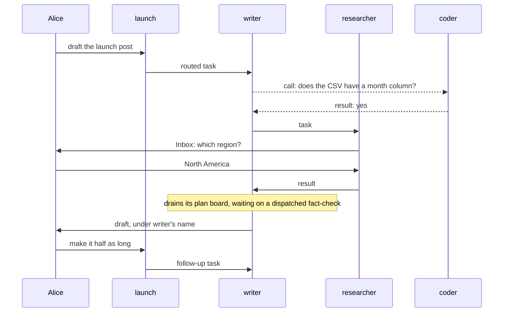

# Workforce Coordination: How It Should Work

## Why this doc

Workers reach each other and their users in many ways today, for three jobs: hand out work,
talk, and stop for a person. This doc gives each job one mechanism, as if it always existed.

Where today's code differs, the phase plan and the retired terms live in
[workforce-coordination-gaps.md](workforce-coordination-gaps.md). That departs from the
concept-doc skill's single-file shape on purpose, to keep the model readable.

## Base terms

**A user is a person.** Everything below acts as one user, inside one org.

**A worker belongs to one user and acts as them.** It runs on the flow it names. A user's
**roster** is all their workers; adding one is a **hire**.

**A session is where a worker works.** Only its user can open it. A **conversation** is the session
where a user talks to one worker: one per worker per user, plus one per project a coordinator
coordinates.

**A request is one run of a worker in a session.** The server sets its **sender**: a user, another
worker's session, or the board. It produces a **result**. A session runs one request at a time. A
request **waits** until a task or a call ends. It is **suspended** when it stops for a person: it
is stored, and **resumes** from the same step. That needs **durable execution**, a host that stores
a waiting request and carries it on later.

## The cast

| Name | Kind | Belongs to |
| -- | -- | -- |
| Alice, Bob | Users in the same org | |
| launch | Coordinator, routing by judgment. Delegates: writer, researcher, coder | Alice |
| writer | Worker on the agent flow. Delegate: researcher | Alice |
| researcher | Worker on the agent flow. No delegates | Alice |
| coder | Worker on a coding flow that drives a harness | Alice |
| Error Reporter | Worker that turns failures into bug reports | Alice |
| Bob's researcher | Worker on the agent flow | Bob |

## The parts, in the order you meet them

1. **Task.** A piece of work on one of a session's two boards: its plan board or its delegation board.
2. **Message.** Conversation with any worker on your roster.
3. **Inbox item.** The one way work stops for a person.
4. **Routing.** How a coordinator hands a user's message to its delegates.
5. **Chain of command.** How work a worker shouldn't file itself reaches someone who can.
6. **Worker contract.** The entries each of a worker's roles needs, checked at hire.

| Part (all owned by the user, private to them) | Stored | How many |
| -- | -- | -- |
| Task | A row on one of the filing session's two boards | One per piece of work |
| Message | The user's message log, and both sessions | One per send or call |
| Inbox item | The suspended request's record, or the held task's row | One per open stop |
| Routing state, delegates | The session's state | One per session |
| Roles | The worker's configuration | One set per worker |

## Tasks

**A task is a piece of work on a board, a session's list of tasks.** Its **filer**, the session that
filed it, plans it, sees how it ends, and can edit, steer or cancel it. Its **assignee** does it and is
accountable. Its **brief** says what the work is.

**A board's `mode` makes it a plan board or a delegation board,** and each session has one of
each. To **drain** a board is to start its ready rows until none is left.

| | Plan board | Delegation board |
| -- | -- | -- |
| Holds | The work of the board's own session | Tasks for delegates |
| `mode` | `"plan"`, the default: the drain waits on every row | `"delegation"`: the drain hands rows off and never waits |
| Drained by | `respond` in a conversation, or any request working the session's task | `dispatch`, a short pass that starts what's ready and exits |
| A row runs | Inline, or dispatched to another session and waited on | In another session, through a **dispatcher** block |
| An ending reaches | The drain, which carries on | The filer, as an event: `onTaskSettled` |

Because a plan board's drain waits on every row, whatever wraps it, such as a goal-seek loop or a
sequence, sees finished work. A **pattern** is a ready-made plan board, such as one that runs several
rows at once; patterns are plan boards as they stand. A **goal-seek loop** drains a board, asks a
judge whether the goal is met, and drains again if not, so it needs a plan board: over a delegation
board its judge would rule while rows are still running.

**writer's plan board** is outline, draft, fact-check, tighten. Its request writes the outline and
draft inline, dispatches the fact-check to another session and waits on it, then tightens. The claim
gate around that session's task entry settles the fact-check's row; the drain waits until it has,
then carries on.

**writer's delegation board** holds one task: researcher, find adoption numbers. `dispatch` starts
it in researcher's session and exits. It runs again on any filing, start, answer, retry or ending
that makes a row startable, and on any **touch** (read or write) of the board. `dispatch` runs one
at a time per session, rejecting a second call. Its last check for a startable row comes after its
other work; a row startable later is a debt (below).

**A board never mixes the two, and one built wrong is refused when built:** a delegation board with
an inline assignee, a plan board with a dispatcher that doesn't wait, or a goal-seek loop over a
delegation board. The **dispatcher** block has its own `wait`, `false` by default; with `wait: true`
the work's result comes back as the block's output, through a durable wait with a deadline. Inside a
board, the board's mode decides.

**Four settings, set at filing,** decide how a delegated task runs. A plan row uses only start and
attempts.

| Setting | Choices | Default |
| -- | -- | -- |
| Start | Now · after named tasks on the same board (its **dependencies**) · **held** until the filer releases it · **held on questions** (see Inbox items) | Now |
| Session | New · the assignee's ongoing session for the filer's conversation · an earlier task's session (a **follow-up**) | New |
| Result goes to | **The filer:** its waiting request if one waits on the task, otherwise its next request · the filer's conversation, under the assignee's name (routing uses this) | The filer |
| Attempts | Failed runs before it fails | 2 |

**A dependency never crosses boards;** crossing is a wait or a held task. writer filed "find
adoption numbers" for researcher on its delegation board, and the plan row "write the stats
section" first waits on that task. The other way round, a delegation task that must start after a
plan step is filed held, and the plan row that finishes the step releases it.

**Plan it, or delegate it?** Plan what needs the session's context or whose result you need next;
delegate what stands alone, with its own attempts and cancel. Use a follow-up for work that needs an
earlier task's memory, like writer asking researcher to shorten the stats.

**Recurring work is a schedule:** a row in the user's schedule list that files an ordinary task
each time it fires. Alice's list of scheduled work reads her schedules and their next fire
times, not a board. A fire whose filing fails is dropped, not retried, and a crash loses a run whose work
the schedule picks as it fires.

A task stays **running** while tasks it filed are open, even when no request is working it (at most
5 deep, 100 under one top task); rule 6 says how it ends. Every wait, on a task or a call, has a
**deadline**: reaching it resumes the request, which waits again or carries on without the result.

**The claim gate closes a dispatched task.** The request working a task holds its **claim**, the
right to record how it ends. The board wraps the **task entry**, the action a task runs through on
its assignee's flow, in the **claim gate**, which checks the claim before the entry runs and settles
the row when it ends: completed is done (or running while tasks it filed are open), failed
retries or fails, suspended is waiting on a person. A worker block never settles its own row: it
returns or throws, and whoever ran it turns that into the row's ending, the plan board's drain for an
inline row and the claim gate for a dispatched one.

**`updateTask` gives each field one meaning and one rule.**

| Field | Means | Allowed |
| -- | -- | -- |
| `goal`, `title`, `context`, `input`, `deps` (same board, no cycles), `priority`, `labels`, `metadata`, `assignee` (one of the filer's delegates), `maxAttempts` | Change the task | Before it starts |
| `status: "held"` / `"pending"` | Hold it, or release it. A task held on questions also needs its answers | Before it starts |
| `status: "cancelled"` | Cancel it: stops its run, cancels its open tasks, closes its Inbox item | Until it finishes |
| `message` | **Steer** it: before it starts it joins the brief; a running worker carries on with it, using no attempt; a question the filer may answer takes it as the answer | Until it finishes |

A refusal names its rule: "goal can't change after a task starts; send a message instead". A cancel
sent with a message or edits is refused. A finished task refuses everything: more work on it is a
new task with the follow-up session setting. Typing in the task's session sends a message; reassigning a
started task is cancel and refile. Never editable: other statuses, `wait`, `followUpOf`, attempts
used, the run link, the sealed payload, and the session and result settings.

**Every ending of a delegated task reaches the filer once,** as the result setting says: to its
waiting request if one waits, otherwise through `onTaskSettled`, which starts its next request.
A failure is an ending like any other; writer messages Error Reporter when one is worth reporting.

**A board pays what it owes.** A **debt** is what a row owes: an ending owed to the filer, a wait
owed a resume, a task whose filed tasks have all ended owed
its settle, or a startable row never started. Each carries a **due time** a few seconds out. The
settling side pays at once, and `dispatch` and every touch resend. Behind both, the engine's
**durability sweeper** wakes at the earliest due time and pays, so after a crash nothing waits on a
later touch.

## Messages

**A message is conversation with any worker on your roster,** delegate or not. Help bigger than the
recipient's one request is a task.

`sendMessage({ to, text, wait?, inReplyTo? })` addresses a worker, `to: "writer"`, or a task,
`to: { task: id }`. It **sends**, returning nothing, or **calls**
(`wait: true`): the sender waits for the recipient's result until a deadline, host-set by default. A
late result is kept under its **call id**, so a caller that waits again, or repeats the call, gets
it.

**The recipient's entry is `receive`.** Each message starts a new request carrying the text and,
set by the server, the sender, whether it waits, and the budget. Only a call gets the result back.
To answer a send, the recipient sends with `inReplyTo`, landing in the session that sent the
original, or the sender's conversation if that session's task has ended.

**Where it lands:** the recipient's conversation with this user, except that a message to the worker
that filed your task lands in the session that filed it. A message to a task lands in that task's
session. The server resolves it, refusing a task the sender can't see (its own, one it filed, or one
on a board it can read); there it is conversation only, for `receive`, and never steers.

**Limits.** A busy recipient queues the message; a call into a waiting session is refused, so two
waits never block each other. A request's **budget** is 6 messages per message a user types, 3 per
request, shared by requests descending from it; one with none behind it, such as the board starting
a held task, gets a fresh one.

## Inbox items

**Work stops for a person in one of two ways, and each stop is one Inbox item.**

**Before it starts, a task can be held on questions.** They show in the user's Inbox as soon as it's
filed, as one item, and only the user answers them. Each answer joins the task's brief, and the last releases the hold; its dependents wait too.
launch files coder's adoption-script task held on "Which CSV export should the script read?"; when
Alice answers, coder starts. Cancelling the task closes the item.

**Midway, a request suspends** with `waitForUser({ kind, prompt, deadline? })`, where `kind` is
approval, question or review. A suspension is not a wait, so a waited-on task may still stop for a
person. If the request works a task, the claim gate marks it waiting on a person; it keeps its
claim, and the resume carries on the same attempt.

| A suspension resumes once | When | The block |
| -- | -- | -- |
| Answered | The first answer, in the Inbox or the task's session | Carries on with it |
| Deadline | No answer by then | Goes ahead, ends, or suspends again (a **check-in**). Unhandled, an approval counts as rejected and a question or review errors, using an attempt |
| Cancelled | Its task is cancelled; the item goes away | Winds down; nothing it returns is recorded |

Only the user answers approvals and reviews; the filer may answer a question, unless the task is
routed. Stopping a suspended request closes its item and cancels any task it works.

**A coding run can't pause midway,** because the coding agent runs as its own process. Its question
ends the run, the coding flow's request suspends, and the answer starts the next run in the same
coding session. A steer stops the run; the next run continues that coding session with the
message.

## Routing

**Routing decides who takes a user's message to a coordinator.** It files **routed tasks** on the
coordinator's delegation board: session = the delegate's ongoing session for this conversation,
result = the conversation under the delegate's name, attempts = 1. The delegate remembers earlier
routed tasks there.

| Policy | Who picks | Cost |
| -- | -- | -- |
| Judgment | The coordinator's own request files tasks, or answers | One request |
| Best fit | The fit check. A weak pick goes to the **fallback**, a delegate the coordinator names | One model call |
| Round robin | The next delegate | None |
| Everyone | Every delegate | None |

**The fit check** picks a delegate for best fit, and vets the **lead** someone chose for a
**workstream**, a piece of a project. With **rounds** (up to 3), the coordinator sees each answer and
can send it back out. Messages to a coordinator get its own request, whatever its routing.

## Chain of command

**Your delegates are your authority.** Each session's list starts from its worker's defaults; `all`
means the whole roster, the worker itself included. Rule 13 says who changes it.

**What a request can't file goes up as a message to the filer above, who decides.** For new work
outside its task, the worker describes it and carries on, and the filer files a **sibling**, a new
task beside the worker's. The filer's flow may spot a request for work with an **evaluator** (a block that
judges input) and file it held, for the user to approve. For work a worker needs but can't assign,
the filer files it if it can, or messages its own filer. Either way, the result goes to whoever
filed the task, who passes it on in a follow-up.

```mermaid
sequenceDiagram
  participant Alice
  participant researcher
  participant writer
  participant launch
  participant coder
  researcher-->>writer: message: I need an adoption script
  writer-->>launch: message: researcher needs a script
  launch->>coder: task, held on: which CSV export?
  Alice->>coder: answers in her Inbox; the hold releases
  coder->>launch: result: the script
  launch->>writer: follow-up, with the script
  writer->>researcher: follow-up, with the script
```

*The need goes up as messages, the work comes down as tasks, and every result returns to its
filer.* Dashed arrows are messages.

## The worker contract

**A worker's roles say which entries its flow must have.** An **entry** is a flow action that starts
a request.

| Role | Entries | Example |
| -- | -- | -- |
| Every worker | `respond`, `receive` | all |
| Contributor (takes tasks) | `work` | researcher, coder |
| Manager (files tasks) | `dispatch`, `onTaskSettled` | writer, which is also a contributor |
| Coordinator (a manager that routes a user's messages) | Manager entries plus the routing entries: `onWorkstreamOpened`, `changeWorkstreamDelegate`, `routeOn`, `roundDeadline` | launch |

`respond`, the only public entry, takes a user's message; `receive`, another worker's; `work`, a
task; `onTaskSettled`, a filed task's ending; `dispatch`, a pass over the delegation board.
Working the session's task, `work` and `onTaskSettled` go through the claim gate and drain the plan board.

Roles combine. A worker declares its roles, and the hire checks that each one's entries exist and
accept their inputs, probing their input schemas as it does for `respond`. A flow gets a role's
entries from a **factory**, a function returning the tools, actions, entries and session state its
author spreads into the flow definition.

The model's six tools: four task tools, `createTask`, `getTask`, `listTasks` and `updateTask`,
plus `sendMessage` and `waitForUser`. The task tools are also public actions a screen calls as the user:
cancel a task, release a held one, answer its questions. Every worker gets `listDelegates`; only a configured coordinator gets
`addDelegate`, `removeDelegate`, `setFallback`.

## How it flows

1. Alice tells launch "Draft the launch post": a `respond` request.
2. It files a routed task for writer, and ends. `dispatch` starts it in writer's session.
3. writer's `work` request calls coder: "Does the CSV have a month column?" coder answers yes.
4. Needing numbers before it plans, it files a task for researcher and ends. writer's task stays
   running with no request on it.
5. researcher asks "Which region?" with `waitForUser`, and suspends. Alice answers in her Inbox, and
   the same request carries on.
6. researcher finishes; the claim gate marks its task done, and `onTaskSettled` starts a request
   working writer's task.
7. That request drains writer's plan board, waiting on the fact-check it dispatched, and finishes with
   nothing open. writer's task is done, and the draft lands in Alice's conversation with launch,
   under writer's name.
8. Alice tells launch "Make it half as long", and launch files writer a follow-up task.



*Three delegated tasks, one plan board, one call and one Inbox item carry the whole job.*

## The rules

A behavior none of these rules explains is a bug in the model.

1. Every request acts as one user, with a server-set sender.
2. Only a request the board started for a task holds its claim. The claim gate settles a
   dispatched task; the drain, an inline plan row.
3. A request files tasks only for work its job needs: its task, or the user's message it answers.
   Anything else is a message to the filer above. Nothing leaves the roster: Alice's workers never
   reach Bob's researcher.
4. A task has one filer, one accountable assignee, and four settings set at filing.
5. A session holds at most one open task from the delegation board above it; another stays pending.
   Plan rows don't count.
6. A task runs while tasks it filed are open, and is done when a request for it finishes with none
   open. Cancelling, retrying or failing it cancels its open tasks; failing or cancelling it cancels
   its dependents.
7. Every ending of a delegated task, a failure included, reaches its filer once, as its result
   setting says: the waiting request, or `onTaskSettled`.
8. Every debt has a due time. The settling side pays it, `dispatch` and every touch resend it, and
   the durability sweeper pays it when due.
9. A request may wait on a task it filed or a call, even inside a waited-on task, up to 5 deep, each
   wait with a deadline. A late call result is kept for a caller that waits again.
10. A call returns the recipient's result; nothing is relayed or answered automatically. A call into
    a waiting session is refused, as is a message past the budget.
11. Every stop for a person is one Inbox item: a suspended request, or a task held on questions.
    Only the user answers approvals and reviews.
12. A suspension resumes once, answered, deadline or cancelled, unless its request is stopped. Its
    task keeps its claim. A task held on questions starts no sooner than its last answer.
13. Only the user changes delegates, except a coordinator configured to change its own.
14. A board's `mode` is `plan`, the default, or `delegation`. A plan board's drain waits on every
    row, a delegation board's on none, and a board built to mix the two is refused when built.
15. A hire is refused when a declared role lacks an entry, or an entry refuses its input.
16. A dependency stays within one board. Crossing boards is a wait or a held task.
17. `dispatch` runs one at a time per session; a second call is rejected.
18. A worker block never settles its own row. It returns or throws; the drain settles an inline row,
    and the claim gate a dispatched one, even one a plan board waits on.
19. A goal-seek loop needs a plan board, and is refused when built over a delegation board.
20. Each `updateTask` field has one rule: edits, hold and release before a task starts; cancel and a
    message until it finishes; nothing after. A follow-up is a new task.
21. A message addresses a worker or a task the sender can see, never a raw session.

## Vocabulary

One term, one thing. Retired: turn, line, post, park, reply, relay, reopen, blocked, kit (say
factory), pieces (say the tasks it filed), self-assigned row (say plan row), chief of staff (say
Shift Coordinator, as the docs and UI do), and dispatcher for anything but the block. The
[retired-terms table](workforce-coordination-gaps.md#retired-terms-the-refactor-removes) has the
rest.

| Term | Means |
| -- | -- |
| User, worker, roster, hire | A person; an agent acting as one user; all of a user's workers; adding one |
| Session, conversation | Where a worker works; where a user talks to one worker |
| Request, sender, result | One run of a worker in a session; who it runs for; what it produces |
| Wait, deadline | Holding a request until a task or a call ends; when a wait or suspension resumes unanswered |
| Suspended, resume, check-in | Stopped for a person and stored; carrying on from the same step; a renewed deadline |
| Durable execution | A host that stores a waiting request and carries it on later |
| Task, filer, assignee, brief | Work on a board; the session that filed it; who does it; what it is |
| Board, row, drain, touch | A session's list of tasks; a task on it; starting its ready rows until none is left; any read or write of it |
| Plan board, pattern, goal-seek loop | The board of its own session's work, whose drain waits on every row; a ready-made plan board, such as one that runs several rows at once; a loop that drains a plan board and asks a judge whether to drain again |
| Mode | The board setting, `plan` or `delegation`, that makes it one kind or the other |
| Delegation board, `dispatch` | The board of tasks for delegates, whose drain never waits; the pass that drains it |
| Dispatch, dispatcher | Start work in another session; the block that does it, waiting for the result only with `wait: true` |
| Schedule | A row in a user's schedule list that files a task each time it fires |
| Dependency, held, held on questions | A task on the same board that must end first; waiting for the filer to release it; waiting for the user's answers |
| Pending, running, waiting on a person | Not yet started; worked, or with filed tasks open; its request suspended |
| Steer | A message into an unfinished task: it joins the brief, redirects the worker, or answers |
| Follow-up, sibling | A new task in an earlier task's session; a task filed beside another, for work its worker reported |
| Claim, claim gate, task entry | The right to record a task's ending; the step that checks it and settles the row; the action a task runs through on its assignee's flow |
| Debt, due time, durability sweeper | What a row owes; when it's due; the engine's pass that pays it |
| Send, call, call id, budget | A message that returns nothing; one whose sender waits; the key a call's result is kept under; how many messages a request may still send |
| Inbox item | One stop for a person: a suspended request or a task held on questions |
| Delegate, coordinator | A worker a session may file tasks with; a worker that routes a user's messages |
| Routed task, fit check, fallback, rounds | A task routing filed; the model call that picks a delegate or vets a lead; the delegate that takes a weak pick; sending answers back out |
| Workstream, lead, evaluator | A piece of a project; the worker that runs it; a block that judges input |
| Entry, role | A flow action that starts a request; contributor, manager or coordinator |
| Factory, capability | A function returning what a flow spreads into its definition; a bundle of tools, context and resources a block uses |

## Decisions

The model above is the owner's, including: nothing settled by hand (no tool settles a task); a
deadline on every wait, a waited dispatch included; nested waits (rule 9); and fourteen newly decided:

- [x] **Held on questions.** Questions known at filing reach the Inbox at once; mid-task stops stay
  suspensions.
- [x] **The worker contract.** Roles declared, their entries checked at hire.
- [x] **The sweeper backs up what a board owes.** The fast paths stay; it pays any debt when due.
- [x] **Dependencies stay within one board (rule 16).** Crossing boards is a wait or a held task.
- [x] **Recurring work is a schedule** that files a task when it fires.
- [x] **A failure is an ending.** The filer messages Error Reporter if it chooses.
- [x] **Task tools are public actions,** called by screens as the user.
- [x] **`dispatch` runs one at a time (rule 17).** The sweeper pays what its last check misses.
- [x] **A board's `mode` is `plan` or `delegation` (rule 14),** `plan` by default. It supersedes a
  board-level `wait: true | false`. No mixing, refused when built. `dispatcher({ wait })` stays,
  `false` by default; inside a board, the board's mode decides.
- [x] **A worker block never settles its own row (rule 18).** Whoever ran the work settles it.
- [x] **A goal-seek loop needs a plan board (rule 19),** and refuses a delegation board when built.
- [x] **Patterns are plan boards.** They keep their boards and don't change.
- [x] **`sendMessage` addresses a worker or `{ task: id }` (rule 21).** A task's message lands in its
  session, conversation only. `{ sessionId }` is deferred until a real need, such as a session with
  no task: routing never trusts a caller's session id (BP-031).
- [x] **Four task tools, one rule per field (rule 20).** `addTask` and `readTask` become `createTask`
  and `getTask`; `cancelTask` folds into `updateTask`; no steer tool. Supersedes one meaning per phase.

Open:

- [ ] **Refusing a call into a waiting session (rule 10).** Recommend revisiting once a resume
  takes its turn in line (FIX-2062), when a waiting session no longer blocks a call.
- [ ] **Renames.** Recommend Shift Coordinator in code, plus the companion file's code renames. The
  old worker id just stops working; nothing outside the repo uses it.
- [ ] **A separate entry for proposing work.** Punted. Found work rides on `sendMessage`, and the
  receiver classifies it. If that proves unreliable, add an optional hint, never authority.
- [ ] **Whether a worker filer hears of its task's suspensions.** Recommend yes: a question starts
  the filer's next request, as an ending does.
- [ ] **Capabilities that contribute entries,** so factories can become capabilities: one way to
  bundle what a flow needs, not two. Recommend exploring it.

## Where today's code differs

In [workforce-coordination-gaps.md](workforce-coordination-gaps.md#where-todays-code-differs).
