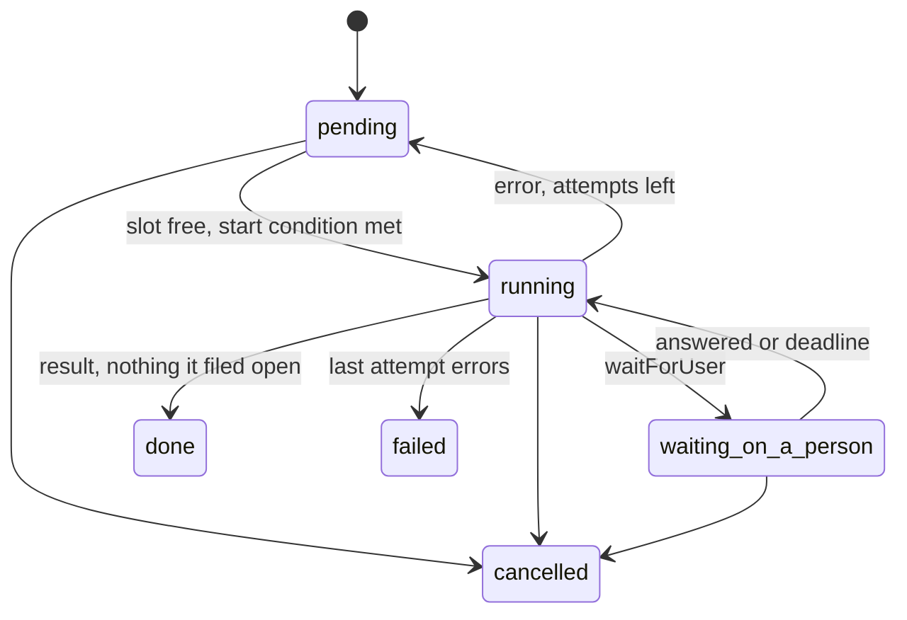
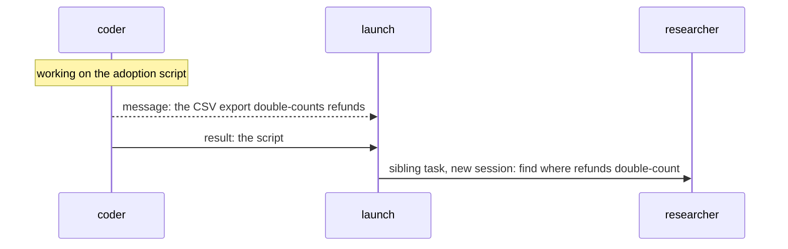
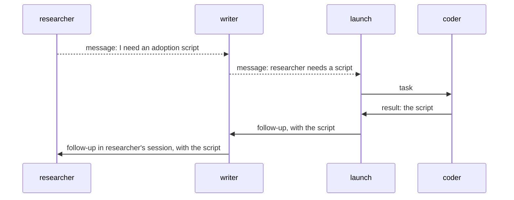
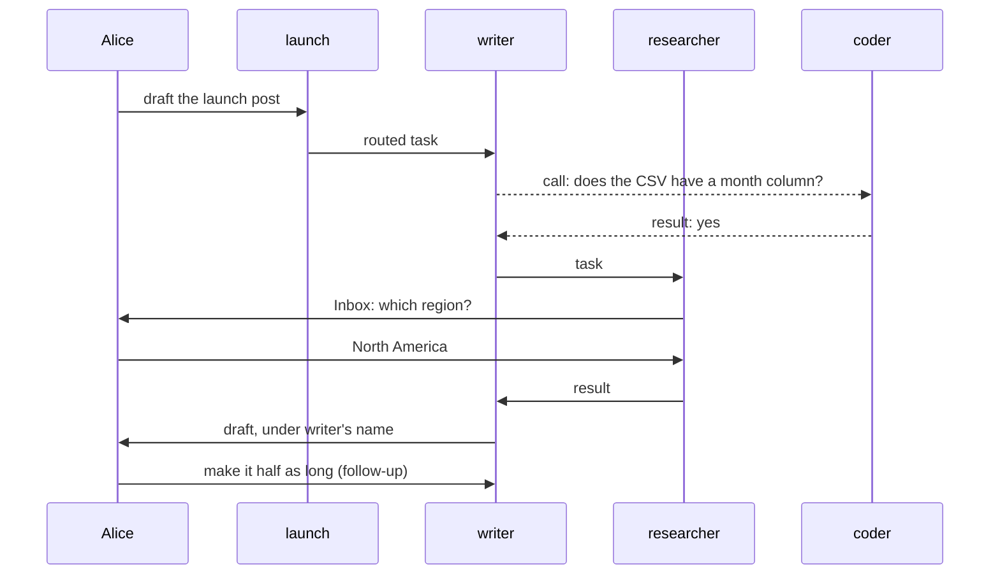

# Workforce Coordination: How It Should Work

## Why this doc

Workers reach each other and their users in many ways today, for three jobs: hand out work,
talk, and stop for a person. This doc gives each job one mechanism, as if it always existed. The
last section lists where today's code differs.

## Base terms

**A user is a person.** Everything below acts as one user, inside one org.

**A worker belongs to one user and acts as them.** It runs on the flow it names. A user's
**roster** is all the workers that belong to them.

**A session is where a worker works.** Only its user can open it.

**A conversation is the session where a user talks to one worker.** One per worker per user. A
coordinator also has one per project it coordinates.

**A request is one run of a worker in a session.** The server sets its **sender**: a user, another
worker's session, or the board. It produces a **result**. A session runs one request at a time.
A request **waits** when it can't go on until a task or a call ends. A request is **suspended** when it stops for a
person: nothing runs, it is stored, and it carries on from the same step when it **resumes**.

## The cast

| Name | Kind | Belongs to |
| -- | -- | -- |
| Alice, Bob | Users in the same org | |
| launch | Coordinator, routing by judgment. Delegates: writer, researcher, coder | Alice |
| writer | Worker on the agent flow. Delegate: researcher | Alice |
| researcher | Worker on the agent flow. No delegates | Alice |
| coder | Worker on a coding flow that drives a harness | Alice |
| Bob's researcher | Worker on the agent flow | Bob |

## The parts, in the order you meet them

1. **Task.** Work assigned to a delegate, or a row a worker keeps for itself.
2. **Message.** Conversation with any worker on your roster.
3. **Inbox item.** The one way work stops for a person.
4. **Routing.** How a coordinator hands a user's message to its delegates.
5. **Chain of command.** How work a worker shouldn't file itself, new or needed, reaches someone who
   can.

| Part (all owned by the user, private to them) | Stored | How many |
| -- | -- | -- |
| Task | A row on the filing session's board, in the user's task ledger | One per piece of work |
| Message | The user's message log, and both sessions | One per send or call |
| Inbox item | The suspended request's record, listed in the user's Inbox | One per open stop |
| Routing state, delegates | The session's state | One per session |

## Tasks

**A task is work assigned to a delegate.** It's a row on the filing session's **board**, its list
of tasks. The assignee is **accountable** for the work. The session that filed it, the **filer**,
plans and coordinates it: it sees how the task ends, and can steer or cancel it.

**A board also holds self-assigned rows,** such as a worker's plan steps; task views show both.
The worker marks its own row done with `completeTask`, and the session and result settings don't
apply. Nothing else is restricted.

**Four settings, fixed at filing,** decide how a task runs.

| Setting | Choices | Default |
| -- | -- | -- |
| Start | Now · after named tasks (its dependencies) · held until `updateTask` starts it | Now |
| Session | New · the assignee's ongoing session for the filer's conversation · an earlier task's session (a **follow-up**) | New |
| Result goes to | **The filer:** its waiting request if one waits on the task, otherwise its next request · the filer's conversation, under the assignee's name (used by routing) | The filer |
| Attempts | Failed runs before it fails | 2 |

A session holds at most one open task assigned to it. Another one routed or continued into it
stays pending until the first ends. The rule is about tasks from the board above, where the
session's own task lives. Rows on the session's own board, its self-assigned rows, don't count:
they are the work the session manages inside itself, and never wait behind its task.

**Do it here, or file it?** Keep work in your session if it needs what the session knows and should
run in order. File it if it can stand alone.

| Choice | Use when | Example |
| -- | -- | -- |
| Self-assigned row | A step of your own task, done in order in this session, on its own board | writer's plan: outline, draft, tighten |
| Task, new session | It can run beside your work, needs a clean start, or deserves its own attempts and cancel | writer files researcher: find adoption numbers |
| Follow-up | It continues earlier work and needs that session's memory | writer: shorten the stats, in researcher's session |

A worker is on its own roster, so it may file a task to itself in a new session, such as writer
drafting three sections side by side.

*Each ending has one path, and a person's answer never costs an attempt.*

- **Done:** a request for it finishes with a result, and nothing it filed is still open.
- **Cancelled:** by the user, the filer, or the end of the task that filed it. Its open tasks go
  too, as they do when it retries or fails for good.
- **A dependency that fails or is cancelled** cancels the tasks that were to start after it.
- **Splitting:** a task stays running while tasks it filed are open. At most 5 deep, 100 under
  one top task.
- **Waiting:** a request may wait on a task it filed, unless something already waits on its own
  task. A wait has a **deadline**: reaching it resumes the request, which decides to wait again or
  carry on. One that doesn't decide carries on without the result. The task keeps going either way.

**The filer steers with `updateTask({ id, message })`,** by the task's status. The user can also
type in the task's session. Any other worker's message there is just a message.

| Status | The message |
| -- | -- |
| Running | Steers: the current request stops and the worker continues with it, using no attempt |
| Waiting on a person | Answers it, within the Inbox rules |
| Done, failed, cancelled | Continues: a follow-up in the same session, with fresh attempts |

**Every ending is delivered once, through `onTaskSettled`,** a public board hook in orchestration.
Workforce's default reruns the board on a retry, and otherwise delivers the result as its setting
says.

## Messages

**A message is conversation with any worker on your roster.** Delegates don't matter. A call may
get help that fits in the recipient's one request; anything bigger is a task.

`sendMessage({ to, text, wait?, inReplyTo? })` **sends**, returning nothing, or **calls**
(`wait: true`): the sender's request waits for the recipient's result. A call is an awaited
dispatch.

**The recipient's entry is `receive`.** It always starts a new request, with input
`{ id, from: { session, worker }, text, waiting, inReplyTo?, budget }`. The server sets `from`,
`waiting` and `budget`.

**The receiver decides.** If `waiting`, its result goes back to the caller; if not, nothing does.
To answer a send, it sends with `inReplyTo`, which lands in the session that sent the original, or
the sender's conversation if that session's task has ended.

**Where it lands:** the recipient's conversation with this user, except that a message to the
worker that filed your task lands in the session that filed it.

**Limits:**

- A busy recipient queues the message. But a call into a session whose current request is itself
  waiting is refused at once, so two waits never block each other.
- A call uses the per-block timeout any block can set. A repeated call id gets the stored result.
- The server sets each request's budget: 6 messages per message a user types, 3 per request.
  Requests descending from a user's message share it. One with none behind it, such as the board
  starting a held task, gets a fresh one.

## Inbox items

**Work stops for a person one way:** `waitForUser({ kind, prompt, deadline? })`, where `kind` is
approval, question or review. It suspends the request. It works with or without a task, and needs
a host with durable execution. A suspension is not a wait, so a task something waits on may still
stop for a person.

**If the request works a task,** the task is waiting on a person. It keeps its claim while
suspended, and its row records which suspension holds it. The resume carries on the same attempt,
so a person's answer uses no attempt.

**A suspension resumes once, one of three ways:**

| Outcome | When | The block |
| -- | -- | -- |
| Answered | The user answers in the Inbox or types in the task's session, or the filer answers a question with `updateTask`. The first answer closes the item | Carries on with the answer |
| Deadline | Its deadline passes unanswered | Decides: go ahead without the person (say, take the recommendation on a call that's easy to undo), escalate (text them) and suspend again with a new deadline, or end. Each renewal is a check-in |
| Cancelled | Its task is cancelled. The Inbox item goes away at once | Winds down without the answer. Nothing it returns is recorded on the cancelled task |

A block that doesn't handle a deadline gets the default: an approval counts as rejected, and a
question or review ends the request with an error, which uses an attempt.

- Every item is listed in the user's Inbox and answered once, wherever the answer comes from.
- Only the user answers approvals and reviews. The filer may answer a question with `updateTask`,
  unless the task is a routed task.
- A resumed request takes its turn in the session, like any other request.
- **Stopping a suspended request** ends it, as a stop ends any request, and closes its Inbox item.
  If it worked a task, the task is cancelled.
- **A coding run can't pause midway,** because the coding agent runs as its own process. Its
  question ends the run, the coding flow's request suspends, and the answer starts the next run in
  the same coding session.

## Routing

**Routing decides who takes a user's message to a coordinator.** It files **routed tasks**:
session = the delegate's ongoing session for this conversation, result = the conversation under the
delegate's name, attempts = 1. The delegate remembers earlier routed tasks there.

| Policy | Who picks | Cost |
| -- | -- | -- |
| Judgment | The coordinator's own request files tasks, or answers | One request |
| Best fit | The fit check. A weak pick goes to the **fallback**, a delegate the coordinator names | One model call |
| Round robin | The next delegate | None |
| Everyone | Every delegate | None |

**The fit check is one model call.** It picks a delegate for best fit, and vets the **lead**
someone already chose for a **workstream**, a piece of a project. With **rounds** (up to 3), the
coordinator also sees each answer, so it can send it back out. A coordinator answers messages with
its own request, whatever its routing.

## Chain of command

**Your delegates are your authority.** You file tasks only with them. Each session's list starts
from its worker's defaults, and `all` means the whole roster. Only the user changes delegates,
except a coordinator whose instructions say so and whose delegate tool is turned on (off by
default).

**A worker files tasks only for work its own task needs.** Everything else goes up as a message to
the filer of its task, who decides. It goes up for one of two reasons.

**New work that isn't part of your task** is the common one. A worker finds something that needs
doing but has nothing to do with the work it's on. It sends its filer a message describing the
work and carries on. The filer files a **sibling**: a new task on its own board, beside the worker's
task, usually in a new session. Its flow may tell a request for work from other messages, for
example with an **evaluator** (a block that judges input), and file it held, for the user to
approve. If the work isn't the filer's to plan either, it messages its own
filer the same way.

*The worker reports new work and keeps going; its filer turns it into a sibling task.* coder's
task never waits on it. Dashed arrows are messages.

**Work you need but can't assign** is the other. A worker that needs work none of its delegates
can do messages its filer, describing the need. That filer files the task if it can, or messages
its own filer.

**A result always goes to whoever filed the task,** who passes it on, usually by filing a follow-up
that carries it. The original task may finish first; the work resumes through the follow-up. It
costs extra hops and needs no new mechanism.

*The need goes up as messages, the work comes down as tasks, and every result returns to its
filer.* Dashed arrows are messages.

## How it flows

1. Alice tells launch "Draft the launch post." That's a request in launch's conversation.
2. That request files a routed task for writer.
3. writer's request calls coder: "Does the CSV have a month column?" coder's request answers yes.
4. The same request files a task for researcher, then ends. writer's task keeps running.
5. researcher's request asks "Which region?" with `waitForUser`, and suspends. Alice answers in her
   Inbox, and the same request carries on.
6. researcher finishes. `onTaskSettled` starts writer's next request.
7. That request finishes with the draft, and nothing it filed is open. The draft lands in Alice's
   conversation with launch, under writer's name.
8. Alice types "Make it half as long" in writer's finished task, and a follow-up runs.

*Three tasks, one call and one Inbox item carry the whole job.*

## Entry points and tools

| Entry | Access | Starts a request for |
| -- | -- | -- |
| `run` | Public | A user's message |
| `receive` | Internal | Another worker's message |
| `work` | Behind the claim gate | A task |
| `onTaskSettled` | Internal | A filed task ending |
| `runTaskBoard` | Internal | The board starting ready tasks |

Role-specific entries stay: `onWorkstreamOpened`, `changeWorkstreamDelegate`, `routeOn`,
`roundDeadline`. The model's eight tools: `addTask`, `updateTask` (with `message` to steer, answer
or continue), `cancelTask`, `completeTask` (self-assigned rows only), `listTasks`, `readTask`,
`sendMessage`, `waitForUser`. Every worker gets `listDelegates`. Only a configured coordinator gets
`addDelegate`, `removeDelegate`, `setFallback`.

## What changes

| | |
| -- | -- |
| Lost | Settling another worker's task by hand. The blocked status. Stopping for a person on a host without durable execution |
| Narrowed | Tasks only to delegates (or `delegates: all`). Workers changing their own delegates. A split's `{ answer, pieces }` result |
| Changed | A wait's deadline doesn't cancel the task. A person's answer resumes the suspended request instead of starting a new one. Deadlines are the flow's to handle. No automatic reply to messages. Every coordinator can be messaged |
| Kept | Pluggable claim orders. A delegate's memory across routed tasks. Routing, rounds and records. `completeTask` for self-assigned rows. A coding run resuming its coding session |

## Naming

| Retire | Say | Why |
| -- | -- | -- |
| Chief of staff | Shift Coordinator | The docs and UI already say it |
| Dispatcher (claim order, host) | Claim order, runner | One word for four things. The dispatcher block and dispatching a task keep it |

## The rules

A behavior none of these rules explains is a bug in the model.

1. Every request acts as one user, with a server-set sender.
2. A request holds a task's claim only if the board started it for that task.
3. Work is a task, filed with a delegate or as a self-assigned row, and only for work the filer's
   own task needs. Anything else is a message to the filer above.
   Neither leaves one user's roster: Alice's workers never reach Bob's researcher.
4. A task has one filer, who plans and coordinates it, one accountable assignee, and four
   settings.
5. A session holds at most one open task assigned to it.
6. A task is done when a request for it finishes with nothing it filed still open. Cancelling,
   retrying or failing it cancels its open tasks, and its failing or cancelling cancels the tasks
   that depend on it.
7. Every ending is delivered once, through `onTaskSettled`, to the task's filer, as its result
   setting says.
8. A request may wait on a task it filed unless something already waits on its own task.
   `waitForUser` suspends the request instead, which is not a wait.
9. A call returns the recipient's result. Nothing is relayed or answered automatically.
10. A call into a waiting session is refused, and so is a message past the budget.
11. Every stop for a person is one Inbox item: a suspended request. Only the user answers
    approvals and reviews.
12. A suspension resumes once, answered, deadline or cancelled, unless its request is stopped. A suspended task keeps its claim,
    and the resumed request takes its turn in the session.
13. Only the user changes delegates, except a coordinator configured to change its own.

## Vocabulary

One term, one thing. Retired: turn, line, post, park, reply, relay, reopen, blocked, plan row,
chief of staff, and dispatcher for the claim order or the host.

| Term | Means |
| -- | -- |
| Request, wait | One run of a worker in a session; a request that can't go on until a task or a call ends |
| Suspended, resume, deadline | A request stopped for a person and stored; carrying on from the same step; when a suspension or wait resumes unanswered |
| Roster | All the workers that belong to one user |
| Delegate, coordinator | A worker a session may file tasks with; a worker that routes a user's messages |
| Evaluator | A block that judges input; here, telling a request for work from other messages |
| Task, filer | Work assigned to a delegate; the session that filed it |
| Board, self-assigned row | A session's list of tasks; a row a worker files for itself |
| Follow-up | A task in an earlier task's session |
| Sibling | A task a filer files beside one of its own, from new work that task's worker reported |
| Send, call | A message that returns nothing; one whose sender waits for the result |
| Inbox item | One stop for a person, as a suspended request: approval, question or review |
| Routed task, fit check | A task routing filed; the model call that picks a delegate or vets a lead |
| Fallback, rounds | The delegate that takes a weak best-fit pick; sending routed answers back out |
| Workstream, lead | A piece of a project; the worker that runs it |
| Claim order, runner | Which ready task starts next; where the host runs work |

### Retired terms the refactor removes

Files mentioning each term on 2026-10-17 (`git grep -l`): package source / docs (docs site,
`docs/architecture`, READMEs) / the rest (tests, apps, goals, labs). Reopen, answer a task and chief
of staff have many spellings, so they count case-insensitive substrings (`-i`). Other rows count
the listed identifiers as whole words (`-w`).

| Retired | Say | In code | Files |
| -- | -- | -- | -- |
| Post | Routed task | `onDelegatedPost`, `isPostRow`, `onPostSettled`, `postCancelled`; `postId`, `RoundPost` | 7 / 1 / 17; 6 / 2 / 21, 2 / 0 / 1 |
| Message entry; tool | `receive`; `sendMessage` | `onWorkerMessage`; `messageWorker` | 5 / 1 / 2; 7 / 4 / 5 |
| Park on a question; review park; a coding run's question inbox | Inbox item | `parkOnQuestion`, `parkedOnQuestion`; `awaitReview`, `unparkAndDrain`, `onReview`; `answerQuestion` | 8 / 4 / 15; 19 / 6 / 42; 2 / 3 / 5 |
| Message door | Steer | `parkedForTurn`, `messageDoor`, `harnessMessageDoor` | 9 / 2 / 5 |
| Reopen | Follow-up | `reopen*` | 26 / 12 / 56 |
| Answer a task | Answer the Inbox item | `answerTask*` | 3 / 6 / 23 |
| Relay; reply | None; `inReplyTo` | `workforceRelayTo`; `replyTo` | 1 / 0 / 0; 5 / 2 / 6 |
| Blocked | Cancel, or a dependency | `blockTask` | 2 / 2 / 12 |
| Removed task tools | `addTask`, `updateTask` | `dispatchTask`; `assignTask`; `failTask` | 14 / 9 / 62; 3 / 4 / 23; 2 / 2 / 13 |
| Split settle; split cancel; piece retry | A running task; cancel; attempts | `settleSplitTask`; `cancelSplitPieces`; `retryOf` | 1 / 0 / 0; 1 / 0 / 0; 6 / 0 / 5 |
| Delegation board | Board | `delegationBoard` | 1 / 0 / 0 |
| Chief of staff | Shift Coordinator | `chief-of-staff`, `chiefOfStaff*`, prose | 23 / 8 / 101 |
| Dispatcher | Claim order; runner | `TaskDispatcher`; `FlowDispatcher` | 13 / 1 / 6; 11 / 2 / 10 |

## Decisions

Everything in the model above is decided by the owner. Open:

- [ ] **Refusing a call into a waiting session (rule 10).** Once a resume takes its turn in line
  (FIX-2062), a waiting session no longer blocks a call, so the refusal may be unnecessary.
  Recommend revisiting once FIX-2062 lands.
- [ ] **Patterns' own task lists.** Recommend an in-request board, and pruning phase 0's dead code.
- [ ] **Renames.** Recommend Shift Coordinator in code, "claim order" and "runner". The
  old worker id simply stops working: there are no consumers outside the repo to migrate.
- [ ] **A separate entry for proposing work.** Punted. Found work rides on `sendMessage`, and the
  receiver's flow classifies it. If classifying proves unreliable, an optional hint on the message
  saying it's a request for new work comes first, as a hint the receiver may ignore, never as
  authority.
- [ ] **Whether a worker filer hears of its task's questions.** It may answer them with
  `updateTask`. Recommend yes: the question starts its next request, as an ending does.

## Where today's code differs

Paths are relative to `packages/`. Each phase is one epic. Phase 0 blocks nothing; 2 needs 1; 3
needs 1 and 2; 4 runs beside 2 and 3; 5 goes last. Phase 2 also needs two fixes that apply to every
suspension, not only these: a resume taking its turn in the session (FIX-2062), and durable
execution by default on file-backed hosts (FIX-2063). Replay of a request suspended across a
deploy is a known risk, deferred.

| Phase | Target | Today |
| -- | -- | -- |
| 0 · Land | A request reads its own claim only | Fixed on the FIX-1047 branch, not on main (`orchestration/src/task-board/flow-policy-wiring.ts`) |
| 0 · Prune | Nothing the repo doesn't use. Exported and documented ones go with their README and docs entries; there are no outside consumers | Unused in the repo: `dispatchAndExecuteBlock` (`orchestration/src/tasks/helpers/dispatch-and-execute.ts`), the classifier and event claim orders, and fifo, a copy of the default (`orchestration/src/tasks/dispatchers/`). The own-state board has no production user (`orchestration/src/skills/task-tools-capability.ts:122`). Drain Pool is docs only (`apps/docs/docs/patterns/overview.md:69`) |
| 1 · One task | Routed tasks; attempts a setting | Posts have their own row kind and entries (`workforce/src/coordinator/delegated-post.ts`). Rounds, their deadlines, `routeOn` and settlement key on `postId` (`workforce/src/coordinator/coordinator-rounds.ts`, `coordinator-state.ts`, `coordinator-flow.ts`), so they move with it. Attempts are 2 for tasks (`workforce/src/conversation-board/board.ts:118`), 1 for posts |
| 1 · One task | `onTaskSettled` in orchestration, every ending delivered | Workforce owns it (`workforce/src/conversation-board/task-settled.ts`). A cancel owes a notice only when a request waits on the task (`orchestration/src/tasks/notice/task-notice.ts:100-102`) |
| 1 · One task | A task's request may wait on a task it filed, unless something waits on its own task | Every task request is refused a wait (`orchestration/src/tasks/helpers/wait-for-response.ts:222-230`) |
| 1 · One task | A wait's deadline leaves the task running | It cancels the row (`orchestration/src/tasks/helpers/wait-for-response.ts`) |
| 1 · One task | Splits use delegates and stay running | Pieces go to any roster worker (`board.ts:280-296`). The parent parks until `settleSplitTask` (`workforce/src/conversation-board/split.ts`) |
| 1 · One task | Delegates are authority; `all` | Any worker with delegates can change them (`workforce/src/delegates/worker-delegates.ts`). No `all` |
| 1 · One task | One open task per session; another stays pending | A follow-up into a busy session is refused, not queued (`session_has_unfinished_task`, `orchestration/src/skills/task-tools-capability.ts:656-662`) |
| 1 · One task | Start: now, after named tasks, or held until `updateTask` | No held start. A filed task can be moved to `blocked` (`orchestration/src/tasks/schema/task-status.ts:15`), and `unblock` has no caller |
| 1 · One task | Cancelling, retrying or failing a task cancels its open tasks | Only cancelling a split task cascades to its pieces (`workforce/src/conversation-board/split.ts:341-361`) |
| 1 · One task | A failed or cancelled dependency cancels its dependents | A dependent waits for a `completed` dependency (`orchestration/src/tasks/collection/internal.ts:742-750`), and one that will never complete leaves it pending for good (`orchestration/src/task-board/blocks/board-meta.ts:245-274`) |
| 1 · One task | Eight tools; one fit call | Twelve task tools (`orchestration/src/skills/task-tools-capability.ts`) plus `messageWorker`. `unblock` has no caller (`orchestration/src/tasks/collection/state-backed.ts:695`). Two fit calls: best fit picks (`workforce/src/best-fit.ts`), lead fit only vets (`workforce/src/projects/lead-fit.ts`) |
| 2 · One Inbox | Every stop for a person is a suspension, with one answer path | Suspensions sit beside three row parks: the question park, the review park and a coding run's question inbox. The Inbox shows only `human_approval` and `human_input` suspensions (`shift-manager/src/lib/reads.ts:327`). Answers go through a resume, `answerTask` or `unparkAndDrain` (`orchestration/src/task-board/park-exit.ts`). `answerQuestion()` has no screen (`harness-manager/src/inbox.ts:257`) |
| 2 · One Inbox | A suspended task keeps its claim; its row records the suspension | A suspended worker stops renewing its claim, so the row lapses and another worker runs it again. Boards are told to park the task instead (`orchestration/src/task-board/index.ts:1101-1129`) |
| 2 · One Inbox | A deadline resumes the block with `deadline`, and the flow decides | Every suspension has an `expiresAt` (`core/src/types/suspension.ts:83`), but only an approval acts on it, always as an expired rejection (`engine/src/durability/stop-suspended.ts`). A wait on a task times out separately, after 30 seconds to an hour (`orchestration/src/tasks/helpers/wait-for-response.ts:212-221`) |
| 2 · One Inbox | Cancelling a task resolves its suspension with `cancelled` | Stopping a suspended request resolves a wait on a task so the parked call can carry on (`stop-suspended.ts`); nothing on the board resolves a person's suspension |
| 2 · One Inbox | Stopping a suspended request closes its Inbox item and cancels its task | A stop of a person's suspension ends the turn `aborted` (`engine/src/durability/stop-suspended.ts`, header); the board isn't told |
| 2 · One Inbox | The claim survives a resume | Untested. The claim is set by the worker's first step (`orchestration/src/task-board/flow-policy-wiring.ts`, on the FIX-1047 branch) |
| 2 · One Inbox | A coding run's question suspends the coding flow's request; the answer starts the next run in the same coding session | The row parks, and the answer starts a new attempt that resumes the coding session (`harness-manager/src/door.ts:15-20`, `ask.ts:24-29`) |
| 3 · Into a task | `updateTask` with a message, one rule by status | Reopen (`workforce/src/conversation-board/reopen.ts`), a coding run's door (`harness-manager/src/door.ts`), `answerTask` |
| 4 · Messages | A call awaits the result | Dispatch waits only for acceptance (`engine/src/context/dispatch-operation.ts`). `messageWorker` has no `wait` (`workforce/src/messages/message-tool.ts`) |
| 4 · Messages | Any block can set a timeout | Only waits can (`core/src/blocks/sequencer.ts:236`), plus a flow-wide tool default (`core/src/types/flow.ts:118`) |
| 4 · Messages | `receive`, no relay; anyone on the roster; the landing rules | `onWorkerMessage` relays the final text (`workforce/src/messages/worker-message-entry.ts`). `takes_tasks_only` and `no_turn` refusals (`workforce/src/messages/send-message.ts:107`). Every message lands in the recipient's conversation (`send-message.ts:228`) |
| 4 · Messages | A server-set budget per request; call ids; a call into a waiting session refused | The count lives in a guarded user-scope exchange row (`workforce/src/messages/hop.ts`), carried to tasks by filing (`board.ts:396`). Messages can't wait. No call ids |
| 5 · Words | One term, one thing | The retired-terms table |
