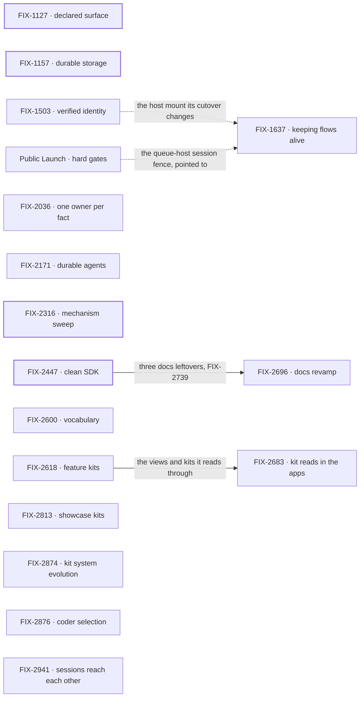

# Framework simplification & cleanup — what FSD says is what it does

**Spec** · [Decisions](DECISIONS.md) · [Rules](BUSINESS-RULES.md) · [Plan](PLAN.md)

This project began in May as an editorial and structural pass driven by a first-principles
review: keep the power, tighten the first hour. That pass is done bar two package extractions.
Since August it has been where FSD fixes the places its surface says one thing and does another,
or offers two of something where a builder needs one, while FSD is pre-1.0 and ahead of its
public release, when a fix breaks the fewest people.

## The outcome

| | |
|---|---|
| **Winning when** | A builder can take every FSD doc, type and default at its word: nothing declared is silently dropped, no job makes them choose between two primitives, a reachable host is not open by default, and a common job such as keeping a flow alive has one published path. Nothing a builder can do today is cut to get there |
| **The read** | Open issues labelled **Bug** in this project. Almost every one is a statement the runtime contradicts. **32 today; zero is done.** It rises when a bug is found as well as falls when one is fixed, so read it beside what was filed that week |
| **Now** | 4 epics done · 8 in flight · 4 filed, not started. 128 open issues, **78 under no epic**. No finish date: the Linear target, May 22, passed with the original pass ([Decisions](DECISIONS.md) → Open) |
| **Kill line** | If a surface cut here keeps coming back within a release because builders needed it, the project is aimed at the wrong thing. What changes is layering, hiding power behind progressive disclosure, not the remaining cut list |

Above the fence is what this project changes; below it is what its epics touch but other projects
own. The fence is one test: does the change make an existing statement true, or remove a second of
something? A change that adds a capability belongs to another project.

## The epics — derived live 2026-11-25 23:25 UTC

| Epic | Outcome it owns | State | Surface |
|---|---|---|---|
| [FIX-1127](https://linear.app/fixpoint-labs/issue/FIX-1127) · **declared surface** | Everything FSD declares or documents is true: four flow options that were silently dropped, a crash on the getting-started path, a resource declaration that leaked between blocks | **done** · 3/3 · Aug 12 | [PR #1249](https://github.com/fixpoint-labs/flow-state-dev/pull/1249), closed at wrap |
| [FIX-1157](https://linear.app/fixpoint-labs/issue/FIX-1157) · **durable storage** | Scope state and resources offer the same verbs where safe; the asymmetry is stated once | **done** · 6/7, 1 canceled · Aug 28 | [PR #1365](https://github.com/fixpoint-labs/flow-state-dev/pull/1365), closed at wrap |
| [FIX-1503](https://linear.app/fixpoint-labs/issue/FIX-1503) · **verified identity** | A reachable host requires a verified principal on every `/api/flows` route but the mint | **in flight** · 0/1 | [`specs/epics/FIX-1503/`](https://github.com/fixpoint-labs/flow-state-dev/tree/main/specs/epics/FIX-1503), merged Sep 22 |
| [FIX-1637](https://linear.app/fixpoint-labs/issue/FIX-1637) · **keeping flows alive** | One published path for how a flow stays alive 24/7, with no new product noun | **in flight** · 4/8, 2 canceled · closure [FIX-1642](https://linear.app/fixpoint-labs/issue/FIX-1642) spec approved | [`specs/epics/FIX-1637/`](https://github.com/fixpoint-labs/flow-state-dev/tree/main/specs/epics/FIX-1637), merged Sep 29 |
| [FIX-2036](https://linear.app/fixpoint-labs/issue/FIX-2036) · **one owner per fact** | Callers stop rebuilding facts the framework already knows: the bugs that causes, and the deletions existing APIs allow | *filed, not started* · 3/10, 1 duplicate | No epic spec |
| [FIX-2171](https://linear.app/fixpoint-labs/issue/FIX-2171) · **durable agents** | Each gap a durable-harness comparison found is closed or decided against | *filed, not started* · 2/15 | No epic spec |
| [FIX-2316](https://linear.app/fixpoint-labs/issue/FIX-2316) · **mechanism sweep** | Each job the October parallel work left with two or three mechanisms gets one | **done** · 5/5 · Oct 31 | No epic spec; children's implementation PRs merged |
| [FIX-2447](https://linear.app/fixpoint-labs/issue/FIX-2447) · **clean SDK** | An adopter importing a package root sees only what an app author needs, one way to do each thing, and a quick start that runs as written | **done** · 32/33, 1 canceled · Nov 15 | [`specs/epics/FIX-2447/`](https://github.com/fixpoint-labs/flow-state-dev/tree/main/specs/epics/FIX-2447), merged Nov 5; closure passed on main `4d97cdc9a` |
| [FIX-2600](https://linear.app/fixpoint-labs/issue/FIX-2600) · **vocabulary** | One word per thing, kept in one glossary | **in flight** · 4/5 · closure [FIX-2602](https://linear.app/fixpoint-labs/issue/FIX-2602) spec approved | [`specs/epics/FIX-2600/`](https://github.com/fixpoint-labs/flow-state-dev/tree/main/specs/epics/FIX-2600), merged Nov 7 |
| [FIX-2618](https://linear.app/fixpoint-labs/issue/FIX-2618) · **feature kits** | An app installs a feature and reads it back without an adapter: views, reads by scope, ids on notices, kits | **in flight** · 24/26, 1 canceled | [`specs/epics/FIX-2618/`](https://github.com/fixpoint-labs/flow-state-dev/tree/main/specs/epics/FIX-2618), merged Nov 9 |
| [FIX-2683](https://linear.app/fixpoint-labs/issue/FIX-2683) · **kit reads in the apps** | Teammates and Shift Manager read through kit views, and their hand-written read models are deleted | **in flight** · 13/15 · closure [FIX-2778](https://linear.app/fixpoint-labs/issue/FIX-2778) next | [`specs/epics/FIX-2683/`](https://github.com/fixpoint-labs/flow-state-dev/tree/main/specs/epics/FIX-2683), merged Nov 17 |
| [FIX-2696](https://linear.app/fixpoint-labs/issue/FIX-2696) · **docs revamp** | The user docs rebuilt around apps, kits and a short book of concepts; also carries clean SDK's docs leftovers ([FIX-2739](https://linear.app/fixpoint-labs/issue/FIX-2739)) | **in flight** · 4/9 | [`specs/epics/FIX-2696/`](https://github.com/fixpoint-labs/flow-state-dev/tree/main/specs/epics/FIX-2696), merged Nov 12 |
| [FIX-2813](https://linear.app/fixpoint-labs/issue/FIX-2813) · **showcase kits** | Memory, a second-opinion check and deep research, each installable with one config object and a goal check | *filed, not started* · 0/4 | No epic spec, by design; three children's implementation PRs open |
| [FIX-2874](https://linear.app/fixpoint-labs/issue/FIX-2874) · **kit system evolution** | One direction for kits: a foundation event bus, and GitHub as its own kit | *filed, not started* · no children · open thinking, parked until the release ships | No epic spec |
| [FIX-2876](https://linear.app/fixpoint-labs/issue/FIX-2876) · **coder selection** | One coding flow, run settings on the task, and a structured "Code with" pick per request or session | **in flight** · 2/5 · closure [FIX-2883](https://linear.app/fixpoint-labs/issue/FIX-2883) | [`specs/epics/FIX-2876/`](https://github.com/fixpoint-labs/flow-state-dev/tree/main/specs/epics/FIX-2876), merged Nov 23 |
| [FIX-2941](https://linear.app/fixpoint-labs/issue/FIX-2941) · **sessions reach each other** | Within one owner, a block reaches another session's copy of a resource by naming the session; a scope sets how many copies exist, never who may look, and the workarounds built around that rule go away | *in setup* · no children yet | Epic spec being authored on `epic/sessions-reach`; no PR yet |

4 done · 8 in flight · 4 filed, not started. Every state above is re-derived from Linear and the
child implementation PRs each refresh; *in flight* counts FIX-2941 from setup.

**Six states disagree with their surface.** FIX-1503's direction merged on Sep 22, but Linear
still reads *In Spec Review* nine weeks later and its one child is in Backlog: counted in flight
because Linear says *started*, with nothing under it begun. FIX-2036 and FIX-2171 read *Backlog*
while five of their children are done, so work is landing under epics no lifecycle is running.
FIX-2447's wrap note counts 34 children done; Linear lists 32 Done and 1 Canceled under it, and
the table carries Linear's count. FIX-2813's four children all read *Backlog*, while three of
them have implementation PRs open. FIX-2941 reads *Backlog* while its epic spec is being
authored: counted in flight from setup.

Four wrapped epics now, three of them standing alone. Clean SDK handed the docs revamp the three
pieces that could only land with the user docs: the quick-start check, the old `stores` lines, and
folding its release check into CI ([Plan](PLAN.md) → seams). Kit reads in the apps reads through
what feature kits ships. The four newest epics are drawn without edges until an Update records
what one hands another. The oldest seam is unchanged: the keeping-alive
docs describe how a host is mounted, and verified identity changes exactly that
([Rules](BUSINESS-RULES.md) → PR-1).

## What this project is not

- **Not a reduction of the model.** Block kinds, state scopes, capabilities, skills, tools, `ui`
  and thought-fabric stay; the review that opened this project retracted those cuts after reading
  the code ([Decisions](DECISIONS.md) → *decided once*).
- **Not new capability.** A missing feature found here is filed where features live.
- **Not a login product.** The host verifies people; FSD mints and checks a token.
