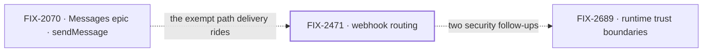

# Inbound Transports & Reactive Flows — any source drives a flow, and an event finds who asked

**Spec** · [Decisions](DECISIONS.md) · [Rules](BUSINESS-RULES.md) · [Plan](PLAN.md)

A flow can be started from outside the runtime in many ways: an HTTP request, a webhook, a
schedule, an MCP client, a chat platform, another session's event. This project makes all of them
one shape, so the runtime below never knows which one it was, and makes an outside event reach the
sessions that asked for it without a model reading every event. The entry points shipped as loose
issues before epics existed. The first epic, FIX-2471, built the routing and wrapped on
2026-11-11.

## The outcome

| | |
|---|---|
| **Winning when** | Every entry point is an `InboundTransportAdapter`, so adding one changes nothing below it. An outside event reaches exactly the sessions that subscribed to it, and only users who can read its thread, with no model reading every event. A developer can build the cross-transport stories from the docs alone |
| **The read** | Three counts. Entry points on the contract: HTTP, webhooks, schedules, MCP and chat, 5 shipped. Cross-transport stories buildable from the docs alone: 0 proven, because the docs (FIX-453) are not written. The cost claim, routing's tokens against a coordinator that reads every event: never measured, now FIX-2694 |
| **Now** | 1 done · 0 in flight · 0 not filed. Routing proved on one `main` commit, all seven goal checks PASS. Fourteen loose issues remain open, none yet an epic |
| **Kill line** | If FIX-2694 measures a coordinator that reads every event at under 5× routing's tokens, routing by subscription is not earning its layer. What changes is FIX-2471's [D1](../../../specs/epics/FIX-2471/DECISIONS.md#d1), not the transports |

Above the fence is how anything gets into a flow and who hears it. The middle row is used, not
owned: a change there is another project's call.

## The epics — derived live 2026-11-11

| Epic | What it owns | State | Surface |
|---|---|---|---|
| [FIX-2471](https://linear.app/fixpoint-labs/issue/FIX-2471) · **webhook routing** | A service flow per provider routes an outside event to the sessions subscribed to it, pushed or polled; routines, one name for work that fires on its own | **wrapped** 2026-11-11. Every implementation child merged; closure [#5108](https://github.com/fixpoint-labs/flow-state-dev/pull/5108) passes all seven goal checks on `main` 00bbaee5. Linear still reads *In Development* | [Epic spec](../../../specs/epics/FIX-2471/SPEC.md) · lessons [#5131](https://github.com/fixpoint-labs/flow-state-dev/pull/5131) (draft) |

1 done · 0 in flight · 0 not filed. Epics are filed as the project reaches them; an unfiled one
is a `FIX-XXX · working title` placeholder that keeps its title when the real id arrives. None
is proposed yet: the open work is loose issues, listed in [the plan](PLAN.md#what-is-deliberately-not-next).

Both neighbours sit in other projects. FIX-2689 owns the two High follow-ups the closure review
found (FIX-2686, FIX-2687): a turn woken by a delivery holds the full tool set, and child
processes inherit host secrets.

## What this project is not

- **Not outbound.** How events leave the runtime (FIX-578, FIX-380) is the mirror of this
  project, not part of it.
- **Not the rest of MCP.** The flow-as-MCP-server transport shipped here (FIX-22). Consuming
  other servers and hardening the server on real clients are the MCP project's.
- **Not durable suspend.** A flow that waits on a callback across a restart is FIX-140/FIX-141.
- **Not a router that reads every event.** See [decided once](DECISIONS.md#decided-once).
- **Not push to screens.** The realtime bus (FIX-2367) tells a screen to read again; it is not an
  entry point.
