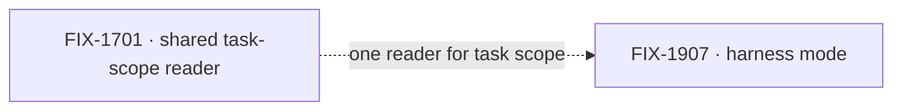

# Kitchen Sink: Harness Mode

**Spec** · [Decisions](DECISIONS.md) · [Rules](BUSINESS-RULES.md) · [Plan](PLAN.md)

Kitchen Sink becomes a direct test bed for each harness we support: Flow State, Codex, Claude
Code and Cursor. You pick a harness and work in that harness's own sessions. Kitchen Sink is mostly
a pass-through, but it still sets up sessions, keeps them in sync with what the harness is doing,
and keeps its tasks in sync too. Running each harness directly is how we see whether those
integrations are tight.

## The outcome

| | |
|---|---|
| **Winning when** | A person opens Kitchen Sink, picks any of the four harnesses, and works in that harness's sessions, with Kitchen Sink's sessions and tasks staying in step with what the harness is doing |
| **The read** | Harnesses usable this way in Kitchen Sink, with session sync and task sync both shown working. 0 of 4 today; 4 of 4 is done |
| **Now** | 0 done · 1 in flight · 0 not started. FIX-1907's epic spec is approved and on `main`; its six children are filed, none built yet |
| **Kill line** | If running a harness directly in Kitchen Sink tells us nothing its own package tests don't already, the test bed is not earning its place: stop at the harnesses that found something |

Above the fence is one person using one harness directly; that is all this project builds. Below
it are the integrations it exercises and does not own. Anything across harnesses is Shift
Manager's.

## The epics — derived live 2026-10-12

| Epic | What it owns | State | Surface |
|---|---|---|---|
| [FIX-1907](https://linear.app/fixpoint-labs/issue/FIX-1907) · **harness mode** | The harness picker, sessions per harness, and session and task sync for each of the four | *in flight* (Linear: Spec Approved). Children: FIX-1914 picker, FIX-1915 Claude Code mode (both In Spec Dev); FIX-1916 Codex, FIX-1917 Cursor, adopted FIX-1185 plan tools, closure FIX-1918 (Backlog) | [`specs/epics/FIX-1907/`](https://github.com/fixpoint-labs/flow-state-dev/tree/main/specs/epics/FIX-1907) on `main` (#3162) |

0 done · 1 in flight · 0 not started. Epics are filed as the project reaches them; an unfiled one
is a `FIX-XXX · working title` placeholder that keeps its title when the real id arrives.

One epic so far. FIX-1701 is an issue outside this project that the three external harnesses'
task sync reads through; it is an input, drawn dashed, not part of the set. Its status disagrees
with itself: Linear still shows In Spec Review, but its PR #2569 merged on 2026-10-01.

## What this project is not

- **Not orchestration across harnesses.** Coordinating several harnesses is Shift Manager's job.
  Kitchen Sink is a way to use each harness by itself.
- **Not new harness integrations.** The four named are the scope. A fifth harness is its own work.
- **Not the owner of the integrations it tests.** The harness packages, core's harness handle,
  FIX-1701 and FIX-1735 live elsewhere; this project shows whether they hold.

Open inside FIX-1907, not here: what happens to Kitchen Sink's current showcase flows, and
whether they move under the Flow State mode. That is the epic's call.
