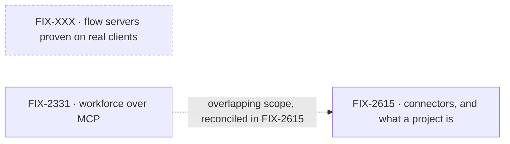

# MCP

**Spec** · [Decisions](DECISIONS.md) · [Rules](BUSINESS-RULES.md) · [Plan](PLAN.md)

FSD speaks MCP in two directions, and both should be solid enough to release. As a **server**,
any flow is its own MCP server, so Claude Desktop, Claude Code, Cursor or another agent can call
its actions as tools. That shipped with FIX-22 and has not been tested hard against real
clients. As a **client**, workforce reaches other MCP servers, such as Linear's, on behalf of its
workers and coding runs. Today that only works through a project's server list, and FIX-2615 is
deciding what a connector is and what a project is.

## The outcome

| | |
|---|---|
| **Winning when** | A flow's MCP server works with several real clients without regressions, with docs that match its behaviour and an example beyond Kitchen Sink. A host installs an MCP server once as a connector, and a worker or coding run uses it with or without a project, while each user's key stays on the server |
| **The read** | Two counts. Real clients the flow server is proven against: none recorded today. Hosts using a connector with no project: 0 today, and the teammates lab is the first |
| **Now** | 0 done · 0 in flight · 1 not started · 1 not filed. FIX-2615's epic spec is being drafted; the server-side epic is not filed |
| **Kill line** | If workers get every tool they need through capabilities, and a connector model adds nothing, the client half is mis-shaped. Keep the server half and drop connectors |

Above the fence is how FSD speaks MCP, as a server and as a client. What a given flow chooses to
expose over its server, such as workforce's own tools in FIX-2331, belongs to that flow's owner.

## The epics — derived live 2026-11-10

| Epic | What it owns | State | Surface |
|---|---|---|---|
| [FIX-2615](https://linear.app/fixpoint-labs/issue/FIX-2615) · **connectors, and what a project is** | MCP servers installed once at the host as connectors; what a project is and which connectors it enables; users' keys kept server-side on every route | *not started* (Linear: Todo). Its epic spec is being drafted; no children filed | Epic spec in draft on `epic/mcp-connectors-and-projects` |
| FIX-XXX · **flow servers proven on real clients** | Hardening the per-flow MCP server, testing it with several real clients, fixing what that finds, and the docs, example and reference deployment | *not filed* | — |

0 done · 0 in flight · 1 not started · 1 not filed. Epics are filed as the project reaches them;
an unfiled one is a `FIX-XXX · working title` placeholder that keeps its title when the real id
arrives.

The two epics don't depend on each other. FIX-2331 is a Shift Manager epic outside this project.
It overlaps FIX-2615, and FIX-2615's own scope says they are reconciled before either starts.

## What this project is not

- **Not which tools a flow exposes.** Workforce's tools over MCP (FIX-2331) are the Shift Manager
  project's. This project owns the server they ride on.
- **Not a single MCP server spanning every flow.** One server per flow kind. See
  [decided once](DECISIONS.md#decided-once).
- **Not a catalogue of third-party servers.** Linear is the one named. Choosing others is not
  in scope.
- **Not how a model sees MCP tools.** That is the MCP client's own surface.
- **Not Linear's Agents API.** FIX-567, filed under this project, is a separate protocol on the
  inbound-transports path. It is a loose issue, not an epic, and serves neither half of the outcome.

Open inside FIX-2615, not here: what a project is, where MCP belongs for workers and coding runs,
and how FIX-2331's overlap is reconciled. Those are the epic's calls.
