# Orchestration Primitives — one work unit, one way to move it

**Spec** · [Decisions](DECISIONS.md) · [Rules](BUSINESS-RULES.md) · [Plan](PLAN.md)

FSD's board-based patterns run on one work unit: a **Task** row in a **TaskCollection**,
worked by a board that binds a dispatcher, a worker and a loop. This project owns that unit and
the ways work moves between workers on it. Patterns that run their own loop off the board are
outside it.

## The outcome

| | |
|---|---|
| **Winning when** | Every pattern that runs on the task board stores its work as Task rows, and work one worker gives another is answered once, whichever path delivers it. A task that stops for a person waits in one place, one Inbox item answered once (FIX-2058). The current bet is one task primitive (FIX-2056): `createTask` files, `getTask({ id, wait })` waits, and `dispatchTask` retires |
| **The read** | Parallel ways to give work. Today: **2** row kinds, a task and a coordinator's post, filed through `addTask` or `dispatchTask`; the claim ticket is already the only answer-once fence, since FIX-1872 removed the coordinator delivery ledger on Oct 13. Done is one task kind, filed by `createTask`, whose ending only the claim gate or the drain records ([PD-3](DECISIONS.md)). `roundRobin` and `debate` run off the board and are outside, by the owner's call ([*decided once*](DECISIONS.md)). Ways to answer a stop for a person outside the Inbox: today **4**, `answerTask`, the `parkOnQuestion` and `awaitReview` parks, and the harness inbox's `answerQuestion()`; done is none, FIX-2058's closure sweep |
| **Now** | 6 epics done (the Plan/Task series counted as one) · 2 in flight · 2 filed, not started |
| **Kill line** | If FIX-2056's closure shows a coordinator or hand-off goal regressing once posts become tasks, one primitive is the wrong bet. Then the job becomes naming the kinds clearly; answered-once still holds as the finish line, and the remaining epics change with it |

Above the fence is the work unit and how it moves between workers. Below it is substrate this
project assembles but other projects own, and the bottom band is what no epic here builds.

## The epics — derived live 2026-10-23

| Epic | What it owns | State | Surface |
|---|---|---|---|
| FIX-443–448 · **Plan/Task series** | Task, TaskCollection, the task board; patterns reshaped onto it | **done** · May 1 | [FIX-442](https://linear.app/fixpoint-labs/issue/FIX-442) |
| [FIX-930](https://linear.app/fixpoint-labs/issue/FIX-930) · **delegation substrate** | Roster, default worker, context supply | **done** · Jul 29 | [PR #873](https://github.com/fixpoint-labs/flow-state-dev/pull/873) |
| [FIX-939](https://linear.app/fixpoint-labs/issue/FIX-939) · **durable jobs** | Detached tasks; the claim ticket | **done** · Aug 12 | [PR #993](https://github.com/fixpoint-labs/flow-state-dev/pull/993) |
| [FIX-980](https://linear.app/fixpoint-labs/issue/FIX-980) · **honest task substrate** | Versioned writes, park and unpark, honest settle | **done** · Oct 10 | [PR #983](https://github.com/fixpoint-labs/flow-state-dev/pull/983) |
| [FIX-1320](https://linear.app/fixpoint-labs/issue/FIX-1320) · **flow instances** | Address a flow instance by global id | **done** · Oct 6 | [PR #1617](https://github.com/fixpoint-labs/flow-state-dev/pull/1617) |
| [FIX-1312](https://linear.app/fixpoint-labs/issue/FIX-1312) · **dispatch protocol** | Reply to whoever dispatched me | **done** · Oct 12 | [PR #1587](https://github.com/fixpoint-labs/flow-state-dev/pull/1587) |
| [FIX-2056](https://linear.app/fixpoint-labs/issue/FIX-2056) · **one task primitive** | Two board modes, one completion rule, five task tools, delegates as authority | **in flight** · spec approved Oct 21 | [PR #3588](https://github.com/fixpoint-labs/flow-state-dev/pull/3588) · `specs/epics/FIX-2056/` |
| [FIX-2058](https://linear.app/fixpoint-labs/issue/FIX-2058) · **one Inbox** | One "waiting on a person", in Inbox | **in flight** · spec approved Oct 23 | [PR #3732](https://github.com/fixpoint-labs/flow-state-dev/pull/3732) (merged) · `specs/epics/FIX-2058/` |
| [FIX-2070](https://linear.app/fixpoint-labs/issue/FIX-2070) · **messages** | Send and call, task sessions, delivery and budget | *filed, not started* · waits on FIX-2056 | — |
| [FIX-2071](https://linear.app/fixpoint-labs/issue/FIX-2071) · **coordination renames** | One term, one thing | *filed, not started* · waits on FIX-2058, FIX-2070 | — |

6 done · 2 in flight · 2 filed, not started. Canceled, kept because the cancel is the decision:
[FIX-1197](https://linear.app/fixpoint-labs/issue/FIX-1197) Relay and
[FIX-1169](https://linear.app/fixpoint-labs/issue/FIX-1169) Strands ([*decided once*](DECISIONS.md)),
and [FIX-1870](https://linear.app/fixpoint-labs/issue/FIX-1870) dispatchTask, canceled Oct 21 after
its children landed: FIX-2056 supersedes it.

```mermaid
flowchart LR
  PT["Plan/Task series"] -->|"the Task row"| D930["FIX-930 · delegation"]
  D930 -->|"roster + workers"| D939["FIX-939 · durable jobs"]
  D939 -->|"claim ticket"| D980["FIX-980 · honest substrate"]
  D1320["FIX-1320 · flow instances"] -->|"an address"| D1312["FIX-1312 · dispatch protocol"]
  D980 -->|"settle + park"| D1870["FIX-1870 · dispatchTask"]
  D1312 -->|"reply-to-sender transport"| D1870
  D1870 -.->|"superseded by"| D2056["FIX-2056 · one task primitive"]
  D2056 -->|"the claim gate + steer"| D2058["FIX-2058 · one Inbox"]
  D2056 -->|"one task primitive"| D2070["FIX-2070 · messages"]
  D2058 --> D2071["FIX-2071 · coordination renames"]
  D2070 --> D2071
  classDef done stroke-width:2px
  classDef canceled stroke-dasharray:1 3,color:#7A828B
  class PT,D930,D939,D980,D1320,D1312 done
  class D1870 canceled
```

Both lines landed and met in dispatchTask, which FIX-2056 replaces. The Inbox and messages wait
on it; the renames come last.

## What this project is not

- **Not every multi-agent pattern.** Patterns off the board, such as `roundRobin` and `debate`,
  are outside; FIX-922 decides whether they stay patterns.
- **Not the screens that ask a person.** Approvals, Shift Manager's AskCard and the harness
  question inbox stay outside. A task that stops for a person is inside: FIX-2058 makes each stop
  one Inbox item, answered once ([*decided once*](DECISIONS.md)).
- **Not a message layer.** Work moves as task rows; Relay tried a second channel and was canceled.
- **Not a choice of execution mode per skill** ([PD-2](DECISIONS.md)).
- **Not Workforce.** Workers, `WORKER.md` and channels sit on this substrate and belong to the
  Workforce projects.
