# Orchestration Primitives — one work unit, one way to move it

**Spec** · [Decisions](DECISIONS.md) · [Rules](BUSINESS-RULES.md) · [Plan](PLAN.md)

FSD's board-based patterns run on one work unit: a **Task** row in a **TaskCollection**,
worked by a board that binds a dispatcher, a worker and a loop. This project owns that unit and
the ways work moves between workers on it. Patterns that run their own loop off the board are
outside it.

## The outcome

| | |
|---|---|
| **Winning when** | Every pattern that runs on the task board stores its work as Task rows, and work one worker gives another is answered once, whichever path delivers it. One dispatch tool over the board (FIX-1870) is the current bet for getting there |
| **The read** | Parallel paths for the same job. Today: **3** worker-to-worker dispatch paths (`addTask({ waitForResponse })`, the board hand-over, the coordinator's `handOff`; `post-to-mailbox` went with mailboxes in FIX-1792) and **2** answer-once fences (the board claim ticket, the coordinator delivery ledger). The conversation board's notice marker (FIX-1794) also tracks delivery, but as a debt that makes sure an ending is told, not a fence that refuses a second telling. Done is 1 path and 1 fence, the claim ticket: a post that expects an answer is a task, and a tell is a plain message with no fence ([Decisions](DECISIONS.md) → PD-3). Patterns that run their roster in their own loop, today `roundRobin` and `debate`, are outside this outcome by the owner's call ([Decisions](DECISIONS.md) → *decided once*); FIX-922 still decides whether they stay patterns |
| **Now** | 6 epics done (the Plan/Task series counted as one) · 1 in flight · 3 filed, not started. The task store, durable execution, flow addressing and reply-to-sender have landed. dispatchTask (FIX-1870) was canceled Oct 21, superseded by FIX-2056, one task primitive, whose epic spec is being authored |
| **Kill line** | If dispatchTask's regression gate shows the dispatch paths differ in behaviour, not only in name, one tool is the wrong bet. Then the job becomes naming the kinds clearly; answered-once still holds as the finish line, and the remaining epics change with it |

Above the fence is the work unit and how it moves between workers. Below it is substrate this
project assembles but other projects own, and the bottom band is what no epic here builds.

## The epics — derived live 2026-10-21

| Epic | What it owns | State | Surface |
|---|---|---|---|
| FIX-443–448 · **Plan/Task series** | Task, TaskCollection, the task board; plan- and queue-shaped patterns reshaped onto it | **done** · May 1 | [FIX-442](https://linear.app/fixpoint-labs/issue/FIX-442) (closed as duplicate) |
| [FIX-930](https://linear.app/fixpoint-labs/issue/FIX-930) · **delegation substrate** | Roster, default worker, worker context supply | **done** · Jul 29 | [PR #873](https://github.com/fixpoint-labs/flow-state-dev/pull/873) |
| [FIX-939](https://linear.app/fixpoint-labs/issue/FIX-939) · **durable jobs** | Detached tasks that outlive their request; the claim ticket | **done** · Aug 12 | [PR #993](https://github.com/fixpoint-labs/flow-state-dev/pull/993) |
| [FIX-980](https://linear.app/fixpoint-labs/issue/FIX-980) · **honest task substrate** | Versioned task writes, park and unpark, honest settle | **done** · Oct 10 | [PR #983](https://github.com/fixpoint-labs/flow-state-dev/pull/983) |
| [FIX-1320](https://linear.app/fixpoint-labs/issue/FIX-1320) · **flow instances** | Address a flow instance by global id; isolation follows the instance | **done** · Oct 6 | [PR #1617](https://github.com/fixpoint-labs/flow-state-dev/pull/1617) |
| [FIX-1312](https://linear.app/fixpoint-labs/issue/FIX-1312) · **dispatch protocol** | Reply to whoever dispatched me (`session: { from: true }`) | **done** · Oct 12 | [PR #1587](https://github.com/fixpoint-labs/flow-state-dev/pull/1587) |
| [FIX-2056](https://linear.app/fixpoint-labs/issue/FIX-2056) · **one task primitive** | One board with two modes, one completion rule, four task tools, delegates as authority (coordination phases 1 and 3) | **in flight** · started Oct 21; epic spec being authored | [#3520](https://github.com/fixpoint-labs/flow-state-dev/issues/3520) · concept [PR #3534](https://github.com/fixpoint-labs/flow-state-dev/pull/3534) |
| [FIX-2058](https://linear.app/fixpoint-labs/issue/FIX-2058) · **one Inbox** | One "waiting on a person", always in Inbox | *filed, not started* · waits on FIX-2056 | — |
| [FIX-2070](https://linear.app/fixpoint-labs/issue/FIX-2070) · **messages** | Send and call, task sessions, delivery and budget (coordination phase 4) | *filed, not started* · waits on FIX-2056 | — |
| [FIX-2071](https://linear.app/fixpoint-labs/issue/FIX-2071) · **coordination renames** | One term, one thing (coordination phase 5) | *filed, not started* · waits on FIX-2058 and FIX-2070 | — |

6 done · 1 in flight · 3 filed, not started. Canceled, and kept here because the cancel is the
decision: [FIX-1197](https://linear.app/fixpoint-labs/issue/FIX-1197) Relay and
[FIX-1169](https://linear.app/fixpoint-labs/issue/FIX-1169) Strands
([Decisions](DECISIONS.md) → *decided once*), and
[FIX-1870](https://linear.app/fixpoint-labs/issue/FIX-1870) dispatchTask, canceled Oct 21 with its
epic PR [#3110](https://github.com/fixpoint-labs/flow-state-dev/pull/3110) closed: FIX-2056
supersedes it, retiring `dispatchTask` for `createTask` and `getTask({ id, wait })`.

**FIX-2056 is shown in flight on the epic's own word.** Linear still has it *Ready to Spec*; its
epic spec is being authored. The outcome, PD-3 and PR-1/PR-2 still name FIX-1870, and re-homing
them is a project update, not this status refresh.

```mermaid
flowchart LR
  PT["Plan/Task series"] -->|"the Task row"| D930["FIX-930 · delegation"]
  D930 -->|"roster + workers"| D939["FIX-939 · durable jobs"]
  D939 -->|"claim ticket"| D980["FIX-980 · honest substrate"]
  D1320["FIX-1320 · flow instances"] -->|"an address"| D1312["FIX-1312 · dispatch protocol"]
  D980 -->|"settle + park"| D1870["FIX-1870 · dispatchTask"]
  D1312 -->|"reply-to-sender transport"| D1870
  D1870 -.->|"superseded by"| D2056["FIX-2056 · one task primitive"]
  D2056 -->|"one task primitive"| D2058["FIX-2058 · one Inbox"]
  D2056 -->|"one task primitive"| D2070["FIX-2070 · messages"]
  D2058 --> D2071["FIX-2071 · coordination renames"]
  D2070 --> D2071
  classDef done stroke-width:2px
  classDef canceled stroke-dasharray:1 3,color:#7A828B
  class PT,D930,D939,D980,D1320,D1312 done
  class D1870 canceled
```

The substrate line and the dispatch line both landed. dispatchTask, where they met, was canceled
and FIX-2056 takes its place; the three filed epics after it wait on it, and the renames come last.

## What this project is not

- **Not every multi-agent pattern.** A pattern that runs its own loop rather than on the task
  board, such as `roundRobin` and `debate`, is outside the outcome. Whether those stay patterns is
  FIX-922's call ([Decisions](DECISIONS.md) → *decided once*).
- **Not a way to ask a person something.** Approvals, Shift Manager's AskCard and the harness
  question inbox are questions to a human, and they stay outside.
- **Not a message layer.** Work moves as task rows. A second channel beside the board was tried
  (Relay) and canceled.
- **Not a choice of execution mode per skill.** A skill carries instructions; its work runs on
  a board, worked by workers ([Decisions](DECISIONS.md) → PD-2).
- **Not Workforce.** Workers, `WORKER.md` and channels are built on this substrate and owned by the
  Workforce projects.
