# Orchestration Primitives — one work unit, one way to move it

**Spec** · [Decisions](DECISIONS.md) · [Rules](BUSINESS-RULES.md) · [Plan](PLAN.md)

FSD's board-based patterns run on one work unit: a **Task** row in a **TaskCollection**,
worked by a board that binds a dispatcher, a worker and a loop. This project owns that unit and
the ways work moves between workers on it. Patterns that run their own loop off the board are
outside it.

## The outcome

| | |
|---|---|
| **Winning when** | Every pattern that runs on the task board stores its work as Task rows, and work one worker gives another is answered once, whichever path delivers it. A task that stops for a person waits in one place, one Inbox item answered once: landed Oct 27 with FIX-2058. One task primitive (FIX-2056) landed Oct 24: `createTask` files, `getTask({ id, wait })` waits, and `dispatchTask` is gone |
| **The read** | Parallel ways to give work. Today: **1**, done since Oct 24. A coordinator's post is a routed task (FIX-2083), `dispatchTask` is gone, and every task tool files through `createTask`; the claim ticket is the only answer-once fence ([PD-3](DECISIONS.md)). FIX-2087's closure ran the coordinator and hand-off goals on that one primitive on `main`. `roundRobin` and `debate` run off the board and are outside, by the owner's call ([*decided once*](DECISIONS.md)). Ways to answer a stop for a person outside the Inbox: today **0**, done since Oct 27. `answerTask`, the `parkOnQuestion` and `awaitReview` parks and the harness inbox's `answerQuestion()` are gone; a stop is a `waitForUser` suspension or a hold on its task row, answered through one of two routes ([PR-3](BUSINESS-RULES.md)). FIX-2134's closure sweep ([#3951](https://github.com/fixpoint-labs/flow-state-dev/pull/3951)) found none of the removed names live on `main` |
| **Now** | 9 epics done (the Plan/Task series counted as one) · 2 in flight · 0 filed, not started |
| **Kill line** | Passed Oct 24: FIX-2056's closure (FIX-2087, round 5 [#3847](https://github.com/fixpoint-labs/flow-state-dev/pull/3847)) showed no coordinator or hand-off goal regressing once posts became tasks, so one primitive holds. Passed Oct 27 for the Inbox half: FIX-2058's closure (FIX-2134, [#3951](https://github.com/fixpoint-labs/flow-state-dev/pull/3951)) walked six kinds of stop with a real model, each one Inbox item answered once, and its sweep found no stop answered outside the Inbox. Both halves of answered-once are met. FIX-2071's renames wrapped Oct 30; what remains is FIX-2070's closure and FIX-2092 |

Above the fence is the work unit and how it moves between workers. Below it is substrate this
project assembles but other projects own, and the bottom band is what no epic here builds.

## The epics — derived live 2026-10-30

| Epic | What it owns | State | Surface |
|---|---|---|---|
| FIX-443–448 · **Plan/Task series** | Task, TaskCollection, the task board; patterns reshaped onto it | **done** · May 1 | [FIX-442](https://linear.app/fixpoint-labs/issue/FIX-442) |
| [FIX-930](https://linear.app/fixpoint-labs/issue/FIX-930) · **delegation substrate** | Roster, default worker, context supply | **done** · Jul 29 | [PR #873](https://github.com/fixpoint-labs/flow-state-dev/pull/873) |
| [FIX-939](https://linear.app/fixpoint-labs/issue/FIX-939) · **durable jobs** | Detached tasks; the claim ticket | **done** · Aug 12 | [PR #993](https://github.com/fixpoint-labs/flow-state-dev/pull/993) |
| [FIX-980](https://linear.app/fixpoint-labs/issue/FIX-980) · **honest task substrate** | Versioned writes, park and unpark, honest settle | **done** · Oct 10 | [PR #983](https://github.com/fixpoint-labs/flow-state-dev/pull/983) |
| [FIX-1320](https://linear.app/fixpoint-labs/issue/FIX-1320) · **flow instances** | Address a flow instance by global id | **done** · Oct 6 | [PR #1617](https://github.com/fixpoint-labs/flow-state-dev/pull/1617) |
| [FIX-1312](https://linear.app/fixpoint-labs/issue/FIX-1312) · **dispatch protocol** | Reply to whoever dispatched me | **done** · Oct 12 | [PR #1587](https://github.com/fixpoint-labs/flow-state-dev/pull/1587) |
| [FIX-2056](https://linear.app/fixpoint-labs/issue/FIX-2056) · **one task primitive** | Two board modes, one completion rule, five task tools, delegates as authority | **done** · wrapped Oct 24 | [PR #3588](https://github.com/fixpoint-labs/flow-state-dev/pull/3588) · `specs/epics/FIX-2056/` · [wrap analysis](https://linear.app/fixpoint-labs/issue/FIX-2056/epic-one-task-primitive-boards-settling-task-tools-and-authority#comment-5093310b) |
| [FIX-2058](https://linear.app/fixpoint-labs/issue/FIX-2058) · **one Inbox** | One "waiting on a person", in Inbox | **done** · wrapped Oct 27 | [PR #3732](https://github.com/fixpoint-labs/flow-state-dev/pull/3732) · `specs/epics/FIX-2058/` · closure [#3951](https://github.com/fixpoint-labs/flow-state-dev/pull/3951) · [wrap analysis](https://linear.app/fixpoint-labs/issue/FIX-2058/epic-one-waiting-on-a-person-always-in-inbox#comment-df99e412) |
| [FIX-2070](https://linear.app/fixpoint-labs/issue/FIX-2070) · **messages** | Send and call, task sessions, delivery and budget | *in flight* · builds landed; closure FIX-2242 running | [PR #3983](https://github.com/fixpoint-labs/flow-state-dev/pull/3983) · `specs/epics/FIX-2070/` |
| [FIX-2071](https://linear.app/fixpoint-labs/issue/FIX-2071) · **coordination renames** | One term, one thing | **done** · wrapped Oct 30 | [PR #3985](https://github.com/fixpoint-labs/flow-state-dev/pull/3985) · `specs/epics/FIX-2071/` · closure [#4244](https://github.com/fixpoint-labs/flow-state-dev/pull/4244) · lessons draft [#4245](https://github.com/fixpoint-labs/flow-state-dev/pull/4245) |
| [FIX-2092](https://linear.app/fixpoint-labs/issue/FIX-2092) · **phased workflows** | A worker runs a feature's lifecycle as phases of tasks: a view over task rows plus a template that files them | *in flight* · epic spec in review | [PR #3970](https://github.com/fixpoint-labs/flow-state-dev/pull/3970) |

9 done · 2 in flight · 0 filed, not started. FIX-2071 wrapped Oct 30 with its seven children merged and its closure ([#4244](https://github.com/fixpoint-labs/flow-state-dev/pull/4244)) green; what it left open is follow-up, not a change of shape ([Plan](PLAN.md)). Canceled, kept because the cancel is the decision:
[FIX-1197](https://linear.app/fixpoint-labs/issue/FIX-1197) Relay and
[FIX-1169](https://linear.app/fixpoint-labs/issue/FIX-1169) Strands ([*decided once*](DECISIONS.md)),
and [FIX-1870](https://linear.app/fixpoint-labs/issue/FIX-1870) dispatchTask, canceled Oct 21 after
its children landed: FIX-2056 supersedes it.

```mermaid
flowchart LR
  PT["Plan/Task series"] -->|"the Task row"| D930["FIX-930 · delegation"]
  D930 -->|"roster + workers"| D939["FIX-939 · durable jobs"]
  D939 -->|"claim ticket"| D980["FIX-980 · honest substrate"]
  D1320["FIX-1320 · flow instances"] -->|"an address"| D1312["FIX-1312 · dispatch protocol"]
  D980 -->|"settle + park"| D1870["FIX-1870 · dispatchTask"]
  D1312 -->|"reply-to-sender transport"| D1870
  D1870 -.->|"superseded by"| D2056["FIX-2056 · one task primitive"]
  D2056 -->|"the claim gate + steer"| D2058["FIX-2058 · one Inbox"]
  D2056 -->|"one task primitive"| D2070["FIX-2070 · messages"]
  D2058 --> D2071["FIX-2071 · coordination renames"]
  D2070 --> D2071
  D2056 --> D2092["FIX-2092 · phased workflows"]
  D2058 -->|"an approval gate as a hold"| D2092
  classDef done stroke-width:2px
  classDef canceled stroke-dasharray:1 3,color:#7A828B
  class PT,D930,D939,D980,D1320,D1312,D2056,D2058,D2071 done
  class D1870 canceled
```

Both lines landed and met in dispatchTask, which FIX-2056 replaced. The Inbox and the renames have
landed on it; messages is closing and phased workflows is in spec review.

## What this project is not

- **Not every multi-agent pattern.** Patterns off the board, such as `roundRobin` and `debate`,
  are outside; FIX-922 decides whether they stay patterns.
- **Not the screens that ask a person.** Approvals and Shift Manager's AskCard stay outside; the
  harness question inbox is gone. A task that stops for a person is inside: since FIX-2058 each
  stop is one Inbox item, answered once ([*decided once*](DECISIONS.md), [PR-3](BUSINESS-RULES.md)).
- **Not a message layer.** Work moves as task rows; Relay tried a second channel and was canceled.
- **Not a choice of execution mode per skill** ([PD-2](DECISIONS.md)).
- **Not Workforce.** Workers, `WORKER.md` and channels sit on this substrate and belong to the
  Workforce projects.
