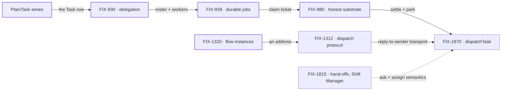

# Orchestration Primitives — one work unit, one way to move it

**Spec** · [Decisions](DECISIONS.md) · [Rules](BUSINESS-RULES.md) · [Plan](PLAN.md)

Every multi-agent pattern in FSD runs on one work unit: a **Task** row in a **TaskCollection**,
worked by a board that binds a dispatcher, a worker and a loop. This project owns that unit and
the ways work moves between workers on it.

## The outcome

| | |
|---|---|
| **Winning when** | Every multi-agent pattern stores its work as Task rows, and a worker hands work to another worker through one tool over that board, with one place that makes sure a task is answered once |
| **The read** | Parallel paths for the same job. Today: **4** worker-to-worker hand-off tools (`addTask({ waitForResponse })`, the board hand-over, the coordinator's `handOff`, `post-to-mailbox`) and **2** answer-once fences (the board claim ticket, the coordinator delivery ledger). Done is 1 and 1 |
| **Now** | 5 epics done (the Plan/Task series counted as one) · 1 in flight · 1 filed, spec being written. The task store, durable execution and flow addressing have landed. dispatchTask (FIX-1870) is the consolidation of the hand-off tools |
| **Kill line** | If dispatchTask's regression gate shows the hand-off tools differ in behaviour, not only in name, the one-tool premise is wrong. Then the job becomes naming the kinds clearly, and the remaining epics change with it |

Above the fence is the work unit and how it moves between workers. Below it is substrate this
project assembles but other projects own, and the bottom band is what no epic here builds.

## The epics — derived live 2026-10-11

| Epic | What it owns | State | Surface |
|---|---|---|---|
| FIX-443–448 · **Plan/Task series** | Task, TaskCollection, the task board; plan- and queue-shaped patterns reshaped onto it | **done** · May 1 | [FIX-442](https://linear.app/fixpoint-labs/issue/FIX-442) (closed as duplicate) |
| [FIX-930](https://linear.app/fixpoint-labs/issue/FIX-930) · **delegation substrate** | Roster, default worker, worker context supply | **done** · Jul 29 | [PR #873](https://github.com/fixpoint-labs/flow-state-dev/pull/873) |
| [FIX-939](https://linear.app/fixpoint-labs/issue/FIX-939) · **durable jobs** | Detached tasks that outlive their request; the claim ticket | **done** · Aug 12 | [PR #993](https://github.com/fixpoint-labs/flow-state-dev/pull/993) |
| [FIX-980](https://linear.app/fixpoint-labs/issue/FIX-980) · **honest task substrate** | Versioned task writes, park and unpark, honest settle | **done** · Oct 10 | [PR #983](https://github.com/fixpoint-labs/flow-state-dev/pull/983) |
| [FIX-1320](https://linear.app/fixpoint-labs/issue/FIX-1320) · **flow instances** | Address a flow instance by global id; isolation follows the instance | **done** · Oct 6 | [PR #1617](https://github.com/fixpoint-labs/flow-state-dev/pull/1617) |
| [FIX-1312](https://linear.app/fixpoint-labs/issue/FIX-1312) · **dispatch protocol** | Reply to whoever dispatched me (`session: { from: true }`) | **in flight** · see note | [PR #1587](https://github.com/fixpoint-labs/flow-state-dev/pull/1587) |
| [FIX-1870](https://linear.app/fixpoint-labs/issue/FIX-1870) · **dispatchTask** | One tool for handing work to another worker; one answer-once fence | *filed* · spec being written | — |

5 done · 1 in flight · 1 filed. Canceled, and kept here because the cancel is the decision:
[FIX-1197](https://linear.app/fixpoint-labs/issue/FIX-1197) Relay and
[FIX-1169](https://linear.app/fixpoint-labs/issue/FIX-1169) Strands
([Decisions](DECISIONS.md) → *decided once*).

**Status disagrees on FIX-1312.** Linear has it *In Development* since Sep 5, but its one live
child, FIX-1171, is Done (Oct 9) and its other is a duplicate. FIX-1870 calls reply-to-sender
"already ships". It is shown in flight because Linear says so; whoever owns it should wrap or
re-scope it.

dispatchTask is where both lines meet. The board half gives it a row to hand over, the dispatch
half gives it transport. FIX-1815 sits in another project and is an input, not a node.

## What this project is not

- **Not a way to ask a person something.** Approvals, Shift Manager's AskCard and the harness
  question inbox are questions to a human, and they stay outside.
- **Not a message layer.** Work moves as task rows. A second channel beside the board was tried
  (Relay) and canceled.
- **Not a choice of execution mode per skill.** A skill declares a team and its work; the board
  runs it ([Decisions](DECISIONS.md) → PD-2).
- **Not Workforce.** Seats, `WORKER.md` and channels are built on this substrate and owned by the
  Workforce projects.
