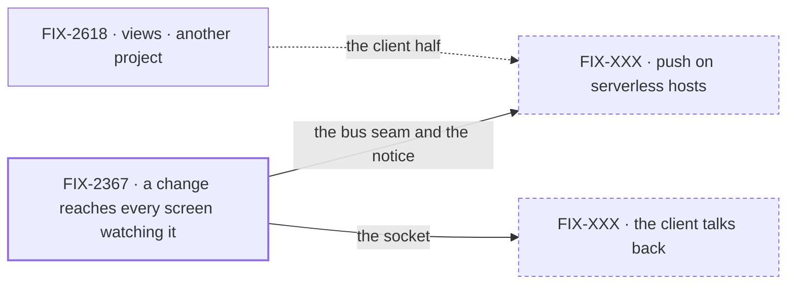

# Realtime / WebSockets

**Spec** · [Decisions](DECISIONS.md) · [Rules](BUSINESS-RULES.md) · [Plan](PLAN.md)

A screen should hear a change the moment it happens, wherever the change was made, without the
app writing push code. SSE already streams a request's own items back to its caller. What it
can't do is tell a screen that something it is watching changed somewhere else: another session,
another user, another process. FIX-2367 built that push on long-lived hosts. Serverless hosts
still poll, and nothing yet travels from the client back over the socket.

## The outcome

| | |
|---|---|
| **Winning when** | On every host FSD ships an adapter for, long-lived or serverless, a change reaches every screen watching it within a second, across processes, through the framework's own hooks, with no read between changes |
| **The read** | Host kinds where a screen still polls. Today two: Vercel and Next poll at 3 s. The Node host with a bus that crosses processes pushes. Zero, or each remaining one documented as a choice, is done |
| **Now** | 1 done · 0 in flight · 2 not filed. Push on long-lived hosts shipped 2026-11-20; serverless push is the next lane |
| **Kill line** | If teams on serverless are content with the 3 s poll and nobody asks for push there, the serverless lane is not filed and the project closes at one epic. The talk-back lane goes first: nothing asks for it yet |

Above the fence is how a change reaches a screen. How the screen reads what changed is views,
which another project owns, and this project only wakes them.

## The epics — derived live 2026-11-20

| Epic | What it owns | State | Surface |
|---|---|---|---|
| [FIX-2367](https://linear.app/fixpoint-labs/issue/FIX-2367) · **a change reaches every screen watching it** | The notice, the bus with in-memory and Postgres adapters, one WebSocket per client on the Node host, and the polling fallback | **done** 2026-11-20. Linear Done; all ten children Done; closure [#5480](https://github.com/fixpoint-labs/flow-state-dev/pull/5480) passes on `main` | [`specs/epics/FIX-2367/`](https://github.com/fixpoint-labs/flow-state-dev/tree/main/specs/epics/FIX-2367) · spec PR [#4512](https://github.com/fixpoint-labs/flow-state-dev/pull/4512) |
| FIX-XXX · **push on serverless hosts** | A screen on Vercel or Next hears a change within a second, from whichever instance made it. [FIX-380](https://linear.app/fixpoint-labs/issue/FIX-380), the Ably adapter, is its first issue (Backlog, spec in review on [#4486](https://github.com/fixpoint-labs/flow-state-dev/pull/4486)) | *not filed* | — |
| FIX-XXX · **the client talks back** | Interrupt, steer and presence sent from the client over the socket | *not filed* | — |

1 done · 0 in flight · 2 not filed. Epics are filed as the project reaches them; an unfiled one
is a `FIX-XXX · working title` placeholder that keeps its title when the real id arrives.

Serverless push plugs into the seams FIX-2367 left for it. The talk-back lane needs the socket
and would reopen what it may carry ([decided once](DECISIONS.md#decided-once)).

Filed under the project and not in any epic: FIX-2856 (a split job queue on the in-memory bus is
silently stale), FIX-2854, FIX-2855, FIX-2844, FIX-2843, FIX-2548, FIX-2587 and FIX-2506. Their
state is Linear's.

## What this project is not

- **Not how a screen reads what changed.** Views (`client.live`, `useView`) are epic FIX-2618's,
  in Framework simplification & cleanup. A notice says *when*; the read says *what*.
- **Not rows on the push.** Live sync, where the socket carries data, is out. See
  [PD-1](DECISIONS.md#pd-1).
- **Not item streams.** Request and item streams stay on SSE, resume included.
- **Not cross-flow events or a message bus between workers.** Those are Reactive Flows' and
  worker messaging's (FIX-1989). A notice reaches screens and starts nothing.
- **Not MCP's transport, and not outbound webhooks.**
