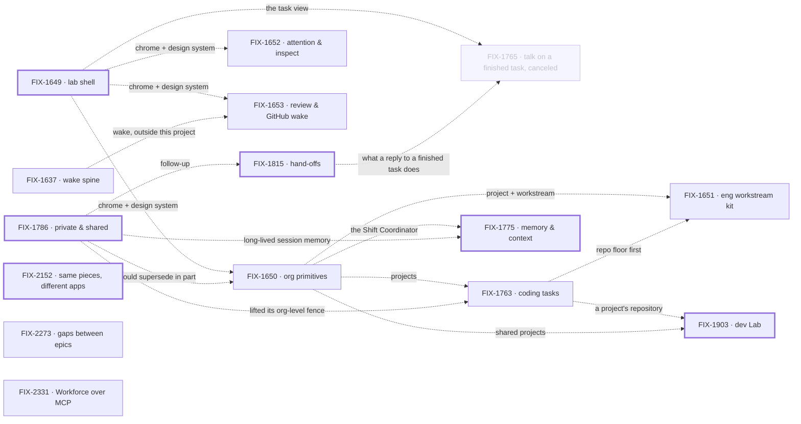

# Workforce: Shift Manager

**Spec** · [Decisions](DECISIONS.md) · [Rules](BUSINESS-RULES.md) · [Plan](PLAN.md)

Shift Manager is the Workforce app Jake dogfoods: one app that opens any Lab built completely on
Workforce, with one shell, one design system, and the org, workstream, attention and review
surfaces a person works in. Layer 2 vocabulary is not here; it stays in
[Workforce: Layer 2 Abstraction](https://linear.app/fixpoint-labs/project/workforce-layer-2-abstraction-9f5c6119ed12).

## The outcome

| | |
|---|---|
| **Winning when** | Jake runs his own work from Shift Manager: projects, workstreams, chat, attention and resources reached from one shell over live Workforce data, and DevForce and CyberForce run in it with no special wrapper |
| **The read** | Nav surfaces a person reaches over live Workforce data, in the shared design system. Five named; all five are reached on `main`, graded by FIX-1663's closure on 01444863c. Attention (Inbox) and resources (Jump to) are interim forms until FIX-1652 |
| **Now** | 6 done · 1 in flight · 6 not started · 1 dropped. The two labs of FIX-2152 wrapped Oct 31: Workforce runs a Claude Code-style app and a Grok Bot-style app with no glue of their own, all six closure goals green on `main` at 07753056. Linear still reads FIX-2152 In Development and its closure FIX-2156 Backlog. FIX-1786 went Done in Linear on Oct 23 with no wrap recorded here, so T2 to T5 still read open ([Decisions](DECISIONS.md) → Open). Org primitives (FIX-1650) merged its closure and has not wrapped. Real-model and browser checks of the labs are owed on Jake's machine |
| **Kill line** | If Shift Manager needs nouns of its own beside Workforce to be usable, the project is mis-shaped: the fix goes to Workforce, not into more epics here |

Above the fence is what this project builds; below it is what it consumes and never extends.
The fence is one test: a noun a second app would need goes to Workforce, not into Shift Manager.

## The epics — derived live 2026-10-31 00:30 UTC

| Epic | What it owns | State | Surface |
|---|---|---|---|
| [FIX-1649](https://linear.app/fixpoint-labs/issue/FIX-1649) · **lab shell** | The chrome, the new design system, nav to every surface, skinning of reused FSD components | **done**, wrapped Oct 4: closure FIX-1663 merged as [#2709](https://github.com/fixpoint-labs/flow-state-dev/pull/2709); Linear Done the same day, 35 of 35 children | [retained spec](https://github.com/fixpoint-labs/flow-state-dev/tree/main/specs/epics/FIX-1649) |
| [FIX-1650](https://linear.app/fixpoint-labs/issue/FIX-1650) · **org primitives** | Project, workstream as channel plus flow, CoS and Ops defaults, single user | **in flight**, approved Oct 1 (Linear: Spec Approved), 15 of 20 children done, 3 canceled; closure FIX-1720 merged Oct 6 as [#2781](https://github.com/fixpoint-labs/flow-state-dev/pull/2781), not yet wrapped; FIX-1726 and FIX-1745 open in Backlog | [retained spec](https://github.com/fixpoint-labs/flow-state-dev/tree/main/specs/epics/FIX-1650) |
| [FIX-1763](https://linear.app/fixpoint-labs/issue/FIX-1763) · **coding tasks** | A project records one optional repository; a harness codes in a worktree mapped from it | *not started* (Linear: Todo, no epic spec). **Its children are already building:** 6 of 12 done (FIX-1762's repository floor, FIX-1778, FIX-1780, FIX-1900, FIX-1963, FIX-1968), 2 canceled, FIX-1777 a duplicate; FIX-1766 in development; FIX-1767 and FIX-1768 in Backlog. Its *projects stay org-level* fence was lifted by FIX-1786's Q2 | — |
| [FIX-1765](https://linear.app/fixpoint-labs/issue/FIX-1765) · **talk on a finished task** | A finished task still takes a message, surfaced upward | **dropped**: canceled Oct 13 as an epic of one issue, folded into FIX-1764 (Done) with Jake's call that a person's message reopens a finished task ([Decisions](DECISIONS.md), 19) | — |
| [FIX-1775](https://linear.app/fixpoint-labs/issue/FIX-1775) · **memory & context** | Shipped memory for the Shift Coordinator; long sessions kept inside the window | **done** in Linear Oct 9, flagged: it went Todo to Done when its first child, FIX-1776 (the Coordinator's memory pack, [#2951](https://github.com/fixpoint-labs/flow-state-dev/pull/2951), [#2958](https://github.com/fixpoint-labs/flow-state-dev/pull/2958)), merged; FIX-1945 and FIX-1972 have since landed under it, 3 of 3 done. No epic spec, no gate, and no child for long sessions | — |
| [FIX-1786](https://linear.app/fixpoint-labs/issue/FIX-1786) · **private & shared** | Private by default, only resources shared: workers as resources, coordinators for mailboxes and rooms | **done** in Linear Oct 23, flagged: 81 of 84 children done, 2 canceled, FIX-1832 a duplicate. Approved Oct 6, spec merged as [#2795](https://github.com/fixpoint-labs/flow-state-dev/pull/2795). No wrap update reached this spec, so what it settled for its siblings is not recorded here and T2 to T5 still read open | [retained spec](https://github.com/fixpoint-labs/flow-state-dev/tree/main/specs/epics/FIX-1786) |
| [FIX-1815](https://linear.app/fixpoint-labs/issue/FIX-1815) · **hand-offs** | Ask (wait for one answer, continue) and assign (a board job, its session open until done), on the board's existing answer-once checks. FIX-1786's follow-up | **done**, wrapped Oct 11: closure FIX-1820 merged as [#3048](https://github.com/fixpoint-labs/flow-state-dev/pull/3048), clean on 2e940454d; Linear Done the same day, 7 of 8 children, FIX-1818 canceled. Eight follow-ups left the epic ([Plan](PLAN.md)) | [retained spec](https://github.com/fixpoint-labs/flow-state-dev/tree/main/specs/epics/FIX-1815) |
| [FIX-1903](https://linear.app/fixpoint-labs/issue/FIX-1903) · **dev Lab** | `pnpm shift-manager:dev` opens the `fsd` profile: FSD and Shift Manager on this repository, coding runs in worktrees of the user's own checkout, and Linear through MCP | **done**, wrapped Oct 14: closure FIX-1919 merged as [#3367](https://github.com/fixpoint-labs/flow-state-dev/pull/3367); Linear Done at 23:39 UTC, 9 of 9 children. Approved Oct 12 (spec [#3164](https://github.com/fixpoint-labs/flow-state-dev/pull/3164), amended by [#3179](https://github.com/fixpoint-labs/flow-state-dev/pull/3179)). Follow-ups left the epic ([Plan](PLAN.md)) | [retained spec](https://github.com/fixpoint-labs/flow-state-dev/tree/main/specs/epics/FIX-1903) |
| [FIX-2152](https://linear.app/fixpoint-labs/issue/FIX-2152) · **same pieces, different apps** | Two familiar apps, a Claude Code-style lab and a Grok Bot-style Teammates lab, built from Workforce's shipped pieces with only config, UI and small flows of their own | **done**, wrapped Oct 31: closure FIX-2156 merged as [#4278](https://github.com/fixpoint-labs/flow-state-dev/pull/4278), all six lab goals pass on 07753056 and every control fails. Approved Oct 23 (spec [#3783](https://github.com/fixpoint-labs/flow-state-dev/pull/3783), amended by #3797 and #3803). 38 of 45 children done; FIX-2359 in review, five follow-ups in Backlog. Flagged: Linear still reads the epic In Development and FIX-2156 Backlog | [retained spec](https://github.com/fixpoint-labs/flow-state-dev/tree/main/specs/epics/FIX-2152) |
| [FIX-2273](https://linear.app/fixpoint-labs/issue/FIX-2273) · **gaps between epics** | The seams recent epics left between them, one child per gap, with no design of its own | *not started* (Linear: Backlog, no epic spec), filed Oct 28; 1 of 3 children done | — |
| [FIX-2331](https://linear.app/fixpoint-labs/issue/FIX-2331) · **Workforce over MCP** | Any connected agent can hand work to the team over MCP | *not started* (Linear: Backlog, no epic spec, no children), filed Oct 29 | — |
| [FIX-1651](https://linear.app/fixpoint-labs/issue/FIX-1651) · **eng workstream kit** | Epic and issue thin sync, per-issue board, EM, Lead and specialist seats | *not started*, held (Backlog) | — |
| [FIX-1652](https://linear.app/fixpoint-labs/issue/FIX-1652) · **attention & inspect** | Needs-you, harness visibility, the resources list | *not started*, held (Backlog) | — |
| [FIX-1653](https://linear.app/fixpoint-labs/issue/FIX-1653) · **review & GitHub wake** | Review and GitHub wake as Layer 2 of the FIX-1637 wake spine | *not started*, held (Backlog); children FIX-1807 and FIX-1809 filed, both Backlog | — |

6 done · 1 in flight · 6 not started · 1 dropped · 0 not filed, re-derived from Linear and the
implementation PRs each refresh. Four contradictions are flagged, not resolved. FIX-1763 has no
approved objective, yet its children are building. FIX-1775 reads Done, but only its memory half was
ever filed. FIX-1786 reads Done with no wrap recorded here. FIX-2152's closure merged while Linear
still reads it In Development. Two issues titled as epics carry no Epic label, so they are not rows:
FIX-1958, a release candidate that polishes what exists (Backlog), and FIX-1996, a task parks on a
child task (Done).

Every edge is soft, per the owner: none is a merge gate. FIX-1763 holds FIX-1651 to FIX-1653 until
its repo floor is real; FIX-1762 merged it on Oct 6. FIX-1786's edges to org primitives and memory
are tensions, not hand-offs, until the owner's answers land; its edge to coding tasks was settled on
Oct 6. Hand-offs' answer to FIX-1765 was declined: Jake chose reopen, and FIX-1765 closed into
FIX-1764. The dev Lab built on FIX-1763's repository floor and FIX-1650's shared projects. The
labs (FIX-2152) have no edge here: they built on Workforce's one task primitive (FIX-2056) and
worker messaging (FIX-1989), outside this project. FIX-2273 and FIX-2331 have no edges yet.

## What this project is not

- **Not Layer 2 vocabulary.** Seat, channel, board and kind are decided in Layer 2 Abstraction;
  Shift Manager consumes them. *FIX-1786, filed here, tests this:
  [Decisions](DECISIONS.md) → Open, ask 2.*
- **Not a Heartbeats, Paperclip or Grok Bot clone.** Their layout is a reference, not a target.
- **Not a Conductor or factory shell beside Workforce.** DevForce and CyberForce are Labs built on
  it, not siblings to it.
- **Not the kitchen-sink.** That stays the teach surface.
