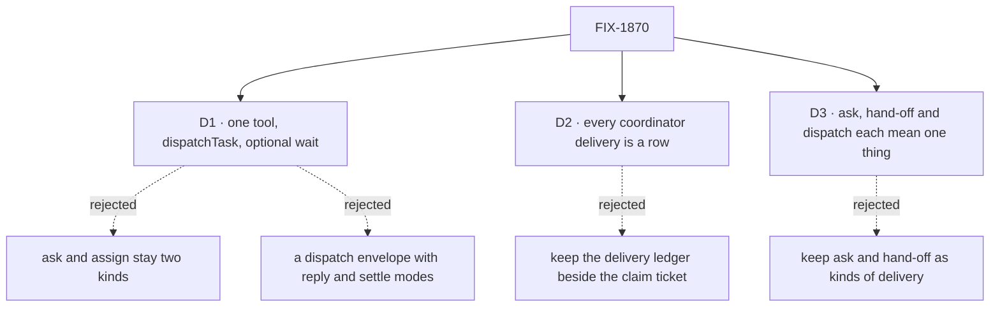

# FIX-1870 · Decisions

[Spec](SPEC.md) · **Decisions** · [Rules](BUSINESS-RULES.md) · [Plan](PLAN.md) · [Docs](DOCS.md) · [Evolution](EVOLUTION.md)

The calls that sit above any one issue: what was chosen, what lost, why, and what each locks in
for the three issues and the closure under it. All three are on the sign-off.

## The tree

## D1 · One tool, `dispatchTask`, starts work on another worker now and can wait for it

| | |
|---|---|
| **Instead of** | Ask (`addTask({ waitForResponse })`) and assign as two kinds of hand-off, with the coordinator's `handOff` beside them · or the first draft: a dispatch envelope carrying a reply mode and a settle mode (FIX-1871, FIX-1874) |
| **Because** | An ask is an ordinary task row the caller waits on (`packages/orchestration/src/tasks/helpers/wait-for-response.ts`). Every way a result comes back (ask resume, `onTaskSettled`, the split wake) already comes from a row ending and runs through the board's notice code. The recipient does the same work either way; only the caller differs. So no new transport is needed |
| **Locks in** | `addTask`, `assignTask` and the other task tools are board CRUD and never start work now. `dispatcher()` stays transport for flow code; a fire-and-forget with no row is a `dispatcher()` call, not a model tool. Every rule ask carries today moves to `wait` unchanged ([ER-3](BUSINESS-RULES.md#what-a-team-gets-and-what-it-doesnt)) |

**What would change my mind:** one of the three regression checks can't stay identical under
`dispatchTask` (the kill line). Then the two callers need two behaviours, and one tool hides that.

![D1: one tool or two kinds. Chosen: dispatchTask with an optional wait. Instead of: ask and assign as two kinds, plus the coordinator's handOff. It comes down to the first row: the recipient does the same work in both, so two tools describe one mechanism. Second row, the price: one tool description must tell the model when to wait. Third row, a tie: what the task does is unchanged either way. Locks in task tools as board CRUD only and dispatcher as flow-code transport. Flips if a regression check can't stay identical](figures/d1-one-tool.svg)

It comes down to the recipient: it does the same work for an ask and an assign, so two tools
describe one mechanism.

## D2 · Every coordinator delivery is a row; the board claim ticket is the only answer-once fence

| | |
|---|---|
| **Instead of** | Keeping FIX-1791's delivery ledger (`packages/workforce/src/delivery-ledger.ts`) beside the claim ticket, or a lighter row-less path for group threads |
| **Because** | Two mechanisms that both decide "answered once" disagree at the edges. FIX-1815 decided on one fence ([its D2](../FIX-1815/DECISIONS.md#d2)) and never built it. A row-less path keeps a second fence alive, because something still has to refuse the duplicate answer |
| **Locks in** | A coordinator on the everyone policy, with rounds, files one row per delegate per post. One answer per delegate per post per round, and the routing record, keep working. FIX-1875's spec measures the row cost; if it's unacceptable, that comes up here, not to a local fix |

![D2: one fence or two. Chosen: every coordinator delivery is a task row, fenced by the board claim ticket. Instead of: the delivery ledger kept beside it. It comes down to the first row: two fences that both decide answered once disagree at the edges. Second row, the price: the everyone policy files one row per delegate per post. Third row, a tie: one answer per delegate per post holds either way. Locks in the ledger and its delegateAnswer and delegateMissed entries removed. Flips if the row cost of the everyone policy is too high to carry](figures/d2-one-fence.svg)

It comes down to two fences disagreeing: the ledger loses because a row already carries the fence.

## D3 · Ask, hand-off and dispatch each mean one thing

Decided by the product owner, 2026-10-11.

| | |
|---|---|
| **Instead of** | Ask and assign named as two kinds of hand-off, and "hand-off" used for delivering new work (`createHandOff`, the coordinator's `handOff` tool, the glossary's *Hand-off*) |
| **Because** | A word that names two things makes a reader look for two mechanisms. Ask already means a question to a person (approvals, Shift Manager's AskCard, the harness question inbox) |
| **Locks in** | **Ask** is only a question to a person. **Hand-off** is only: I was doing the work, and I'm handing it to another session mid-work. Delivering new work is **dispatching a task**; **wait** is what a caller does on one. Every new public name in the set follows it ([ER-7](BUSINESS-RULES.md#what-a-team-gets-and-what-it-doesnt)) |

It comes down to readers: one word for two things sends them looking for two mechanisms.

## Who owns what

Every rule has one owner. Read a row to see where it is built and where it is only consumed; a
*consumes* cell is a place a child must not re-decide.

## Decided in review, recorded so no child reopens them

- **`post-to-mailbox` is already gone from code.** FIX-1792 P4 (`617aeabb5`) removed it.
  FIX-1875 retires nothing there; stale mentions in `.changeset/` and `goals/` are FIX-1876's.
  The closure sweep still checks it stays gone.
- **Why FIX-1818 was canceled.** [FIX-1815 Q1](../FIX-1815/DECISIONS.md#q1), the product owner,
  2026-10-08: it did not move that epic's goal, and ask could ride an existing fence. FIX-1872
  carries its intent; FIX-1872 closes it in favour of itself.
- **No separate wait depth.** Depth is the task chain limit, `MAX_TASK_DEPTH`.
- **`onTimeout: "continue"` is the only new behaviour, and it is a caller choice.** The row runs on,
  as an unwaited dispatch would; its ending reaches the filer through `onTaskSettled`.

## What the end-state POC showed

None built. The premise, that every result path already comes from a row ending, is read off
`wait-for-response.ts` and the notice code on `main`, and the closure's reruns test it.

## How it got here

- **First draft (2026-10-10)** — a dispatch envelope with reply and settle modes, FIX-1871 and
  FIX-1874.
- **Redrafted (2026-10-11)** — the board already does it. FIX-1871 and FIX-1874 canceled; one tool
  over the board; the owner fixed the vocabulary (D3).
- **Spec written (2026-10-11)** — closure FIX-1887 filed; D2 settles the everyone policy's row cost
  at epic level, since a row-less path keeps a second fence.

**Open: none.**
