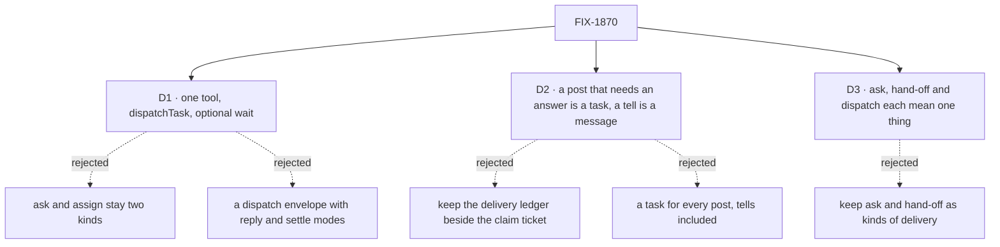

# FIX-1870 · Decisions

[Spec](SPEC.md) · **Decisions** · [Rules](BUSINESS-RULES.md) · [Plan](PLAN.md) · [Docs](DOCS.md) · [Evolution](EVOLUTION.md)

The calls that sit above any one issue: what was chosen, what lost, why, and what each locks in
for the three issues and the closure under it. All three are on the sign-off, and the product
owner decided D2 and D3.

## The tree

## D1 · One tool, `dispatchTask`, starts work on another worker now and can wait for it

| | |
|---|---|
| **Instead of** | Ask (`addTask({ waitForResponse })`) and assign as two kinds of hand-off, with the coordinator's `handOff` beside them · or the first draft: a dispatch envelope carrying a reply mode and a settle mode (FIX-1871, FIX-1874) |
| **Because** | An ask is an ordinary task row the caller waits on (`packages/orchestration/src/tasks/helpers/wait-for-response.ts`). Every way a result comes back (ask resume, `onTaskSettled`, the split wake) already comes from a row ending and runs through the board's notice code. The recipient does the same work either way; only the caller differs. So no new transport is needed |
| **Locks in** | `addTask`, `assignTask` and the other task tools are board CRUD and never start work now. `dispatcher()` stays transport for flow code; a fire-and-forget with no row is a `dispatcher()` call, not a model tool. Every rule ask carries today moves to `wait` unchanged ([ER-3](BUSINESS-RULES.md#what-a-team-gets-and-what-it-doesnt)) |

**What would change my mind:** one of the three regression checks can't stay identical under
`dispatchTask` (the kill line). Then the two callers need two behaviours, and one tool hides that.

![D1: one tool or two kinds. Chosen: dispatchTask with an optional wait. Instead of: ask and assign as two kinds, plus the coordinator's handOff. It comes down to the first row: the recipient does the same work in both, so two tools describe one mechanism. Second row, the price: one tool description must tell the model when to wait. Third row, a tie: what the task does is unchanged either way. Locks in task tools as board CRUD only and dispatcher as flow-code transport. Flips if a regression check can't stay identical](figures/d1-one-tool.svg)

It comes down to the recipient: it does the same work for an ask and an assign, so two tools
describe one mechanism.

## D2 · A coordinator post that needs an answer is a task; a tell is a plain message

Decided by the product owner, 2026-10-11, answering this spec's Open 1.

| | |
|---|---|
| **Instead of** | [FIX-1816 D3](../../issues/FIX-1816/DECISIONS.md#d3), merged: a coordinator's post stays a post, fenced by FIX-1791's delivery ledger (`packages/workforce/src/delivery-ledger.ts`) beside the claim ticket · or a task for every post, tells included · or a lighter row-less path for group threads |
| **Because** | Anything that needs a confirmed answer is tracked to an ending: claimed once, done or failed, and the caller hears it. A tell that expects no reply needs none of that. Claude Code draws the same line: Agent and team tasks are tracked to an ending, SendMessage messages are not. Two fences that both decide "answered once" disagree at the edges, and FIX-1815 decided on one ([its D2](../FIX-1815/DECISIONS.md#d2)) and never built it. A task for every post would give a tell a deadline and a missed answer it never needed. FIX-1816 D3 kept each delegate's own line, a routing policy and rounds for what the person sees; D2 keeps them and changes only the fence, so it amends D3 rather than reversing it |
| **Locks in** | Every coordinator post that expects an answer is a task, one per delegate, sent through `dispatchTask`. One answer per delegate per post per round, each delegate's own line, the round deadline, the missed answer and the routing record keep working ([ER-6](BUSINESS-RULES.md#what-a-team-gets-and-what-it-doesnt)). A tell that expects no reply is a plain message, `dispatcher()` from flow code or a session message, with no row, no deadline and no once-only check. No model-facing tell tool is added. FIX-1872's spec first checks whether any coordinator post today is a tell: if none is, every post is a task and nothing changes but names; if some are, those become plain messages. The coordinator's `handOff` tool and the ledger go in one change, FIX-1872, so no build ships two fences. A question kind of task, shown differently in the UI, waits until something needs it |

**What would change my mind:** a post's own lines, rounds or routing can't run as rows. Then D2
narrows to task endings, the ledger stays for posts, and FIX-1872 shrinks to the hand-off route.
That, or a row cost FIX-1872's spec can't accept, comes back to this epic, not to a local fix.

![D2: what a coordinator's post becomes, three options side by side. Chosen: a post that needs an answer is a task, one per delegate, and a tell is a plain message. Instead of: a task for every post, or today's post fenced by the delivery ledger. It comes down to the first row, what is tracked to an ending: the split tracks exactly what expects an answer, a task for every post gives a tell a deadline it never needed, and the ledger keeps a second fence. Second row, the price: a row per delegate for each post that needs an answer, with today's posts sorted first; a row for every post; or none. Third row, a tie: each delegate's own line, rounds and routing hold in all three. Locks in the ledger removed and no tell tool. Flips if a post's own lines can't run as rows](figures/d2-answer-or-tell.svg)

It comes down to what is tracked to an ending: a task for every post tracks tells nobody answers,
and the ledger tracks answers with a second fence.

## D3 · Ask, hand-off and dispatch each mean one thing

Decided by the product owner, 2026-10-11.

| | |
|---|---|
| **Instead of** | Ask and assign named as two kinds of hand-off, and "hand-off" used for delivering new work (`createHandOff`, the coordinator's `handOff` tool, the glossary's *Hand-off*) |
| **Because** | A word that names two things makes a reader look for two mechanisms. Ask already means a question to a person (approvals, Shift Manager's AskCard, the harness question inbox) |
| **Locks in** | **Ask** is only a question to a person. **Hand-off** is only: I was doing the work, and I'm handing it to another session mid-work. Delivering new work is **dispatching a task**; **wait** is what a caller does on one. Every new public name in the set follows it ([ER-7](BUSINESS-RULES.md#what-a-team-gets-and-what-it-doesnt)) |

It comes down to readers: one word for two things sends them looking for two mechanisms.

## Who owns what

Every rule has one owner. Read a row to see where it is built and where it is only consumed; a
*consumes* cell is a place a child must not re-decide.

## Decided in review, recorded so no child reopens them

- **`post-to-mailbox` is already gone from code.** FIX-1792 P4 (`617aeabb5`) removed it.
  FIX-1875 retires nothing there; stale mentions in `.changeset/` and `goals/` are FIX-1876's.
  The closure sweep still checks it stays gone.
- **Why FIX-1818 was canceled.** [FIX-1815 Q1](../FIX-1815/DECISIONS.md#q1), the product owner,
  2026-10-08: it did not move that epic's goal, and ask could ride an existing fence. FIX-1872
  carries its intent; FIX-1872 closes it in favour of itself.
- **Wait depth stays one.** A turn that is itself working a task can't wait, as `addTaskAndWait`
  refuses today ([FIX-1816's cut](../../issues/FIX-1816/DECISIONS.md#cut-before-the-gate)).
  `MAX_TASK_DEPTH` bounds the task chain, not waits. Nested waits would be a behaviour change (ER-8).
- **A timeout cancels the row, as it ships.** Keeping a timed-out row running is not built here;
  it would be new behaviour that no rerun proves (ER-8).
- **The coordinator's `handOff` tool retires in FIX-1872, with the ledger.** Retiring it in
  FIX-1875 left a window where deliveries were rows and the ledger still fenced routing: two fences
  (ER-10). `handOff` and `dispatchTask` coexist until FIX-1872 merges.
- **The conversation board's notice marker is not a fence.** FIX-1794's marker
  (`conversation-board/ledger.ts`, `recordEnding`) records a notice owed; only delivering the
  notice clears it. It never refuses a duplicate answer, so ER-5 and the sweep hold with it in place.
- **`openWorkstream` is not a hand-off tool.** FIX-1793's project-coordinator action starts a
  workstream; ER-2 and ER-10 don't touch it. A post *to* a workstream's session that expects an answer
  is a coordinator post like any other, and moves to a row under ER-5; a tell stays a message.
- **The coordinator checks are FIX-1791's, FIX-1794's and FIX-1610's goals.** The earlier
  "FIX-1840 check" was FIX-1794's `files-tasks-down-the-owners-chain`; FIX-1840 only appears in a
  verdict row there.

## Open

None. Open 1, whether a coordinator's passed-on message becomes a task, was answered by the
product owner on 2026-10-11 and is now [D2](#d2). The project-spec asked the same question
(#3102, Open 2); this answer settles both.

## What the end-state POC showed

None built. The premise, that every result path already comes from a row ending, is read off
`wait-for-response.ts` and the notice code on `main`, and the closure's reruns test it.

## How it got here

- **First draft (2026-10-10)** — a dispatch envelope with reply and settle modes, FIX-1871 and
  FIX-1874.
- **Redrafted (2026-10-11)** — the board already does it. FIX-1871 and FIX-1874 canceled; one tool
  over the board; the owner fixed the vocabulary (D3).
- **Spec written (2026-10-11)** — closure FIX-1887 filed; D2 settles the everyone policy's row cost
  at epic level, since a row-less path keeps a second fence.
- **Review folded (2026-10-12)** — D2 names the FIX-1816 D3 amendment and waits on Open 1; the
  `handOff` retirement moved into FIX-1872; the coordinator checks and package READMEs joined the
  closure; wait depth and timeout restated as they ship, with `onTimeout: "continue"` dropped.
- **Open 1 answered (2026-10-11, after merge)** — the owner: anything that needs a confirmed
  answer is a task, a tell is a plain message. D2 now reads that way and amends FIX-1816 D3 to
  match; a question kind of task is deferred. Folded by a follow-up PR.

**Open: 0.**
