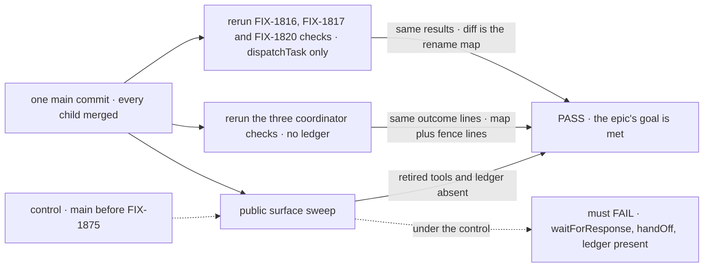
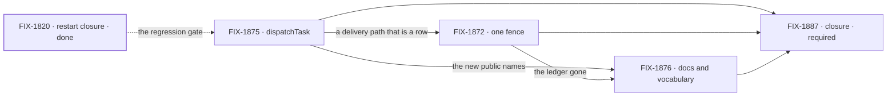

# FIX-1870 · dispatchTask: one tool for handing work to another worker

**Spec** · [Decisions](DECISIONS.md) · [Rules](BUSINESS-RULES.md) · [Plan](PLAN.md) · [Docs](DOCS.md) · [Evolution](EVOLUTION.md)

## Five teams, before and after

| A team that… | Today | After this epic |
|---|---|---|
| **builds a worker that needs a colleague's result before it continues** | Calls `addTask({ waitForResponse: true })`, a board tool that a flag turns into a delivery tool | Calls `dispatchTask({ …, wait: true })`. Same park, same resume, same limits |
| **builds a worker that hands work over and moves on** | Picks from four overlapping tools: `addTask` plus an assignee, the board's hand-over, the coordinator's `handOff`, and (until FIX-1792) `post-to-mailbox` | Calls `dispatchTask` without `wait`, and hears the ending through `onTaskSettled`. `addTask` and `assignTask` only record work the board schedules |
| **runs a coordinator** | Its deliveries are fenced by a delivery ledger the board doesn't know about | Each post that needs an answer is a task row per delegate, and the board's claim ticket fences it. One answer per delegate per post, each delegate's own line, rounds and routing still hold. A tell that expects no reply is a plain message ([D2](DECISIONS.md#d2)) |
| **reads the docs** | "Ask" names a kind of hand-off and a question to a person; "hand-off" names delivering new work | Ask is a question to a person. Hand-off is passing your own work to another session mid-work. New work is dispatched |
| **maintains the framework** | Keeps two answer-once fences in agreement | Keeps one |

**Why now.** [FIX-1815](https://linear.app/fixpoint-labs/issue/FIX-1815) closed on 2026-10-11
when [FIX-1820](https://linear.app/fixpoint-labs/issue/FIX-1820) passed. Ask and assign are now
pinned by three passing goal checks, so this is the cheapest moment to collapse their names: any
behaviour change shows up as a failing check. And two pieces of work wait on the vocabulary:
[FIX-1637](https://linear.app/fixpoint-labs/issue/FIX-1637)'s hand-off docs and
[FIX-1796](https://linear.app/fixpoint-labs/issue/FIX-1796)'s term cleanup.

## The goal, and how we'll know it's met

**A worker that needs another worker to do something has one tool that starts the work now and
can wait for the result. Today it has to pick from four tools that overlap.**

| Is it the right goal? | |
|---|---|
| **The real need** | Every new worker author has to learn which of four tools to use, and every maintainer keeps two fences in agreement. Ask and assign do the same work for the recipient; only the caller differs |
| **Smaller, and rejected** | "`dispatchTask` ships." [FIX-1875](https://linear.app/fixpoint-labs/issue/FIX-1875) alone meets it, while the coordinator keeps its delivery ledger beside the claim ticket and the docs still teach ask as a kind of hand-off. Two fences and two words for one thing stay |
| **Bigger, and not this epic's** | Waiting on several tasks at once · a row-less question tool for workers · a question kind of task · channels |
| **Not done if** | Any of the three regression checks changed by more than names · a coordinator check changed by more than names and its declared fence lines · a retired name is still exported · the delivery ledger is still in the coordinator's state · a published page or package README still teaches `waitForResponse` or the `handOff` tool · the closure goal check hasn't run · a bug the closure run found is open |

The reruns prove nothing changed for a waiter or a coordinator; the sweep proves the old ways are gone. Today's `main` must fail
the sweep, which is what makes its pass mean something.

| How we verify | |
|---|---|
| **Goal check** | The closure issue, [FIX-1887](https://linear.app/fixpoint-labs/issue/FIX-1887), on one `main` commit after every other child merges ([ER-15](BUSINESS-RULES.md#the-closure)) |
| **Signal** | `goals/hand-offs/ask-survives-a-restart/` (FIX-1816), `goals/coordinators/task-session-stays-open/` (FIX-1817) and `goals/hand-offs/survives-a-restart-and-runs-once/` (FIX-1820) each get the result they got before, with workers that use only `dispatchTask`. `goals/coordinators/hands-each-post-to-its-delegates/` (FIX-1791), `goals/coordinators/files-tasks-down-the-owners-chain/` (FIX-1794) and `goals/workforce-mailboxes/a-routed-post-gets-one-answer/` (FIX-1610) each get the result they got before, with the ledger gone. The sweep reads exported symbols, the tool names in every tool list, `apps/docs` and the package READMEs: no `waitForResponse` or `timeoutMs` on `addTask`, no coordinator `handOff` tool, no `post-to-mailbox`, no delivery ledger, no `delegateAnswer` / `delegateMissed` |
| **Input** | The three checks as they stand on `main` when this spec merges, the real model they already use, a durable store |
| **Anti-game** | The diff to the three checks since this spec merged is a rename map, and a script fails the check if any changed line isn't explained by the map. The coordinator checks may also change lines that read the ledger's state, each replaced by the row's equivalent and listed in the closure report; no outcome line (what the person sees) changes. No assertion is loosened, and no leg is dropped. No asserting on a child's own tests. *Amended 2026-10-12 (ER-14):* the map is the union of the pinned name tables in [FIX-1875](../../issues/FIX-1875/PLAN.md#pinned-names) and [FIX-1876](../../issues/FIX-1876/PLAN.md#pinned-names), plus FIX-1872's two shape changes as named entries: the post entry's declaration moving from `internal` to `task`, and `handOff({ to })` → `dispatchTask({ post: true, assignee })` |
| **Control that must fail** | The sweep, run on the `main` commit before FIX-1875 merged, must FAIL. A planted non-name edit to one check's assertions must FAIL the rename-map script |

| | |
|---|---|
| **Lead measure** | The children whose goal check has passed, listed by name. **None today** |
| **Not doing** | Changing what a waited-on or dispatched task does · waiting on several tasks at once · a row-less question tool for workers · a model-facing tell tool · a special class of task for questions ("question" or "ask", shown differently in the UI), until something needs it · channels |
| **Kill line** | One of the three regression checks can't stay identical. That would mean ask and assign really do behave differently for the recipient, and one tool would be hiding two |

## What's in the box

The box is one tool and one fence; everything under them already ships. The fence keeps a rename
from becoming a redesign ([ER-8](BUSINESS-RULES.md#what-no-child-may-do)).

## The set · as of 2026-10-11

A dated snapshot. Live state is Linear and the implementation PRs.

| Issue | What it delivers | Why the set needs it | Status |
|---|---|---|---|
| [FIX-1875](https://linear.app/fixpoint-labs/issue/FIX-1875) · dispatchTask | The tool, with `wait`; retires `waitForResponse` / `timeoutMs` on `addTask` and the public ask names | The substance ([D1](DECISIONS.md#d1)) | Backlog · spec route |
| [FIX-1872](https://linear.app/fixpoint-labs/issue/FIX-1872) · one fence | Coordinator posts that need an answer through `dispatchTask`, a workstream's row carrying its `target` into its existing session, and any tell as a `dispatcher()` message; the coordinator's `handOff` tool, the delivery ledger and its `delegateAnswer` / `delegateMissed` entries removed in the same change | Without it two fences stay ([D2](DECISIONS.md#d2)) | Backlog · spec route · blocked by FIX-1875 |
| [FIX-1876](https://linear.app/fixpoint-labs/issue/FIX-1876) · docs and vocabulary | Internal ask names and the hand-off names that mean "deliver new work" renamed; the published pages and glossary describe one path | Without it the docs teach two mechanisms for one ([D3](DECISIONS.md#d3)) | Backlog · spec route · blocked by FIX-1875, FIX-1872 |
| [FIX-1887](https://linear.app/fixpoint-labs/issue/FIX-1887) · closure · **required** | The QA plan and its run on one `main` commit: the three reruns, the surface sweep, every child's own check | Proves the whole ([ER-15](BUSINESS-RULES.md#the-closure)) | Backlog · blocked by FIX-1875, FIX-1872, FIX-1876 |

Three issues and a closure. [FIX-1871](https://linear.app/fixpoint-labs/issue/FIX-1871) and
[FIX-1874](https://linear.app/fixpoint-labs/issue/FIX-1874), the first draft's envelope and
settle-as-reply, are canceled: the board already does what they proposed. Whether three is really
two: FIX-1876 could fold into the other two, but its internal renames touch the files both of them
edit, so landing it last keeps both diffs reviewable. The collapse trigger is FIX-1875 or FIX-1872
finishing the renames themselves.

## How the issues flow into each other

An edge is what one issue hands the next; the dashed edge is an input from FIX-1815. The set is a
straight chain: the ledger can't go until a coordinator post that needs an answer is a row, and the internal renames
wait until both have stopped moving the files they rename.

## What stays as it is

- **What a waited-on or dispatched task does**, every limit included ([ER-3](BUSINESS-RULES.md#what-a-team-gets-and-what-it-doesnt)).
- **A tell that expects no reply**, as a plain `dispatcher()` message (into the target's session for a workstream), with no row; not the board's `-tell` notice flush.
- **`dispatcher()`**, as transport for flow code, and [FIX-1312](https://linear.app/fixpoint-labs/issue/FIX-1312)'s reply-to-sender (`session: { from: true }`).
- **`addTask`, `assignTask` and the other task tools**, as board CRUD.
- **Ask as a question to a person**: approvals, Shift Manager's AskCard, the harness question inbox.
- **Related, not children:** FIX-1815, FIX-1816, FIX-1786, FIX-1791, FIX-1794, FIX-1796, FIX-1637, FIX-1312.

## Sign off

**[The goal](#the-goal-and-how-well-know-its-met), at that size:** one tool, one fence, one
vocabulary, proven by three unchanged checks. If wrong: we rename for nothing, or a real
difference between ask and assign gets buried under one name. The kill line catches the second.

1. **[D1](DECISIONS.md#d1) · One tool, `dispatchTask`, with an optional `wait`.** If wrong: the
   model misuses `wait` where a fire-and-forget was right, and turns park for no reason.
2. **[D2](DECISIONS.md#d2) · A coordinator post that needs an answer is a task; a tell is a plain
   message; the claim ticket is the only fence.** Decided by the owner, 2026-10-11; it amends a
   merged decision, FIX-1816 D3. If wrong: a coordinator post answered twice, or each delegate's
   own line folded into one.
3. **[D3](DECISIONS.md#d3) · Ask, hand-off and dispatch each mean one thing.** Decided by the
   owner, 2026-10-11. If wrong: a rename pass over published pages that a later epic undoes.

**Open: 0.** Reasoning and what lost: [DECISIONS.md](DECISIONS.md). Rules:
[BUSINESS-RULES.md](BUSINESS-RULES.md). Order: [PLAN.md](PLAN.md).

Epic · 3 issues and a closure · Orchestration Primitives · Goal 4, keep the foundation honest
