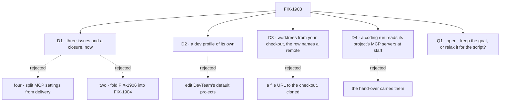

# FIX-1903 · Decisions

[Spec](SPEC.md) · **Decisions** · [Rules](BUSINESS-RULES.md) · [Plan](PLAN.md) · [Docs](DOCS.md) · [Evolution](EVOLUTION.md)

The calls that sit above any one issue: what was chosen, what lost, why, and what each locks in
for the three issues and the closure under it. D1 to D4 are engineering calls, taken and on the
sign-off. Q1 is the product owner's.

## The tree

## D1 · Three issues and a closure, now

| | |
|---|---|
| **Instead of** | Four, with FIX-1905 split into settings now and delivery after FIX-1875 · or two, with FIX-1906 folded into FIX-1904 |
| **Because** | Delivery needs no hand-over tool. A coding run already learns its project from the task row it holds, never from the hand-over's payload (`packages/workforce/src/projects/project-workspace.ts`, `projectWorkspace()` and `namedProjectOf`). That is how its repository reaches it, and MCP servers can ride the same read. So FIX-1905 doesn't wait on FIX-1875, and a split buys nothing. FIX-1906 stays its own issue because it carries the epic's kill line, that a fresh worktree of this monorepo gets its dependencies and builds, and it is a reusable host capability in `packages/workspace` and `harness-manager`, where FIX-1904 is one profile's data and defaults. Kept apart, the risky one is proven first, on its own review, before anything builds on it |
| **Locks in** | The coder's default (Q1) goes in FIX-1904, not a new issue. FIX-1906's spec proves a fresh worktree installs and builds once before FIX-1904 or FIX-1905 builds on it ([PLAN](PLAN.md#what-each-issue-entails)). FIX-1905 ships as one PR after FIX-1904 merges, not two stacked PRs. FIX-1875's blocks relation to FIX-1905 becomes *related* when this spec is approved |

**What would change my mind:** a coding run that must have Linear and can't name its project
when it starts. Then delivery needs the hand-over, and FIX-1905 splits after all. For the
fold: FIX-1906's proof finding a worktree builds with no work and the mapping a few lines.
Then its spec says so and it folds into FIX-1904, a smaller set with nothing else moved.

![D1: is the set three issues and a closure, four with MCP delivery split out to wait for dispatchTask, or two with FIX-1906 folded into FIX-1904. Chosen: three. It comes down to the first row, what each piece waits on: with three, only what it builds on, FIX-1906 proving a worktree builds first; with four, delivery waits on FIX-1875 for a read the run already makes; with two, the risky host change waits inside a profile PR. Second row, the price: three specs and FIX-1905 the largest child in one PR. Third row, a tie: the closure is the same run. Locks in FIX-1906 proving the build first, FIX-1905 as one PR, the coder default in FIX-1904 and FIX-1875 related, not blocking. Flips if a run that needs Linear can't name its project at start, or FIX-1906's proof is trivial](figures/d1-the-set.svg)

It comes down to what each piece waits on: a run already reads its project from its own task row,
so nothing waits on FIX-1875, and kept apart, FIX-1906's build proof waits on nothing.

## D2 · `shift-manager:dev` opens a dev profile of its own; DevTeam stays the goal Lab

| | |
|---|---|
| **Instead of** | Replacing DevTeam's three demo projects with FSD and Shift Manager · or adding the two beside the three |
| **Because** | Five goal checks serve `teams/devteam/fsdev.config.mts` itself, among them `goals/shift-manager/it-groups-workstreams-under-their-projects`, which reads Storefront's two workstreams, and `goals/shift-manager/one-person-runs-a-labs-projects-and-people`, which requires the profile's own projects unchanged. Replacing them breaks those checks. Adding keeps a scratch repository and three demo projects on every open, which isn't the clean start the goal asks for |
| **Locks in** | A second profile on the same team tree, opened through the same `openLab`. `start` and `dev` both default to it; DevTeam serves with `--config`. No child edits DevTeam ([ER-10](BUSINESS-RULES.md#what-no-child-may-do)). The profile's file and name are FIX-1904's |

![D2: where FSD and Shift Manager live. Chosen: a dev profile of its own, beside DevTeam. Instead of: editing DevTeam's default projects. It comes down to the first row, the goal checks that serve DevTeam unedited: kept as they are, against at least two broken and rewritten. Second row, the price: two profiles on one team tree that can drift. Third row: a fresh open shows only the two dev projects, against demo projects beside them or in their place. Locks in DevTeam served by --config. Flips if no goal check serves DevTeam unedited](figures/d2-own-profile.svg)

It comes down to the goal checks: five serve DevTeam's config unedited, and two read its demo projects.

## D3 · Worktrees are cut from your own checkout; the project row keeps naming a remote

| | |
|---|---|
| **Instead of** | The row's `repository` set to `file://` plus the checkout's path, which the host clones into a bare clone of its own (works today: DevTeam's Storefront does it with a scratch repository) · or a clone from GitHub |
| **Because** | The owner asked for worktrees from the local checkout. The work a person reviews belongs in the repository they review in: a branch in a hidden clone has to be fetched before anyone sees it. And a `file://` path is a folder on one machine in a shared row, which [FIX-1762](../../issues/FIX-1762/BUSINESS-RULES.md)'s rule (a remote, never a folder) exists to keep out |
| **Locks in** | Each dev project's row names this repository's remote. The host maps that remote to the checkout the server runs from: the operator's host config, never a row, and bound to the project ids it names (or to a host declared trusted and single-user), never resolved from a row's remote alone, which any project's owner can set ([ER-13](BUSINESS-RULES.md#what-no-child-may-do)). The workspace host gains that mapping, and its existing local-repository mode (`localRepositories` in `packages/workspace/src/local-host.ts`) gains the project's files beside the checkout, which it refuses today. The server cuts `conductor/…` branches in your checkout. Two projects on one checkout are proved not to collide, not assumed ([ER-4](BUSINESS-RULES.md#what-a-person-gets-and-what-they-dont)) |

**What would change my mind:** people find runs' branches in their checkout a nuisance. Then a
host clone fed from the checkout is the better default, and the mapping stays.

![D3: where a run's worktree comes from. Chosen: your own checkout, with the row naming a remote. Instead of: a file URL to the checkout in the row, cloned by the host. It comes down to the first row, where the branch a person reviews ends up: in their checkout, against a hidden clone they must fetch from. Second row, the price: a workspace host change, against none today. Third row: the row stays a remote, against a machine path in a shared row. Locks in the remote-to-checkout mapping as host config, bound to the projects it names. Flips if branches in the checkout prove a nuisance](figures/d3-your-checkout.svg)

It comes down to where the branch lands: in your checkout you can review it at once; in a clone
you fetch it first.

## D4 · A coding run reads its project's MCP servers when it starts

| | |
|---|---|
| **Instead of** | The coordinator attaching a project's MCP servers to the workers it hands work to, through `handOff` (retiring, [FIX-1870 D2](../FIX-1870/DECISIONS.md#d2)) or a field on `dispatchTask` · or MCP servers in a worker's `WORKER.md` |
| **Because** | A hand-over carries config only on the paths that use it: a row approved in Inbox, or filed by the chief of staff, would miss it. The run's own task row names its project on every path, and that read already gives the run its repository. A worker serves many projects, so its file can't say which tracker a project uses |
| **Locks in** | MCP servers are a project setting, read when a coding run starts. FSD connects to them for the run with its owner's key, and the harness gets their tools only, through one generic option, `mcpTools` ([ER-9](BUSINESS-RULES.md#what-no-child-may-do)). A row names a host-approved server alias only; the alias's endpoint is host config, the key is each person's own, set on Settings, and the key reaches FSD's MCP connection only ([ER-6](BUSINESS-RULES.md#what-a-person-gets-and-what-they-dont), [ER-14](BUSINESS-RULES.md#what-no-child-may-do)). A row that could name a URL and a variable could send any host secret anywhere. Coding runs only in this epic, Claude Code first; Cursor and Codex later |

**What would change my mind:** a worker that doesn't code (the chief of staff, the EM) turns
out to need Linear for the goal. Then those workers get the project's servers too, through the
MCP capability (`createMcpCapability` in `packages/tools/src/mcp/capability.ts`), still read
from the project.

![D4: how a project's MCP servers reach the worker that works the item. Chosen: the coding run reads them from its own project when it starts. Instead of: the coordinator attaches them when it hands work over. It comes down to the first row, which runs get them: every coding run for the project, against only runs a coordinator handed over. Second row, the price: FSD holds the connection per run and the harness gains a tools-only option. Third row: no dependency on dispatchTask, against waiting for it. Locks in MCP servers as a project setting, chosen by host alias, with no URL or credential on the row. Flips if a worker that doesn't code needs Linear for the goal](figures/d4-read-at-run-start.svg)

It comes down to which runs get them: a run started from Inbox never passes through a
coordinator's hand-over.

## Q1 · Open · Keep the goal, a real coding agent on a fresh open, or relax it to allow the script?

**Plain terms.** The goal says a coding agent works the item on a fresh open with nothing set
but credentials, and a script can't work an item. So this is not a choice of default inside the
goal; it is whether to keep the goal as written. Today the dev Lab's coder is a script: it
writes one file and commits it, needs no model and costs nothing. A real agent, Claude Code,
needs the person signed in to Claude or an Anthropic key, and each run costs model time.

**The trade-off.** Keep the goal: Claude Code by default, the goal met on a fresh open, and
every person who opens the dev Lab to work on a screen pays for a coder they may not use. Relax
the goal: the script by default keeps those opens free, and the goal and its closure check are
rewritten to "a coding agent, after one setting", with "sets anything but credentials" struck
from *Not done if*.

**My recommendation.** Keep the goal. The dev profile runs Claude Code by default. With no
Claude credential, it refuses to start and names the variable to set, or
`DEVFORCE_LAB_HARNESS=stub` for the script. It never falls back to the script silently, which is
DevTeam's rule today (`packages/shift-manager/teams/devteam/harness.mts`): a run that quietly
used the script would be read as an agent's. **Merging this PR accepts this recommendation
unless the owner says otherwise at the gate.**

**What would change my mind.** Most opens of `shift-manager:dev` are for screen work, where an
agent is unwanted. Then relax the goal: the script stays the default and the real agent is one
documented setting.

**What being wrong costs.** Little in code: one default in one profile, changed in a line, and
no data depends on it. Relaxing also rewrites the goal and the closure's acceptance.

![Open: keep the goal, a real coding agent on a fresh open, or relax it to allow the script. Recommended: keep it, a real coding agent refusing to start without a credential. Instead of: relax the goal, the script by default. It comes down to the first row, whether a fresh open meets the goal as written: yes, against no, the goal is rewritten. Second row, the price: every open needs a Claude credential and spends model time on runs, against free. Third row, a tie: neither falls back silently. Locks in a loud refusal with no credential. Flips if most opens are for screen work](figures/open-real-coder.svg)

It comes down to the goal: a script can't work an item, so keeping the goal means an agent by
default, and the script means relaxing it.

## Who owns what

Every rule has one owner. Read a row to see where it is built and where it is only consumed; a
*consumes* cell is a place a child must not re-decide.

## Decided in review, recorded so no child reopens them

The handover's binding points are rules now: the layer boundary is
[ER-9](BUSINESS-RULES.md#what-no-child-may-do); both projects shared, on one remote, told apart
by their briefs, is [ER-1](BUSINESS-RULES.md#what-a-person-gets-and-what-they-dont); each person's
Linear key is [ER-6](BUSINESS-RULES.md#what-a-person-gets-and-what-they-dont); no
picker is [ER-15](BUSINESS-RULES.md#what-no-child-may-do); "worker", never "seat", is
[ER-16](BUSINESS-RULES.md#what-no-child-may-do). Review round 1 (Cursor, Codex) settled:

- **FIX-1906 stays its own issue**, and proves a fresh worktree builds before the rest builds on
  it ([D1](#d1)).
- **FIX-1905 is one PR, after FIX-1904**, not two stacked PRs ([D1](#d1), [PLAN](PLAN.md)).
- **The checkout mapping is bound to project ids** in the operator's host config, never resolved
  from a row's remote alone ([D3](#d3), [ER-13](BUSINESS-RULES.md#what-no-child-may-do)).
- **A row names an MCP server by host-approved alias only**; the endpoint is host config
  ([D4](#d4), [ER-14](BUSINESS-RULES.md#what-no-child-may-do)).
- **A missing key is a degraded run, not a pass**: with no key on Settings and
  `LINEAR_MCP_API_KEY` unset, the closure's leg a must FAIL
  ([ER-7](BUSINESS-RULES.md#what-a-person-gets-and-what-they-dont)).

After merge, the owner decided on FIX-1905's spec review
([#3174](https://github.com/fixpoint-labs/flow-state-dev/pull/3174#issuecomment-6131359139)):

- **FSD holds the MCP connection and the key, not the coding agent.** The run gets tools only,
  through `mcpTools` ([ER-6](BUSINESS-RULES.md#what-a-person-gets-and-what-they-dont), [ER-9](BUSINESS-RULES.md#what-no-child-may-do)).
- **Each person sets their own key on Settings**; there are no admins. `LINEAR_MCP_API_KEY` only
  seeds the operator identity for headless runs ([ER-6](BUSINESS-RULES.md#what-a-person-gets-and-what-they-dont)).
- **Q1 is whether to keep the goal**, not a default inside it; merging accepts the
  recommendation unless the owner says otherwise ([Q1](#q1)).
- **A run's branch is reviewed in its worktree** or diffed from the checkout; normal git refuses
  to check out a branch a retained worktree holds. Whether to detach it on settle is FIX-1906's
  ([DOCS](DOCS.md)).
- **The figures stay.** Each is one `spec-figures.md` requires at epic altitude: the box, the
  path, the ownership matrix, and one trade-off per signed decision.

## What the end-state POC showed

None built. D1 and D4 rest on how a run learns its project today, read off `project-workspace.ts`
on `main`; FIX-1905's goal check proves it with a run that wasn't handed over by a coordinator.

## How it got here

- **Filed (2026-10-12)** — the owner's epic and three children; the handover asked whether
  FIX-1905 splits around FIX-1875.
- **Spec written (2026-10-12)** — closure FIX-1919 filed. D4 found that delivery needs no
  hand-over tool, so FIX-1905 doesn't split (D1). D2 kept DevTeam as the goal Lab after finding
  five goal checks serve its config unedited.
- **Review round 1 (2026-10-12)** — Cursor and Codex. FIX-1906 kept apart and made to prove a
  build first; FIX-1905 one PR; the checkout mapping and MCP servers bound to host config (ER-13,
  ER-14); Q1 reframed as keeping or relaxing the goal.

**Open: 1** ([Q1](#q1)).
