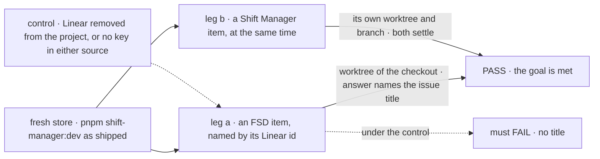
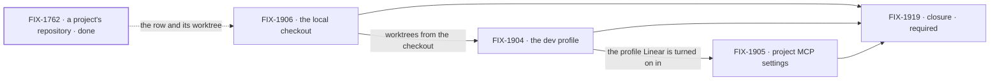

# FIX-1903 · Out of the box, shift-manager:dev develops Shift Manager and FSD

**Spec** · [Decisions](DECISIONS.md) · [Rules](BUSINESS-RULES.md) · [Plan](PLAN.md) · [Docs](DOCS.md) · [Evolution](EVOLUTION.md)

## Four teams, before and after

| A team that… | Today | After this epic |
|---|---|---|
| **opens `pnpm shift-manager:dev` to work on FSD** | Finds Storefront, Platform and Sandbox, demo projects on a scratch repository. A coding run is a script that commits one file | Finds two projects, FSD and Shift Manager, each with a brief that names its focus. An item they pick is worked by a coding agent in a worktree of their own checkout |
| **wants the coder to read the Linear issue it is working** | Pastes the issue into the conversation. A coding run has no Linear, and no project can give it any | The project carries Linear as an MCP server, and every coding run for the project gets it, acting as the person it works for |
| **runs one item on each project at once** | Has no way to point either project at their checkout | Two runs, two worktrees, two branches in the one checkout, and neither waits on the other's work |
| **maintains the DevTeam goal checks** | The DevTeam profile is both the daily dev Lab and the goal Lab | Unchanged. DevTeam stays the goal Lab, served by `--config` ([D2](DECISIONS.md#d2)) |

**Why now.** A project can name its repository and a coding run works in a branch of it
([FIX-1762](https://linear.app/fixpoint-labs/issue/FIX-1762), done), and two runs on one
project commit side by side ([FIX-1888](https://linear.app/fixpoint-labs/issue/FIX-1888),
done). Everything a person needs to work on FSD with Shift Manager exists, except the three
things this epic adds. Until then the people who build Shift Manager don't use it to build
anything, and its gaps are found by synthetic checks instead of by use.

## The goal, and how we'll know it's met

**On a fresh open of `pnpm shift-manager:dev`, with no config edited, a person picks an item on
FSD or on Shift Manager, and a coding agent works it in a worktree of their checkout, with
Linear available to it.**

| Is it the right goal? | |
|---|---|
| **The real need** | The people who build Shift Manager use it every day on the code they are building. That needs no setup step, a real coding agent, and the issue tracker the work comes from |
| **Smaller, and rejected** | "The two projects show in the sidebar." [FIX-1904](https://linear.app/fixpoint-labs/issue/FIX-1904) alone meets it while every run is a script in a scratch repository with no Linear. Nothing is worked |
| **Bigger, and not this epic's** | A Linear issue picker in Shift Manager · a run that pushes and opens a pull request ([FIX-1768](https://linear.app/fixpoint-labs/issue/FIX-1768)) · signing in to Linear by OAuth (each person pastes their own key instead) · MCP for workers that don't code (the chief of staff, the EM) · a Lab served from a published install, with no checkout |
| **Not done if** | A person sets anything but their credentials before the first item · a run's worktree is not in their checkout · a project row holds a folder, a credential, an MCP address or a variable name · a missing Linear credential is silent · a DevTeam goal check fails · the closure goal check hasn't run · a bug the closure run found is open |

The person gives only the issue id, so the title in the answer can only come from Linear. With
Linear removed from the project, or with no key on Settings and `LINEAR_MCP_API_KEY` unset, leg a
must fail, which is what makes its pass mean something.

| How we verify | |
|---|---|
| **Goal check** | The closure issue, [FIX-1919](https://linear.app/fixpoint-labs/issue/FIX-1919), on one `main` commit after every other child merges ([ER-20](BUSINESS-RULES.md#the-closure)) |
| **Signal** | In a real browser, as the dev profile's owner: leg a files work on FSD through the chief of staff, naming one Linear issue by id. Its run's worktree is a worktree of the checkout (`git worktree list` there names it), its branch is in the checkout, its session shows a Linear tool call, and its answer names the issue's title. Leg b does the same on Shift Manager while leg a runs: a second worktree and branch, both rows settle `completed` |
| **Input** | A fresh store, the command with no flags, a held-out Linear issue picked at run time and read only, the person's Claude credential in their shell and their Linear key set on Settings (`LINEAR_MCP_API_KEY` stands in only for a headless run) |
| **Anti-game** | No assertion on a child's own output. The prompt carries the id and never the title. The check edits no config and sets no variable a person wouldn't |
| **Control that must fail** | The project's Linear setting removed, or no key on Settings and `LINEAR_MCP_API_KEY` unset: leg a must FAIL its title. Today's `main`: both legs must FAIL (no FSD project) |

| | |
|---|---|
| **Serves** | [Goal 1, validate through real usage](../../../docs/objectives.md#1-validate-through-real-usage). It adds one goal to the corpus. Its larger effect is that FSD gets used daily by the people who build it, and real use finds gaps that checks don't |
| **Lead measure** | The children whose goal check has passed, by name. **None today** |
| **Kill line** | The coding agent can't do useful work in a worktree of this repository (it can't build or test there). Then the dev profile is a demo, and the next step is the worktree, not more projects. FIX-1906 tests this first: its spec proves a fresh worktree installs and builds once before FIX-1904 or FIX-1905 builds on it ([PLAN](PLAN.md#what-each-issue-entails)) |

## What's in the box

![In the box: the dev profile with two shared projects, FSD and Shift Manager, a real coding agent and Linear on both; the host mapping a project's remote to this machine's checkout, worktrees cut from it; MCP servers as a project setting, read when a coding run starts and connected by FSD with the key each person sets on Settings. Unchanged beside it: the DevTeam profile, served by --config, a project's repository as a remote, dispatchTask and the hand-over tools. Replaced in one line: the default config of shift-manager:dev, and the scripted coder in the dev profile. Not built, below a fence: an issue picker, push and pull request, Linear sign-in by OAuth, MCP for workers that don't code, a migration](figures/end-state.svg)

The box is one profile and two settings a host can act on. The fence keeps this a dev setup, not
a new integration product ([ER-9](BUSINESS-RULES.md#what-no-child-may-do)).

## The set · as of 2026-10-12

A dated snapshot. Live state is Linear and the implementation PRs.

| Issue | What it delivers | Why the set needs it | Status |
|---|---|---|---|
| [FIX-1906](https://linear.app/fixpoint-labs/issue/FIX-1906) · the local checkout | First, proof that a fresh worktree of this repository gets its dependencies and builds. Then the host maps a named project's remote to this machine's checkout and cuts worktrees from it, with the project's files beside each one; two projects on one checkout don't collide | Without it the projects point at a remote the host can't reach, or at a clone the person never sees ([D3](DECISIONS.md#d3)) | Backlog · spec route |
| [FIX-1904](https://linear.app/fixpoint-labs/issue/FIX-1904) · the dev profile | A profile `shift-manager:dev` opens by default: FSD and Shift Manager, shared, on this repository, each brief naming its focus, and the coder as Q1 decides (Claude Code, if the recommendation stands) | The substance a person sees ([D2](DECISIONS.md#d2)) | Backlog · spec route · builds after FIX-1906 |
| [FIX-1905](https://linear.app/fixpoint-labs/issue/FIX-1905) · project MCP settings | MCP servers on a project row; a coding run gets its project's servers' tools when it starts, connected by FSD with its owner's key; each person's key on a Settings page; Linear on both dev projects | Without it the agent works an issue it can't read ([D4](DECISIONS.md#d4)) | Backlog · spec route · one PR, after FIX-1904 |
| [FIX-1919](https://linear.app/fixpoint-labs/issue/FIX-1919) · closure · **required** | The QA plan and its run on one `main` commit: both legs, each team's journey, every child's own check | Proves the whole ([ER-20](BUSINESS-RULES.md#the-closure)) | Backlog · blocked by FIX-1904, FIX-1905, FIX-1906 |

Three issues and a closure. Whether three is really two: FIX-1906 could fold into FIX-1904, but
it carries the kill line and a host capability any Lab can use, where FIX-1904 is one profile's
data and defaults. Apart, the risky one is proven first ([D1](DECISIONS.md#d1)). Whether three
is really four: FIX-1905 doesn't split into settings and delivery, because delivery reads the
project at run start and so doesn't wait on FIX-1875 ([D1](DECISIONS.md#d1)). The coder's
default goes in FIX-1904, the profile's other default, not in a new issue.

## How the issues flow into each other

An edge is what one issue hands the next; the dashed edge is an input from FIX-1762. The builds
are a chain: FIX-1905 is one PR, built after FIX-1904 merges.

## What stays as it is

- **The DevTeam profile**: its projects, workstreams, ask and scripted coder. It is the goal Lab.
- **A project's `repository`**: a remote, never a folder ([FIX-1762](../../issues/FIX-1762/BUSINESS-RULES.md) BR-5).
- **`dispatchTask`, `handOff` and every hand-over tool** ([FIX-1870](../FIX-1870/SPEC.md)).
- **Where a run's worktree goes and what its branch is called**, apart from the repository it
  is cut from.
- **Related, not children:** FIX-1763, FIX-1762, FIX-1888, FIX-1870, FIX-1875, FIX-1768.

## Sign off

**[The goal](#the-goal-and-how-well-know-its-met), at that size:** a fresh open, either
project, a real agent in your checkout, Linear in reach. If wrong: we build a dev setup nobody
opens, or one that still needs a setup step.

1. **[D1](DECISIONS.md#d1) · Three issues and a closure, now; FIX-1906 proves a worktree builds
   first.** If wrong: one more spec than needed, or a closure run on a dev profile, a cost the
   first week of use would have shown anyway.
2. **[D2](DECISIONS.md#d2) · A profile of its own; DevTeam stays the goal Lab.** If wrong: two
   profiles drift, and the dev one stops being tested.
3. **[D3](DECISIONS.md#d3) · Worktrees come from your checkout, for the projects host config
   names; the row keeps naming a remote.** If wrong: the server writes branches into the
   repository you work in.
4. **[D4](DECISIONS.md#d4) · A coding run reads its project's MCP servers, by host alias, when
   it starts.** If wrong: a worker that isn't a coding run never gets them.

**Open: 1.** [Q1](DECISIONS.md#q1): keep the goal, a real coding agent on a fresh open, or relax
it to allow the script? I recommend keeping it, with Claude Code by default. **Merging this PR
accepts that recommendation unless the owner says otherwise.** Reasoning: [DECISIONS.md](DECISIONS.md). Rules: [BUSINESS-RULES.md](BUSINESS-RULES.md).
Order: [PLAN.md](PLAN.md).

Epic · 3 issues and a closure · Workforce: Shift Manager · Goal 1, validate through real usage
