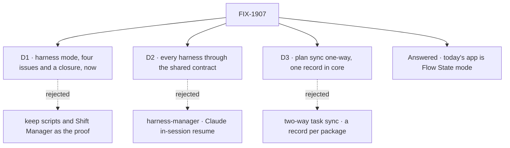

# FIX-1907 · Decisions

[Spec](SPEC.md) · **Decisions** · [Rules](BUSINESS-RULES.md) · [Plan](PLAN.md) · [Docs](DOCS.md) · [Evolution](EVOLUTION.md)

The calls that sit above any single issue: what was chosen, what lost, why, and what each locks
in for the children. Three are signed, and the one product question is answered.

## The tree

## D1 · Harness mode is worth four issues, an adopted bug and a closure run, now

| | |
|---|---|
| **Instead of** | Keeping the goal scripts and Shift Manager as the harness proof · or one harness first, the other two later |
| **Because** | Goal 1 wants each integration on the real path in a real app. Today Codex is proved from a script, Claude Code only through harness-manager on a task board, Cursor not at all, and no harness's plan end to end. A shared contract proves itself only when more than one harness goes through the same app, so one harness first proves nothing shared |
| **Locks in** | Kitchen Sink's front page becomes the picker. FIX-1185 becomes a child. Collapse trigger: FIX-1916 and FIX-1917 fold into one if FIX-1915 leaves each a few lines of options and no plan work |

**What would change my mind:** evidence that harness-manager's board path is the only way anyone
will drive a harness. Then a direct mode tests a path nobody uses, and this epic should not start.

![D1: is harness mode worth an epic now? Chosen: four issues, an adopted bug and a closure run. Instead of: the goal scripts and Shift Manager as the proof. It comes down to whether the shared contract is ever run side by side: only one app with all three does that. The price is Kitchen Sink's front page changing. Gaps found: before a closure trips on them, against only when one does. Locks in the picker as the front page and FIX-1185 as a child. Flips if harness-manager's path is the only way anyone drives a harness](figures/d1-worth-it.svg)

It comes down to side by side: without one app over all three, the shared contract is never run as shared.

## D2 · Kitchen Sink drives every harness through the shared contract

The block, `resume` and `onSession`, and the handle: nothing else.

| | |
|---|---|
| **Instead of** | Driving them through harness-manager on a task board · or Claude Code's own in-session resume, which stores its id in session state |
| **Because** | What we are testing is what the three packages share. harness-manager adds a board row, a checkout per task and a verdict: orchestration, and Shift Manager's. Claude Code's in-session resume exists for one harness only, so a gap in the other two would hide behind it. `labs/fsd-coding-skill` already runs all three this way |
| **Locks in** | Claude Code runs `detached: true` with resolvers in Kitchen Sink. Its in-session path is left to its own tests. One session flow factory builds one flow kind per harness, and a coding harness differs only by its block's options and its kind ([ER-6](BUSINESS-RULES.md#what-a-team-gets-and-what-it-doesnt)) |

**What would change my mind:** app authors using Claude Code's in-session path far more than the
contract. Then Kitchen Sink should exercise that path too, as a fifth leg.

It comes down to what is shared: harness-manager tests a board, and in-session resume tests one harness.

## D3 · Task sync is one-way and read-only: each harness's own plan, in one record shape in core

| | |
|---|---|
| **Instead of** | Two-way sync, where a person or Kitchen Sink adds a task the harness picks up · or each package keeping its own plan record and Kitchen Sink drawing one panel per harness |
| **Because** | Handing a harness work from a list is what harness-manager and Shift Manager do, and the ask puts it out of scope. The Claude Code docs already say [the plan is not a work queue](../../../apps/docs/docs/tools/claude-code-sdk.md#the-plan-is-not-a-work-queue). Per-package copies drift: FIX-1701 lifted `itemScope` into core because a missing copy hid a task's steps ([FIX-1692](https://linear.app/fixpoint-labs/issue/FIX-1692)) |
| **Locks in** | The `observed-plan` shape moves into `@flow-state-dev/core` (FIX-1915). Codex and Cursor write it. A harness that reports no plan says so. FIX-1185 is a child, because without it Claude Code's record stays empty. A harness that reports its plan as the whole list writes it through core's `replacePlanList`, which also keeps the per-turn `observed-plan-list` marker (FIX-1915 S1, BR-22a to BR-22d); no harness keeps a writer of its own |

**What would change my mind:** the product wanting Kitchen Sink to hand a harness work from a list.
That is a second epic, with Shift Manager, not a widening of this one.

It comes down to who puts work on a harness: two-way sync makes Kitchen Sink an orchestrator.

## Answered · Does today's Kitchen Sink become the Flow State mode, or move out?

**Settled: keep, from Jake's merge of #3167.** The archived ask follows.

**Answered: it becomes the Flow State mode, unchanged.** The owner decided it on 2026-10-12 by
merging FIX-1914's spec (#3167), which said it would not merge until this was answered, and it
matches their earlier note on the project mailbox: "keep today's Kitchen Sink unchanged as Flow
State mode". The ask is kept below as it was put.

**In plain terms.** Kitchen Sink's front page today is a support desk run by a team of AI workers,
next to an assistant with many settings, background tasks, a scheduled weekly digest and voice.
Harness mode puts a picker in front. Either all of that is what you see when you pick **Flow
State**, or it moves to other example apps and Flow State mode becomes one assistant, a peer of the
three coding harnesses.

**The trade-off.** Keeping it under Flow State costs almost nothing: the 29 goals, 9 browser tests,
the README and 9 docs pages that mention Kitchen Sink keep working. But Flow State mode is
then far larger than the other three, so the four modes are not like for like. Moving it out makes
the comparison clean, and costs a migration of all those references that does nothing for the
harnesses: its own epic. A third option, keeping the showcases beside the picker rather than under
it, gives the app two front doors.

**My recommendation: it becomes the Flow State mode, unchanged.** Flow State mode opens on the
assistant, with the support desk and the rest in its rail.

**What would change my mind:** you want Kitchen Sink read first as a harness test bed, and the
support desk under Flow State muddies the comparison.

**What being wrong costs.** Keeping it is cheap to reverse: moving it out later is the same work
then as now. Moving it out now is expensive to undo and puts a migration in front of the harness
work. It gated FIX-1914's spec only; the other children didn't wait.

![Settled: today's Kitchen Sink stays as the Flow State mode, unchanged (decided by merging #3167). The ask as put: where does today's Kitchen Sink go? Recommended: it becomes the Flow State mode, unchanged. Instead of: moving it to other example apps so Flow State mode is one assistant. It comes down to cost against a clean comparison: 29 goals, 9 browser tests and 9 docs pages keep working, and the four modes are not like for like. Locks in the support desk in Flow State mode's rail. Flips if the product wants Kitchen Sink read first as a harness test bed](figures/open-showcase.svg)

It comes down to the dependents: keeping it costs nothing, and moving it is a migration of its own.

## Who owns what

Every rule has one owner. FIX-1916 and FIX-1917 own no rule: they consume all of FIX-1915's,
which is the point. The Shift Manager column is the boundary: a cell that says *stays out* is a
place no child may build.

## Decided while drafting, recorded so no child reopens them

- **FIX-1735 and FIX-1701 are inputs, not children.** Both shipped: #2654 merged 2026-10-02 and
  #2569 merged 2026-10-01, and `itemScope` is in all three emitters. FIX-1701's Linear status
  still reads In Spec Review; that is stale.
- **FIX-1185 joins the set.** It had no parent, and it is the Claude Code half of task sync.
- **Harness modes are local only.** A deployed Kitchen Sink shows them unavailable with the reason
  ([ER-1](BUSINESS-RULES.md#what-a-team-gets-and-what-it-doesnt)).
- **Sessions started outside Kitchen Sink are not imported or listed.** Each mode lists the sessions
  it started.
- **FIX-1179 is not a child.** It is re-delivery on a queue; Kitchen Sink runs a turn in the request.

## What the end-state POC showed

None built. The closest evidence is `labs/fsd-coding-skill/src/flow.ts`, which already runs all
three harnesses through one flow with `resume` and `onSession` (Claude Code `detached: true`). It is
the shape D2 assumes, shipped, so no POC was needed to show the division holds.

## How it got here

- **Drafted (Oct 12)**: four new issues under one outcome, FIX-1185 adopted, the closure filed;
  one product question left open.
- **Amended (Oct 12)**: ER-6's "one session flow serves all three harnesses" became "one session flow
  factory, one flow kind per harness", because FIX-1915 (#3165) settled on a shared factory building
  `claude-code-session`, `codex-session` and `cursor-session`, and FIX-1914 (#3167) scopes each mode's
  rail by flow kind. One shared contract and no harness-specific flow logic stand unchanged.
- **Amended after the cross-spec check (Oct 12)**: the Flow State question recorded as answered;
  the README draft says "on a repository you choose" and no longer promises a Codex to-do list;
  FIX-1917's row says Cursor writes its own list; FIX-1185 publishes its own docs edits; a note
  under D3 names `replacePlanList` and the list marker as the whole-list write path.

**Open: 0.** FIX-1916 carries one open question of its own, the Codex plan panel.
