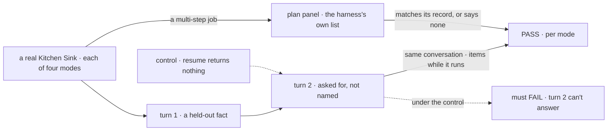
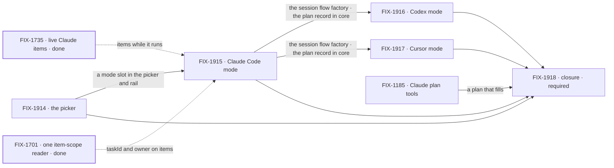

# FIX-1907 · Kitchen Sink harness mode: work each harness directly

**Spec** · [Decisions](DECISIONS.md) · [Rules](BUSINESS-RULES.md) · [Plan](PLAN.md) · [Docs](DOCS.md) · [Evolution](EVOLUTION.md)

## Five teams, before and after

| A team that… | Today | After this epic |
|---|---|---|
| **builds on one of our coding harnesses** (Claude Code, Codex, Cursor) | Reads a contract page and unit tests. Codex has run on a real model only from a goal script; Cursor never has | Works that harness in a real app: turns continue one conversation, the run shows while it works, its plan is beside it |
| **maintains the harness packages** | Finds a gap when a Shift Manager closure trips on it ([FIX-1735](https://linear.app/fixpoint-labs/issue/FIX-1735), [FIX-1692](https://linear.app/fixpoint-labs/issue/FIX-1692)) | Has one app where each harness runs directly, on flows from the same session flow factory, so a gap shows in one mode against the others |
| **wants to know what a run planned** | Claude Code's plan record is proved by unit tests only, because its SDK path never calls the plan tools ([FIX-1185](https://linear.app/fixpoint-labs/issue/FIX-1185)). Codex and Cursor record no plan | Reads each harness's own to-do list beside its session, or a plain line saying there is none |
| **learns the framework from Kitchen Sink** | Lands on the support desk and the assistant | Picks **Flow State** and finds the framework's own flows there ([answered](DECISIONS.md#flow-state-mode)) |
| **runs Shift Manager** | Owns orchestration across harnesses | Still does. Kitchen Sink takes none of it |

**Why now.** Three harness packages ship one contract: the handle, `resume`, and `onSession`
([coding agents](../../../apps/docs/docs/tools/coding-agents.md)). Two Shift Manager closures found harness gaps
only by tripping over them, through a task board and harness-manager. Both inputs this epic leans
on are shipped: live Claude Code items and the held starting turn ([FIX-1735](https://linear.app/fixpoint-labs/issue/FIX-1735),
merged in #2654) and one item-scope reader ([FIX-1701](https://linear.app/fixpoint-labs/issue/FIX-1701), merged in #2569).
Kitchen Sink was rebuilt twice this quarter ([FIX-1455](../FIX-1455/SPEC.md), [FIX-1592](../FIX-1592/SPEC.md)), so its shell is current.

## The goal, and how we'll know it's met

**A person picks any of the four harnesses in Kitchen Sink and works a session in it as they
would use that harness directly: each turn continues the same harness conversation, the run
shows while it works, and the harness's own plan stays in step beside it.**

| Is it the right goal? | |
|---|---|
| **The real need** | Kitchen Sink is the test bed for our harness integrations. The need is to see each one hold on the real path, side by side, where a person would notice a gap |
| **Smaller, and rejected** | "A picker that opens each harness." One turn per mode passes it while continuity and the plan, the parts that broke before, go untested. "Claude Code only" proves no shared contract |
| **Bigger, and not this epic's** | Orchestration across harnesses (Shift Manager) · a task list that hands a harness work · importing sessions started outside Kitchen Sink · harness modes on a deployed host |
| **Not done if** | A mode passes only on a scripted model · a coding harness's turn 2 opened a new conversation · a plan panel is empty without saying why · Kitchen Sink has code that only one coding harness needs, beyond its block's options · Claude Code's plan is still empty with FIX-1185 open · the closure check hasn't run · a finding is open |

Turn 2 is the leg the smaller goal skips. With the binding cut it must fail for every coding
harness, which is what makes its pass mean the conversation carried.

| How we verify | |
|---|---|
| **Goal check** | The closure issue, [FIX-1918](https://linear.app/fixpoint-labs/issue/FIX-1918), in a browser on one `main` commit after every other child merges ([ER-17](BUSINESS-RULES.md#the-closure)) |
| **Signal** | Per mode: turn 2 answers from turn 1 with the same harness session id · an item shows before the run completes · the plan panel equals the harness's own record, or says it reports none · after a reload, turn 3 continues the same conversation |
| **Input** | A held-out fact and a held-out multi-step job · each harness's real model · a local host where each harness is signed in · a durable store |
| **Anti-game** | Assert in the browser on what the person sees, and read the session id from state. Never assert on a child's own tests, and never on a scripted model |
| **Control that must fail** | `resume` returning nothing: turn 2 FAILS for each coding harness. The plan writer off: the plan leg FAILS for each harness that reports one. Today's `main`: every leg FAILS |

**Objective served:** [Goal 1](../../../docs/objectives.md#1-validate-through-real-usage), validate through real
usage. Today one of three harness packages has a real-model goal of its own (Codex, from a
script), Claude Code is proved only through Shift Manager's board path, Cursor not at all, and none
in an app a person drives. This closes that harness slice of Goal 1: one new goal, four legs, every
harness on the real path. It touches no other subsystem Goal 1 covers.

## What's in the box

![In the box: a harness picker with four modes and an honest unavailable state; one harness session flow factory, a flow kind per harness, binding a session to a harness conversation through resume and onSession, with live items, stop and one workspace resolver; one plan record in core that each coding harness writes and Kitchen Sink only reads. Unchanged beside it: the three harness blocks and their handle, and the framework's own flows under Flow State mode. Replaced in one line: the support desk as the front page, the plan record living in the Claude Code package, Codex's to-do list as a bare tool item. Not built, below a fence: orchestration across harnesses, driving a harness from a task board, a task list that hands a harness work, importing outside sessions, harness modes on a deployed host](figures/end-state.svg)

The box is a front door and one session flow factory; the harnesses do the rest. The fence keeps Kitchen
Sink a pass-through: anything that plans or dispatches work across harnesses is Shift Manager's
([D2](DECISIONS.md#d2), [D3](DECISIONS.md#d3)).

## The set · as of 2026-10-12

A dated snapshot. Live state is Linear and the implementation PRs.

| Issue | What it delivers | Why the set needs it | Status |
|---|---|---|---|
| [FIX-1914](https://linear.app/fixpoint-labs/issue/FIX-1914) · the picker | Four modes, a rail scoped to the picked mode, an honest unavailable state, Flow State mode holding the framework's own flows | The front door. Its spec follows the [Flow State answer](DECISIONS.md#flow-state-mode) | Backlog · spec route |
| [FIX-1915](https://linear.app/fixpoint-labs/issue/FIX-1915) · Claude Code mode | The one harness session flow factory, a flow kind per harness (binding, live items, stop, workspace), and the plan record moved into core | The shared path the other two plug into ([D2](DECISIONS.md#d2), [D3](DECISIONS.md#d3)) | Backlog · spec route · blocked by FIX-1914 |
| [FIX-1916](https://linear.app/fixpoint-labs/issue/FIX-1916) · Codex mode | Codex on its own flow kind from that factory; Codex writes its to-do list to the plan record | Codex's first in-app real-path run | Backlog · spec route · blocked by FIX-1915 |
| [FIX-1917](https://linear.app/fixpoint-labs/issue/FIX-1917) · Cursor mode | Cursor on its own flow kind from that factory; Cursor writes its own confirmed to-do list to the plan record | Cursor's first real-path run of any kind | Backlog · spec route · blocked by FIX-1915 |
| [FIX-1185](https://linear.app/fixpoint-labs/issue/FIX-1185) · Claude plan tools | Why the in-process SDK never calls `TaskCreate` / `TaskUpdate`, and a fix or a written finding | Without it Claude Code's plan panel stays empty. Adopted: no parent, no label (spec route by default) | Backlog |
| [FIX-1918](https://linear.app/fixpoint-labs/issue/FIX-1918) · closure · **required** | The QA plan and its run on one `main` commit | Proves the whole ([ER-17](BUSINESS-RULES.md#the-closure)) | Backlog · blocked by FIX-1914, FIX-1915, FIX-1916, FIX-1917, FIX-1185 |

Four new issues, one adopted, one closure. Whether four is three: FIX-1916 and FIX-1917 could be
one issue, but they touch two packages, find different gaps and run side by side. The collapse
trigger is FIX-1915 leaving each of them a few lines of block options and no plan work.

## How the issues flow into each other

An edge is what one issue hands the next; dashed edges are inputs from other epics, both shipped.
FIX-1185 can run at any time; Codex and Cursor run side by side once the session flow factory lands.

## What stays as it is

- **The three harness blocks and their handle.** A mode adds options, not a fourth contract.
- **Orchestration across harnesses, harness-manager and the task board** that drives coding runs. Shift Manager's ([FIX-1786](https://linear.app/fixpoint-labs/issue/FIX-1786), [FIX-1650](https://linear.app/fixpoint-labs/issue/FIX-1650)).
- **Flow State mode's tasks**: its flows' own task boards, as they ship.
- **Detached re-delivery resume** ([FIX-1179](https://linear.app/fixpoint-labs/issue/FIX-1179)). Kitchen Sink runs a turn in the request, not on a queue.
- **Related, not children:** FIX-1735, FIX-1701 (both shipped), FIX-1340 (the coding-skill flow, prior art for one flow over three harnesses), FIX-1179.

## Sign off

**[The goal](#the-goal-and-how-well-know-its-met), at that size:** four modes, two turns, live
items and the plan, on the real path. If wrong: we wrap a picker whose sessions don't carry, or we
carry a plan leg nobody reads.

1. **[D1](DECISIONS.md#d1) · Harness mode is worth four issues, an adopted bug and a closure run, now.**
   If wrong: Kitchen Sink's front door changes for a test bed only we use.
2. **[D2](DECISIONS.md#d2) · Kitchen Sink drives every harness through the shared contract, never
   through harness-manager or Claude Code's in-session resume.** If wrong: a gap only the in-session
   path has goes unseen.
3. **[D3](DECISIONS.md#d3) · Task sync is one-way and read-only: each harness's own plan, in one
   record shape in core.** If wrong: someone wants to hand a harness work from Kitchen Sink, and that
   is a Shift Manager epic.

**Open: 0.** [Does today's Kitchen Sink become the Flow State mode, or move out?](DECISIONS.md#flow-state-mode)
Answered: it becomes the Flow State mode, unchanged, decided by the owner merging #3167 on
2026-10-12. Rules:
[BUSINESS-RULES.md](BUSINESS-RULES.md). Order: [PLAN.md](PLAN.md).

Epic · 5 issues and a closure · Kitchen Sink: Harness Mode · Goal 1, validate through real usage
