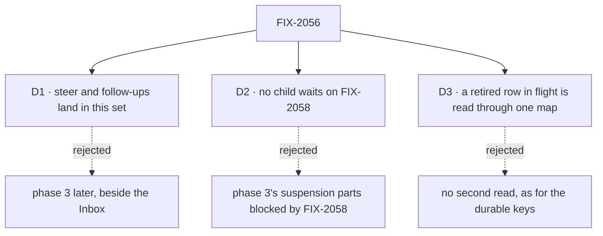

# FIX-2056 · Decisions

[Spec](SPEC.md) · **Decisions**

The calls above any one issue. The owner decided the model in
[`workforce-coordination-concept.md`](../../../docs/internal/design/workforce-coordination-concept.md#decisions);
these three carry it out.

## The tree

## D1 · Steer and follow-ups land in this set

| | |
|---|---|
| **Instead of** | Phase 3 (steer and follow-ups, FIX-2086) later, beside the Inbox |
| **Because** | One chain rewrites `updateTask` and the output a finished task keeps: FIX-2080's settings, then FIX-2081's one rule per field, whose last row is `message`, then FIX-2086's steer and follow-up, which retire reopen. Split, `updateTask`'s field table and the reopen path are each rewritten twice, and reopen survives a release beside follow-ups, overwriting output FIX-2077's settle rule keeps |
| **Locks in** | FIX-2058 and FIX-2070 wait for FIX-2086 too |
| **FIX-2086 does not, until FIX-2058** | Answer a question a task stopped on with a steer · retire `answerTask` or the parks · mark a task waiting on a person ([D2](#d2)) |

**What would change my mind:** FIX-2058 or FIX-2070 finding it can start without FIX-2086. Then
FIX-2086 leaves the set and those epics start one issue earlier.

It comes down to `updateTask`: folded, it is rewritten once; split, twice.

## D2 · No child waits on FIX-2058

| | |
|---|---|
| **Instead of** | The gaps file's line "its phase 3 parts that touch suspensions wait on FIX-2058" |
| **Because** | FIX-2058 is blocked by this epic, so a child blocked by FIX-2058 is a cycle: the epic can never wrap. The parts that touch suspensions are two, a steer that answers a question and marking a task *waiting on a person*, and both are FIX-2058's objective |
| **Locks in** | FIX-2077 tells a person's stop from a wait, so a wait leaves the task running; FIX-2058 marks the person's stop and owns the answer. Until it lands, `answerTask` is a fifth task tool the closure's sweep allows. No child waits on FIX-2070 either: work that needs `receive` is its. The coordinator checks both at each refresh |

**What would change my mind:** FIX-2058's blocker narrowed to the children it needs (FIX-2077 and
FIX-2081). Then the answer by steer can stay in FIX-2086.

It comes down to the cycle: a child blocked by FIX-2058 would keep this epic from ever wrapping.

## D3 · A retired row in flight at upgrade is read, not dropped, through one map

| | |
|---|---|
| **Instead of** | Extending the durable keys' accepted cost (no second spelling read) to the task rows this epic retires |
| **Because** | BP-030. The rows are a user's open work in a persistent store; dropping them loses work a person filed. The durable keys are replay detail the owner accepted losing |
| **Locks in** | One map in the collection layer, built and tested by FIX-2080 for all four shapes: a post to a routed task, blocked to held, a parked split to running, a reopened row to pending. FIX-2077, FIX-2083 and FIX-2086 each turn their shape's entry on in the PR that stops writing it, and build no read of their own. The map is removed no earlier than FIX-2071 |

**What would change my mind:** no persistent store outside tests and local dev databases holds
these rows. Then the map is dead code, and the durable keys' rule covers rows too.

It comes down to a user's open task in a persistent store: read, it survives the upgrade; dropped, it is gone.

## Who owns what

A *uses* cell is a place a child must not re-decide. Board modes and delegates are FIX-2076's and
FIX-2081's own scope.

| # | Rule every child obeys | Owner | Checked at |
|---|---|---|---|
| ER-1 | Only the claim gate (a dispatched row) or the drain (an inline row) records a row's ending. No tool, worker block, wait or Workforce path does (rule 18) | FIX-2076 | Every spec review; the closure sweep |
| ER-2 | One predicate for done (rule 6), in orchestration, checked after the request's background work and when a task it filed ends. Every wait, a plan board's drain included, wakes on the ending the gate writes; a deadline writes none. No Workforce code re-derives a request's kind from session state | FIX-2077 | FIX-2078's, FIX-2082's, FIX-2083's and FIX-2086's spec review |
| ER-3 | Every ending of a delegated task reaches its filer once, through one path, and every debt has a due time with the sweeper as backstop | FIX-2078 | FIX-2083's and FIX-2085's spec review; legs b and c |
| ER-4 | Four filing settings. Start and attempts editable until a task starts; session and result never change | FIX-2080 | FIX-2081's, FIX-2083's and FIX-2086's spec review |
| ER-5 | The four task tools are the only task surface, for models and screens, with identity from the server (BP-031) | FIX-2081 | Every later spec review; the closure sweep |
| ER-6 | A retired row shape is read through FIX-2080's one map, never a child's own ([D3](#d3)) | FIX-2080 | FIX-2077's, FIX-2083's and FIX-2086's spec review |

## Coordination seams

| Seam | Owner, then who else touches it |
|---|---|
| The task tool list (`orchestration/src/skills/task-tools-capability.ts`) | FIX-2081 owns the list and field rules. FIX-2080's settings, FIX-2082's wait and FIX-2086's `message` land after it |
| The claim gate (`task-board/task-entry.ts`, `blocks/record-result.ts`) and the request's end (`engine/src/execution/runAction.ts`, after the side-chain pool drains) | FIX-2077 owns the predicate and where it runs. FIX-2082's waits wake on its ending; FIX-2078 calls it when a filed task ends |
| The wait (`tasks/helpers/wait-for-response.ts`) | FIX-2082 owns it, for `getTask` and a plan board's drain alike. FIX-2076 only sets which boards wait |
| `afterRun`, the notice and `runTaskBoard` (`workforce/src/conversation-board/board.ts`) | FIX-2078 moves the notice and replaces resends with due times; FIX-2077 removes the split settle; FIX-2084 renames the entry `dispatch` |
| The collection read (`tasks/collection/`) | FIX-2080 owns the map; the retiring children turn entries on |
| Queued messages | FIX-2077 runs them through today's message entry; FIX-2070 makes it `receive` |
| A task stopped for a person | FIX-2077 tells it from a wait; FIX-2058 marks it and owns the answer |

## Decided in review, recorded so no child reopens them

- **The epic issue's three open questions are answered by the concept.** A delegate may wait on
  work it hands off (rule 9), except a task whose result goes to the conversation. Result into the
  conversation is a filing setting, not a task kind. Rows in flight: [D3](#d3).
- **The attempts setting is FIX-2080's**; FIX-2083 only uses it (attempts 1).
- **FIX-1024 is not a child.** FIX-2077 reads the claim at the gate; if its spec collapses the two
  copies, it closes FIX-1024.
- **Overlapping bugs are related, not re-parented:** FIX-1884 and FIX-1700 close with FIX-2078,
  FIX-1659 with FIX-2081. FIX-1870 is superseded and stays canceled.
- **Round 1 (cursor review):** FIX-2079 merged into FIX-2078, one ending-path owner. D3 is one map,
  not four reads. The rules cut to six. Kept: the closure issue (every epic ends in one), the
  31-row lead measure (a countable measure, each child citing its rows) and FIX-2085 (no blocker).
- **One answer for done**, from the POC below: no seam keeps its own test.

## What the end-state POC showed

- **Built:** [`poc/claim-gate-seam/`](poc/claim-gate-seam/): today's claim gate on the real engine (four legs), and a model of FIX-2076, FIX-2077 and FIX-2082 merged, with one, two and today's answers to "is this task done?" over six scenarios.
- **See it:** `bash specs/epics/FIX-2056/poc/claim-gate-seam/run.sh` (7 pass on `c179030c`).
- **Showed:** **one answer.** Rule 6 at the gate is the only "done" needed; a drain with its own answer moves past a running row in four of six scenarios. Today the gate settles about 300 ms before background work ends and with a filed task open.
- **Changed:** the waited dispatch moved from FIX-2076 to FIX-2082, one wait with one owner (FIX-2082 now blocked by FIX-2076), and FIX-2077's check runs after the engine drains background work, not at the entry's last step.

## How it got here

- **Concept merged (2026-10-21)** — #3534; the owner decided the model.
- **Spec written (2026-10-21)** — the 31 rows split into eleven issues and a closure. D2 removes a cycle.
- **Review round 1 (2026-10-21)** — FIX-2079 merged into FIX-2078; D3 became one map in FIX-2080.
- **POC** — the waited dispatch moved to FIX-2082, because the run showed two answers to "done" let a drain move past a running row.

**Open: none.**
