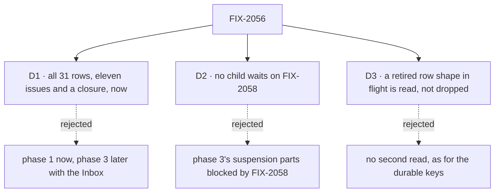

# FIX-2056 · Decisions

[Spec](SPEC.md) · **Decisions**

The calls that sit above any one issue: what was chosen, what lost, why, and what each locks in
for the eleven issues and the closure under it. The model itself was decided by the owner in
[`workforce-coordination-concept.md`](../../../docs/internal/design/workforce-coordination-concept.md#decisions)
and is not reopened here. These three are how the set carries it out; all three are on the sign-off.

## The tree

## D1 · All 31 rows as eleven issues and a closure, phase 3 folded in, now

| | |
|---|---|
| **Instead of** | Phase 1 now, and phase 3 (steer and follow-ups) later, beside the Inbox |
| **Because** | Phase 3 changes the tool phase 1 rewrites: `updateTask` gets one rule per field in FIX-2081, and its `message` field is that rule's last row. Reopen overwrites an output that FIX-2077's settle rule and FIX-2080's follow-up session are built to keep. Split later, `updateTask` and the reopen path are each rewritten twice |
| **Locks in** | One epic slot for a twelve-issue set. FIX-2058 and FIX-2070 wait for the whole set, steer included. Eleven issues because the 31 rows fall along the code's seams (gate, notice, collection, tools, coordinator, contract); the two rows that cross a seam are split by part, each half named in its issue |

**What would change my mind:** FIX-2058 or FIX-2070 finding it can start on phase 1 alone. Then
FIX-2086 moves out of the set, and those epics start one issue earlier.

It comes down to `updateTask`: folded, it is rewritten once; split, twice.

## D2 · No child waits on FIX-2058

| | |
|---|---|
| **Instead of** | The gaps file's line "its phase 3 parts that touch suspensions wait on FIX-2058", and the epic issue's matching sequencing line |
| **Because** | FIX-2058 is blocked by this epic. A child blocked by FIX-2058 makes a cycle: the epic can't wrap until the child is done, and the child can't start until FIX-2058, which can't start until the epic wraps. The parts that touch suspensions are two: a steer that answers a question a task stopped on, and marking a task *waiting on a person*. Both are about stopping for a person, which is FIX-2058's objective |
| **Locks in** | FIX-2086's steer never answers a question; FIX-2058 owns that, with the retirement of `answerTask` and the parks. FIX-2077 tells a person's stop from a wait, so a wait leaves the task running; FIX-2058 marks the person's stop. Until FIX-2058 lands, `answerTask` is a fifth task tool, and the closure's sweep allows it |

**What would change my mind:** FIX-2058's blocker narrowed to the children it needs (FIX-2077 and
FIX-2081), so it can start mid-epic. Then the answer by steer can stay in FIX-2086.

It comes down to the cycle: a child blocked by FIX-2058 would keep this epic from ever wrapping.

## D3 · A row of a retired shape that is in flight at upgrade is read, not dropped

| | |
|---|---|
| **Instead of** | Extending the gaps file's accepted cost for the durable keys (`fsd.ask.*`, the `asked` flag, the hand-off route names: no second spelling read) to the task rows this epic retires |
| **Because** | BP-030: a persisted record keeps its old shape until it is read. The rows are a user's open work in a SQLite or Postgres store: a post, a blocked task, a parked split, a reopened task. Dropping them loses work a person filed. The durable keys are replay detail inside one request, and the owner accepted losing those |
| **Locks in** | Each child that retires a row shape reads it, maps it to its nearest new meaning (a post to a routed task, blocked to held, a parked split to running, a reopened row to pending), and tests that, under ER-9. The reads are removed no earlier than FIX-2071 |

**What would change my mind:** no persistent store outside tests and local dev databases holds
these rows. Then the reads are dead code, and the durable keys' rule covers rows too.

It comes down to a user's open task in a persistent store: read, it survives the upgrade; dropped, it is gone.

## Who owns what

Every rule has one owner, or one builder per retired shape for ER-9. Read a row to see where a
rule is decided and where it is only consumed; a *uses* cell is a place a child must not
re-decide.

| # | Rule every child obeys | Owner | Checked at |
|---|---|---|---|
| ER-1 | Only the claim gate (a dispatched row) or the drain (an inline row) records a row's ending. No tool, worker block or Workforce path settles one (rule 18) | FIX-2076 | Every child's spec review; the closure sweep |
| ER-2 | One predicate for when a task is done (rule 6), at the gate in orchestration. No Workforce code re-derives it, or a request's kind, from session `taskId` or `filingSessionId` | FIX-2077 | FIX-2082's, FIX-2083's and FIX-2086's spec review |
| ER-3 | Every ending of a delegated task reaches its filer exactly once, through one path. No second report path | FIX-2078 | FIX-2079's, FIX-2083's and FIX-2085's spec review; leg c |
| ER-4 | Every debt has a due time, with the sweeper as its backstop. No new path pays only on the next touch | FIX-2079 | Every child's spec review; leg b |
| ER-5 | A board's `mode` decides whether its drain waits; a board that mixes them is refused when built | FIX-2076 | FIX-2082's and FIX-2083's spec review |
| ER-6 | Four filing settings. Start and attempts stay editable until a task starts; session and result never change | FIX-2080 | FIX-2081's, FIX-2083's and FIX-2086's spec review |
| ER-7 | The four task tools are the only task surface, for models and screens alike, with identity from the server (BP-031). No child adds a task tool or a second write path | FIX-2081 | Every later child's spec review; the closure sweep |
| ER-8 | Tasks go only to the filer's delegates, or anyone with `delegates: all`; only the user changes delegates, unless a coordinator was configured to | FIX-2081 | FIX-2083's spec review |
| ER-9 | A persisted row of a shape a child retires is read and mapped, not dropped ([D3](#d3)) | FIX-2077 (split park), FIX-2080 (blocked), FIX-2083 (post), FIX-2086 (reopened) each build their own | Each of those four's spec review |
| ER-10 | No child waits on FIX-2058 or FIX-2070. Work that needs the Inbox or `receive` is theirs ([D2](#d2)) | The coordinator | Each refresh |

## Coordination seams

| Seam | Between | Rule |
|---|---|---|
| The task tool list (`orchestration/src/skills/task-tools-capability.ts`) | FIX-2080, FIX-2081, FIX-2082, FIX-2086 | FIX-2081 owns the list and the field rules. FIX-2080 builds the held status and settings it exposes; FIX-2082 adds `getTask`'s wait and FIX-2086 the `message` field, each after FIX-2081 merges |
| The claim gate (`task-entry.ts`, `record-result.ts`) | FIX-2077, FIX-2076, FIX-2082 | FIX-2077 owns the settle predicate. FIX-2076's waited dispatch and FIX-2082's waits read it |
| The conversation board's `afterRun` and the notice | FIX-2078, FIX-2079, FIX-2077 | FIX-2078 moves the notice into orchestration; FIX-2079 replaces `afterRun`'s resends with due times; FIX-2077 removes the split settle |
| The board-pass entry, `runTaskBoard` | FIX-2079, FIX-2084 | FIX-2079 makes it one at a time; FIX-2084 renames it `dispatch` and keeps that |
| Queued messages | FIX-2077, FIX-2070 | FIX-2077 runs them through today's message entry; FIX-2070 makes it `receive` |
| A task stopped for a person | FIX-2077, FIX-2086, FIX-2058 | FIX-2077 tells it from a wait; FIX-2058 marks it and owns the answer; FIX-2086's steer never answers |

## Decided in review, recorded so no child reopens them

- **The epic issue's three open questions are answered by the concept.** A delegate answering a
  person's message may wait on work it hands off (rule 9), except on a task whose result goes to
  the conversation. Result into the conversation is a filing setting any task may take, not a kind
  of task, so the invent-kill against a task-type flag holds. Rows in flight at upgrade: [D3](#d3).
- **The attempts setting is FIX-2080's**, with the other three; FIX-2083 only uses it (attempts 1).
- **FIX-1024 is not a child.** It is a phase 0 question (two claim copies). FIX-2077 reads the
  claim at the gate; if its spec collapses the copies, it closes FIX-1024.
- **Overlapping bugs are related, not re-parented:** FIX-1884 and FIX-1700 close with FIX-2079,
  FIX-1659 with FIX-2081. Each is narrower than its child.
- **FIX-1870 is superseded** by this epic; it stays canceled and related.

## What the end-state POC showed

None built yet. One is recommended before the gate, narrow: the claim gate's seam alone, where
FIX-2076's waited dispatch, FIX-2077's settle rule and FIX-2082's nested wait meet. If those three
need the gate to answer "is this task done?" in more than one place, the division moves
before eleven specs are written against it. The other seams are one-writer edits and need none.

## How it got here

- **Concept merged (2026-10-21)** — #3534; the owner decided the model and its last four open calls.
- **Spec written (2026-10-21)** — the 31 rows split into eleven issues and a closure, FIX-2076 to
  FIX-2087. D2 removes the cycle the gaps file's sequencing line would have made.

**Open: none.**
