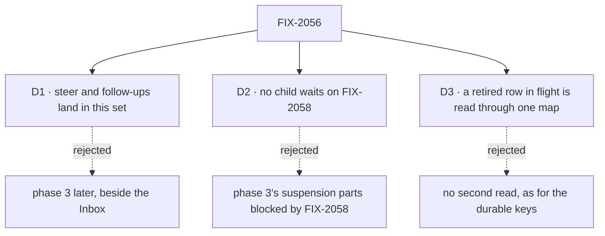

# FIX-2056 · Decisions

[Spec](SPEC.md) · **Decisions**

The calls above any one issue. The owner decided the model in
[`workforce-coordination-concept.md`](../../../docs/internal/design/workforce-coordination-concept.md#decisions);
these three carry it out.

## The tree

## D1 · Steer and follow-ups land in this set

| | |
|---|---|
| **Instead of** | Phase 3 (steer and follow-ups, FIX-2086) later, beside the Inbox |
| **Because** | One chain rewrites `updateTask` and the output a finished task keeps: FIX-2080's settings, then FIX-2081's one rule per field, whose last row is `message`, then FIX-2086's steer and follow-up, which retire reopen. Split, `updateTask`'s field table and the reopen path are each rewritten twice, and reopen survives a release beside follow-ups, overwriting output FIX-2077's settle rule keeps |
| **Locks in** | FIX-2058 and FIX-2070 wait for FIX-2086 too |
| **FIX-2086 does not, until FIX-2058** | Answer a question a task stopped on with a steer · retire `answerTask` or the parks · mark a task waiting on a person ([D2](#d2)) |

**Confirmed by the owner** (2026-10-21, [(b)](#b)): FIX-2086 lands in this epic.

**What would change my mind:** FIX-2058 or FIX-2070 finding it can start without FIX-2086. Then
FIX-2086 leaves the set and those epics start one issue earlier.

It comes down to `updateTask`: folded, it is rewritten once; split, twice.

## D2 · No child waits on FIX-2058

| | |
|---|---|
| **Instead of** | Phase 3's parts that touch suspensions blocked by FIX-2058, as the gaps file and the epic issue said until this PR |
| **Because** | FIX-2058 is blocked by this epic, so a child blocked by FIX-2058 is a cycle: the epic can never wrap. Both suspension parts, a steer that answers a question and marking a task *waiting on a person*, are FIX-2058's objective |
| **Locks in** | FIX-2077 tells a person's stop from a wait, so a wait leaves the task running; FIX-2058 marks the person's stop and owns the answer. Until it lands, `answerTask` is an interim extra tool the closure's sweep allows. No child waits on FIX-2070 either: work that needs `receive` is its |

**What would change my mind:** FIX-2058's blocker narrowed to the children it needs (FIX-2077 and
FIX-2081). Then the answer by steer can stay in FIX-2086.

It comes down to the cycle: a child blocked by FIX-2058 would keep this epic from ever wrapping.

## D3 · A retired row in flight at upgrade is read, not dropped, through one map

| | |
|---|---|
| **Instead of** | Extending the durable keys' accepted cost (no second spelling read) to the task rows this epic retires |
| **Because** | BP-030. The rows are a user's open work in a persistent store; dropping them loses work a person filed. The durable keys are replay detail the owner accepted losing |
| **Locks in** | One map in the collection layer, built and tested by FIX-2080 for all six shapes: a post to a routed task, blocked to held, the recorded-not-started mark to held, a parked split to running, a reopened row to pending, a row parked for a turn to pending. FIX-2077, FIX-2083 and FIX-2086 each turn their shape's entry on in the PR that stops writing it, and build no read of their own. The map is removed no earlier than FIX-2071 |

**What would change my mind:** no persistent store outside tests and local dev databases holds
these rows. Then the map is dead code, and the durable keys' rule covers rows too.

It comes down to a user's open task in a persistent store: read, it survives the upgrade; dropped, it is gone.

## Who owns what

A *uses* cell is a place a child must not re-decide. Board modes and delegates are FIX-2076's and
FIX-2081's own scope.

| # | Rule every child obeys | Owner | Checked at |
|---|---|---|---|
| ER-1 | Only the claim gate (a dispatched row) or the drain (an inline row) records a row's ending. No tool, worker block, wait or Workforce path does (rule 18) | FIX-2076 | Every spec review; the closure sweep |
| ER-2 | One predicate for done (rule 6), in orchestration, checked after the request's background work and when a task it filed ends. Every wait, a plan board's drain included, wakes on the ending the gate writes; a deadline writes none. Code a child adds asks whether a request works a task through `isTaskTurn` or the gate, and finds a session's task from its server-set field or the row whose run link names the request; it never re-derives a request's kind from session state ([debt](#er-2-debt)) | FIX-2077 | FIX-2078's, FIX-2082's, FIX-2083's, FIX-2086's and FIX-2088's spec review |
| ER-3 | Every ending of a delegated task reaches its filer once, through one path, and every debt has a due time with the sweeper as backstop. Shift Manager's error report rides that path, not a second one ([f](#f)) | FIX-2078 | FIX-2083's and FIX-2085's spec review; legs b and c |
| ER-4 | Four filing settings. Start and attempts editable until a task starts; session and result never change | FIX-2080 | FIX-2081's, FIX-2082's, FIX-2083's and FIX-2086's spec review |
| ER-5 | The five task tools are the only task surface: the filer's four, for models and as a screen's actions, and the worker's `reportProgress`, for models only; identity comes from the server (BP-031) | FIX-2081 | Every later spec review; the closure sweep |
| ER-6 | A retired row shape is read through FIX-2080's one map, never a child's own ([D3](#d3)) | FIX-2080 | FIX-2077's, FIX-2083's and FIX-2086's spec review |

**ER-2's debt.** Workforce code on `main` that tells a task session from session state, each with an owner: the reach check (`workforce/src/conversation-board/board.ts:289`, FIX-2081) and the Error Reporter's held-or-request split (`workforce/src/error-reporter/reporter.ts:220`, FIX-2078) survive the set and move to `isTaskTurn` or the gate when their owner touches them; the piece owner (`conversation-board/split.ts:195-205`, FIX-2077) and the post session check (`coordinator/delegated-post.ts:189`, FIX-2083) go with the split settle and posts.

## Coordination seams

| Seam | Owner, then who else touches it |
|---|---|
| The task tool list (`orchestration/src/skills/task-tools-capability.ts`) | FIX-2080 lands first: it removes `blockTask`, adds `status` (held or pending) to `updateTask`'s patch, turns the busy-session refusal into a wait and adds `held` to the status filter. Then FIX-2081 owns the list and field rules, and FIX-2082's wait, FIX-2083's `target` on `createTask` and FIX-2086's `message` land after it |
| Who a filing can reach (`workforce/src/conversation-board/board.ts`, `reach()`) | FIX-2081 replaces a task session's roster arm with the self-step grant, after FIX-2076's plan rows land, so a worker files its own steps with or without delegates |
| The claim gate (`task-board/task-entry.ts`, `blocks/record-result.ts`) and the request's end | FIX-2077 owns the predicate and where it runs: after the engine's last drain on every terminal path, which follows `onFinished` (`engine/src/execution/runAction.ts:2447`→`:2630`→`:2641`, `:2773`→`:2918`→`:2936`), through an engine seam for framework packages, not an author hook. FIX-2082's waits wake on its ending; FIX-2078 calls it when a filed task ends; FIX-2088 hands it the request's background failures at the seam after the last drain, and the check fails the attempt on any, except a failed after-answer memory capture on a task whose result goes to the conversation, which is logged ([FIX-2088 D1](../../issues/FIX-2088/DECISIONS.md#d1-amendment)) |
| The wait (`tasks/helpers/wait-for-response.ts`) and its limits | FIX-2082 owns it and its limits: 5 waits deep; a tree 5 deep, 100 under its top task. FIX-2076 only sets which boards wait. A board's dispatch rides the row's wait. A bare `dispatcher({ wait: true })` has no row, and the engine awaits acceptance only (`core/src/blocks/dispatcher.ts:169-171`, `engine/src/context/dispatch-operation.ts:273-280`): FIX-2082 adds an engine wait that returns the result |
| The sweeper (`engine/src/durability/durability-sweeper.ts:40-50`), re-armed only from wait gates | FIX-2078 adds a due-time source the re-arm reads and a step that pays board debts, FIX-2080's cascade debt among them |
| `afterRun`, the notice and `runTaskBoard` (`workforce/src/conversation-board/board.ts`) | FIX-2078 moves the notice, replaces resends with due times, removes the `reportOwed` marker and keeps Shift Manager's error route on the ending path ([f](#f)); FIX-2077 removes the split settle; FIX-2084 renames the entry `dispatch` |
| The collection read (`tasks/collection/`) | FIX-2080 owns the map; the retiring children turn entries on |
| Queued messages | No longer part of a task (FIX-2103): a message to an open task's session is conversation: it doesn't hold the task and isn't part of it. FIX-2070 makes the entry `receive` |
| The filer on a task row (`tasks/schema/task.ts`) | FIX-2078 owns the server-written filer fields, session and flow, under rule 4 (a user's follow-up copies the original's). FIX-2082 and FIX-2086 read them; FIX-2081's filing-task link is its own |

## Decided in review, recorded so no child reopens them

- **The concept answers the epic issue's three questions.** A delegate may wait on work it hands
  off (rule 9), unless its result goes to the conversation, a filing setting, not a task kind.
  Rows in flight: [D3](#d3).
- **The attempts setting is FIX-2080's**; FIX-2083 only uses it (attempts 1).
- **FIX-1024 is not a child.** FIX-2077 reads the claim at the gate; if its spec collapses the two
  copies, it closes FIX-1024.
- **Overlapping bugs are related, not re-parented:** FIX-1884 and FIX-1700 close with FIX-2078,
  FIX-1659 with FIX-2081. FIX-1870 is superseded and stays canceled.
- **Kept in round 1:** the closure issue (every epic ends in one), the 31-row lead measure (each
  child cites its rows) and FIX-2085 (no blocker). The rules cut to six.
- **One answer for done**, from the POC below: no seam keeps its own test.
- **Round 2 (architect):** FIX-2062 (#3538) is built on: every resume waits its session's turn.
  FIX-1637, the keep-alive docs epic, is related: its guide picks up FIX-2085's schedules and
  FIX-2082's waits.
- **(e) · The old task APIs are removed outright, no deprecation release** (owner,
  2026-10-21). Every surface in [`migration.md`](migration.md) goes in the owning child's PR, in a
  minor bump (pre-1.0). That child's changeset carries the removal's one line from `migration.md`.
  No child ships a deprecated alias, wrapper or warning, and the closure's tool sweep allows none:
  the only task tools besides the five are `answerTask` and `parkOnQuestion` until FIX-2058 ([D2](#d2)), and `dispatchTask` until FIX-2082
  and FIX-2083 replace its wait and its post form, the sweep naming it ([FIX-2081 D1](../../issues/FIX-2081/DECISIONS.md#d1), amended at that
  gate). The cost, accepted: teams
  outside the repo calling them rewrite at upgrade.
- **(f) · Shift Manager's automatic error route is kept** (owner, 2026-10-21).
  FIX-2078 owns it: `errorCapture` into the Error Reporter
  (`packages/shift-manager/teams/devteam/host.mts:1194`) is preserved, re-expressed on the new
  ending and notice path, not removed. Hosts wiring `errorCapture` keep getting error reports and
  get no migration line. The `reportOwed` marker and its resends still go (ER-3). The gaps row
  *a failure is an ending delivered to the filer* is met by the filer hearing it once; its
  "Error Reporter hears only what a filer messages" half does not gate the closure.
- **(a) · One epic, not two** (owner, 2026-10-21). Board modes (FIX-2076) and the
  waited dispatch (FIX-2082) stay in this set: the claim-gate POC showed FIX-2076, FIX-2077 and
  FIX-2082 must share one answer for done.
- **(b) · D1 kept** (owner, 2026-10-21): steer and follow-ups, phase 3 and
  FIX-2086, land in this epic ([D1](#d1)).

## What the end-state POC showed

- **Built:** [`poc/claim-gate-seam/`](poc/claim-gate-seam/): today's claim gate on the real engine, and a model of FIX-2076, FIX-2077 and FIX-2082 merged with one, two and today's answers to "done", over six scenarios.
- **See it:** `bash specs/epics/FIX-2056/poc/claim-gate-seam/run.sh` (7 pass on `c179030c`).
- **Showed:** **one answer.** Rule 6 at the gate is the only "done" needed; a drain with its own answer moves past a running row in four of six scenarios. Today the gate settles about 300 ms before background work ends and with a filed task open.
- **Changed:** the waited dispatch moved from FIX-2076 to FIX-2082 (FIX-2082 now blocked by FIX-2076), and FIX-2077's check runs after the engine drains background work, not at the entry's last step.

## How it got here

- **2026-10-21** — #3534 merged the model; the spec split 31 rows into ten issues and a closure.
- **Round 1** — FIX-2079 merged into FIX-2078; D3 became one map in FIX-2080.
- **POC** — the waited dispatch moved to FIX-2082.
- **Round 2** — sources agree with D2; engine prerequisites named; (e), (f) opened.
- **Amendment** — the owner answered (e): remove outright, no deprecation release; then (f): keep
  the error route; (a): one epic; (b): D1 kept.
- **Amendment (FIX-2103)** — the owner reversed the queued-message hold: a task settles when its
  turn ends, and a message to its session is conversation, not part of it. The *Queued messages* seam row and
  POC S6's note follow.

## Open

None. Every question the epic asked is answered above.
