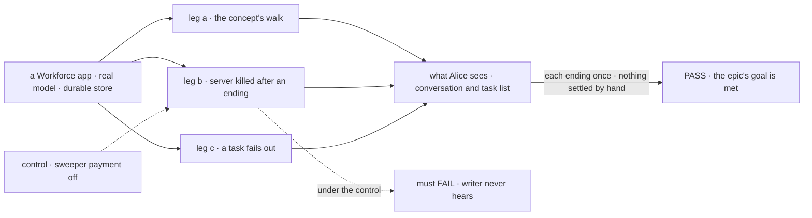
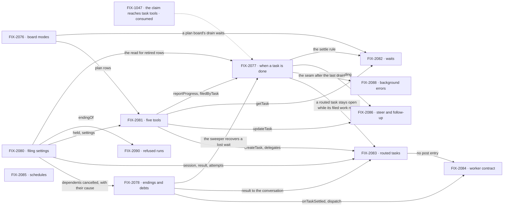

# FIX-2056 · One task primitive: boards, settling, task tools and authority

**Spec** · [Decisions](DECISIONS.md)

## Five teams, before and after

| A team that… | Today | After this epic |
|---|---|---|
| **builds a worker that hands out work** | Eleven task tools; can't wait inside a task | Five tools; it waits on what it filed and hears every ending once |
| **runs a coordinator** | Routed work is a post a user can't list, steer or cancel | Routed work is a task in the user's list |
| **builds a goal-seek loop** | Its judge can rule on work still running | A wrong board is refused when built |
| **runs Workforce on a host that restarts** | A finished task waits for the next touch of the board | The sweeper pays every debt when due |
| **maintains the framework** | Two row kinds, two failure paths, four row lookups | One task, one completion rule, one ending path |

**Why now.** FIX-1047 merged on 2026-10-20 ([#3521](https://github.com/fixpoint-labs/flow-state-dev/pull/3521)),
so a worker's claim reaches its task tools. The model is on `main`
([#3534](https://github.com/fixpoint-labs/flow-state-dev/pull/3534)). One Inbox (FIX-2058),
Messages (FIX-2070) and the renames (FIX-2071) wait for it.

## The goal, and how we'll know it's met

**A worker hands out work, waits on it, steers it and hears how it ended through one task, and
nothing records a task's ending except the claim gate or the drain.**

The bar is the rules of [`workforce-coordination-concept.md`](../../../docs/internal/design/workforce-coordination-concept.md).
The scope is every phase 1 and phase 3 row of
[`workforce-coordination-gaps.md`](../../../docs/internal/design/workforce-coordination-gaps.md#where-todays-code-differs):
**31 of its 48 rows**, each cited by its child in Linear.

| Is it the right goal? | |
|---|---|
| **Smaller, and rejected** | Posts become tasks alone: FIX-2058 would build on a gate that lets a waiting task run twice |
| **Not done if** | An ending is recorded outside the gate or the drain · a sixth task tool is exported, deprecated ones included, `answerTask` and `parkOnQuestion` until FIX-2058 and, until FIX-2082 and FIX-2083, `dispatchTask` aside ([D2](DECISIONS.md#d2), [(e)](DECISIONS.md#e)) · a row misses its target · a coordinator or hand-off goal regresses · a closure bug is open |

| How we verify | |
|---|---|
| **Goal check** | The closure issue's (FIX-2087), real model, on one `main` commit after every other child merges |
| **Signal** | Leg a, the concept's *How it flows* minus calls and the Inbox: a routed task Alice can list, one `onTaskSettled`, a plan board waiting on a dispatched row, the draft landing once, a follow-up. Leg b: writer hears within the due time. Leg c: one failure notice, the dependent cancelled. Plus a sweep of tools and ending writes |
| **Anti-game** | Assert on what Alice sees and on rows read through public task actions |
| **Control that must fail** | Leg b with sweeper payment off; on today's `main`, leg a and the sweep |

**Lead measure:** in-scope rows whose story acceptance check passes on `main`, of 31. **0 today.**
Four rows hold a half other epics own, which does not gate the closure ([D2](DECISIONS.md#d2)), as
[(f)](DECISIONS.md#f) carves out its row's Error Reporter half: *waiting on a person*, and answering
a question by public action or by `updateTask`'s message (FIX-2058); `sendMessage` among the
model's tools (FIX-2070).

## What's in the box

The fence holds the work that stands on the task; this set builds none of it ([D2](DECISIONS.md#d2)).

**Docs:** the task-board page opens by teaching one task. FIX-2081 publishes it; each child documents its own specifics.

## The set · as of 2026-10-21

The reviewed snapshot; live state, and each issue's gap rows, are in Linear.

| Issue | Delivers | Blocked by |
|---|---|---|
| [FIX-2076](https://linear.app/fixpoint-labs/issue/FIX-2076) · board modes | Plan and delegation boards; wrong boards refused | — |
| [FIX-2077](https://linear.app/fixpoint-labs/issue/FIX-2077) · when a task is done | Rule 6 at the claim gate, after background work; a wait leaves a task running | FIX-2078, FIX-2080, FIX-2081 |
| [FIX-2078](https://linear.app/fixpoint-labs/issue/FIX-2078) · endings and debts | Every ending to its filer once; due times and the sweeper | FIX-2080 |
| [FIX-2080](https://linear.app/fixpoint-labs/issue/FIX-2080) · filing settings | Start, session, result, attempts; cascades; the one read for retired rows ([D3](DECISIONS.md#d3)) | — |
| [FIX-2081](https://linear.app/fixpoint-labs/issue/FIX-2081) · five tools | Five task tools, one rule per field; delegates as authority | FIX-2076, FIX-2080 |
| [FIX-2082](https://linear.app/fixpoint-labs/issue/FIX-2082) · waits | `getTask` and the waited dispatch as one wait; 5 deep, 100 under a top task | FIX-2076, FIX-2077, FIX-2081 |
| [FIX-2083](https://linear.app/fixpoint-labs/issue/FIX-2083) · routed tasks | Posts become routed tasks; one fit check; the stopgap goes | FIX-2077, FIX-2078, FIX-2080, FIX-2081 |
| [FIX-2084](https://linear.app/fixpoint-labs/issue/FIX-2084) · worker contract | Roles checked at hire; `respond` and `dispatch` | FIX-2078, FIX-2083 |
| [FIX-2085](https://linear.app/fixpoint-labs/issue/FIX-2085) · schedules | A schedule files an ordinary task | — |
| [FIX-2086](https://linear.app/fixpoint-labs/issue/FIX-2086) · steer and follow-up | `updateTask({ message })`; finished output never changes | FIX-2077, FIX-2081 |
| [FIX-2088](https://linear.app/fixpoint-labs/issue/FIX-2088) · background errors | A task's background error fails its attempt, through the gate's one check | FIX-2077 |
| [FIX-2090](https://linear.app/fixpoint-labs/issue/FIX-2090) · refused runs | A refused harness-manager run ends its task through the one ending path | FIX-2080 |
| [FIX-2087](https://linear.app/fixpoint-labs/issue/FIX-2087) · closure · **required** | The QA plan, run on one `main` commit | every other child |

Twelve and a closure; the POC moved the waited dispatch to FIX-2082
([why](DECISIONS.md#what-the-end-state-poc-showed)). Engine prerequisites:
[seams](DECISIONS.md#coordination-seams).

## How the issues flow into each other

An edge is what one issue hands the next. FIX-2076, FIX-2080 and FIX-2085 start at once;
every child blocks the closure, left off. The longest chain is five (FIX-2080, FIX-2081, FIX-2077, FIX-2083, FIX-2084).

## What stays as it is

- **Patterns**, already plan boards; claim orders; routing policies, rounds and records; a delegate's memory.
- **The agent flow**, and `chief-of-staff` until FIX-2071; **messages** until FIX-2070; **parks and
  `answerTask`** until FIX-2058.
- **Shift Manager's error route** into the Error Reporter, re-expressed on the ending path ([(f)](DECISIONS.md#f)).
- **`dispatcher()`** stays the transport a row runs through, not a row of its own.
- **Not children:** FIX-2072, FIX-2073, FIX-2075, FIX-2063, FIX-1024, FIX-1637 ([why](DECISIONS.md#decided-in-review-recorded-so-no-child-reopens-them)).

## What's already here, and the debt

| Already here | What the set does with it |
|---|---|
| The concept docs; FIX-1047's claim (#3521); FIX-2057's prune (#3541); FIX-2062's resume in turn (#3538) | **Builds on.** A removal needs a second route to its job, not zero callers (tenet 3) |
| [#3102](https://github.com/fixpoint-labs/flow-state-dev/pull/3102)'s PD-3, PR-1 and PR-2: FIX-1870's, through `dispatchTask` | **Re-homed.** PR-1 and PD-3 to FIX-2083, PR-2 to FIX-2081 and FIX-2082 (`createTask`, riding `dispatchTask`'s wait until `getTask`'s, per [FIX-2081 D1](../../issues/FIX-2081/DECISIONS.md#d1)). #3102 is amended at approval |
| [FIX-1870 D1](../FIX-1870/DECISIONS.md#d1) and [its review notes](../FIX-1870/DECISIONS.md#decided-in-review-recorded-so-no-child-reopens-them): `dispatchTask` waits, one deep, and a timeout cancels | **Superseded.** `getTask` waits, 5 deep, and a deadline cancels nothing |
| [FIX-1870 D2](../FIX-1870/DECISIONS.md#d2): a post that needs an answer is a task | **Kept and finished** by FIX-2083 |
| [FIX-1872 D1](../../issues/FIX-1872/DECISIONS.md#d1): a post row on the delegate's own entry | **Superseded.** Session and result are filing settings |
| [FIX-1815 D3](../FIX-1815/DECISIONS.md#d3), [D4](../FIX-1815/DECISIONS.md#d4): asks bounded; fire-and-forget default | **Kept** |

| The debt | |
|---|---|
| **Removes** | Posts · six task tools · `settleSplitTask` · reopen · blocked · the `reportOwed` error marker · `afterRun`'s resends · the stopgap · a second fit call |
| **Adds** | A board `mode` · `getTask`'s wait · four filing settings · the role check at hire · scheduled tasks · one read for retired rows until FIX-2071 ([D3](DECISIONS.md#d3)) |

**Net: down.** Six task tools and a row kind leave; one setting per job arrives.

## Sign off

**[The goal](#the-goal-and-how-well-know-its-met):** all 31 rows, proved by a walk, a crash and a
failure. **[The debt](#whats-already-here-and-the-debt):** net down.

1. **[D1](DECISIONS.md#d1) · Steer and follow-ups land in this set.** If wrong: FIX-2058 and
   FIX-2070 wait one issue longer than needed.
2. **[D2](DECISIONS.md#d2) · No child waits on FIX-2058.** If wrong: a steer can't answer a
   question until FIX-2058 lands.
3. **[D3](DECISIONS.md#d3) · A retired row in flight at upgrade is read, not dropped, through one
   map.** If wrong: one read nobody needed.

**Decided by the owner:** [(e) remove the old APIs outright](DECISIONS.md#e), no deprecation
release · [(f) keep Shift Manager's error route](DECISIONS.md#f) · [(a) one epic](DECISIONS.md#a) ·
[(b) D1 kept](DECISIONS.md#b).

**Open, the owner's:** none.

Epic · 12 issues and a closure · Orchestration Primitives · Goal 2, differentiate on hard problems · Goal 4, keep the foundation honest
