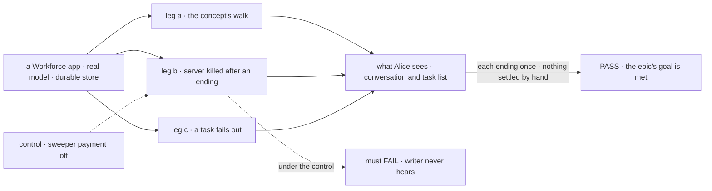
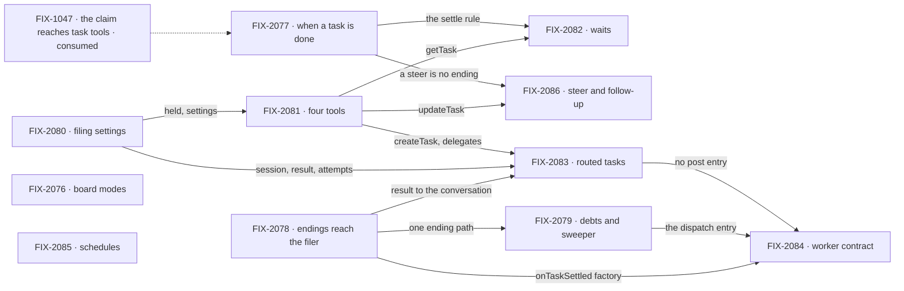

# FIX-2056 · One task primitive: boards, settling, task tools and authority

**Spec** · [Decisions](DECISIONS.md)

## Five teams, before and after

| A team that… | Today | After this epic |
|---|---|---|
| **builds a worker that hands out work** | Picks from eleven task tools, can't wait while it works a task, settles some tasks by hand | Four tools. It files and ends, or waits on what it filed, and hears every ending once |
| **runs a coordinator** | Its routed work is a post, which a user can't list, steer or cancel | Routed work is an ordinary task in the user's task list |
| **builds a pattern or a goal-seek loop** | Can build a loop whose judge rules on work still running elsewhere | A plan board waits on every row; a wrong board is refused when built |
| **runs Workforce on a host that restarts** | A finished task waits until something touches the board | The sweeper pays every debt at its due time |
| **maintains the framework** | Keeps two row kinds, two failure-report paths and four row-holding lookups in agreement | One task, one completion rule, one ending path |

**Why now.** FIX-1047 merged on 2026-10-20 ([#3521](https://github.com/fixpoint-labs/flow-state-dev/pull/3521)),
so a worker's claim reaches the task tools it calls: the precondition for one gate. The model is
decided and on `main` ([#3534](https://github.com/fixpoint-labs/flow-state-dev/pull/3534)). One
Inbox (FIX-2058), Messages (FIX-2070) and the renames (FIX-2071) are designed on this task and
wait for it. Meanwhile new work keeps adding ways to hand out work; FIX-2059 counts four.

## The goal, and how we'll know it's met

**A worker hands out work, waits on it, steers it and hears how it ended through one task, and
nothing records a task's ending except the claim gate or the drain.**

The model is [`workforce-coordination-concept.md`](../../../docs/internal/design/workforce-coordination-concept.md);
its rules are the bar. The scope is every phase 1 and phase 3 row of
[`workforce-coordination-gaps.md`](../../../docs/internal/design/workforce-coordination-gaps.md#where-todays-code-differs):
**31 of its 48 rows, 65% of the gap.** The set carries concept rules 4, 5, 7, 8, 13, 14, 16 to 20
in full and 2, 3, 6, 9 and 15 in part; the rest of those, and rules 10 to 12 and 21, are FIX-2058's
and FIX-2070's.

| Is it the right goal? | |
|---|---|
| **The real need** | Work moves between workers in more than nine ways. Two epics and the renames are designed on one task and can't land on today's two row kinds |
| **Smaller, and rejected** | "Posts become tasks", this epic's first framing: FIX-2083 alone. FIX-2058 would then build on a gate that lets a waiting task lapse and run twice |
| **Bigger, and not this epic's** | One Inbox (FIX-2058) · send, call and `receive` (FIX-2070) · one term for one thing (FIX-2071) |
| **Not done if** | A code path records an ending outside the gate or the drain · a task tool beyond the four is exported, `answerTask` aside until FIX-2058 ([D2](DECISIONS.md#d2)) · an in-scope row misses its target · a coordinator goal or FIX-2005's hand-off goal regresses · the closure check hasn't run · a bug it found is open |

Leg b is the one a smaller goal would skip: without the sweeper it must fail, so its pass shows
nothing waits on a later touch of the board.

| How we verify | |
|---|---|
| **Goal check** | The closure issue's (FIX-2087), real model, on one `main` commit after every other child merges |
| **Signal** | Leg a, the concept's *How it flows* minus its call and Inbox steps: Alice's message files a routed task she can list; writer files a task and ends, its own task still running; one `onTaskSettled` follows; writer's plan board waits on a dispatched fact-check; the draft lands once under writer's name; her follow-up runs in writer's session and the first output is unchanged. Leg b: writer hears within the due time, untouched. Leg c: writer hears the failure once, the dependent is cancelled, the Error Reporter hears nothing. Plus a sweep of exported tools and terminal-status writes |
| **Input** | A held-out brief; the concept's cast, built only from the role factories |
| **Anti-game** | Assert on what Alice sees and on rows read through the public task actions, never a child's own tests. No coordination code in the app |
| **Control that must fail** | Leg b with sweeper payment off. On today's `main`: leg a (the message is a post, absent from `listTasks`) and the sweep (`completeTask` exported) |

**Lead measure:** in-scope rows whose story acceptance check passes on `main`, of 31. **0 today.**

## What's in the box

![In the box: one task, with two board modes, one completion rule and four filing settings; four task tools that are also public actions, with delegates as authority; one ending path and swept debts; routed tasks, steering, follow-ups, schedules and roles built on it. Composed in by the app: worker flows, routing, delegates, schedules. Replaced in one line: posts, dispatchTask's wait, the renamed and removed tools, blocked, reopen. Not built, below a fence: the Inbox, messages, renames, prune, default instructions](figures/end-state.svg)

Inside the box is one task and its four tools. The fence holds the neighbouring epics and issues
that stand on it; this set builds none of their surfaces ([D2](DECISIONS.md#d2)).

**Docs:** the orchestration task-board page opens by teaching one task: two boards, four tools, one
rule for done. FIX-2081 publishes it with the tools; each child documents its own specifics.

## The set · as of 2026-10-21

The reviewed snapshot; live state is Linear and the implementation PRs. All on the spec route, all Backlog.

| Issue | What it delivers | Why the set needs it | Blocked by |
|---|---|---|---|
| [FIX-2076](https://linear.app/fixpoint-labs/issue/FIX-2076) · board modes | Plan and delegation boards; a plan board waits on a row it dispatched; wrong boards refused | A worker gets a plan; a judge never rules on work in flight | — |
| [FIX-2077](https://linear.app/fixpoint-labs/issue/FIX-2077) · when a task is done | Rule 6 at the claim gate; a wait leaves a task running | The gate every ending passes | — |
| [FIX-2078](https://linear.app/fixpoint-labs/issue/FIX-2078) · endings reach the filer | `onTaskSettled` in orchestration; every ending once; no automatic error route | One ending path | — |
| [FIX-2079](https://linear.app/fixpoint-labs/issue/FIX-2079) · a board pays what it owes | Due times and the sweeper; ready rows dispatched; one `dispatch` at a time | Leg b | FIX-2078 |
| [FIX-2080](https://linear.app/fixpoint-labs/issue/FIX-2080) · filing settings | Start, session, result, attempts; one open task per session; same-board dependencies; cascades | What routed tasks and follow-ups are made of | — |
| [FIX-2081](https://linear.app/fixpoint-labs/issue/FIX-2081) · four tools | Four task tools, one rule per field, as public actions; delegates as authority | The surface every worker and screen uses | FIX-2080 |
| [FIX-2082](https://linear.app/fixpoint-labs/issue/FIX-2082) · waits | `getTask({ id, wait, deadline? })`, 5 deep; a deadline leaves the task running | A task uses a sub-task's result in one request | FIX-2081, FIX-2077 |
| [FIX-2083](https://linear.app/fixpoint-labs/issue/FIX-2083) · routed tasks | Posts become routed tasks; one fit check; the `taskTurn: false` stopgap goes | The second row kind is most of the debt | FIX-2080, FIX-2081, FIX-2078 |
| [FIX-2084](https://linear.app/fixpoint-labs/issue/FIX-2084) · worker contract | Roles checked at hire; `respond` and `dispatch` | A broken worker is refused at hire | FIX-2078, FIX-2079, FIX-2083 |
| [FIX-2085](https://linear.app/fixpoint-labs/issue/FIX-2085) · schedules | A schedule files an ordinary task; next fire times listed | The weakest: one row, no seam. Kept, or recurring work stays outside the task | — |
| [FIX-2086](https://linear.app/fixpoint-labs/issue/FIX-2086) · steer and follow-up | `updateTask({ message })`; finished output never changes; reopen goes | Phase 3 ([D1](DECISIONS.md#d1)) | FIX-2081, FIX-2077 |
| [FIX-2087](https://linear.app/fixpoint-labs/issue/FIX-2087) · closure · **required** | The QA plan, run on one `main` commit | Proves the whole | every other child |

Eleven and a closure, none started. Is it fewer? FIX-2085 could leave the set and run alone; it
stays because the goal is one task, and a schedule outside it is a second way to start work.
FIX-2078 and FIX-2079 could merge, into six rows across the notice and the sweeper.

## How the issues flow into each other

An edge is what one issue hands the next; the dashed input is consumed. FIX-2076, FIX-2077,
FIX-2078, FIX-2080 and FIX-2085 start at once. Every child blocks the closure, left off to keep the
graph readable. The longest chain is four: settings, tools, routed tasks, contract.

## What stays as it is

- **Patterns**, already plan boards; claim orders; routing policies, rounds and records; a
  delegate's memory across routed tasks; a retry re-entering its session; a coding session resuming.
- **The agent flow**, and the `chief-of-staff` id until FIX-2071.
- **Messages** until FIX-2070; **parks and `answerTask`** until FIX-2058.
- **Not children:** FIX-2072, FIX-2073, FIX-2075, FIX-2063, FIX-1024 ([why](DECISIONS.md#decided-in-review-recorded-so-no-child-reopens-them)).

## What's already here, and the debt

| Already here | What the set does with it |
|---|---|
| The concept, gaps and stories docs (`docs/internal/design/workforce-coordination-*.md`) | **Builds to.** Each child cites its rows and stories |
| FIX-1047's claim bound to its request (#3521) | **Builds on.** The gaps file's "not on main" is stale since 2026-10-20. Its `taskTurn: false` stopgap goes in FIX-2083 |
| FIX-2057's prune | **Builds on.** The own-state board and unused claim orders are gone |
| [FIX-1870 D1](../FIX-1870/DECISIONS.md#d1): one `dispatchTask` with `wait` | **Superseded.** `createTask` files; `getTask` waits |
| [FIX-1870 D2](../FIX-1870/DECISIONS.md#d2): a post that needs an answer is a task | **Kept and finished** by FIX-2083 |
| [FIX-1870, decided in review](../FIX-1870/DECISIONS.md#decided-in-review-recorded-so-no-child-reopens-them): wait depth one; a timeout cancels the row | **Superseded** by rule 9 (FIX-2082) |
| [FIX-1872 D1](../../issues/FIX-1872/DECISIONS.md#d1): a post row on the delegate's own entry | **Superseded.** Session and result are filing settings |
| [FIX-1815 D3](../FIX-1815/DECISIONS.md#d3), [D4](../FIX-1815/DECISIONS.md#d4): every ask bounded; dispatch fire-and-forget by default | **Kept.** The depth cap moves from 1 to 5 |

| The debt | |
|---|---|
| **Removes** | The post row kind, entry and predicates · `dispatchTask`, `assignTask`, `completeTask`, `failTask`, `blockTask`, `cancelTask` · the split park and `settleSplitTask` · reopen and the message door · the blocked status · the automatic error routes and report outbox · `afterRun`'s resends · the stopgap · a second fit call |
| **Adds** | A board `mode` · `getTask`'s wait · four filing settings · the role check at hire · schedules filing tasks · legacy reads until FIX-2071 ([D3](DECISIONS.md#d3)) |
| **Leaves** | `answerTask` and the parks (FIX-2058) · retired names in docs and goals (FIX-2071) |

**Net: down.** Six task tools and a row kind leave; one setting per job arrives.

## Sign off

**[The goal](#the-goal-and-how-well-know-its-met), at that size:** all 31 rows, proved by a walk, a
crash and a failure. If wrong: FIX-2058 builds on a gate that lets waiting tasks lapse.

**[The set's debt](#whats-already-here-and-the-debt), net down.** If wrong: legacy reads outlive
their release.

1. **[D1](DECISIONS.md#d1) · All 31 rows, eleven issues and a closure, phase 3 folded in, now.**
   If wrong: FIX-2058 and FIX-2070 wait one issue longer than needed.
2. **[D2](DECISIONS.md#d2) · No child waits on FIX-2058.** If wrong: a steer can't answer a
   question until FIX-2058 lands.
3. **[D3](DECISIONS.md#d3) · A retired row shape in flight at upgrade is read, not dropped.** If
   wrong: four children carry a read nobody needed.

**Open: none.**

Epic · 11 issues and a closure · Orchestration Primitives · Goal 2, differentiate on hard problems · Goal 4, keep the foundation honest
