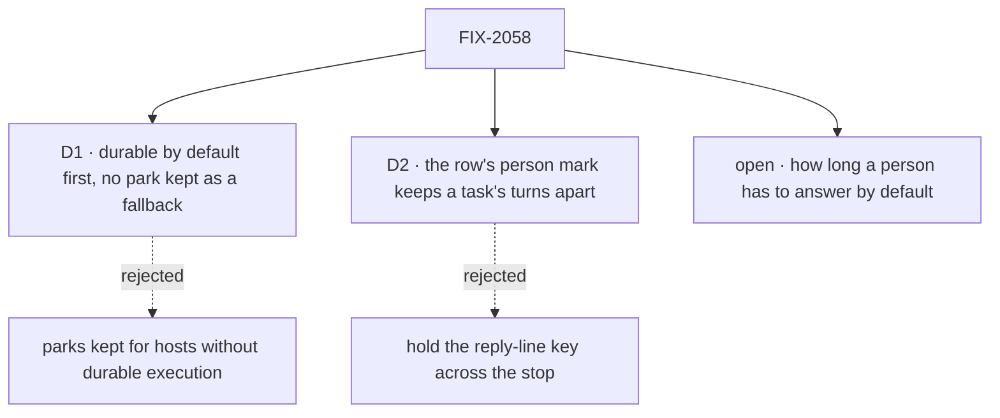

# FIX-2058 · Decisions

[Spec](SPEC.md) · **Decisions**

The calls above any one issue. The owner decided the model in
[`workforce-coordination-concept.md`](../../../docs/internal/design/workforce-coordination-concept.md#inbox-items)
(rules 11 and 12); these two carry it out, and one question is still the owner's.

## The tree

## D1 · Durable execution by default comes first, and no park survives as a fallback

| | |
|---|---|
| **Instead of** | Keeping the question and review parks as the way to stop for a person on a host without durable execution |
| **Because** | A fallback is the second form this epic exists to remove: every child would build and test two paths, and a person would again have two places to look. Serverless hosts without durability are not a target |
| **Locks in** | FIX-2063 blocks every child. A host without durable execution refuses a stop loudly ([ER-6](#who-owns-what)). The kill line: if FIX-2063 can't make durability the default on dev, local and self-hosted hosts, we stop before any park is retired |

**What would change my mind:** a host we support that can't be made durable. Then the kill line
fires and the parks stay.

It comes down to two forms of one job: a fallback park keeps the thing the epic removes.

## D2 · The task row's person mark keeps a task's turns apart across a stop, not the reply-line key

*An engineering call, decided under the epic's posture; recorded because three children touch it.*

| | |
|---|---|
| **Instead of** | Holding the session's reply-line key while a request is suspended for a person |
| **Because** | A request gives the key back when it suspends, and keeping it would also hold back the notices that must run while a task waits on a person, such as a filed task ending (#3696's engineering calls; FIX-2077). The row already carries `waitingOn: "person"` (FIX-2077 D1), so the mark exists; today the steer admission doesn't read it |
| **Locks in** | [ER-2](#who-owns-what): every path that admits a turn of a task reads the row's mark. A steer into a task waiting on a person answers its question or waits for the resume; it never starts a turn beside it |

**What would change my mind:** an engine key that holds a session's turns but lets notices
through. Then the key is the simpler mark.

It comes down to notices: holding the key across a stop keeps a task from hearing its filed work end.

## Who owns what

A *uses* cell is a place a child must not re-decide.

| # | Rule every child obeys | Owner | Checked at |
|---|---|---|---|
| ER-1 | One call stops a request for a person: `waitForUser({ kind, prompt, deadline? })`, kind approval, question or review. One predicate says whether a suspension is a person's; the claim gate and the Inbox both read it, and no child keeps its own list of reasons | FIX-2129 | Every later spec review; the closure's leg a |
| ER-2 | A task waiting on a person is marked on its row with the suspension that holds it. That mark, never the reply-line key, keeps its turns apart: while it waits, only notices and the stop's own answer are admitted ([D2](#d2)) | FIX-2129 | FIX-2131's and FIX-2132's spec review |
| ER-3 | A stop resumes exactly once: answered, deadline or cancelled. Whichever comes first wins and the rest find it resolved. A user's stop ends the request, closes its item and cancels its task | FIX-2130 | FIX-2131's, FIX-2132's and FIX-2133's spec review; legs b and c |
| ER-4 | No task tool answers a stop for a person. The filer answers only a question its task asked midway, by a steer, and not on a routed task; approvals, reviews and held questions are the user's (rule 11) | FIX-2131 | Every later spec review; the closure sweep |
| ER-5 | A row parked before the refactor is read through FIX-2080's one map ([FIX-2056 D3](../FIX-2056/DECISIONS.md#d3)), never a child's own read. States in flight between the refactor epics get no shim | FIX-2131 | FIX-2132's spec review |
| ER-6 | Stopping for a person needs durable execution, on by default wherever stores persist. No child builds a path for a host without it; such a host refuses a stop loudly | FIX-2063 | Every spec review |

## Coordination seams

| Seam | Owner, then who else touches it |
|---|---|
| The claim gate's stop arm (`orchestration/src/task-board/task-request.ts`, `stopOf`) | FIX-2129 keys it on ER-1's predicate and records the suspension on the row; FIX-2130 adds the cancel and the user's stop |
| The suspension record, the stop and the sweep (`core/src/types/suspension.ts`, `engine/src/durability/stop-suspended.ts`, `durability-sweeper.ts`) | FIX-2063 runs the sweeper on file-backed hosts; FIX-2129 adds the kind; FIX-2130 the deadline resume and the stop that cancels. The wait gate (`core/src/types/wait-gate.ts`) already resumes once with answered, deadline or stopped: FIX-2130 uses the same outcome words, not a second set |
| Steer admission (`workforce/src/conversation-board/steer.ts`, `task-admission.ts`) | FIX-2113's gate stays for plan waits. FIX-2131 makes a steer into a task waiting on a person answer or wait (ER-2); FIX-2132 makes it end the coding run |
| The Inbox read (`shift-manager/src/lib/reads.ts`, `surfaces/Inbox.tsx`) | FIX-2131 lists questions and reviews through ER-1's predicate; FIX-2133 adds held tasks, read from task rows; FIX-2132 adds nothing a question doesn't |
| The task tools and the closure sweep (`orchestration/src/skills/task-tools-capability.ts`; `rules.mjs` on `fix/FIX-2087`) | FIX-2131 removes `answerTask` and `parkOnQuestion` and their allowances in the sweep |
| FIX-2080's retired-shape map (`orchestration/src/tasks/collection/`) | FIX-2131 adds the parked question and review entries (ER-5); FIX-2132 the harness's. Mapping a parked question onto *held on questions* would make that child wait on FIX-2133, and the graph would show it |
| The held start (`updateTask` `status: "held"`, FIX-2080) | FIX-2133 adds held on questions, released by its last answer, never by `status` |

## Decided in review, recorded so no child reopens them

Settled from the sources before review:

- **Timeout policy per kind** (the Linear epic's open question): the concept's deadline rule. The
  block handles a deadline; unhandled, an approval counts as rejected and a question or review
  errors, using an attempt. Only the default length is open ([below](#open)).
- **A coding run's question shares the Inbox card:** it is a `waitForUser` question (concept,
  *Inbox items*, last paragraph), so its item is a question's.
- **In-flight parks** (owner, 2026-10-23): nothing deploys until the related refactor epics land,
  so in-flight and deploy-window states between them get no BP-030 shim. Rows persisted before the
  refactor are still read (ER-5).
- **Telling the filer moved to FIX-2070** (owner, 2026-10-23), with a comment there. The row's
  record of the question stays in FIX-2129.
- **FIX-2133 is kept** (owner), over a proposed cut.
- **Removed outright, no deprecation release,** as [FIX-2056 (e)](../FIX-2056/DECISIONS.md#e) set
  for the task surface. FIX-2056's closure sweep allows `answerTask` and `parkOnQuestion` only
  until this epic.
- **FIX-1851** (`answerTask` declining a task parked for its pieces) is related, not a child, and
  closes as superseded when FIX-2131 removes the tool.
- **The person mark is not new.** FIX-2077 D1 records it and drops the lease; FIX-2129 keys it on
  `waitForUser` and records which suspension holds the task.

## What the end-state POC showed

None built. The seams sit on code FIX-2056 has just shipped and tested (the claim gate's stop
arm, the wait gate's outcomes, the steer admission), so the closure run is the first end-state
check.

## How it got here

- **2026-10-15**: filed as a sibling of FIX-2056, not folded into it (owner, via the architect).
- **2026-10-20**: the objective refreshed to the decided model.
- **2026-10-21**: FIX-2056 D2 moved marking the task and answering by steer here.
- **2026-10-23**: FIX-2129 to FIX-2133 filed; the five objective lines agreed; the filer's
  message moved to FIX-2070; drafted, with the closure FIX-2134.

## Open

### How long does a person have to answer, by default, before an unanswered stop counts against the work?

| | |
|---|---|
| **In plain terms** | When a worker asks Alice something and she doesn't answer, at the deadline the flow is told "no answer". If it doesn't handle that, a question or review fails that try at the task (one retry by default) and an approval counts as a no. Today a stop has no default deadline at all, and a wait on a task defaults to 5 minutes |
| **The trade-off** | Short, and work fails while Alice is at lunch or away for the weekend. Long, and a forgotten question sits in her Inbox. None breaks the model's rule that every stop has a deadline, and nothing ever clears a stale one |
| **My recommendation** | A default of its own for a person's stop, **7 days**, set per host and per call. Not the 5-minute wait default |
| **What would change my mind** | Apps where a stale question is worse than a failed try, such as a live chat. Then 24 hours |
| **What being wrong costs** | Little, and it's reversible: one host setting. Too short fails real work; too long leaves an item up for a week |

It doesn't hold the epic's gate. FIX-2130's spec needs the answer.

It comes down to a person being away: the wait default fails their work within minutes.
