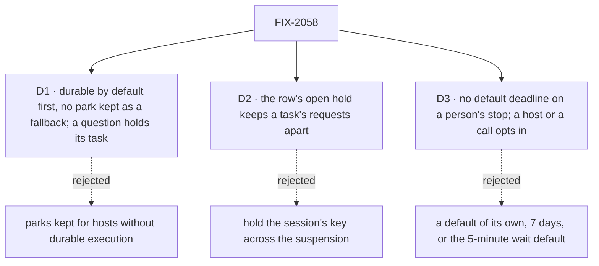

# FIX-2058 · Decisions

[Spec](SPEC.md) · **Decisions**

The calls above any one issue. The owner decided the model in
[`workforce-coordination-concept.md`](../../../docs/internal/design/workforce-coordination-concept.md#inbox-items)
(rules 11 and 12); D1 and D2 carry it out, and the owner decided D3. The owner's 2026-10-25
decision, one list of holds per task, reached this set relayed by another session, and this
amendment's direction gate is his confirmation of it ([Amendment · 2026-10-25](#amendment--2026-10-25--one-list-of-holds-per-task)).
Open: that confirmation, and where `confirm` sits beside an approval ([Open](#open)).

## The tree



<a name="d1"></a>
## D1 · Durable execution by default comes first, and no park survives as a fallback

| | |
|---|---|
| **Instead of** | Keeping the question and review parks as the way to stop for a person on a host without durable execution |
| **Because** | A fallback is the second form this epic exists to remove: every child would build and test two paths, and a person would again have two places to look. Serverless hosts without durability are not a target |
| **Applied to questions** | The owner's rule, 2026-10-23: if code reads the answer on its next line, the stop suspends with `waitForUser` (an approval, a review, input); if the work can pick up from its brief, the task holds on its row (a question, at filing or midway, [ER-8](#who-owns-what)). The hold is one form on every host, not a fallback, and needs no durable execution. An approval suspends, "go ahead with the plan?" included, when code reads the yes or no next. A yes or no the work picks up from its brief, a task filed to wait for the user's go, is a `confirm` row hold (owner, relayed 2026-10-25; where the line sits is [Open](#open)). A review is a verdict the code reads; a revision request is new direction, so its words are a steer the work takes after the verdict ([FIX-2131 D1](../../issues/FIX-2131/DECISIONS.md#d1)). A question in a turn with no task row has nothing to hold, so it suspends as input. The mid-task question park is retired for good |
| **Locks in** | FIX-2063 blocks every child that suspends, FIX-2129 and FIX-2131; FIX-2133's hold waits on neither it nor FIX-2129. A host without durable execution refuses a suspension loudly ([ER-6](#who-owns-what)). The kill line: if FIX-2063 can't make durability the default on dev, local and self-hosted hosts, we stop before the review park is retired |

**What would change my mind:** a host we support that can't be made durable. Then the kill line
fires and the review park stays.


It comes down to two forms of one job: a fallback park keeps the thing the epic removes.

<a name="d2"></a>
## D2 · The task row's open hold keeps a task's requests apart across a suspension, not the session's key

*An engineering call, decided under the epic's posture; recorded because three children touch it.
The mark's shape is the owner's, amended 2026-10-25: an open hold on the row ([ER-8](#who-owns-what)).*

| | |
|---|---|
| **Instead of** | Holding the session's key while a request is suspended for a person |
| **Because** | A request gives the key back when it suspends, and keeping it would also hold back the `onTaskSettled` requests that must run while a task waits on a person, such as a filed task ending (#3696's engineering calls; FIX-2077). The row already carries the mark: FIX-2077 D1's `waitingOn`, which FIX-2129 writes as `"user"` with `waitingFor` (#3866), and which FIX-2133 moves onto a `source: "suspension"` hold. Today the steer admission doesn't read it |
| **Locks in** | [ER-2](#who-owns-what): every path that admits a request into a task's session reads the row's open holds. A steer into a task waiting on a person waits for the resume; it never starts a request beside it. A steer naming a held question is its answer ([ER-8](#who-owns-what)) |
| **Not decided here** | Messages. A send or a call to a session waiting on a person follows rule 10 as written: it queues. Giving the key back could let one run instead; that is FIX-2070's call, and FIX-2129 pins what a message does there today with a test so the change is seen |

**What would change my mind:** an engine key that holds a session's requests but lets
`onTaskSettled` through. Then the key is the simpler mark.


It comes down to `onTaskSettled`: holding the key across a suspension keeps a task from hearing its filed work end.

<a name="d3"></a>
## D3 · A person's stop has no deadline by default; a host or a call opts in

*Decided by the owner, 2026-10-24.*

| | |
|---|---|
| **Instead of** | A default of its own, 7 days, set per host and per call, or the 5-minute default a wait on a task already has |
| **Because** | The owner: waiting 7 days and then going ahead is arbitrary. No one length fits every stop, and a stop that ends on a length nobody chose for it fails or guesses on work a person still means to answer; minutes fail it while she is at lunch. With no deadline, a stop waits until someone answers it, or its task is stopped or cancelled. An app that wants a stop to end says when |
| **Applied to every kind** | Confirmed by the owner, 2026-10-24: D3 was one rule for approvals, questions, reviews and input, so no default covers all four, approvals included |
| **Locks in** | A host setting for a person's stop, separate from the wait default and unset by default: set, every `waitForUser` with no `deadline` and every row hold gets it ([ER-1](#who-owns-what), [ER-8](#who-owns-what)); `waitForUser`'s `deadline` sets one on a single call. At a deadline the endings stand: an approval is a no, a review or input throws, the model's tool returns no answer, and a held question's deadline is the debt pass's, where the work goes ahead from its brief. Neither the sweeper nor the debt pass ends a stop with no deadline. FIX-2129 builds the setting. The concept (`workforce-coordination-concept.md`, *Inbox items* and *Decisions*) says so as of this amendment: every wait has a deadline; a stop for a person has none unless the host or the call sets one |

**What would change my mind:** Inboxes filling with stops nobody will answer. Then the host sets
the setting, one line, without a change here.


It comes down to a fixed length being arbitrary: 7 days or 5 minutes ends work nobody chose to end.

## Who owns what


A *uses* cell is a place a child must not re-decide. FIX-2137 owns no rule and is Done (#3749).
It blocks FIX-2063's default flip and FIX-2129's approval resumes, and stays on FIX-2132: the manager's
own question holds, but a host's own harness block, judge or hook can still `ctx.suspend`
([FIX-2132 D1](../../issues/FIX-2132/DECISIONS.md#d1)).

| # | Rule every child obeys | Owner | Checked at |
|---|---|---|---|
| ER-1 | One call stops a request for a person when its code reads the answer next: `waitForUser({ kind, prompt, deadline? })`, kind approval, review or input, never a question, which holds its task ([ER-8](#who-owns-what)); with no `deadline`, the host's deadline for a person's stop if one is set, else none, and it waits until answered, stopped or cancelled ([D3](#d3)). It is built on the person suspensions, not the wait gate: a wait gate is resumed only from inside its own session, and a person answers from outside it. The two use the same words, answered and deadline, not the same shape: a wait returns `{ answered: false, deadline: true }`, where a person's suspension at its deadline throws the existing `SuspensionTimeoutError` for a review or an input and reads as a no for an approval ([FIX-2129 D1](https://github.com/fixpoint-labs/flow-state-dev/pull/3735)), and FIX-2131's model-facing tool returns a deadline result instead of throwing, since a model can't catch. A person's suspension resumes with `cancelled`, which the block reads and runs to its end, where a wait gate's `stopped` ends the request unread. One predicate, in `contracts` beside the suspension reasons, says whether a suspension is a person's; the claim gate, the Inbox and the Lab's send all read it, and no child keeps its own list of reasons | FIX-2129 | Every later spec review; the closure's leg a |
| ER-2 | A task waiting on a person is marked on its row by an open hold: for a suspension, a `source: "suspension"` hold that mirrors it ([ER-8](#who-owns-what)). That hold, never the session's key, keeps its requests apart: while it waits, only `onTaskSettled` and the suspension's own answer are admitted, a steer waits for the resume, and messages follow rule 10 ([D2](#d2)). The hold opens in the same write that drops the lease. A person's stop never holds back the notices of tasks its request filed: FIX-2123 holds them while a filing request is parked, and FIX-2129 exempts a person's stop from that hold | FIX-2129 | FIX-2131's spec review; the closure's leg d |
| ER-3 | A stop ends exactly once: a suspension resumes answered, deadline or cancelled, and its mirror hold closes with that resume; a row hold ends answered, deadline or cancelled ([ER-8](#who-owns-what)). Whichever comes first wins and the rest find it resolved, and every ending closes its item, an unhandled deadline included. A user's stop ends the request, closes its item and cancels its task | FIX-2129 | FIX-2131's, FIX-2132's and FIX-2133's spec review; legs b and c |
| ER-4 | No task tool answers a suspension for a person. The filer answers only a question its task asked midway, by a steer, and not on a routed task; approvals, reviews and questions asked at filing are the user's (rule 11) | FIX-2131 | Every later spec review; the closure sweep |
| ER-5 | No row persisted before this work is read: stores are reset (owner, 2026-10-23). FIX-2080's retired-shape map ([FIX-2056 D3](../FIX-2056/DECISIONS.md#d3)) gains no entry for a parked question or review, harness rows included, and no question is migrated onto the hold ([ER-8](#who-owns-what)); BP-030's dual-read is waived for this epic's persisted shapes. The `parked` status goes as a write and a read. Where a coding row needs its session back, FIX-2132 reads that from the harness manager's run record (`harness-manager/src/run-record.ts`), not from the row. States in flight between the refactor epics get no shim | FIX-2131 | FIX-2132's spec review |
| ER-6 | Suspending for a person needs durable execution, on by default wherever stores persist. No child builds a path for a host without it; such a host refuses a suspension loudly. A question's hold needs none | FIX-2063 | Every spec review |
| ER-7 | The Inbox answers each kind of item through one route the server trusts, and the server sets who answered. A suspension resumes through FIX-2129's route, without opening the public resume route to a `task` source (BP-031), and only after the checks the public resume path runs (`ownsRecord` and `callerReachesRequest`: flow instance, tenant, user, org) before it loads or resolves the suspension ([FIX-2129 D2](../../issues/FIX-2129/DECISIONS.md#d2)). A row hold, a question or a confirm, is answered by a steer from the user through the board's own `updateTask` action, which scopes the row to the signed-in user, tenant and org the same way, and names the hold it answers (the field is `question` until FIX-2071's renames; [FIX-2133 D1](../../issues/FIX-2133/DECISIONS.md#d1)). The Inbox makes one answer call, and the call routes by the item's `source`: a suspension to FIX-2129's route, a row hold to `updateTask`. No child builds a third route | FIX-2129; FIX-2133 builds the question leg | FIX-2131's, FIX-2132's and FIX-2133's spec review; leg b |
| ER-8 | One list of holds per task: `holds[]` on its row ([the type](#amendment--2026-10-25--one-list-of-holds-per-task)), and *open holds* the one predicate, whatever the row's status. The claim gate never claims a row with an open hold; the row never settles with one except by cancel; `renewLease` and `reclaim()` refuse it; the deadline pass and the crash debts (`resumeOwed`, `cancelOwed`) read it; the Inbox lists its `actor: "user"` holds. A status is at most derived from it. A hold's `source` says what releases it. **`"suspension"`** mirrors a task run's parked `waitForUser` stop: the claim gate's stop arm opens it in the write that drops the lease, and it closes when the engine resumes the stop (ER-3), so the engine is unchanged and FIX-2129's route answers it (ER-7). **`"row"`** has nothing parked, and its first releaser wins; `answer` (a steer carrying the hold's id; one carrying none releases nothing) is the only releaser in this epic. Row holds are questions and confirms. Every change to `holds[]` is one pure write both store backings call, beside the predicate in `orchestration/src/tasks/collection/`: open, release, deadline (a "no answer came" steer, and the work goes ahead from its brief: owner, 2026-10-24) and cancel, which closes every hold. A row's open holds come from one source at a time. `actor` and `releasedBy` are stored from the first write, so a later kind needs no migration. One deadline, none unless set: a row hold's `due` is the host's person-stop setting ([D3](#d3)), paid by the board's debt pass (rule 8), and with none it stays open until answered or cancelled; a suspension hold's `due` copies its suspension's deadline, which the engine ends. Before start the row is `pending`; midway, `in_progress` with no lease, re-entered on its same attempt ([FIX-2086](../../issues/FIX-2086/DECISIONS.md#d2)'s steer turn), owed by a mark of the hold's own, not `waitingOn: "steer"`, which keeps only FIX-2086's meaning. Every claim of a row advances a turn generation, one more field on the existing claim ticket, that every claim-ticket write (renew, complete, fail, settle) checks, so a predecessor turn never writes after its successor's claim. Re-entry holds three invariants: at most one live turn per attempt; a row with no open hold is never stranded; a stop ends exactly once. The mechanism is [FIX-2133's](../../issues/FIX-2133/DECISIONS.md) to design and prove with tests, and further protocol findings go to its spec and implementation review, not to this epic. It replaces the planned `questions[]`, and `waitingOn: "user"` with `waitingFor` (#3866), which move onto the list. Event releasers and `ctx.waitForEvent` are not this epic's. The word stays *hold*, the concept's *held on questions*; renames are FIX-2071's | FIX-2133 | FIX-2131's and FIX-2132's spec review; legs a, b and c |

## Coordination seams

| Seam | Owner, then who else touches it |
|---|---|
| The claim gate's stop arm (`orchestration/src/task-board/task-request.ts`, `stopOf`) | FIX-2129 keys it on ER-1's predicate, records the suspension on the row (`waitingFor`, #3866), and adds the cancel and the user's stop; FIX-2133 moves that record onto a `source: "suspension"` hold, and adds the refusal of a row with an open row hold, which cancels the losing suspension, and the settle guard (ER-8). One wait per turn, a row's open holds from one source at a time, is [FIX-2133's rule](../../issues/FIX-2133/DECISIONS.md#decided-not-asked) |
| The suspension record, the stop and the sweep (`core/src/types/suspension.ts`, `engine/src/durability/stop-suspended.ts`, `durability-sweeper.ts`) | FIX-2137 makes a resume skip its completed steps with trace observability off; FIX-2063 runs the sweeper on file-backed hosts; FIX-2129 adds the kind, the cancel's debt on the board's existing owed-resume marks (`payOwedResumes`, `resumeWait` widened, no eighth host verb), and the opt-in person-stop deadline setting, unset by default ([D3](#d3)), which FIX-2133's row-hold deadline reads (until it lands, only FIX-2133's test hook sets one), the deadline resume and the stop that cancels. The wait gate (`core/src/types/wait-gate.ts`) stays for waits on work: `waitForUser` shares its words answered and deadline, not their shape or its mechanism, and adds `cancelled` (ER-1) |
| The answer route (`engine/src/routes/resume-routes.ts`, its public re-entry check; `shift-manager/src/lib/reads.ts`, `REOPENED_SOURCES`) | FIX-2129 builds ER-7's route for suspensions, and FIX-2131's reviews answer through it. FIX-2133 answers a row hold through the board's `updateTask` action, and FIX-2131 and FIX-2132 reuse it. The Inbox's one answer call routes between the two by the item's `source` (ER-7) |
| Steer admission (`workforce/src/conversation-board/steer.ts`, `task-admission.ts`) | FIX-2113's gate stays for plan waits. FIX-2131 makes a steer into a task waiting on a person wait (ER-2) and a steer naming a held question answer it (ER-8). A line typed in a task's session answers in one server-side home, orchestration's `steerFromLine`, which harness-manager's session door and workforce's steer share: FIX-2133 makes it answer the oldest open question through ER-8's write (a confirm is answered only in the Inbox or by `updateTask`, since a typed line is no yes or no, [FIX-2131 D1](../../issues/FIX-2131/DECISIONS.md#d1)); FIX-2131's composer sends the plain line; FIX-2132 changes nothing there, and its owed turn starts the next coding run in the same session |
| The Inbox read (orchestration, new; `shift-manager/src/lib/reads.ts`, `send.ts`, `surfaces/Inbox.tsx`) | **One item type over open holds** (amended 2026-10-25). An item is one task row's open `actor: "user"` holds, with an `answerable` flag and one answer call routed by `source` (ER-7). A suspension in a request with no task row has no row to hold, so it lists from `readAsks` as the same item type, and `readAsks` skips a task run's suspensions: those list from their hold alone. The read belongs to orchestration, a read plus a browser client, as workforce's `createWorkforceClient` is, not to the client package; Shift Manager and FIX-2157's lab both consume it. FIX-2133's first PR reshapes `reconcileInbox` onto that item type, checked against reads independent of the listing (`listTasks` rows and `listSessionRequests` filtered by ER-1's predicate); its `bothArms` clause becomes a drift check between each task-run suspension and its mirror hold, and a `rules.mjs` rule keeps building an item inside the read. Every child's acceptance is the reconciler green with its kind present. FIX-2133 lists row holds, before start and midway, and the mirror; FIX-2131 lists reviews through it, adding no source, and moves `send.ts` onto ER-1's predicate; FIX-2132 adds nothing a held question doesn't. `getTask` and `listTasks` show a row's open holds. This supersedes the 2026-10-24 rule, one listing source per kind (suspensions from `readAsks`, questions from rows, `waitingFor` never) |
| The task tools and the closure sweep (`orchestration/src/skills/task-tools-capability.ts`; `rules.mjs` on `fix/FIX-2087`) | FIX-2131 removes `answerTask` and `parkOnQuestion` and their allowances in the sweep. `PERSON_STOPS_REMOVED` ratchets: each child adds the names it deletes in that PR, FIX-2132 first, and FIX-2134 checks the list is complete ([FIX-2134 D2](../../issues/FIX-2134/DECISIONS.md#d2)). Its midway ask calls ER-8's write; what the request did before asking stands (its writes, messages and last checkpoint), and the next turn starts from the brief, that checkpoint and the answer |
| FIX-2080's retired-shape map (`orchestration/src/tasks/collection/`) | No child adds an entry: stores are reset, so no parked row is read (ER-5). FIX-2131 removes the `parked` status; FIX-2132's coding row gets its confirmed session back from the harness manager's run record, spending no try |
| The holds (`holds[]` on the row, beside FIX-2080's `held` flag, which composes with them: both must clear) | FIX-2133 owns the list (ER-8), its one write, the suspension's mirror and the re-entry protocol, proved by its own tests against both backings. Its constraints: an ask opens a row hold, drops the lease and ends the turn unsettled; the last answer or the deadline releases the row's last open hold; cancel closes every hold with the row, a cancelled suspension hold keeping its address until the `cancelled` resume it owes is paid, from both backings' direct and cascade cancel (`state-backed.ts`, `resource-backed.ts`); `renewLease` and `reclaim()` refuse a row with an open hold, an ask racing a renewal included; the write that closes the last open row hold sets the hold's own owed-turn mark on the row in that same write, never relying on a wake record (owed before the row write, and absent without `RequestWakes`, `request-host.ts`); the claim gate claims a marked `in_progress` row with no lease and no open hold for its same attempt, spending no fresh budget, and clears the mark atomically; every claim advances the turn generation that claim-ticket writes check (today ownership is fenced only by row, status and attempt, `internal.ts`); a wake, where the host has one, only starts the turn sooner; `updateTask` gains a row hold's id, accepted from the public action for any row hold and from the filer's tool only for a midway question on a task not routed (ER-4), so filing with several questions keeps working. FIX-2131 and FIX-2132 ask through it. The drain's counts (`task-board/shared.ts`, `countWaitable`, `activeWorkerCount`; `quiescence.ts`) are FIX-2131's: with the park exit gone, the active-worker count excuses a row with an open hold, so a `complete-or-blocked` board whose only open rows wait on a person reports `blocked` instead of spinning to its iteration limit, which with no deadline never ends |
| Outside this epic: [FIX-2163](../../issues/FIX-2163/SPEC.md) (epic FIX-2152), a harness run's review | Consumes `waitForUser({ kind: "review" })`, FIX-2129's catchable `SuspensionTimeoutError` and the person-stop setting, and amends FIX-2132's manager: with `reviewChanges` on, the manager suspends for a review, never for a question. Whether this epic's closure walks a coding run's review is FIX-2156's call |

## Decided in review, recorded so no child reopens them

Settled from the sources before review:

- **Timeout policy per kind** (the Linear epic's open question): the concept's deadline rule. The
  block handles a deadline; unhandled, an approval counts as rejected and a review or input
  errors, using an attempt. A held question's deadline is the board's debt pass's ([ER-8](#who-owns-what)).
  Whether a stop has a deadline at all is [D3](#d3): none unless set.
- **A coding run's question shares the Inbox card:** it holds its task like any question (concept,
  *Inbox items*, last paragraph), so its item is a question's.
- **In-flight parks** (owner, 2026-10-23): nothing deploys until the related refactor epics land,
  so in-flight and deploy-window states between them get no BP-030 shim. Rows persisted before the
  refactor aren't read either: stores are reset (owner, later the same day; ER-5).
- **Telling the filer moved to FIX-2070** (owner, 2026-10-23), with a comment there. The row's
  record of the question stays here, as the hold (FIX-2133).
- **FIX-2133 is kept** (owner), over a proposed cut.
- **Removed outright, no deprecation release,** as [FIX-2056 (e)](../FIX-2056/DECISIONS.md#e) set
  for the task surface. FIX-2056's closure sweep allows `answerTask` and `parkOnQuestion` only
  until this epic.
- **FIX-1851** (`answerTask` declining a task parked for its pieces) is related, not a child, and
  closes as superseded when FIX-2131 removes the tool.
- **The person mark is not new.** FIX-2077 D1 records it and drops the lease; FIX-2129 keys it on
  `waitForUser` and records which suspension holds the task.

In the first review round:

- **FIX-2130 folded into FIX-2129** (engineering): a `waitForUser` without its deadline, cancel
  and stop is no contract for the children after it to test against. FIX-2130 closed as a duplicate.
- **LAB-162 is superseded** (owner, 2026-10-23): #1612 is closed as superseded. This epic keeps
  shared harness dispatch and a coding run continuing its saved session. LAB-164 closes as
  superseded on this epic's approval; LAB-163, the OMP slot, isn't decided here and needs a fresh
  spec on `waitForUser` if still wanted. Neither has started.
- **`waitForUser` on the person suspensions, not the wait gate** (engineering): a wait gate is
  never resumed from outside its session, and a person's answer always is ([ER-1](#who-owns-what)).

In the second review round:

- **A person's suspension resumes with `cancelled`**, the concept's word, which the block reads and
  runs to its end; it shares only the words answered and deadline with the wait gate, whose `stopped` ends
  the request unread ([ER-1](#who-owns-what)).
- **D2 doesn't decide messages:** rule 10 stands, a message to a session waiting on a person
  queues, and the call is FIX-2070's.

After the merge (owner, 2026-10-23):

- **A question holds its task; approvals, reviews and input suspend** ([D1](#d1), [ER-8](#who-owns-what)).
  FIX-2129 drops the `question` kind from `waitForUser`; FIX-2131 moves its midway question onto the
  hold and keeps retiring the board park and the steer answer; FIX-2132 becomes a hold and a steer
  into the same coding session; FIX-2133 owns the hold before start and midway.
- **FIX-2133's spec proposals** (#3747), engineering: the Inbox answers a held question through
  the board's `updateTask` action as the user, so ER-7 reads one trusted route per kind,
  adopted; FIX-2133 waits on neither FIX-2063 nor FIX-2129, adopted, its deadline paid as a
  board debt; its row reading `status: "held"`, not adopted: the owner's hold is one predicate
  on `pending` and `in_progress` rows alike, and a status for the pre-start case would make it
  two. Its midway case is the owner's, and joins it.
- **FIX-2137 joins the set** as a direct-route bug, no spec: a durable resume with trace
  observability off runs completed steps again. It blocks FIX-2063's default flip and
  FIX-2129's approval resumes, and FIX-2132's spec keeps its edge ([who owns what](#who-owns-what)).
- **No old data** (owner, 2026-10-23): "I don't care about old data. For now we will be resetting
  everything." Stores are reset, and nothing persisted before this work is read: no retired-shape
  map entries for parks, no migrated questions, and BP-030's dual-read waived for this epic's
  persisted shapes ([ER-5](#who-owns-what)). So `waitingOn: "person"` becomes `"user"` as a plain
  rename (FIX-2129), the stored old value unread.

After the analysis (2026-10-24):

- **No default deadline** on any stop for a person, approvals included ([D3](#d3), owner,
  confirmed 2026-10-24).
- **A held question goes ahead at a set deadline** (owner): the debt pass closes it with a "no
  answer came" steer and the work goes on from its brief, "with whatever recommendation it
  provided". FIX-2133's deadline path and its legs stay, with the deadline set explicitly. This
  was the epic's open question; it is decided.
- **A board whose only open rows wait on a person reports `blocked`** (engineering, from the
  analysis): FIX-2131 moves the park exit's excusal onto ER-1's predicate and ER-8's hold
  ([seams](#coordination-seams), *The hold*).

## What the end-state POC showed

None built. The seams sit on code FIX-2056 has just shipped and tested (the claim gate's stop
arm, the wait gate's outcomes, the steer admission), so the closure run is the first end-state
check.

## Analysis · 2026-10-24

The forward pass on the set, watermark 2026-10-23. It changed D3's reach (above) and the drain's
counts; the rest is recorded so no child re-derives it.

- **[FIX-2129 D1](../../issues/FIX-2129/DECISIONS.md#d1) holds:** a block's review or input throws
  at its deadline, an approval is a no.
- **A model's review returns where a block's throws:** FIX-2131's tool gives the model a deadline
  result, so nothing on the task says the deadline ended it. That signal is
  [FIX-2165](https://linear.app/fixpoint-labs/issue/FIX-2165)'s, linked from FIX-2131.
- **[FIX-2170](https://linear.app/fixpoint-labs/issue/FIX-2170) agrees with ER-2.**
- **[FIX-2151](https://linear.app/fixpoint-labs/issue/FIX-2151) is cheapest built alongside FIX-2129.**
- **FIX-2129's answer call lands on whichever client survives
  [FIX-2162](https://linear.app/fixpoint-labs/issue/FIX-2162).**
- **The kill line did not fire:** FIX-2063 is done.
- **Liveness bounds:** [FIX-2166](https://linear.app/fixpoint-labs/issue/FIX-2166) and
  [FIX-2169](https://linear.app/fixpoint-labs/issue/FIX-2169) carry them. With no default deadline
  they, and the drain's `blocked` verdict, are what keeps a stop nobody answers from costing more
  than a listed item.
- **Ergonomics debt, for FIX-2071:** `waitingOn: "steer"` means both a queued steer and a turn
  owed after a held question's last answer (split 2026-10-25: the hold's own mark owes the
  second); `waitForUser` names two contracts, a block's that throws and a model tool's that returns.
- **Prior art:** LangGraph's `interrupt` waits until resumed, with no timeout
  ([docs](https://docs.langchain.com/oss/python/langgraph/interrupts)), the shape D3 now takes.
  Inngest's `step.waitForEvent` takes a timeout and resolves `null` at it
  ([docs](https://www.inngest.com/docs/reference/functions/step-wait-for-event)), as FIX-2131's
  model tool returns. Temporal's `condition(fn, timeout)` resolves `false` at its timeout
  ([docs](https://typescript.temporal.io/api/namespaces/workflow#condition)), and the approval
  workflow decides what that means; the analysis read its approval pattern as raising, the way a
  block's review or input throws here.

**Other shapes.** An adhd pass over five frames, three deepened. The five-issue split is kept;
what it changed is above (the reconciler first, the sweep's ratchet, `steerFromLine` as a line's
one home, FIX-2132 cut to the coding-run delta). Code input needs no framework work beyond FIX-2129
and FIX-2063. Considered and dropped:

- **The closure shipped as a red ledger with the first child:** it reopens four approved specs,
  typechecks against APIs not yet built, and FIX-2134 doesn't go away. Its ratchet was kept.
- **Deleting FIX-2132:** several hundred real lines remain, with a merge edge and a dependent in
  another epic (FIX-2163).
- **Re-splitting before the claim against after it:** rewrites five merged specs.
- **A steer as the one answer route, or a single `answerStop` action:** against ER-7's one trusted
  route per kind.
- **Retiring the park first, with reviews as interim row questions:** throwaway work.
- **The hold as a resource:** it fights the claim gate as the one place the hold is enforced.
- **`waitForUser` as a capability:** ergonomics debt for FIX-2071, not a change of direction.

**Reuse review verdicts**, on the set's *Adds*:

- **R1 · reuse.** FIX-2129's cancel debt is the board's `cancelOwed`/`resumeOwed`, paid by
  `payOwedResumes` through `RequestHost.resumeWait`, widened for a person's suspension resuming
  `cancelled`; `cancelOwed` is the precedent. Not a second debt, payer or host verb.
- **R2 · one listing source per kind.** Two reads, not three: `readAsks` for suspensions,
  `toBoardRow` for held questions; FIX-2131 adds none. `waitingFor` is never listed. FIX-2133 owns
  the rule and the one package read; FIX-2134 checks it. *Superseded 2026-10-25* by one item type
  over open holds ([Amendment](#amendment--2026-10-25--one-list-of-holds-per-task)).
- **R3 · extend.** The turn generation is one more field on `TaskClaimTicket`, checked at
  `transitionDeclineReason`; the copies that compare `attempts` outside it (`holds`,
  `advisory-write-back.ts`, `task-entry.ts`, harness-manager's `manager.ts` and `run-record.ts`)
  move onto it ([FIX-2133 D3](../../issues/FIX-2133/DECISIONS.md#d3)).
- **R4 · remove.** `Task.turnReentries` goes with its only writer, the park's answer (FIX-2131).
- **Genuinely new:** FIX-2133's single question write, and FIX-2132's run counter, with one note
  for its implementer: could clearing the marker before each run remove the counter?

## Amendment · 2026-10-25 · one list of holds per task

*The owner's decision of 2026-10-25, relayed to this session by another session and not yet
confirmed to it directly. This amendment's direction gate is his confirmation.* It came after
FIX-2129 merged (#3866), writing `waitingOn: "user"` and `waitingFor` on a task's row, and while
FIX-2133's first PR (#3854) is held and conflicts with `main`: it built one Inbox list of two arms,
`reconcileInbox` with a `bothArms` clause, and an `INBOX_READ` sweep rule.

```ts
type HoldBase = {
  id: string;
  actor: "user" | "system";          // the Inbox lists actor "user"
  openedAt: number;
  due?: number;                      // none unless set; cancel closes every hold
};
type SuspensionHold = HoldBase & {   // mirrors a parked run; closed when the engine resumes it
  source: { kind: "suspension"; flowId: string; requestId: string; suspensionId: string };
  ask: { kind: "approval" | "review" | "input"; prompt: string; title?: string };
};
type RowHold = HoldBase & {          // nothing parked; first releaser wins
  source: { kind: "row"; releasedBy: Releaser[] };
  ask: { kind: "question" | "confirm"; prompt: string; title?: string };
};
type TaskHold = SuspensionHold | RowHold;   // discriminated on source.kind
type Releaser = { by: "answer" } | { by: "event"; event: string; key: string };
```

1. **One list per task.** The claim check, cancel, the deadline pass, crash debt and the Inbox
   all read open holds ([ER-8](#who-owns-what)).
2. **The engine is unchanged.** `waitForUser` stays as #3866 built it; the board mirrors a task
   run's stop as a `source: "suspension"` hold and closes it on resume. ER-7 stands.
3. **Row holds.** Questions and a new `confirm` kind are `source: "row"` holds released by
   `answer`. `actor` and `releasedBy` are stored from the start; stores are reset (ER-5), so
   nothing old is read.
4. **Scope.** Event releasers and `ctx.waitForEvent` are out of this epic. No new issue:
   FIX-2133 owns `holds[]` under ER-8, in two PRs, the reshaped #3854 and then the row holds
   with the mirror ([FIX-2133](../../issues/FIX-2133/DECISIONS.md#decided-not-asked)).

**What would change my mind.** A lighter variant was considered: unify only the Inbox read, keep
`questions[]` and `waitingFor` on the row, and persist no mirror. The amendment does not take it,
because the relayed decision makes open holds the one predicate for the claim, cancel, the
deadline, crash debt and the Inbox; an Inbox-only read gives that to the Inbox alone, and the
other four keep reading two fields.

The relayed type lists every ask kind on one shape; written here as a union on `source`, so a
mirror carries only a suspension's kinds and a row hold only a question or a confirm, and an
invalid pair can't be written.

**What it supersedes.** ER-8's open-questions predicate and FIX-2133 D2's `questions[]`; the
row's `waitingOn: "user"` and `waitingFor` (#3866), which move onto the suspension hold; one
listing source per kind (R2 above, and the Inbox seam), FIX-2133's derived `waitingOn`/`waitingFor`
read, and the package read in Shift Manager, which become one item type over open holds read
by orchestration; `bothArms`, which becomes a drift check, and most of `INBOX_READ`; `waitingOn:
"steer"` as a held question's owed turn; and D1's "every approval suspends", which now holds
where code reads the yes or no next ([Open](#open)). The five-issue split, D3, the answer routes
and the Codex-once rule are unchanged.

**Reuse review**, on the new *Adds* only:

- **`holds[]` · extend** ER-8's `questions[]`: the same list widened, with `waitingFor` moved in,
  never beside either. FIX-2080's `held: true` stays its own flag and composes; folding it in
  would reopen FIX-2133 D2's rejected status. `holds()`, the claim-ownership check in
  `task-board/task-request.ts`, collides with the field's name; the implementer renames it.
- **The mirror · extend** `waitingFor`: the same fields, written by the same `setWaitingOn`
  write, cleared at the same resume, kept after a cancel until `resumeOwed` is paid. It is a
  move: a `waitingFor` left beside it would be the second record the review warns against.
- **`answer` routing · reuse** FIX-2133's two-arm union and `LabReader.resume`'s one call,
  moved into orchestration's browser client and keyed on the item's `source`. No third route.
- **`confirm` · not a reuse, routed to the owner.** It overlaps `waitForUser({ kind: "approval" })`,
  whose D1 line said every approval suspends so nobody has to learn a rule, and FIX-2080's `held`
  before the start, which the filer releases and the Inbox doesn't list ([Open](#open)).

## How it got here

- **2026-10-15**: filed as a sibling of FIX-2056, not folded into it (owner, via the architect).
- **2026-10-20**: the objective refreshed to the decided model.
- **2026-10-21**: FIX-2056 D2 moved marking the task and answering by steer here.
- **2026-10-23**: FIX-2129 to FIX-2133 filed; the five objective lines agreed; the filer's
  message moved to FIX-2070; drafted, with the closure FIX-2134.
- **2026-10-23**, first review round: FIX-2130 folded into FIX-2129; LAB-162's park superseded;
  ER-7 added for the answer route; held tasks start, not resume; leg d for a steer during a stop.
- **2026-10-23**: the owner decided D3, 7 days; #1612 closed as superseded; second review round:
  `cancelled` as a person's stop's outcome, messages left to rule 10.
- **2026-10-23**, after the merge: the owner decided questions hold their task and code-consumed
  answers suspend; ER-8 added, owned by FIX-2133.
- **2026-10-23**, the owner: no old data, stores are reset (ER-5). The epic aligned with its four
  merged child specs: `waitingOn: "user"`; FIX-2137, Done, kept on FIX-2132; FIX-2132 merges
  before FIX-2131.
- **2026-10-24**, the owner: D3 changed to no default deadline on a person's stop; the host
  setting and the call's `deadline` stay as opt-ins; a held question goes ahead at a set
  deadline, closing the open question. The forward analysis folded: the drain's counts, FIX-2163
  named as a consumer, the reuse verdicts, and the other shapes (the Inbox reconciler as FIX-2133's
  first PR, the sweep's ratchet, `steerFromLine`, FIX-2132 cut to its coding-run delta). Amended with the five child specs, FIX-2163 and the concept in one PR.
- **2026-10-25**, the owner, relayed: one list of holds per task, `holds[]`; the engine unchanged
  and mirrored; questions and `confirm` as row holds; event releasers out. ER-2, ER-3, ER-7, ER-8,
  D2, the Inbox and hold seams, FIX-2131, FIX-2133 and FIX-2134 amended in one PR
  ([Amendment](#amendment--2026-10-25--one-list-of-holds-per-task)).
- **2026-10-25**, the owner, relayed (decided on FIX-2133's #3890): a confirm takes
  `onNo: "cancel" | "continue"` from its filer, default `"cancel"`. A No on a `"cancel"` confirm
  cancels the task through the ordinary cancel, its No and note the cancel's reason; on
  `"continue"` the work goes on with "No." in its brief. Confirms filed up front and asked midway
  alike. An evaluator that reads the answer's meaning is a separate follow-up.

## Open

The owner confirmed on 2026-10-24 that no default deadline covers approvals too ([D3](#d3)).
Two things are open, both his:

**Is the relayed decision yours, as written?** It reached this set through another session, so
the direction gate on this amendment is its confirmation. Merging it says yes; FIX-2133's two PRs
wait on that merge.

**Where does `confirm` stop and an approval start?**

- **In plain terms:** both ask the user a yes or no. An approval stops the run and the code reads
  the answer on its next line. A `confirm` ends the turn, or keeps the task from starting, and the
  work picks the answer up from its brief.
- **The trade-off:** `confirm` lets a task be filed to wait for the user's go, listed in the Inbox,
  which `held` can't do (its filer releases it, unseen). The price is a second yes-or-no kind
  where D1 had one, so an author has to pick.

  

  It comes down to a task waiting for a go: without `confirm`, a run starts only to stop.
- **My recommendation:** keep `confirm`, and draw the line by the rule people already learn: code
  reads it next, an approval; the work picks it up from its brief, a `confirm`. In this epic only
  a filer asks one, at filing (`createTask`); a model's midway yes or no stays an approval. I have
  written that line into D1 and FIX-2133.
- **What would change my mind:** authors who can't tell which one to use. Then `confirm` goes,
  and a task waiting for the user's go is an approval in its first turn.
- **What being wrong costs:** small and reversible while nothing ships: one kind in the hold's
  `ask`, its Inbox buttons and one leg of FIX-2133's check. Stores are reset, so no data moves.
