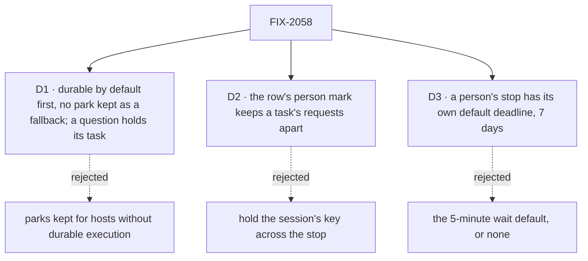

# FIX-2058 · Decisions

[Spec](SPEC.md) · **Decisions**

The calls above any one issue. The owner decided the model in
[`workforce-coordination-concept.md`](../../../docs/internal/design/workforce-coordination-concept.md#inbox-items)
(rules 11 and 12); D1 and D2 carry it out, and the owner decided D3. Two things are open: renewed
approval of the post-merge amendment, and what an unanswered question does at its deadline ([Open](#open)).

## The tree

## D1 · Durable execution by default comes first, and no park survives as a fallback

| | |
|---|---|
| **Instead of** | Keeping the question and review parks as the way to stop for a person on a host without durable execution |
| **Because** | A fallback is the second form this epic exists to remove: every child would build and test two paths, and a person would again have two places to look. Serverless hosts without durability are not a target |
| **Applied to questions** | The owner's rule, 2026-10-23: if code reads the answer on its next line, the stop suspends with `waitForUser` (an approval, a review, input); if the work can pick up from its brief, the task holds on its row (a question, at filing or midway, [ER-8](#who-owns-what)). The hold is one form on every host, not a fallback, and needs no durable execution. Every approval suspends, "go ahead with the plan?" included, so nobody has to learn the rule. A review is a verdict the code reads; a revision request is new direction, so it is a steer into a held task. A question in a turn with no task row has nothing to hold, so it suspends as input. The mid-task question park is retired for good |
| **Locks in** | FIX-2063 blocks every child that suspends, FIX-2129 and FIX-2131; FIX-2133's hold waits on neither it nor FIX-2129. A host without durable execution refuses a suspension loudly ([ER-6](#who-owns-what)). The kill line: if FIX-2063 can't make durability the default on dev, local and self-hosted hosts, we stop before the review park is retired |

**What would change my mind:** a host we support that can't be made durable. Then the kill line
fires and the review park stays.

It comes down to two forms of one job: a fallback park keeps the thing the epic removes.

## D2 · The task row's person mark keeps a task's requests apart across a stop, not the session's key

*An engineering call, decided under the epic's posture; recorded because three children touch it.*

| | |
|---|---|
| **Instead of** | Holding the session's key while a request is suspended for a person |
| **Because** | A request gives the key back when it suspends, and keeping it would also hold back the `onTaskSettled` requests that must run while a task waits on a person, such as a filed task ending (#3696's engineering calls; FIX-2077). The row already carries `waitingOn: "person"` (FIX-2077 D1), so the mark exists; today the steer admission doesn't read it |
| **Locks in** | [ER-2](#who-owns-what): every path that admits a request into a task's session reads the row's mark. A steer into a task waiting on a person waits for the resume; it never starts a request beside it. A steer into a task held on a question is its answer ([ER-8](#who-owns-what)) |
| **Not decided here** | Messages. A send or a call to a session waiting on a person follows rule 10 as written: it queues. Giving the key back could let one run instead; that is FIX-2070's call, and FIX-2129 pins what a message does there today with a test so the change is seen |

**What would change my mind:** an engine key that holds a session's requests but lets
`onTaskSettled` through. Then the key is the simpler mark.

It comes down to `onTaskSettled`: holding the key across a stop keeps a task from hearing its filed work end.

## D3 · A person's stop has a default deadline of its own, 7 days

*Decided by the owner, 2026-10-23.*

| | |
|---|---|
| **Instead of** | The 5-minute default a wait on a task already has, or no default at all |
| **Because** | When a worker asks Alice something and she doesn't answer, at the deadline the flow is told "no answer"; unhandled, a review or input fails that try at the task and an approval counts as a no. Minutes fail work while she is at lunch; no default breaks the model's rule that every stop has a deadline |
| **Locks in** | A host setting for a person's stop, separate from the wait default, overridable on each call by `waitForUser`'s `deadline` ([ER-1](#who-owns-what)); a held question's deadline reuses it ([ER-8](#who-owns-what)). FIX-2129 builds it and amends the concept's "defaults to the host's" wording (`workforce-coordination-concept.md`, *Inbox items*, L219) to name this default |

**What would change my mind:** apps where a stale question is worse than a failed try, such as a
live chat. Then 24 hours, and it is one host setting.

It comes down to a person being away: the wait default fails their work within minutes.

## Who owns what

A *uses* cell is a place a child must not re-decide. FIX-2137 owns no rule. It blocks FIX-2063's
default flip and FIX-2129's approval resumes; it may no longer block FIX-2132, whose question now
holds with no suspension to resume, and FIX-2132's spec confirms or drops that edge.

| # | Rule every child obeys | Owner | Checked at |
|---|---|---|---|
| ER-1 | One call stops a request for a person when its code reads the answer next: `waitForUser({ kind, prompt, deadline? })`, kind approval, review or input, never a question, which holds its task ([ER-8](#who-owns-what)); with no `deadline`, the host's default for a person's stop, 7 days ([D3](#d3)). It is built on the person suspensions, not the wait gate: a wait gate is resumed only from inside its own session, and a person answers from outside it. The two use the same words, answered and deadline, not the same shape: a wait returns `{ answered: false, deadline: true }`, where a person's stop at its deadline throws the existing `SuspensionTimeoutError` for a review or an input and reads as a no for an approval ([FIX-2129 D1](https://github.com/fixpoint-labs/flow-state-dev/pull/3735)), and FIX-2131's model-facing tool returns a deadline result instead of throwing, since a model can't catch. A person's stop resumes with `cancelled`, which the block reads and runs to its end, where a wait gate's `stopped` ends the request unread. One predicate, in `contracts` beside the suspension reasons, says whether a suspension is a person's; the claim gate, the Inbox and the Lab's send all read it, and no child keeps its own list of reasons | FIX-2129 | Every later spec review; the closure's leg a |
| ER-2 | A task waiting on a person is marked on its row with the suspension that holds it. That mark, never the session's key, keeps its requests apart: while it waits, only `onTaskSettled` and the stop's own answer are admitted, a steer waits for the resume, and messages follow rule 10 ([D2](#d2)). The mark lands in the same write that drops the lease. A person's stop never holds back the notices of tasks its request filed: FIX-2123 holds them while a filing request is parked, and FIX-2129 exempts a person's stop from that hold | FIX-2129 | FIX-2131's spec review; the closure's leg d |
| ER-3 | A stop ends exactly once: a suspension resumes answered, deadline or cancelled, and a question's hold ends answered, deadline or cancelled ([ER-8](#who-owns-what)). Whichever comes first wins and the rest find it resolved, and every ending closes its item, an unhandled deadline included. A user's stop ends the request, closes its item and cancels its task | FIX-2129 | FIX-2131's, FIX-2132's and FIX-2133's spec review; legs b and c |
| ER-4 | No task tool answers a stop for a person. The filer answers only a question its task asked midway, by a steer, and not on a routed task; approvals, reviews and questions asked at filing are the user's (rule 11) | FIX-2131 | Every later spec review; the closure sweep |
| ER-5 | A row parked before the refactor is read through FIX-2080's one map ([FIX-2056 D3](../FIX-2056/DECISIONS.md#d3)), never a child's own read. One owner maps every parked question, harness rows included, onto the hold ([ER-8](#who-owns-what)): the rows share one shape (`awaitReview`, `parkPatch`), so no split by row is possible. Where a coding row needs its session back, FIX-2132 reads that from the harness manager's run record (`harness-manager/src/run-record.ts`), not from the row. States in flight between the refactor epics get no shim | FIX-2131 | FIX-2132's spec review |
| ER-6 | Stopping for a person needs durable execution, on by default wherever stores persist. No child builds a path for a host without it; such a host refuses a suspension loudly. A question's hold needs none | FIX-2063 | Every spec review |
| ER-7 | The Inbox answers each kind of item through one route the server trusts, and the server sets who answered. A suspension resumes through FIX-2129's route, without opening the public resume route to a `task` source (BP-031), and only after the checks the public resume path runs (`ownsRecord` and `callerReachesRequest`: flow instance, tenant, user, org) before it loads or resolves the suspension ([FIX-2129's spec](https://github.com/fixpoint-labs/flow-state-dev/blob/spec/FIX-2129/specs/issues/FIX-2129/DECISIONS.md), #3735, pending merge). A held question is answered by a steer from the user through the board's own `updateTask` action, which scopes the row to the signed-in user, tenant and org the same way, and names the question it answers ([FIX-2133 D1](https://github.com/fixpoint-labs/flow-state-dev/blob/spec/FIX-2133/specs/issues/FIX-2133/DECISIONS.md#d1), #3747, pending merge). No child builds a third route | FIX-2129; FIX-2133 builds the question leg | FIX-2131's, FIX-2132's and FIX-2133's spec review; leg b |
| ER-8 | One hold for a question. Open questions are a predicate on the task's row, whatever its status, and the one source of truth: the claim gate never claims the row, and it never settles except by cancel; a status is at most derived from it. Every change to it is one pure write both store backings call, beside the predicate in `orchestration/src/tasks/collection/`: ask, answer (a steer carrying the question's id; one carrying none answers nothing), deadline (a "no answer came" steer; [Open](#open)) and cancel. One deadline: the board's debt pass (rule 8), 7 days by default ([D3](#d3)). Before start the row is `pending`; midway, `in_progress` with no lease, re-entered on its same attempt ([FIX-2086](../../issues/FIX-2086/DECISIONS.md#d2)'s steer turn). Every claim of a row advances a turn generation that every claim-ticket write (renew, complete, fail, settle) checks, so a predecessor turn never writes after its successor's claim. Re-entry holds three invariants: at most one live turn per attempt; a row with no open question is never stranded; a stop ends exactly once. The mechanism is [FIX-2133's](https://github.com/fixpoint-labs/flow-state-dev/blob/spec/FIX-2133/specs/issues/FIX-2133/DECISIONS.md) (#3747, pending merge) to design and prove with tests, and further protocol findings go to its spec and implementation review, not to this epic. The word stays *hold*, the concept's *held on questions*; renames are FIX-2071's | FIX-2133 | FIX-2131's and FIX-2132's spec review; legs a, b and c |

## Coordination seams

| Seam | Owner, then who else touches it |
|---|---|
| The claim gate's stop arm (`orchestration/src/task-board/task-request.ts`, `stopOf`) | FIX-2129 keys it on ER-1's predicate, records the suspension on the row, and adds the cancel and the user's stop; FIX-2133 adds the refusal of a row with an open question and the settle guard (ER-8) |
| The suspension record, the stop and the sweep (`core/src/types/suspension.ts`, `engine/src/durability/stop-suspended.ts`, `durability-sweeper.ts`) | FIX-2137 makes a resume skip its completed steps with trace observability off; FIX-2063 runs the sweeper on file-backed hosts; FIX-2129 adds the kind, the person-stop default deadline ([D3](#d3)) and its host setting, which FIX-2133's question deadline reads (a 7-day constant until it lands), the deadline resume and the stop that cancels. The wait gate (`core/src/types/wait-gate.ts`) stays for waits on work: `waitForUser` shares its words answered and deadline, not their shape or its mechanism, and adds `cancelled` (ER-1) |
| The answer route (`engine/src/routes/resume-routes.ts`, its public re-entry check; `shift-manager/src/lib/reads.ts`, `REOPENED_SOURCES`) | FIX-2129 builds ER-7's route for suspensions, and FIX-2131's reviews answer through it. FIX-2133 answers a held question through the board's `updateTask` action, and FIX-2131 and FIX-2132 reuse it |
| Steer admission (`workforce/src/conversation-board/steer.ts`, `task-admission.ts`) | FIX-2113's gate stays for plan waits. FIX-2131 makes a steer into a task waiting on a person wait (ER-2) and a steer into a held question answer it (ER-8); FIX-2132 makes that answer start the next coding run in the same coding session |
| The Inbox read (`shift-manager/src/lib/reads.ts`, `send.ts`, `surfaces/Inbox.tsx`) | FIX-2131 lists reviews through ER-1's predicate and moves `reads.ts` and `send.ts` onto it; FIX-2133 lists held questions, before start and midway, read from task rows; FIX-2131 and FIX-2132 add nothing a held question doesn't |
| The task tools and the closure sweep (`orchestration/src/skills/task-tools-capability.ts`; `rules.mjs` on `fix/FIX-2087`) | FIX-2131 removes `answerTask` and `parkOnQuestion` and their allowances in the sweep. Its midway ask calls ER-8's write; what the request did before asking stands (its writes, messages and last checkpoint), and the next turn starts from the brief, that checkpoint and the answer |
| FIX-2080's retired-shape map (`orchestration/src/tasks/collection/`) | FIX-2131 adds the parked question and review entries, harness rows included, each question mapped onto ER-8's hold (ER-5). FIX-2132 adds no entry: a coding row's confirmed session comes back from the harness manager's run record, spending no try. A parked question maps onto the hold, so both wait on FIX-2133, as the graph shows |
| The hold (`updateTask` `status: "held"`, FIX-2080, and the row's open questions) | FIX-2133 owns the hold on questions (ER-8), its one write and the re-entry protocol, proved by its own tests against both backings. Its constraints: ask adds the question, drops the lease and ends the turn unsettled; the last answer or the deadline releases the hold; cancel closes every question with the row, from both backings' direct and cascade cancel (`state-backed.ts`, `resource-backed.ts`); `renewLease` and `reclaim()` refuse a row with an open question, an ask racing a renewal included; the write that closes the last question sets an owed-turn mark on the row in that same write, never relying on a wake record (owed before the row write, and absent without `RequestWakes`, `request-host.ts`); the claim gate claims a marked `in_progress` row with no lease and no open question for its same attempt, spending no fresh budget, and clears the mark atomically; every claim advances the turn generation that claim-ticket writes check (today ownership is fenced only by row, status and attempt, `internal.ts`); a wake, where the host has one, only starts the turn sooner; `updateTask` gains a question id, accepted from the public action for any question and from the filer's tool only for a midway question on a task not routed (ER-4), so filing with several questions keeps working. FIX-2131 and FIX-2132 ask through it |

## Decided in review, recorded so no child reopens them

Settled from the sources before review:

- **Timeout policy per kind** (the Linear epic's open question): the concept's deadline rule. The
  block handles a deadline; unhandled, an approval counts as rejected and a review or input
  errors, using an attempt. A held question's deadline is the sweeper's ([ER-8](#who-owns-what)).
  The default length is [D3](#d3).
- **A coding run's question shares the Inbox card:** it holds its task like any question (concept,
  *Inbox items*, last paragraph), so its item is a question's.
- **In-flight parks** (owner, 2026-10-23): nothing deploys until the related refactor epics land,
  so in-flight and deploy-window states between them get no BP-030 shim. Rows persisted before the
  refactor are still read (ER-5).
- **Telling the filer moved to FIX-2070** (owner, 2026-10-23), with a comment there. The row's
  record of the question stays here, as the hold (FIX-2133).
- **FIX-2133 is kept** (owner), over a proposed cut.
- **Removed outright, no deprecation release,** as [FIX-2056 (e)](../FIX-2056/DECISIONS.md#e) set
  for the task surface. FIX-2056's closure sweep allows `answerTask` and `parkOnQuestion` only
  until this epic.
- **FIX-1851** (`answerTask` declining a task parked for its pieces) is related, not a child, and
  closes as superseded when FIX-2131 removes the tool.
- **The person mark is not new.** FIX-2077 D1 records it and drops the lease; FIX-2129 keys it on
  `waitForUser` and records which suspension holds the task.

In the first review round:

- **FIX-2130 folded into FIX-2129** (engineering): a `waitForUser` without its deadline, cancel
  and stop is no contract for the children after it to test against. FIX-2130 closed as a duplicate.
- **LAB-162 is superseded** (owner, 2026-10-23): #1612 is closed as superseded. This epic keeps
  shared harness dispatch and a coding run continuing its saved session. LAB-164 closes as
  superseded on this epic's approval; LAB-163, the OMP slot, isn't decided here and needs a fresh
  spec on `waitForUser` if still wanted. Neither has started.
- **`waitForUser` on the person suspensions, not the wait gate** (engineering): a wait gate is
  never resumed from outside its session, and a person's answer always is ([ER-1](#who-owns-what)).

In the second review round:

- **A person's stop resumes with `cancelled`**, the concept's word, which the block reads and
  runs to its end; it shares only the words answered and deadline with the wait gate, whose `stopped` ends
  the request unread ([ER-1](#who-owns-what)).
- **D2 doesn't decide messages:** rule 10 stands, a message to a session waiting on a person
  queues, and the call is FIX-2070's.

After the merge (owner, 2026-10-23):

- **A question holds its task; approvals, reviews and input suspend** ([D1](#d1), [ER-8](#who-owns-what)).
  FIX-2129 drops the `question` kind from `waitForUser`; FIX-2131 moves its midway question onto the
  hold and keeps retiring the board park and the steer answer; FIX-2132 becomes a hold and a steer
  into the same coding session; FIX-2133 owns the hold before start and midway.
- **FIX-2133's spec proposals** (#3747), engineering: the Inbox answers a held question through
  the board's `updateTask` action as the user, so ER-7 reads one trusted route per kind,
  adopted; FIX-2133 waits on neither FIX-2063 nor FIX-2129, adopted, its deadline paid as a
  board debt; its row reading `status: "held"`, not adopted: the owner's hold is one predicate
  on `pending` and `in_progress` rows alike, and a status for the pre-start case would make it
  two. Its midway case is the owner's, and joins it.
- **FIX-2137 joins the set** as a direct-route bug, no spec: a durable resume with trace
  observability off runs completed steps again. It blocks FIX-2063's default flip and FIX-2129's
  approval resumes; its edge to FIX-2132 may drop ([who owns what](#who-owns-what)).

## What the end-state POC showed

None built. The seams sit on code FIX-2056 has just shipped and tested (the claim gate's stop
arm, the wait gate's outcomes, the steer admission), so the closure run is the first end-state
check.

## How it got here

- **2026-10-15**: filed as a sibling of FIX-2056, not folded into it (owner, via the architect).
- **2026-10-20**: the objective refreshed to the decided model.
- **2026-10-21**: FIX-2056 D2 moved marking the task and answering by steer here.
- **2026-10-23**: FIX-2129 to FIX-2133 filed; the five objective lines agreed; the filer's
  message moved to FIX-2070; drafted, with the closure FIX-2134.
- **2026-10-23**, first review round: FIX-2130 folded into FIX-2129; LAB-162's park superseded;
  ER-7 added for the answer route; held tasks start, not resume; leg d for a steer during a stop.
- **2026-10-23**: the owner decided D3, 7 days; #1612 closed as superseded; second review round:
  `cancelled` as a person's stop's outcome, messages left to rule 10.
- **2026-10-23**, after the merge: the owner decided questions hold their task and code-consumed
  answers suspend; ER-8 added, owned by FIX-2133.

## Open

**What does an unanswered question do at its deadline: go ahead, or fail the try?**

- **Plain terms:** a worker asks Alice "Which region?" and she doesn't answer in 7 days. Either the
  work carries on from its brief, told no answer came, or that try at the task fails.
- **The trade-off:** going ahead keeps the work moving but may build on a guess; failing is safe
  but throws away a week of waiting and, for a task held before it starts, fails it outright.
- **My recommendation:** go ahead. The hold exists because the work *can* pick up from its brief;
  a question whose answer the code can't do without is input, and suspends.
- **What would change my mind:** apps where a guessed answer does harm, such as spending money.
  Those should ask an approval, which reads as a no at its deadline.
- **What being wrong costs:** one sweeper outcome to flip in FIX-2133 before it ships.

It comes down to the work being able to go on: failing would treat a question as input.
