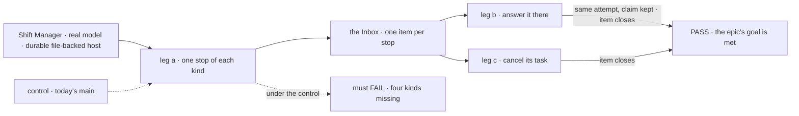
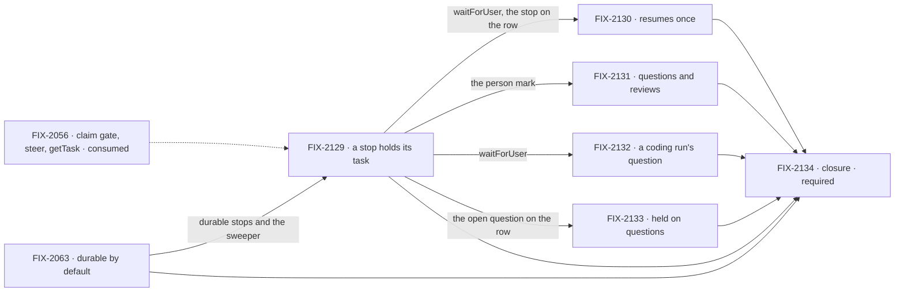

# FIX-2058 · One "waiting on a person": every stop is one Inbox item

**Spec** · [Decisions](DECISIONS.md)

## Five teams, before and after

| A team that… | Today | After this epic |
|---|---|---|
| **uses Shift Manager** | The Inbox lists approvals and input. A question or review parks where it can't see it; a coding run's question has no screen | Every stop waiting on them is one Inbox item, answered there, on the same attempt |
| **builds a worker that files work** | Answers its task's question with `answerTask`, a second tool; can't ask before a task starts | Answers a midway question with a steer, first answer wins; files a task held on questions |
| **writes a flow that asks a person** | An approval expires only as a rejection; a question has no deadline; a user's stop leaves the board unaware | One `waitForUser({ kind, deadline? })`; the flow decides at the deadline; a cancel or a stop closes the item |
| **runs flows locally or self-hosted** | `fsdev run` with no app config refuses to stop for a person | Durable execution by default on file-backed hosts |
| **maintains the framework** | Six forms of stopping for a person, three answer paths | One suspension, one held start, one answer path |

**Why now.** FIX-2056 is in its last PRs (#3698, #3701). Its claim gate already records a person's
stop on the row (FIX-2077), a steer exists (FIX-2086), and the renames (FIX-2071) wait for this.

## The goal, and how we'll know it's met

**A person sees every stop that is waiting on them as one Inbox item and answers it in one place,
and the answer carries on the same attempt:** an approval, a question, a review, a coding run's
question and a task held on questions.

The bar is rules 11 and 12 of
[`workforce-coordination-concept.md`](../../../docs/internal/design/workforce-coordination-concept.md#inbox-items);
the scope is the nine *2 · One Inbox* rows of
[`workforce-coordination-gaps.md`](../../../docs/internal/design/workforce-coordination-gaps.md#where-todays-code-differs),
less the message half of the last, now FIX-2070's.

| Is it the right goal? | |
|---|---|
| **The real need** | Six forms of stopping for a person ([the reduction check](https://claude.ai/artifact/QNetb3YFwTCAypMm1EkE4M)) become one. Goal 4: a person shouldn't hunt for what waits on them |
| **Smaller, and rejected** | "Questions and reviews show in the Inbox." FIX-2131 alone meets it, while a coding run's question has no screen and a task can't ask before it starts |
| **Not done if** | A park or the harness inbox still answers a stop · an answer starts a new attempt · a cancelled task's item stays open · a local host refuses a stop · a closure bug is open |

Leg a is where today's `main` fails: a question, a review and a coding run's question never reach
the Inbox, and a held task can't be filed.

| How we verify | |
|---|---|
| **Goal check** | The closure issue's (FIX-2134), real model, in Shift Manager, on one `main` commit after every other child merges |
| **Signal** | Leg a: each of the five kinds shows as one item. Leg b: an Inbox answer resumes the same attempt with its claim. Leg c: cancelling the task closes its item. A sweep: `answerTask`, `parkOnQuestion`, `awaitReview`, `unparkAndDrain` and harness-manager's `answerQuestion()` have no references in package source |
| **Anti-game** | Assert on what the Inbox shows and on rows read through public task actions |
| **Control that must fail** | Today's `main`: leg a and the sweep. Every other check names its control, and each is run red at least once: a control never seen failing proves nothing |

**Lead measure:** the set's goal-proven children, named. **None today**, of FIX-2063 and FIX-2129
to FIX-2133.

**Not doing:**

- **Telling the filer its task's midway question** by a message to its `receive`: moved to
  FIX-2070. The row still records the question, so `getTask` and `listTasks` show it (FIX-2129).
- **The renames** (FIX-2071).
- **Replaying a request suspended across a deploy:** a known risk, deferred.
- **Serverless hosts without durable execution** ([D1](DECISIONS.md#d1)).
- **An Inbox redesign** beyond listing every stop.

**Kill line:** if FIX-2063 can't make durable execution the default on dev, local and self-hosted
hosts, retiring the parks takes away stopping for a person there. We stop before any park is retired.

## What's in the box

Inside the box is what a flow gets by calling one function; below the fence is the Not doing list.

**Docs:** the durable-execution guide and the task-board page teach one way to stop for a person.
FIX-2131 publishes it; FIX-2063 documents the durable default. Each child documents its own specifics.

## The set · as of 2026-10-23

The reviewed snapshot; live state is in Linear. FIX-2056 blocks every child too.

| Issue | Delivers | Blocked by |
|---|---|---|
| [FIX-2063](https://linear.app/fixpoint-labs/issue/FIX-2063) · durable by default | Durability and the sweeper with no app config; a host without it refuses a stop loudly. Stays in Developer Tools | — |
| [FIX-2129](https://linear.app/fixpoint-labs/issue/FIX-2129) · a stop holds its task | `waitForUser`; the person mark keyed on it; the claim across a resume; the row's record of its stop | FIX-2063 |
| [FIX-2130](https://linear.app/fixpoint-labs/issue/FIX-2130) · resumes once | Answered, deadline or cancelled; a user's stop cancels the task | FIX-2063, FIX-2129 |
| [FIX-2131](https://linear.app/fixpoint-labs/issue/FIX-2131) · questions and reviews | Retires both parks, `answerTask`, `unparkAndDrain`; a steer answers; the Inbox lists both | FIX-2063, FIX-2129 |
| [FIX-2132](https://linear.app/fixpoint-labs/issue/FIX-2132) · a coding run's question | The coding flow's request suspends; the harness inbox goes | FIX-2063, FIX-2129 |
| [FIX-2133](https://linear.app/fixpoint-labs/issue/FIX-2133) · held on questions | Asked at filing, one item, the last answer releases it | FIX-2063, FIX-2129 |
| [FIX-2134](https://linear.app/fixpoint-labs/issue/FIX-2134) · closure · **required** | The QA plan, on one `main` commit | every other child |

Six and a closure. The one I'd cut is FIX-2129: FIX-2077 already marks a person's stop and drops
the lease, leaving `waitForUser` and the row's record. It stays because four children build on that
call; if its spec finds only the record, it folds into FIX-2131. FIX-2133 the owner kept.

## How the issues flow into each other

An edge is what one issue hands the next; the dashed input is consumed, not owned. FIX-2063 and
FIX-2056 block every child, drawn once through FIX-2129; after it, four run in parallel.

## What stays as it is

- **Approval and input suspensions** and the resume route: they become `waitForUser`'s kinds.
- **A coding run resuming its coding session** (`harness-manager/src/door.ts:15-20`).
- **FIX-2113's serialization** of a request waiting on its own plan step (#3696).
- **Messages** until FIX-2070; **the words** until FIX-2071.

## What's already here, and the debt

| Already here | What the set does with it |
|---|---|
| FIX-2077 D1: an approval or input stop records `waitingOn: "person"`, drops the lease, and the resume completes the same attempt (`orchestration/src/task-board/task-request.ts:298-310`) | **Builds on.** The gaps row saying the row lapses (`task-entry.ts:533-537`) predates it |
| [FIX-2056 D2](../FIX-2056/DECISIONS.md#d2): marking the task and answering by steer are this epic's | **Kept and finished** by FIX-2129 and FIX-2131 |
| [FIX-2056 (e)](../FIX-2056/DECISIONS.md#e): its closure sweep allows `answerTask` and `parkOnQuestion` until this epic (`rules.mjs`, on `fix/FIX-2087`) | **Ended** by FIX-2131 |
| [FIX-2056 D3](../FIX-2056/DECISIONS.md#d3): retired rows read through FIX-2080's one map | **Extended** to parked rows ([ER-5](DECISIONS.md#who-owns-what)) |
| #3696: a parked request gives back the session's reply-line key | **Kept**; the row's mark holds a person's stop instead ([D2](DECISIONS.md#d2)) |
| `PERSON_REASONS` (`shift-manager/src/lib/reads.ts`) and the gate's `stopOf`: two copies of "is it a person's stop" | **Replaced** by one predicate ([ER-1](DECISIONS.md#who-owns-what)) |

| The debt | |
|---|---|
| **Removes** | Both parks, the harness question inbox, `answerTask`, `unparkAndDrain`, `answerQuestion()`, a second person-stop check |
| **Adds** | `waitForUser`, held on questions, a default deadline for a person's stop, map entries until FIX-2071 |

**Net: down.** Six forms and three answer paths become one suspension, one held start and one answer.

## Sign off

**[The goal](#the-goal-and-how-well-know-its-met):** five kinds, one Inbox, the same attempt.
If wrong: we wrap with a stop a person still can't find. **[The debt](#whats-already-here-and-the-debt):**
net down. If wrong: map entries nobody reads.

1. **[D1](DECISIONS.md#d1) · Durable execution by default comes first; no park survives as a
   fallback.** If wrong: a host we care about loses stopping for a person.
2. **[D2](DECISIONS.md#d2) · The row's person mark, not the reply-line key, keeps a task's turns
   apart across a stop.** Engineering, decided. If wrong: a steer runs beside a waiting request.

**Decided by the owner:** the five objective lines; FIX-2133 kept; the filer's message to FIX-2070;
[no shim for in-flight states](DECISIONS.md#decided-in-review-recorded-so-no-child-reopens-them).

**Open, the owner's:** [how long a person has to answer by default](DECISIONS.md#open).

Epic · 6 issues and a closure · Orchestration Primitives · Goal 4, keep the foundation honest · Goal 2, differentiate on hard problems
