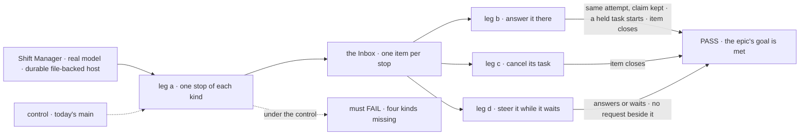
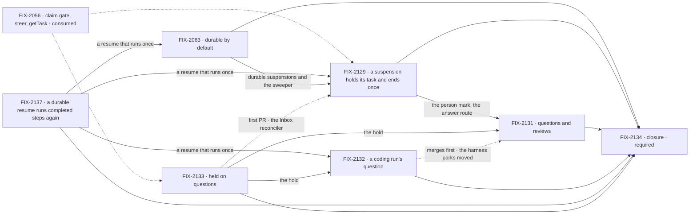

# FIX-2058 · One "waiting on a person": every stop is one Inbox item

**Spec** · [Decisions](DECISIONS.md)

## Five teams, before and after

| A team that… | Today | After this epic |
|---|---|---|
| **uses Shift Manager** | The Inbox lists approvals and input. A question or review parks where it can't see it; a coding run's question has no screen | Every stop waiting on them is one Inbox item, answered there, on the same attempt |
| **builds a worker that files work** | Answers its task's question with `answerTask`, a second tool; can't ask before a task starts | Answers a midway question with a steer, first answer wins; files a task held on questions |
| **writes a flow that asks a person** | An approval expires only as a rejection; a question has no deadline; a user's stop leaves the board unaware | One `waitForUser({ kind, prompt, deadline? })`, with no deadline unless the call or the host sets one; the flow decides at a deadline; a cancel or a stop closes the item |
| **runs flows locally or self-hosted** | `fsdev run` with no app config refuses to stop for a person | Durable execution by default on file-backed hosts |
| **maintains the framework** | Six forms of stopping for a person, three answer paths | One suspension, one list of holds per task, one trusted route per kind ([ER-7](DECISIONS.md#who-owns-what), [ER-8](DECISIONS.md#who-owns-what)) |

**Why now.** FIX-2056 is in its last PRs (#3701, and #3692, its closure). Its claim gate already records a person's
stop on the row (FIX-2077), a steer exists (FIX-2086), and the renames (FIX-2071) wait for this.

## The goal, and how we'll know it's met

**A person sees every stop that is waiting on them as one Inbox item and answers it in one place,
and the answer carries on the same attempt, or for a task held on questions, starts its first:**
an approval, a question, a review, a coding run's question and a task held on questions.

The bar is rules 11 and 12 of
[`workforce-coordination-concept.md`](../../../docs/internal/design/workforce-coordination-concept.md#inbox-items);
the scope is the nine *2 · One Inbox* rows of
[`workforce-coordination-gaps.md`](../../../docs/internal/design/workforce-coordination-gaps.md#where-todays-code-differs),
less the message half of the last, now FIX-2070's.

| Is it the right goal? | |
|---|---|
| **The real need** | Six forms of stopping for a person ([the reduction check](https://claude.ai/artifact/QNetb3YFwTCAypMm1EkE4M)) become one. Goal 4: a person shouldn't hunt for what waits on them |
| **Smaller, and rejected** | "Questions and reviews show in the Inbox." FIX-2131 alone meets it, while a coding run's question has no screen and a task can't ask before it starts |
| **Not done if** | A park or the harness inbox still answers a stop · an answer to a stop starts a new attempt · a steer runs beside a waiting request · a cancelled task's item stays open · a local host refuses a suspension · a stop with no deadline set ends unanswered · a closure bug is open |

Leg a is where today's `main` fails: a question, a review and a coding run's question never reach
the Inbox, and a held task can't be filed. Leg b fails there too for any stop in a task's request:
the public resume route refuses a `task` source (`engine/src/routes/resume-routes.ts:111-117`), so
the Inbox shows the item as unanswerable (`shift-manager/src/lib/reads.ts:834-839`).

| How we verify | |
|---|---|
| **Goal check** | The closure issue's (FIX-2134), real model, in Shift Manager, on one `main` commit after every other child merges |
| **Signal** | Leg a: each of the five kinds shows as one item. Leg b: an Inbox answer resumes an approval's or a review's same attempt with its claim, and a held question's answer restarts the work from its brief on the same attempt, a task held before it starts on its first. Leg c: cancelling the task closes its item. Leg d: a steer into a suspended task waits for the resume, and no request runs beside it; a steer naming a held question answers it, and one naming none answers nothing. A sweep: `answerTask`, `parkOnQuestion`, `awaitReview`, `unparkAndDrain` and harness-manager's `answerQuestion()` have no references in package source |
| **Anti-game** | Assert on what the Inbox shows and on rows read through public task actions |
| **Control that must fail** | Today's `main`: leg a, leg b for a task's suspension, and the sweep. Every other check names its control, and each is run red at least once: a control never seen failing proves nothing |

**Lead measure:** the set's goal-proven children, named. **None today**, of FIX-2063, FIX-2129,
FIX-2131 to FIX-2133 and FIX-2137.

**Not doing:**

- **Telling the filer its task's midway question** by a message to its `receive`: moved to
  FIX-2070. The row still records the question, so `getTask` and `listTasks` show it (FIX-2133).
- **The renames** (FIX-2071).
- **Replaying a request suspended across a deploy:** a known risk, deferred.
- **Serverless hosts without durable execution** ([D1](DECISIONS.md#d1)).
- **An Inbox redesign** beyond listing every stop.
- **A hold released by an event, and `ctx.waitForEvent`.** A hold stores its releasers from the start, so a later epic adds one without a migration ([ER-8](DECISIONS.md#who-owns-what), owner, relayed 2026-10-25).

**Kill line:** if FIX-2063 can't make durable execution the default on dev, local and self-hosted
hosts, retiring the review park takes away stopping for an approval or a review there. We stop before
it is retired. Questions hold their task on the row and don't need durable execution.

## What's in the box

Inside the box is what a flow gets by calling one function; below the fence is the Not doing list.

**Docs:** the durable-execution guide and the task-board page teach one rule for stopping for a person: suspend when code reads the answer next, hold the task on a question.
FIX-2131 publishes it; FIX-2063 documents the durable default. Each child documents its own specifics.

## The set · as of 2026-10-25

The reviewed snapshot; live state is in Linear. FIX-2056 blocks every child too.

| Issue | Delivers | Blocked by |
|---|---|---|
| [FIX-2063](https://linear.app/fixpoint-labs/issue/FIX-2063) · durable by default | Durability and the sweeper with no app config; a host without it refuses a suspension loudly. Stays in Developer Tools | FIX-2137, for the default flip |
| [FIX-2129](https://linear.app/fixpoint-labs/issue/FIX-2129) · a suspension holds its task and ends once | `waitForUser`, kinds approval, review and input; the person mark keyed on it; the claim across a resume; the row's record of its stop (#3866; FIX-2133 moves it onto a hold); the Inbox's one answer route; answered, deadline or cancelled, and a user's stop cancels the task | FIX-2063; FIX-2137 (Done), for approval resumes; FIX-2133's first PR, the Inbox reconciler (soft) |
| [FIX-2131](https://linear.app/fixpoint-labs/issue/FIX-2131) · questions and reviews | A review suspends; a midway question holds its task ([ER-8](DECISIONS.md#who-owns-what)); retires both parks, `answerTask`, `unparkAndDrain`; a steer answers a question; the Inbox lists both | FIX-2063, FIX-2129, FIX-2133; merges after FIX-2132, which moves the harness parks off the shared park this removes |
| [FIX-2132](https://linear.app/fixpoint-labs/issue/FIX-2132) · a coding run's question | The question holds its task; the answer, a steer, starts the next run in the same coding session; the harness inbox goes; LAB-162's park is superseded | FIX-2133; FIX-2137 (Done): a host's own harness block may still suspend ([FIX-2132 D1](../../issues/FIX-2132/DECISIONS.md#d1)) |
| [FIX-2133](https://linear.app/fixpoint-labs/issue/FIX-2133) · held on questions | One list of holds per task, `holds[]` ([ER-8](DECISIONS.md#who-owns-what)). First, #3854 reshaped: the Inbox as one item type over open holds, an orchestration read, and the reconciler every child's acceptance runs. Then the row holds, questions and `confirm`, before start and midway, with the suspension's mirror moved from FIX-2129's `waitingFor` as its first change: the claim gate refuses a row with an open hold, it can't settle, one item, the last answer or a set deadline releases it | — |
| [FIX-2137](https://linear.app/fixpoint-labs/issue/FIX-2137) · a durable resume runs completed steps again · bug | A durable resume with trace observability off no longer runs its completed steps again. Direct route: no spec, a fix PR | — |
| [FIX-2134](https://linear.app/fixpoint-labs/issue/FIX-2134) · closure · **required** | The QA plan, on one `main` commit | every other child |

Six and a closure. FIX-2137 is a bug on the direct route, so it has no spec PR; it joined after the
merge (owner, 2026-10-23). FIX-2130 folded into FIX-2129 in review: a `waitForUser` shipped without its
deadline, cancel and stop is no contract for the three children after it to test against, and
FIX-2129 alone was thin. FIX-2133 the owner kept.

## How the issues flow into each other

An edge is what one issue hands the next; the dashed input is consumed, not owned, and the dashed
edge from FIX-2132 to FIX-2131 is merge order only: FIX-2131 builds in parallel and merges after it. The dashed edge from FIX-2133 to FIX-2129 is a soft one, on FIX-2133's first PR only, the reconciler FIX-2129's acceptance runs; it costs nothing, since FIX-2129 already waits on FIX-2063.
FIX-2137, Done, stays on FIX-2132 because a host's own harness block may suspend. FIX-2056 blocks
every child, drawn into the two that start first. FIX-2063 blocks the two that suspend; FIX-2133's
hold needs neither it nor FIX-2129, and comes before the two that ask a question midway.

## What stays as it is

- **Approval and input suspensions** and the public resume route, for the sources it serves: they
  become `waitForUser`'s kinds.
- **A coding run resuming its coding session** (the harness's `resume` resolver,
  `harness-manager/src/manager.ts`).
- **FIX-2113's serialization** of a request waiting on its own plan step (#3696).
- **Messages** until FIX-2070; **the words** until FIX-2071.

## What's already here, and the debt

| Already here | What the set does with it |
|---|---|
| FIX-2077 D1: an approval or input stop records `waitingOn: "person"` (renamed `"user"` by FIX-2129; stores are reset, so the old value is not read; then moved onto a hold, below), drops the lease, and the resume completes the same attempt (`orchestration/src/task-board/task-request.ts:298-310`) | **Builds on.** The gaps row saying the row lapses (`task-entry.ts:533-537`) predates it |
| [FIX-2056 D2](../FIX-2056/DECISIONS.md#d2): marking the task and answering by steer are this epic's | **Kept and finished** by FIX-2129 and FIX-2131 |
| [FIX-2056 (e)](../FIX-2056/DECISIONS.md#e): its closure sweep allows `answerTask` and `parkOnQuestion` until this epic (`rules.mjs`, on `fix/FIX-2087`; on `main` with FIX-2056's closure, before any child starts) | **Ended** by FIX-2131 |
| [FIX-2056 D3](../FIX-2056/DECISIONS.md#d3): retired rows read through FIX-2080's one map | **Unchanged:** no entry for parked rows, since stores are reset and nothing persisted before this work is read ([ER-5](DECISIONS.md#who-owns-what)) |
| #3696: a parked request gives back the session's key | **Kept**; the row's open hold holds a person's suspension instead ([D2](DECISIONS.md#d2)) |
| FIX-2129 (#3866): a stop in a task run writes `waitingOn: "user"` and `waitingFor` on the row, answered through the engine route | **Moved** onto a `source: "suspension"` hold, the first change of FIX-2133's second PR; the engine and the route stay ([ER-8](DECISIONS.md#who-owns-what)) |
| FIX-2133's first PR (#3854, open, held): one Inbox list of two arms, `reconcileInbox` with `bothArms`, an `INBOX_READ` sweep rule, the read in Shift Manager | **Reshaped** onto one item type over open holds, read by orchestration; `bothArms` becomes a drift check and most of the sweep rule goes ([the Inbox seam](DECISIONS.md#coordination-seams)) |
| Three copies of "is it a person's stop": the gate's `stopOf` (`task-request.ts`), `PERSON_REASONS` (`shift-manager/src/lib/reads.ts`) and the Lab send's own `stopOf` on it (`send.ts`) | **Replaced** by one predicate in `contracts` ([ER-1](DECISIONS.md#who-owns-what)) |
| The Inbox can't answer a stop in a task's request: the public resume route refuses a `task` source, and opening it would re-enter a task's handler with caller data (BP-031) | **Replaced** by one trusted route per kind ([ER-7](DECISIONS.md#who-owns-what)), FIX-2129 |
| [LAB-162](https://linear.app/fixpoint-labs/issue/LAB-162) ([#1612](https://github.com/fixpoint-labs/flow-state-dev/pull/1612), closed unmerged as superseded): a coding run's question parks its task and is answered through the harness inbox; worker suspension is in its Not doing ([its D2](https://github.com/fixpoint-labs/flow-state-dev/blob/epic/pi-harness/specs/epics/LAB-162/DECISIONS.md#d2), on FIX-1241 D-1) | **Superseded** by FIX-2132 and [D1](DECISIONS.md#d1); this epic keeps shared harness dispatch and a coding run continuing its saved session. LAB-164 closes as superseded on this epic's approval; LAB-163, the OMP slot, needs a fresh spec on `waitForUser` if still wanted ([decided in review](DECISIONS.md#decided-in-review-recorded-so-no-child-reopens-them)) |

| The debt | |
|---|---|
| **Removes** | Both parks, the harness question inbox, `answerTask`, `unparkAndDrain`, `answerQuestion()`, two extra person-stop checks, the Inbox's unanswerable task stops, the row's `waitingOn: "user"` and `waitingFor` (moved onto the hold) |
| **Adds** | `waitForUser`, one list of holds per task with one pure write both store backings call, a suspension's mirror on it and the `confirm` kind ([ER-8](DECISIONS.md#who-owns-what)), one Inbox item type with one answer call routed by `source`, read by orchestration with a browser client, an opt-in host deadline for a person's stop, unset by default ([D3](DECISIONS.md#d3)), one trusted answer route |

**Net: down for authors, up on the row.** An author meets fewer forms and fewer answer routes: six forms and three answer paths become one suspension, one list of holds and one trusted route per kind (ER-7). The row gains `holds[]`, the suspension's mirror and a drift check to keep them in step, which is FIX-2133's *Net: up, by design*.

## Sign off

**[The goal](#the-goal-and-how-well-know-its-met):** five kinds, one Inbox, the same attempt.
If wrong: we wrap with a stop a person still can't find. **[The debt](#whats-already-here-and-the-debt):**
net down. If wrong: a second path to a person survives somewhere.

1. **[D1](DECISIONS.md#d1) · Durable execution by default comes first; no park survives as a
   fallback.** Questions hold their task instead and need neither. If wrong: a host we care about
   loses approvals and reviews.
2. **[D2](DECISIONS.md#d2) · The row's open hold, not the session's key, keeps a task's requests
   apart across a suspension.** Engineering, decided; messages stay rule 10's. If wrong: a steer runs
   beside a waiting request.
3. **[D3](DECISIONS.md#d3) · A person's stop has no deadline by default;** a host setting or a
   call's `deadline` opts in. The owner's, decided 2026-10-24, approvals included (confirmed).
   If wrong: unanswered stops sit in the Inbox until someone sets the host setting.

**Decided by the owner:** the five objective lines; FIX-2133 kept;
[questions hold their task, approvals, reviews and input suspend](DECISIONS.md#d1) (2026-10-23); the filer's message to FIX-2070;
[no shim for in-flight states, and no old data read: stores are reset](DECISIONS.md#decided-in-review-recorded-so-no-child-reopens-them);
#1612 closed as superseded; D3, no default deadline, and a held question going ahead from its brief at a set deadline (2026-10-24).

**Decided in review, engineering:** FIX-2130 folded into FIX-2129; LAB-162's park superseded;
`waitForUser` on the person suspensions, not the wait gate, resuming with `cancelled`; one trusted
answer route (ER-7).

**Decided by the owner, relayed 2026-10-25:** one list of holds per task; the engine unchanged and
mirrored; questions and `confirm` as row holds; event releasers out of this epic
([Amendment](DECISIONS.md#amendment--2026-10-25--one-list-of-holds-per-task)).

**Open:** the owner's confirmation of that relayed decision, which is this amendment's direction
gate, and where `confirm` stops and an approval starts ([Open](DECISIONS.md#open)).

Epic · 6 issues and a closure · Orchestration Primitives · Goal 4, keep the foundation honest · Goal 2, differentiate on hard problems
