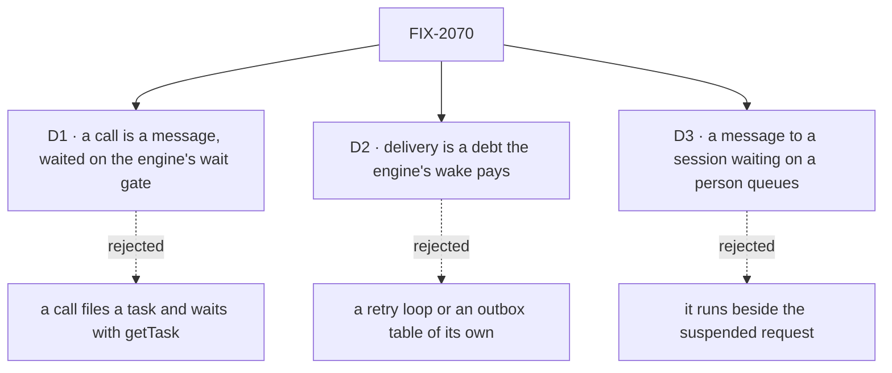

# FIX-2070 · Decisions

[Spec](SPEC.md) · **Decisions**

The calls above any one issue. The owner decided the model in
[`workforce-coordination-concept.md`](../../../docs/internal/design/workforce-coordination-concept.md#messages)
(the Messages section, rules 10, 11 and 21). D1 reads the project's PR-2 against it and needs the
owner's confirmation; D2 and D3 carry the model out. Open: D1's reading of PR-2, which the owner
confirms by merging this spec ([Open](#open)).

## The tree

## D1 · A call is a message, waited on the engine's wait gate, not a task

*Needs the owner's confirmation: it reads the project's PR-2 and PD-3 against the concept.*

| | |
|---|---|
| **Instead of** | A call filing a task for the recipient and waiting on it with `getTask({ id, wait })` |
| **Because** | A call asks for an answer in words that the asking request uses next: "does the CSV have a month column?" It owes no tracked ending, no attempt, no retry and no Inbox item. A task would give that question a row nobody tracks, which is the reason PD-3 itself gives against "a task for every post". The concept already has calls: rule 10, stories M-02 and M-11, and the decision dropping the refusal of a call into a waiting session |
| **How** | `sendMessage({ to, text, wait: true, deadline? })` dispatches to the recipient's `onMessageReceived` and parks on the engine's wait gate, bound to the request it started (FIX-2082's `dispatcher({ wait: true })`). The call's result is that request's output. At the deadline the caller resumes with `running` and stops nothing. The late result is the request's own record: the message row keeps the id of the request its delivery became, so the call id (the message id) finds it, and waiting again or repeating the call returns it. Nothing else is stored. A call counts toward rule 9's five waits deep |
| **Reads PR-2 as** | PR-2 says a post that expects an answer is a task. This epic reads it as tracked work: anything that needs attempts, a retry or an ending told to its filer is still a task. A call is talk that waits. PD-3's "no model-facing tool for tells" is read the same way: `sendMessage` replaces `messageWorker` (FIX-1989) as the one message tool and adds no second one. The amended PR-2 and PD-3 wording goes on the project spec (#3102) with this spec's approval, not at wrap, so every child's spec review reads the rule as approved: "Tracked work (attempts, a retry, an ending owed to its filer) is a task. A call is talk that waits on the wait gate and is owed no tracked ending" (concept rule 9) |
| **Locks in** | [ER-4](#who-owns-what). The tool's description says which to use: call for an answer now, a task for work to track |

**What would change my mind:** the closure run showing workers calling for work that needed a
retry, or calls timing out where a task would have finished. Then a call is narrowed to questions
the recipient answers from its own session, or dropped.

It comes down to what a question owes: a task gives an answer in words a row, an attempt and a retry it never uses.

## D2 · Delivery is a debt the engine's wake pays, not a retry loop of its own

*An engineering call, decided under the epic's posture; recorded because the call and the budget
both send through it.*

| | |
|---|---|
| **Instead of** | A retry loop in the send, as today's two tries are, or an outbox table beside the message log |
| **Because** | A crash between the log row and the dispatch loses a message that a loop in the request can't resend: the request is gone. Only a due time the engine keeps survives it. The engine has one: a wake (FIX-2078), which it fires as an internal entry until a pass clears it, durable by default since FIX-2063 |
| **How** | The same shape as a task's ending (`orchestration/src/tasks/notice/delivery.ts`, FIX-2078): owe the wake first, write, then the fast path, and the wake's pass resends whatever the fast path left owed. The wake is the sender's session's existing one, and its debt is paid in that session board's existing `dispatch` pass (`workforce/src/conversation-board/delivery.ts`), so no new wake kind is added. A delivered or refused message clears the debt; the pass resends only a row whose `status` is still `unconfirmed`. `onMessageReceived` acts on a message id once, and the evidence it checks must last as long as the message's debt: a recipient can act on a message and the sender crash before marking the row delivered, and FIX-1989's per-session window (`MAX_SEEN`, 500 ids) can evict the id before a resend (a debt lives up to `maxDebtAgeMs`, 24 h). So the bounded window alone does not meet the once rule; FIX-2240's spec picks durable evidence, such as the id of the request a delivery became, already kept on the row. A refusal is final and returned to the sender (rule 10). The log row is the record; nothing else is stored. A resend is the same dispatch as the first, so it queues behind a busy or waiting session the same way (ER-4) |
| **Not a second once-only check** | PR-2's "the claim ticket is the only once-only check" is about claiming work. The dedupe is a delivery's idempotency, already on `main` since FIX-1989, and claims nothing |
| **Host posture** | Delivery once needs wakes, which durable execution provides by default wherever stores persist (FIX-2063). A host without them, a serverless one, delivers on the first dispatch only; that is in the Not doing list, as FIX-2058's D1 does for suspensions |
| **Locks in** | [ER-5](#who-owns-what) |

**What would change my mind:** a wake that can't carry a dispatch into another session's flow.
Then the resend is the sender's own internal entry, fired by the same wake.

It comes down to a crash after the log write: only a due time the engine keeps resends what the request can't.

## D3 · A send or a call to a session waiting on a person queues

*FIX-2058 D2 left this call here. Rule 10 as written; decided under the epic's posture.*

| | |
|---|---|
| **Instead of** | Letting a message run in a session whose request is suspended for a person, since the request gives the session's key back |
| **Because** | A person's answer resumes the suspended request at the same step, reading the session as it left it. An `onMessageReceived` running in between can change that session's state and history under it. Rule 10 already says a waiting session queues, and FIX-2058 kept the row's open hold, not the key, as what keeps a task's requests apart |
| **Not free** | The engine's `defer` policy does not hold a suspended session: a suspension gives its place back. `onMessageReceived`'s admission must read the session's open person suspension itself, through FIX-2058 ER-1's one predicate, `isUserSuspension` (`contracts/src/types/suspension.ts`); FIX-2239 builds it (ER-4) |
| **Locks in** | [ER-4](#who-owns-what): a call into a waiting session waits no longer than its deadline. The model's tool says when the recipient is waiting on a person, so the caller can send instead of calling |

**What would change my mind:** a lab that needs to talk to a worker while it waits on a person,
such as asking a coder "what are you waiting for?". Then an `onMessageReceived` that only reads runs beside it.

## Who owns what

A *uses* cell is a place a child must not re-decide.

| # | Rule every child obeys | Owner | Checked at |
|---|---|---|---|
| ER-1 | Every worker hears another worker's message on one entry, `onMessageReceived`, input `{ id, from, text, call, inReplyTo?, budget }`, where the server sets `from`, `call` (the sender waits on this) and `budget` from the sending request and the message row, never from tool input (BP-031). One tool sends: `sendMessage({ to, text, wait?, deadline?, inReplyTo? })`, and waits again on a call with `sendMessage({ callId, deadline? })` ([FIX-2239 D1](../../issues/FIX-2239/DECISIONS.md#d1)). Nothing is relayed or answered automatically. Every worker flow carries `onMessageReceived`, and the hire checks it; every coordinator runs its own `onMessageReceived`, whatever its routing | FIX-2238 | Every later spec review; the closure's sweep |
| ER-2 | Where a message lands: the recipient's default conversation with this user (the project's conversation for the project coordinator, from work in that project); a message to the worker that filed your task, in the session that filed it; an answer (`inReplyTo`), in the session that sent the original, even if its task has ended; a `{ task }` message, in that task's session. A message never steers, holds no claim, isn't part of a task, and an error in it is its own. Into a session whose task's turn is running, it runs after that turn | FIX-2238; FIX-2160 builds the `{ task }` leg | FIX-2160's and FIX-2241's spec review; legs b and e |
| ER-3 | The server resolves every target to a session within the sending session's tenant and checks it before anything is written: a worker on the user's roster; a task of the user's; a `{ session }` that is a conversation of the sender's user, in the sender's org, of a worker still on the roster and on that session's flow, never a task or delegate session; the sender's own name is refused, a different session of its own is not | FIX-2160 | Leg b; the closure's refusal checks |
| ER-4 | A call waits on the engine's wait gate for the `onMessageReceived` request's result, up to its deadline, the host's wait default unless passed; a late result is that request's record, found by the call id. A send or a call to a busy or waiting session queues until its current request ends, through the engine's existing `defer` concurrency policy (as `onMessageReceived`'s entry runs today, `AFTER_REPLY_CONCURRENCY`), never a queue store of its own. That policy alone covers a busy session only: a request that suspends gives its place back (`engine/src/transports/concurrency/arbiter.ts`), and another request may start during the suspension (`engine/test/transports/resume-concurrency.test.ts`). So `onMessageReceived`'s admission also holds while the session has a request suspended for a person, read from that session's open person suspension with `isUserSuspension` (`contracts/src/types/suspension.ts`, FIX-2058's ER-1; a task's session reads its row's open hold, FIX-2058's ER-2), and runs once the suspension resumes; FIX-2239 builds that admission check; a call waits no longer than its deadline; a session waiting on a person is waiting. A caller parked on a call is on the wait gate, never a person's stop: PR-3's one Inbox item and the board's `waiting-on-a-user` never count it ([D1](#d1), [D3](#d3)) | FIX-2239 | Leg a |
| ER-5 | A message lands once: the send owes a debt on its session's wake until the message is delivered or refused, the board's `dispatch` pass resends a row still `unconfirmed`, and `onMessageReceived` acts on its id once. The evidence for "once" lasts as long as the debt, not a bounded window. A refusal is final ([D2](#d2)) | FIX-2240 | Leg c |
| ER-6 | One budget per message a user types: 6 messages, shared by every request descending from it through messages, calls and filed tasks; at most 3 per request; a held task released and started gets a fresh 6; a message is paid when it passes the send's checks and its row is written, before delivery; a send refused before that pays nothing. No session starts a chain of its own except a user's turn, a released held task, and a request with nothing behind it (one no turn, message or task carries a chain into). The budget is today's hop chain (`messages/hop.ts`, `hireWorkforce`'s `hopLimit` and `perTurn`) carried forward, not a new counter. Only messages spend it: filing a task never does, and the server-sent midway question (FIX-2241) is exempt, so a spent budget never keeps a question from its filer | FIX-2238 | Leg d |
| ER-7 | Removed outright, with no alias or warning: `onWorkerMessage`, `messageWorker`, `replyTo`, `workforceRelayTo`, `takes_tasks_only`, `no_turn` ([FIX-2056 (e)](../FIX-2056/DECISIONS.md#e)). Other renames are FIX-2071's (its D4 agrees name for name), and no child renames anything else | FIX-2238 | FIX-2249 adds the names to `RETIRED`; the closure's sweep |

## Coordination seams

| Seam | Owner, then who else touches it |
|---|---|
| The send path (`workforce/src/messages/send-message.ts`) | FIX-2238 rebuilds it for `sendMessage` and the landing rules. FIX-2160 adds target resolution before the limits; FIX-2239 adds the wait after the dispatch; FIX-2240 replaces the two tries with the wake. FIX-2238 moves the hop count onto the budget. Their specs run in parallel on FIX-2238's merge; their implementation PRs land in a fixed order, FIX-2238, then FIX-2160, then FIX-2240, then FIX-2239, then FIX-2241's Workforce send, each stacked on the one before (GitHub stacks), so no two rebase over each other |
| The message row (`workforce/src/messages/log-row.ts`, pinned pattern `workforce/messages/*`) | FIX-2238 renames `replyTo` to `inReplyTo` on the row and drops `answerTo`. FIX-2160 adds the target kind as `addressedBy` (`task` or `session`; absent for a worker's name) and the task id `toTask`. Stores are reset between the refactor epics, so no old row is read (as FIX-2058's ER-5). FIX-2240 adds the delivery's take and resend record (`takenBy`, `deliveredAs`, `resent`, `toldAt`, `toState`; the owed ids live in the sending session's state and the next send in the pass's request state, [FIX-2240](../../issues/FIX-2240/DECISIONS.md#decided-not-asked)); FIX-2239 reads `deliveredAs` to find a late result, and adds `queuedBehind` for a message waiting behind a person |
| The session factory (`workforce/src/conversation-board/session-board.ts`) and the roles table (`workforce/src/worker-roles.ts`) | FIX-2238 spreads `onMessageReceived` into every worker flow and adds it to every worker's entries. No other child adds an entry |
| The question message (`orchestration`'s midway ask, FIX-2133's hold write) | FIX-2241 sends from the task's session after the hold is written, through `sendMessage`'s server path, never the model tool. The hold stays the record and the Inbox stays the answer's home (PR-3) |
| Shift Manager's conversation and Messages view (`shift-manager/src/`) | FIX-2238 draws a received message as its own item; FIX-2240 changes the Messages view's statuses (its fourth, `undeliverable`); FIX-2239 shows a call waiting; nothing else changes the view |
| FIX-2071 (renames, next epic) | Leaves the names in ER-7 alone; everything else in the gaps file's retired-terms table stays its own |

## Decided in review, recorded so no child reopens them

Settled from the sources before review:

- **`replyTo` becomes `inReplyTo`** in this epic, because it is `sendMessage`'s input and `onMessageReceived`'s
  field, not a later rename.
- **The hire checks `onMessageReceived`** in FIX-2238 (story W-01: "`onMessageReceived` joins the check in phase 4").
- **The project coordinator's project conversation** stays the landing for work in a project
  (`filingProjectAddressOf`), as the concept says.
- **A received message is its own item,** carrying `from`, the message id and `inReplyTo` (asked by
  FIX-2154 on this epic, 2026-10-23). FIX-2238 builds it.
- **FIX-2160 is a child,** re-scoped to `{ task }` and `{ session }`; its rule-21 conflict is settled by
  #3797.
- **No deprecation release** for the removed names ([FIX-2056 (e)](../FIX-2056/DECISIONS.md#e)).
- **`call`, not `waiting`,** on `onMessageReceived`'s input: "waiting" already means waiting on a person
  (rule 10, PR-3, `waiting-on-a-user`), and FIX-2183 keeps one word per hold state.
- **The entry is `onMessageReceived`, not `receive`** (the owner, 2026-10-27, after this spec
  merged; amended in FIX-2238's spec PR). Entries the system calls when something arrives are `on`
  plus the event, as `onTaskSettled` is; `respond` stays the one bare verb, the door a person uses.
  Derived names follow `onTaskSettled`'s: `messageReceivedEntry`, `MESSAGE_RECEIVED_ENTRY`.
  FIX-2071's renames table carries the row.
- **Waiting again takes the call id,** `sendMessage({ callId, deadline? })` (FIX-2239 D1, amended
  into ER-1 by FIX-2239's spec PR). Matching a repeat by its words would send again for a rephrased
  question, and the late result is "found by the call id" (D1).

## Open

- **D1's reading of PR-2** (a call is talk that waits; tracked work stays a task). The owner
  confirms it by merging this spec; if the owner rules a call must be a task, FIX-2239 is cut and
  `sendMessage` has no `wait`.

## Review rounds

Round 1 (cursor, 2026-10-27), folded: Open listed instead of "none"; D2 names task-notice
delivery as the shape to copy; the queue is the engine's `defer` policy; the host posture for
delivery; the call's kept result found through the request id on the row; when a message is paid;
the send-path children land stacked in a fixed order. Codex, on ad92c2d: `defer` alone lets a message run during a person's suspension, so ER-4 and D3 now give FIX-2239 the admission check that holds it. Not folded: merging FIX-2239 into FIX-2240
(the stack removes the rebase cost, and each keeps a small review); folding FIX-2160 into
FIX-2238 (FIX-2238 is already the largest); trimming ER-1 to ER-3 to deltas (they are the
ownership record); dropping FIX-2241 (the owner placed it here as its own deliverable).

FSD Architect, on 0f70ed8, folded: PR-2 and PD-3 amended on #3102 with this approval; D2's
send order stated once, paid in the board's existing `dispatch` pass, resending only `unconfirmed`
rows; `isUserSuspension` named, and a parked caller is never a person's stop; the budget moves to
FIX-2238 (it ships the field and rewrites the hop chain), leaving FIX-2240 delivery only; ER-7
checked at FIX-2249; `waiting` renamed `call`; the midway question exempt from the budget;
FIX-2152's stale rule-21 lines pointed here. Codex, on 8e6f7f9: the bounded dedupe window can evict an id a resend still needs, so the once evidence must outlive the debt (D2, ER-5).
