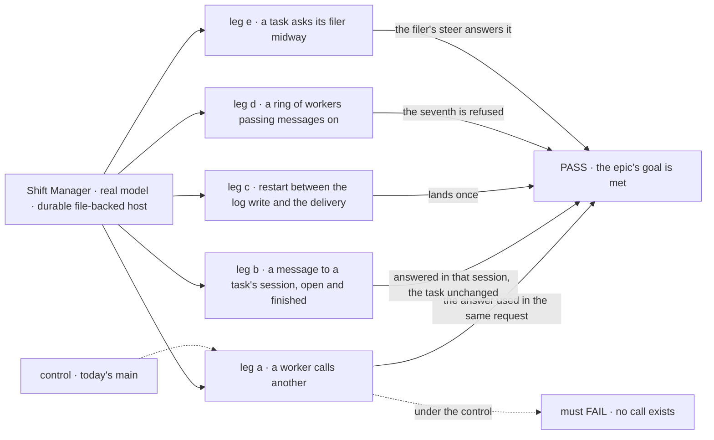
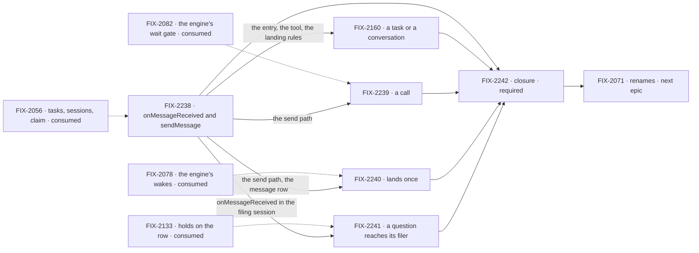

# FIX-2070 · Messages: send and call, to any worker, task or conversation

**Spec** · [Decisions](DECISIONS.md)

## Five teams, before and after

| A team that… | Today | After this epic |
|---|---|---|
| **uses Shift Manager** | A worker's message is a plain "From X: …" line in the recipient's conversation, away from the work it is about | It lands in the session it is about (the task's, the filer's, the one that asked) as its own item, with who sent it and what it answers |
| **builds a worker that talks to others** | `messageWorker` can't wait for an answer. A coder that only takes tasks, and a round-robin or everyone coordinator, can't be messaged. A woken worker's last text is sent back for it | `sendMessage` sends, or calls and uses the answer in the same request, to any worker, task or conversation of its user. Nothing is said for it |
| **builds a worker that files work** | Hears its task's midway question only by reading the row with `getTask` | Hears it as a message from the task's session, and may answer it with a steer |
| **runs Workforce in production** | Delivery gives up after two tries and leaves the message `unconfirmed`. A routed task's session starts a new chain at 0, outside the budget | A message lands once, a crash included. One budget per message a user types, with no way around it |
| **maintains the framework** | Two names for one job (`onWorkerMessage`, `messageWorker`), a relay, two refusals, a delivery with no resend | One entry, one tool, one budget, and delivery as a debt the engine's wake pays |

**Why now.** FIX-2056 (one task primitive) and FIX-2058 (one Inbox) have both wrapped, so a task's
session, its claim and its holds are settled ground. FIX-2058 moved telling a filer about its task's
question here. The renames (FIX-2071) wait on this epic alone, and the Grok Bot-style lab
(FIX-2154) waits on it to wire its talk cards.

## The goal, and how we'll know it's met

**A worker can message any worker, task or conversation of its user and, when it calls, use the
answer in the same request; every message lands once, in the session it is about, inside one
budget per message the user typed.**

The bar is the Messages section and rules 10, 11 and 21 of
[`workforce-coordination-concept.md`](../../../docs/internal/design/workforce-coordination-concept.md#messages);
the scope is the five *4 · Messages* rows of
[`workforce-coordination-gaps.md`](../../../docs/internal/design/workforce-coordination-gaps.md#where-todays-code-differs),
plus the message half of the *2 · One Inbox* question row, which FIX-2058 moved here.

| Is it the right goal? | |
|---|---|
| **The real need** | Workers talk the way the concept says, so a lab can be built on talk without its own plumbing. Goal 4: keep the foundation honest. The reduction check's message row goes from two names, a relay and two refusals to one entry and one tool |
| **Smaller, and rejected** | "Rename `messageWorker` to `sendMessage`." FIX-2238 alone meets it, while a worker still can't use an answer in the same request, a question about a finished task still lands away from the work, and a message is still lost after two failed tries |
| **Bigger, and not this epic's** | A lookup tool for a user's sessions, so a worker finds a `{ session }` id itself (the first version takes a pasted id, rule 21). A separate entry for proposing work (punted in the concept) |
| **Not done if** | A call can't return its result in the same request · a message to a finished task lands anywhere but that task's session · a message is lost or seen twice across a restart · a seventh message on one typed message is sent · a filer never hears its task's midway question · `onWorkerMessage`, `messageWorker`, `replyTo` or the relay is still in package source · a closure bug is open |

Leg a is where today's `main` fails first: `messageWorker` has no `wait`
(`workforce/src/messages/message-tool.ts`). Legs b, c and e fail there too: nothing addresses a
task, a twice-failed delivery is never resent (`workforce/src/messages/send-message.ts`, the two
tries), and a filer hears no question.

| How we verify | |
|---|---|
| **Goal check** | The closure issue's (FIX-2242), real model, in Shift Manager, on one `main` commit after every other child merges |
| **Signal** | Leg a: the caller's request reads the other worker's answer as the call's result (the coder hears only in its tasks' sessions, FIX-2238 D1, so it is reached by `{ task }`); past a short deadline it resumes without it, and waiting again returns the kept result. Leg b: the message runs as `onMessageReceived` in the task's session, with its history; an open task's turn finishes first, and the task's status, output and attempts don't change. Leg c: the server stops after the log row is written and before the dispatch; after the restart the recipient sees the message once. Leg d: the fourth message from one request and the seventh from one typed message are refused. Leg e: the midway question arrives at the filer's `onMessageReceived` in the session that filed the task; its steer releases the hold. A sweep: the removed names have no references in package source |
| **Anti-game** | Assert on what the recipient's session and the message log show, read through public actions; never on a child's own helper |
| **Control that must fail** | Today's `main`: legs a, b, c and e, and the sweep. Every other check names its control, and each is run red at least once |

**Lead measure:** the set's goal-proven children, named. **None today**, of FIX-2238, FIX-2160,
FIX-2239, FIX-2240 and FIX-2241.

**Not doing:**

- **A session lookup tool.** A `{ session }` id is pasted by the user in the first version (rule 21).
- **A message running in a session that waits on a person.** It queues, as rule 10 says ([D3](DECISIONS.md#d3)).
- **Delivery once on a host without wakes,** such as a serverless host without durable execution: there a message is delivered on its first dispatch only ([D2](DECISIONS.md#d2)).
- **Default worker instructions** (FIX-2073) and **a separate entry for proposing work** (punted in the concept).
- **The renames beyond this epic's own names** (FIX-2071). This epic removes `onWorkerMessage`,
  `messageWorker`, `replyTo` and `workforceRelayTo`, because it replaces what they name ([ER-7](DECISIONS.md#who-owns-what)).

## What's in the box

![In the box: one entry, onMessageReceived, with a server-set sender, call flag and budget; one tool, sendMessage, that sends or calls, to a worker, a task or a conversation; delivery once, as a debt the engine's wake pays; one budget per typed message; a task's midway question to its filer. Composed in by the app: the two limits through hireWorkforce, the host's wait deadline, and the Messages view. Replaced in one line: onWorkerMessage, messageWorker, replyTo, the relay and two refusals. Not built, below a fence: a session lookup tool, a message running beside a person's stop, and a proposal entry](figures/end-state.svg)

Inside the box is what every worker flow gets from the session factory; below the fence is the Not
doing list.

**Docs:** the Workforce guide's messaging page (`apps/docs/docs/workforce/messaging-workers.md`) teaches one rule: send to talk, call to use the answer
now, file a task for tracked work. FIX-2238 publishes it, and FIX-2239 adds the call. Each child
documents its own specifics.

## The set · as of 2026-10-27

The reviewed snapshot; live state is in Linear. FIX-2056 (Done) blocks every child.

| Issue | Delivers | Blocked by |
|---|---|---|
| [FIX-2238](https://linear.app/fixpoint-labs/issue/FIX-2238) · `onMessageReceived` and `sendMessage` | The entry, input `{ id, from, text, call, inReplyTo?, budget }`, server-set; the tool, send only; no relay; every worker and every coordinator receives, and the hire checks `onMessageReceived`; the landing rules; a received message as its own item; one budget per typed message, 6 and 3 per request, fresh for a released held task, paid when sent, carried on today's hop chain; the routed-task leak closed; the old names removed | — |
| [FIX-2160](https://linear.app/fixpoint-labs/issue/FIX-2160) · a task or a conversation | `to: { task }` for any task of the user's, open or finished, as conversation in its session; `to: { session }` for one of the user's own conversations, checked by the server. Re-scoped from its first proposal, whose conflict rule 21 now settles | FIX-2238 |
| [FIX-2239](https://linear.app/fixpoint-labs/issue/FIX-2239) · a call | `wait: true` and `deadline?` on the engine's wait gate; the late result kept under the call id; a send or a call queues behind a busy or waiting session | FIX-2238 |
| [FIX-2240](https://linear.app/fixpoint-labs/issue/FIX-2240) · lands once | Delivery retried until it lands, as a debt on the session's existing wake paid by the board's `dispatch` pass; only a row still `unconfirmed` is resent; seen once by id | FIX-2238 |
| [FIX-2241](https://linear.app/fixpoint-labs/issue/FIX-2241) · a question reaches its filer | A task's midway question as a message from its session to the filer's `onMessageReceived`; the filer may answer by steer, unless the task is routed | FIX-2238 |
| [FIX-2242](https://linear.app/fixpoint-labs/issue/FIX-2242) · closure · **required** | The QA plan, on one `main` commit | every other child |

Five and a closure. The budget rides with FIX-2238: it ships the `budget` field and rewrites the
hop chain the budget carries forward. Delivery stays its own child, so its wake work rides alone. FIX-2241 is the
smallest; it stays apart because FIX-2058's owner call put it here as its own deliverable, and its
check (a hold released by a filer's steer) is FIX-2058's ground, not the message path's.

## How the issues flow into each other

An edge is what one issue hands the next; a dashed input is consumed, not owned. FIX-2238 goes
first; the other four are specified in parallel on it. Three share the send path, so their
implementation PRs land stacked in order on FIX-2238's, FIX-2160, FIX-2240, FIX-2239
([the send-path seam](DECISIONS.md#coordination-seams)); FIX-2241's orchestration half lands on its own, and its
Workforce send stacks last. The closure waits on all of them. FIX-2071 starts
after this epic wraps.

## What stays as it is

- **The message log** (`workforce/messages/*`, user scope), read by Shift Manager's Messages view.
  Rows gain fields; the pattern stays.
- **`hireWorkforce`'s `messages` limits** (`hopLimit`, `perTurn`), defaults 6 and 3. Their meaning
  becomes the budget's.
- **Tasks for tracked work** ([PR-2](https://github.com/fixpoint-labs/flow-state-dev/blob/project/orchestration-primitives/spec/_projects/orchestration-primitives/BUSINESS-RULES.md)):
  anything with attempts, a retry or an ending owed is still filed with `createTask` and waited on
  with `getTask({ id, wait })`.
- **The Inbox** and its two answer routes (PR-3). A message never answers a person's stop.

## What's already here, and the debt

| Already here | What the set does with it |
|---|---|
| FIX-1989: `messageWorker`, `onWorkerMessage`, the message log, the per-session dedupe of message ids, and the hop count by chain (`workforce/src/messages/`) | **Builds on and replaces the names.** The log, the dedupe and the chain stay; the entry and the tool are rebuilt as `onMessageReceived` and `sendMessage` (FIX-2238) |
| The relay: a woken turn's final text is sent back as the answer (`worker-message-entry.ts`, `workforceRelayTo`), pending a product decision | **Removed.** The concept decides it: nothing is relayed (rule 10, story M-03) |
| `takes_tasks_only` and `no_turn` refusals (`send-message.ts`) | **Removed.** Every worker has `onMessageReceived` (W-01), and every coordinator runs its own request for a message (R-06) |
| An answer to a message from a task's session goes to the sender's conversation, because "a task's session ends with its turn" (`send-message.ts`, `answerTo`) | **Replaced.** A task's session outlives its task (rule 21), so the answer lands where the original was sent (M-04) |
| FIX-2082: `dispatcher({ wait: true })` parks a request on one wait gate bound to the request it started, with the host's deadline, and outputs how it ended | **Builds on.** A call is that wait; no new wait mechanism ([D1](DECISIONS.md#d1)) |
| FIX-2078: wakes, a due time the engine keeps and fires as an internal entry until a pass clears it | **Builds on.** An undelivered message is a wake its sending session owes ([D2](DECISIONS.md#d2)) |
| FIX-2058 D2: a send or a call to a session waiting on a person queues; whether it may run is this epic's call | **Kept** ([D3](DECISIONS.md#d3)) |
| FIX-2160: a proposal to address another session, which conflicted with rule 21 as it then read | **Re-scoped** as the addressing child; rule 21 now carries `{ session }` (#3797) |
| A post's delegate session born at hop 0, outside the budget (`hop.ts`, gaps row) | **Closed** by FIX-2238 |

| Adds | Existing piece considered | How composed |
|---|---|---|
| `wait` and `deadline` on `sendMessage` (FIX-2239) | `getTask({ id, wait })` on a filed task | Different job: an answer in words for this request, with no row, attempt or retry. Tracked work stays a task ([D1](DECISIONS.md#d1)) |
| A resend of an undelivered message (FIX-2240) | The session's existing wake; the board's `dispatch` pass (`conversation-board/delivery.ts`) | Reuses the wake. No retry loop of its own, no outbox table: the log row is the record ([D2](DECISIONS.md#d2)) |
| `to: { task }` and `to: { session }` (FIX-2160) | The worker's derived address (`deriveWorkerSessionId`) and a session's readonly kind markers (`taskId`, `filingSessionId`) | Extends: the server resolves each target to a session and checks it with the markers that exist |
| The question message to the filer (FIX-2241) | The row's hold (FIX-2133) and `sendMessage` | Composes: the hold stays the record; the message is a send from the task's session |

| The debt | |
|---|---|
| **Removes** | `onWorkerMessage`, `messageWorker`, `replyTo`, `workforceRelayTo`, `takes_tasks_only`, `no_turn`, the two-try delivery, the hop-0 leak |
| **Adds** | `wait` and `deadline` on the one message tool; `{ task }` and `{ session }` targets; a message debt on the existing wake, with no new wake kind; the question message |

**Net: down for authors, flat for the framework.** An author meets one entry and one tool where
there were two names, a relay and two refusals. The framework trades the relay and the refusals for
a call and two targets, each built on a piece that exists.

## Sign off

**[The goal](#the-goal-and-how-well-know-its-met):** send and call, to any worker, task or
conversation, landing once, inside one budget. If wrong: we wrap with workers that still can't use
an answer in the request that asked.

**[The debt](#whats-already-here-and-the-debt):** net down for authors. If wrong: a second message
path survives beside `sendMessage`.

1. **[D1](DECISIONS.md#d1) · A call is a message, not a task.** It waits on the engine's wait gate
   for the recipient's `onMessageReceived` result, with no row, attempt or retry. This reads the project's
   PR-2 ("when it expects an answer, it is a task") as covering tracked work, and needs your
   confirmation: the concept already has calls (rule 10, M-02), PR-2's wording predates it. The
   amended PR-2 and PD-3 wording is on the project spec (#3102), approved with this spec. If
   wrong: workers use calls for work that needed a retry, and nobody sees it fail.
2. **[D2](DECISIONS.md#d2) · Delivery is a debt the engine's wake pays.** Engineering, decided. If
   wrong: a host without wakes loses messages after two tries, as it does today.
3. **[D3](DECISIONS.md#d3) · A message to a session waiting on a person queues.** Rule 10 as written;
   FIX-2058 left the call here. If wrong: a call into a worker that waits on a person always hits its
   deadline.

**Decided by the owner:** the model (concept, Messages and rules 10, 11, 21); telling the filer moved
here from FIX-2058 (2026-10-23); `{ session }` in rule 21 (#3797); retired APIs removed outright, no
alias (FIX-2056 (e)).

**Open:** D1's reading of PR-2, confirmed by merging this spec ([Open](DECISIONS.md#open)).

Epic · 5 issues and a closure · Orchestration Primitives · Goal 4, keep the foundation honest
