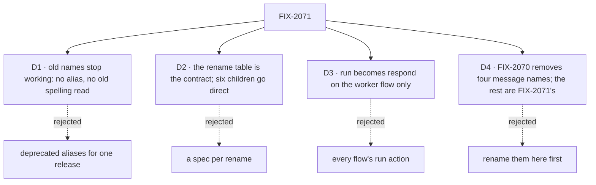

# FIX-2071 · Decisions

[Spec](SPEC.md) · **Decisions** · [Renames](renames.md)

The calls above any one issue. The names come from the
[gaps file's retired-terms table](../../../docs/internal/design/workforce-coordination-gaps.md#retired-terms-the-refactor-removes),
which the owner approved with the coordination concept; [`renames.md`](renames.md) gives each its
head name and owner. The owner decided that this epic waits on FIX-2070 (2026-10-27), and the
Linear epic says the old worker id stops working and an in-flight local request may not replay.
D2 moves a gate, so it is the owner's to sign. D1, D3 and D4 are engineering, decided.

## The tree

## D1 · Old names stop working, with no alias and no old spelling read

| | |
|---|---|
| **Instead of** | Re-exporting each old name as a deprecated alias for a release, or reading both spellings of a persisted key |
| **Because** | An alias is a second name for one thing, which is the debt this epic removes. Nothing outside the repo uses these names (the gaps file), stores are reset (owner, 2026-10-23), and FIX-2056 removed its surfaces the same way ([FIX-2056 (e)](../FIX-2056/DECISIONS.md#e)) |
| **Locks in** | [ER-1](#who-owns-what). Each published package a child touches gets a minor changeset that names its rows, so a consumer outside the repo rewrites at upgrade. BP-030 is met by the reset, not by a dual read: the durable spellings kept for replay (`fsd.ask.*`, `asked`, a wait gate's `"ask"`, the `-hand-off-` routes) go with no second spelling read, and a request left in flight in a local dev database may not replay |

**What would change my mind:** a consumer outside the repo on one of these names. Then that one
name gets an alias for one release, named in its changeset.

It comes down to a second name: an alias keeps the thing the epic removes.

## D2 · The rename table is the contract, so six children take the direct route

*A gate question: the owner signs it by merging this spec.*

| | |
|---|---|
| **Instead of** | Each child writing its own spec and waiting at its own spec gate, the default route for an Improvement |
| **Because** | A spec gate is for a child whose approach is a decision. For "rename X to Y" the decision is the name, and the table puts every name in front of you here, once, with its owner. A spec per child would repeat its rows. The approach is the same for all six: a committed codemod ([ER-2](#who-owns-what)) |
| **Not decided here** | FIX-2183's names. Four meanings of *hold* and the `question` field need a choice of words, so FIX-2183 keeps the spec route and adds its rows to the table before it builds |
| **Locks in** | Six children go straight to an implementation PR, where the review is the diff and the codemod. A name a child finds wrong, or a derived spelling that collides, stops the child and comes back here as an amendment, never as a choice made in the PR |

**What would change my mind:** a child whose rename needs a behaviour change. Then it takes the
spec route.

It comes down to where a name is reviewed: once in the table, or again in six specs that copy it.

## D3 · `run` becomes `respond` on the worker flow only

*Engineering, decided.*

| | |
|---|---|
| **Instead of** | Renaming every flow's `run` action, which the gaps file counts as an upper bound (26 / 21 / 364) |
| **Because** | The concept's word is for a worker answering a user: the worker flow's action. The worker contract already requires that door to be `respond` (`workforce/src/worker-flow-contract.ts`, check 2). A flow outside Workforce names its own actions; renaming them would teach that `run` is reserved, which it isn't |
| **Locks in** | FIX-2246 renames the `run` actions left on Workforce's worker flows and their callers, and the doc examples that show one (`session-board.ts`'s header). Flows in tests, examples and patterns keep their own names |

**What would change my mind:** the engine treating `run` as a default action. Then the default
moves to `respond` too.

## D4 · FIX-2070 removes four message names as it builds; the rest are this epic's

*Engineering, agreed with FIX-2070's epic spec (#3983, its ER-7 and coordination seams).*

| | |
|---|---|
| **Instead of** | Renaming `onWorkerMessage`, `messageWorker`, `replyTo` and `workforceRelayTo` here |
| **Because** | FIX-2070 replaces each with a new contract (`onMessageReceived`, `sendMessage`, `inReplyTo`, no relay). Renaming them first means renaming code FIX-2070 then deletes |
| **Locks in** | FIX-2070 removes them with the `takes_tasks_only` and `no_turn` refusals. Every other row of the table is this epic's, the message door included. FIX-2070's closure, FIX-2242, adds them to the sweep's `RETIRED` (#4024), so a leftover is caught and FIX-2246 removes it |

## Who owns what

| # | Rule every child obeys | Owner | Checked at |
|---|---|---|---|
| ER-1 | A renamed name is gone: no alias, no re-export, no second spelling read. A line that names it on purpose carries `retired-name-refusal` | Each child, for its rows | The sweep, in each child's PR |
| ER-2 | A child's renames come from one committed codemod under `scripts/codemod/`, type-aware where the old name collides with a live one. The second child to land extracts a shared `renameIdentifiers({ from, to, scope })` helper that later children configure, so six codemods are not six copies. File and directory moves are in scope, by `git mv` in the same PR. A PR that conflicts is regenerated by re-running it on fresh `main`, never merged by hand | Each child | The PR review: re-run the codemod, diff |
| ER-3 | A child adds its rows' identifiers to `RETIRED` in `goals/vocabulary/one-word-per-thing/rules.mjs` in the same PR, as exact identifiers, never a prefix that catches a live meaning. `RETIRED` only grows. A hit kept on purpose goes in `KEEP` with its reason. FIX-2243, the first, updates the file's header, which today says RETIRED never grows | Each child; FIX-2242, FIX-2070's closure, for FIX-2070's rows | The sweep in CI |
| ER-4 | No child changes behaviour. A rename that needs one stops and comments up | Each child | The PR review, and `pnpm test` unchanged |

## Coordination seams

| With | The seam |
|---|---|
| FIX-2070 (messages, #3983) | It removes the names in its ER-7 and renames nothing else. Every child here waits on its closure, so no rename lands under its open PRs |
| FIX-2072 (prune leftovers) | Removes `fifoDispatcher`, or keeps it; FIX-2245 renames it if kept |
| FIX-2230 (one route to stop for a person) | Decides whether a raw `ctx.suspend` with a person's reason stays public. FIX-2151 renames the reasons either way; if FIX-2230 is in flight, FIX-2151 merges after it |
| FIX-2092 (phased workflows, #3970) | Files the next phase's steps *held* and releases them with `updateTask({ status: "pending" })`, one of the meanings of *hold*. FIX-2183's spec lists it among its meanings, and whichever of the two lands second carries the other's usage in its codemod. FIX-2092 keeps its own "no new hold kind" rule until then |
| FIX-2183 ↔ FIX-2243 | FIX-2183's hold names land in the table first, so the task collection's names change once |

## Decided in review, recorded so no child reopens them

- **Rows that matched the code on paper only** (the Architect's and a second-look review, 2026-10-27): the engine's request `retryOf` is kept, and only Workforce's unwritten `RETRY_OF` goes; `reopen` is not renamed, since the follow-up already has its name, and only the retired task shape is swept; `runTaskBoard` is already `dispatch`, and what is left is the `upgradeWorkerEntryNames` reader; `postId`'s head name waits on FIX-2246's read of a known collision with `taskId`; the notice flag becomes `waitedOn`, `listTasks`' word, not a new `waited`.
- **Readers of old spellings are named rows,** so "no second spelling read" can be checked: `upgradeWorkerEntryNames`, `legacyPostRowId`, the `ask` readers and the `ask:` gate prefix.
- **FIX-2151's strings are in `RETIRED` in its own PR,** because `SuspensionReason`'s open arm turns a missed call site into a silent custom reason.
- **FIX-2183 also owns *waiting*,** so a task waiting on a person and a question hold don't rename one word two ways. FIX-2070's `onMessageReceived` names its input field `call`, so it does not use the word (#3983, as merged).
- **Merge order** for the three children on the board files: FIX-2243, FIX-2245, FIX-2246.

## Open

None.
