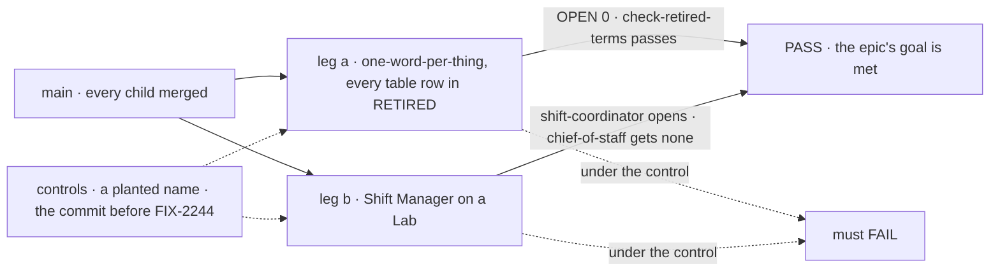
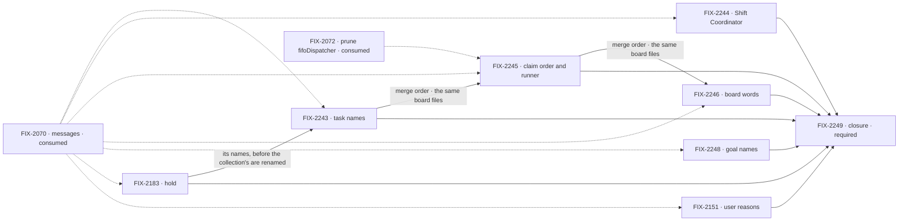

# FIX-2071 · One term, one thing: the coordination renames

**Spec** · [Decisions](DECISIONS.md) · [Renames](renames.md)

## Four teams, before and after

| A team that… | Today | After this epic |
|---|---|---|
| **builds on the task board** | Files a task with the tool `createTask` but the collection's `addTask`; meets "dispatcher" as a block, a claim order and a host transport | One name per thing: `createTask` everywhere, `ClaimOrder`, `FlowRunner`, and "dispatcher" only for the block |
| **uses Shift Manager** | Sees "Shift Coordinator" on screen; declares a worker named `chief-of-staff`, reached at a `cos` route | Declares `shift-coordinator`, the name on screen. A Lab still declaring `chief-of-staff` gets no Shift Coordinator |
| **writes a Workforce worker flow** | Reads `postId`s and `reopen` follow-ups, and a user's stop is a `human_*` reason | Routed tasks and follow-ups are called that; a stop is a `user_*` reason |
| **maintains the framework** | A word in code can mean what the concept retired, and three sweeps each know part of the list | Every retired name is in one identifier sweep that CI runs, so it can't come back |

**Why now.** FIX-2056 and FIX-2058 are done, and they kept their old names on purpose so the
renames land once (the [project spec](https://github.com/fixpoint-labs/flow-state-dev/pull/3102):
*hold* and `updateTask`'s `question` are this epic's). FIX-2070 is the last epic that adds
coordination names. This one goes after it.

## The goal, and how we'll know it's met

**A reader who meets a coordination word in package source, a README or the docs finds the one
thing the [coordination concept](../../../docs/internal/design/workforce-coordination-concept.md)
means by it, and no retired name from the
[gaps file's table](../../../docs/internal/design/workforce-coordination-gaps.md#retired-terms-the-refactor-removes)
remains to mislead them.** Stories V-02 and V-03.

| Is it the right goal? | |
|---|---|
| **The real need** | Tenet 1, one name for one thing. The table has 22 rows, and their names are in well over a thousand files today |
| **Smaller, and rejected** | "The worker id and the task tools," the epic's two named deliverables. It leaves `TaskDispatcher` naming a claim order and `reopen` naming a follow-up, which V-02 rejects |
| **Not done if** | An identifier from the table is in package source off a `retired-name-refusal` line · `chief-of-staff` still reaches the Shift Coordinator · a name is kept as an alias · a README or docs page teaches an old name · a guard exception exists only to keep an old name |

| How we verify | |
|---|---|
| **Goal check** | The closure issue's (FIX-2249), on one `main` commit after every other child merges |
| **Signal** | Leg a: the sweep at OPEN 0 with every identifier in [`renames.md`](renames.md) in `RETIRED`, FIX-2070's message names included, and `check-retired-terms` with no `goal-names` exception. Leg b: a Lab declaring `shift-coordinator` opens on it; the same Lab declaring `chief-of-staff` shows none. `pnpm typecheck` and `pnpm test` pass |
| **Anti-game** | `RETIRED` only grows, and an exception strips a token on a marked line, never a file |
| **Control that must fail** | The sweep's `--control` plants a retired identifier in package source; leg b on the commit before FIX-2244 merges |

**Lead measure:** rows of the gaps file's retired-terms table (22, the denominator) that a CI sweep refuses, with no replay reader
left for them. **Today, 2 of 22 in part:** seat and mailbox prose (`check-retired-terms`, less its
`goal-names` exception), and ask and hand-off (`RETIRED`, with marked replay readers still in place).

**Not doing:**

- **The four message names FIX-2070 removes** (`onWorkerMessage`, `messageWorker`, `replyTo`, `workforceRelayTo`) and what replaces them ([D4](DECISIONS.md#d4)). The closure's sweep still refuses them.
- **Words that collide but aren't retired** (coordinator, delegates, question, stream; the gaps file lists them), apart from *hold*, which FIX-2183 brings in.
- **Whether a raw `ctx.suspend` with a person's reason stays public** (FIX-2230). FIX-2151 renames what is there.
- **Rewriting history:** specs, changesets, `CHANGELOG.md` files, `docs/internal/`, verdict logs.
- **Old names kept working.** Stores are reset, and nothing outside the repo uses the names ([D1](DECISIONS.md#d1)).

**Kill line:** none. Each rename stands alone, so a child that stalls leaves its rows out of
`RETIRED` and nothing else waits.

## What's in the box

Inside the box is the table, the codemods and the sweep. Below the fence is what this epic leaves
to others or to history.

**Docs:** each child updates the READMEs and docs pages its names appear on in the same PR.
FIX-2183 records the hold vocabulary in the concept doc and the task-board page.

## The set · as of 2026-10-27

Every child waits on FIX-2070 (owner, 2026-10-27). Live state is in Linear.

| Issue | Delivers | Blocked by |
|---|---|---|
| [FIX-2243](https://linear.app/fixpoint-labs/issue/FIX-2243) · task names | `addTask` → `createTask` on the collection and board, the last old task-tool names | FIX-2070, FIX-2183 |
| [FIX-2244](https://linear.app/fixpoint-labs/issue/FIX-2244) · Shift Coordinator | `chief-of-staff` → `shift-coordinator`, `chiefOfStaff*`, the `cos` route | FIX-2070 |
| [FIX-2245](https://linear.app/fixpoint-labs/issue/FIX-2245) · claim order and runner | `TaskDispatcher` → `ClaimOrder`, `FlowDispatcher` → `FlowRunner` | FIX-2070; FIX-2243 (merge order); FIX-2072 for `fifoDispatcher` (soft) |
| [FIX-2246](https://linear.app/fixpoint-labs/issue/FIX-2246) · board words | Post, reopen, run the board, retry, kit, the last `run` actions on worker flows, and the durable spellings and old-name readers kept for replay. One issue because each slice is small (the replay spellings are one source file and two marked route names); its codemod runs them as separate phases, one commit each, so a slice that stalls drops out of the PR without holding the rest | FIX-2070; FIX-2245 (merge order) |
| [FIX-2248](https://linear.app/fixpoint-labs/issue/FIX-2248) · goal names | Seat and mailbox out of goal names; the `goal-names` exception deleted | FIX-2070 |
| [FIX-2183](https://linear.app/fixpoint-labs/issue/FIX-2183) · hold | One word per state for the four meanings of *hold*, and `updateTask`'s `question` field. **Spec route:** its names are a decision | FIX-2070, for the build only |
| [FIX-2151](https://linear.app/fixpoint-labs/issue/FIX-2151) · user reasons | `human_approval`, `human_input` → `user_approval`, `user_input` | FIX-2070 |
| [FIX-2249](https://linear.app/fixpoint-labs/issue/FIX-2249) · closure · **required** | The QA plan above, on one `main` commit | every other child |

Seven and a closure. FIX-2183 and FIX-2151 were filed from FIX-2056's and FIX-2058's wraps and
join here. Six children take the direct route, with the table as their contract ([D2](DECISIONS.md#d2)).

## How the issues flow into each other

An edge is what one issue hands the next. FIX-2070 blocks every build: the message names and
the coordinator's routing are its work in flight, and a rename under it is a merge conflict on
every PR it has open. FIX-2183's spec can be written now. It goes before FIX-2243, so the task
collection's names change once. FIX-2243, FIX-2245 and FIX-2246 all rewrite `orchestration/src/task-board`
and `workforce/src/conversation-board`, so they merge in that order; FIX-2244, FIX-2248 and
FIX-2151 touch other files and run beside them.

## What stays as it is

- **Behaviour.** No child changes what code does. A rename that needs a behaviour change stops and comments up.
- **The dispatcher block, dispatching a task, and `dispatch`.**
- **Retired names in history and on `retired-name-refusal` lines:** migration notes and refusal tests name what they refuse.
- **`check-retired-terms.mjs`** for prose words. It keeps its own list, minus `goal-names`.

## What's already here, and the debt

| Already here | What the set does with it |
|---|---|
| `goals/vocabulary/one-word-per-thing` (FIX-1876): an identifier sweep with a `RETIRED` list, a keep list, the `retired-name-refusal` marker and a `--control`, run by CI | **Extended:** every row goes into its `RETIRED` ([D2](DECISIONS.md#d2)) |
| `scripts/check-retired-terms.mjs`: prose words (seat, mailbox, room…), with a `goal-names` exception | **Kept**; the exception goes (FIX-2248) |
| `goals/workforce-coordination/runs-on-one-task` (FIX-2087): the removed task tools, from FIX-2056's migration table | **Kept** for the task surface; this set's names don't go there |
| `scripts/codemod/` (FIX-595): committed, type-aware codemods for repo-wide renames | **Builds on:** one codemod per child |
| [FIX-2056's migration table](../FIX-2056/migration.md): one line per removed surface, no deprecation release | **Same shape** for [`renames.md`](renames.md) |
| The durable spellings kept for replay (`.changeset/wait-vocabulary.md`, `.changeset/dispatch-vocabulary.md`) | **Ended** by FIX-2246, with no second spelling read |

| The debt | |
|---|---|
| **Removes** | 22 rows of retired names, the `goal-names` exception, and the durable second spellings |
| **Adds** | One table, one codemod per child, and rows in an existing sweep |

**Net: down.** No new mechanism: one identifier list in the sweep we have, beside the prose guard we have, instead of three partial lists.

## Sign off

**[The goal](#the-goal-and-how-well-know-its-met):** every row of the table, not only the two
named deliverables. If wrong: we spend seven PRs where two would do. **[The
debt](#whats-already-here-and-the-debt):** net down. If wrong: a fourth sweep appears anyway.

1. **[D1](DECISIONS.md#d1) · Old names stop working, with no alias and no old spelling read.**
   The epic's own text, and stores are reset. If wrong: a consumer outside the repo breaks at
   upgrade, which the changesets name.
2. **[D2](DECISIONS.md#d2) · The rename table is the contract, so six children take the direct
   route.** A gate question, so it is yours: a spec for "rename X to Y" repeats the table. FIX-2183
   keeps its spec. If wrong: a name nobody reviewed ships, and the fix is a second rename.
3. **[D4](DECISIONS.md#d4) · FIX-2070 removes four message names as it builds; the rest are
   ours.** Engineering, agreed with FIX-2070's spec (#3983, its ER-7). If wrong: a name is renamed twice.

**Decided in this spec, engineering:** [D3](DECISIONS.md#d3), `run` → `respond` on Workforce's worker flows only, where the worker contract already requires it.

**Decided by the owner:** FIX-2071 waits on FIX-2070 (2026-10-27); the old worker id stops working,
and in-flight local requests may not replay (the Linear epic).

**Open:** none.

Epic · 7 issues and a closure · Orchestration Primitives · Goal 4, keep the foundation honest
